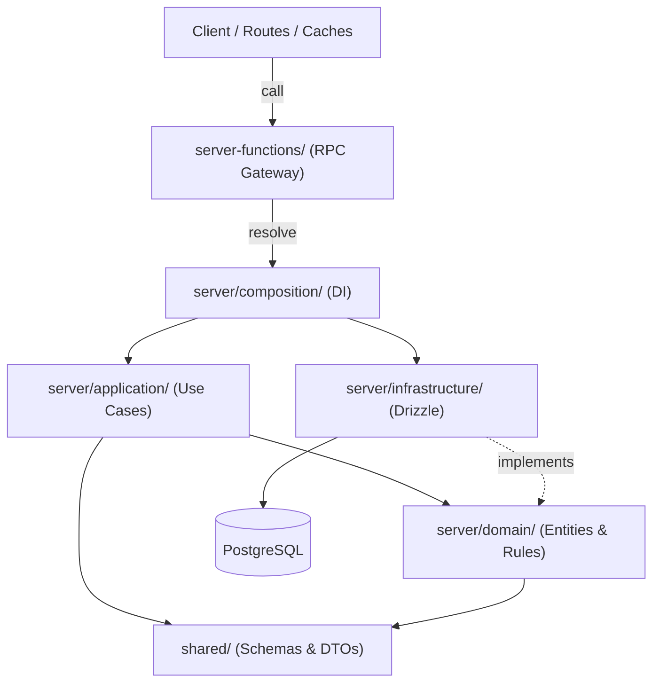
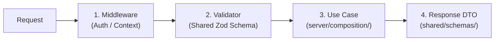
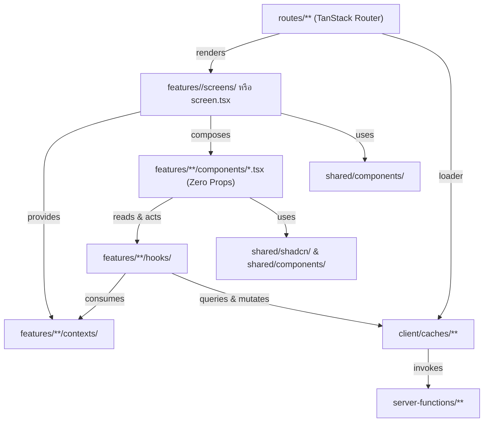

# Architecture Boundary

ข้อกำหนดขอบเขตสถาปัตยกรรม (Architectural Boundaries) และทิศทางการพึ่งพา (Dependency Flow) ของระบบ

---

## Folder Structure

### Main Responsibilities

- `client/`: **Frontend & State Layer** — UI/UX, State, TanStack Query Caches ภายใต้ข้อกำหนด **Zero Props**
- `routes/`: **TanStack Router File Routes** — URL routing, Route Guards (`beforeLoad`), Preload (`loader`), Head tags โดยไม่ประกอบ UI ย่อย และจัดกลุ่มหน้าสาธารณะผ่าน Pathless Layout Route (`_public/**`)
- `server/`: **Backend Domain & Core Logic** — Clean Architecture & DDD แยกขาดจาก UI ห้าม Client/Routes เรียกตรง
- `server-functions/`: **TanStack Start RPC Gateway** — ทางผ่านเดียวระหว่าง Client กับ Server พร้อม Middleware (Auth, Error, Validation)
- `shared/`: **Isomorphic Layer** — Zod Schemas, DTOs และ Utilities ที่ใช้ร่วมกันแบบไร้ Framework Side-effects

---

### Server Boundary

**`server/`**: แกนกลางฝั่งเซิร์ฟเวอร์ ออกแบบตาม Clean Architecture & DDD เพื่อแยก Business Logic ออกจาก Framework และ Database

- `application/`: จัดการ Use Cases ประจำแต่ละโมดูล และ Data Mappers แปลงระหว่าง Entity กับ DTO
- `composition/`: DI Container รวม Object Graph (ผูก Infrastructure Repositories เข้ากับ Use Cases) แบบ Singleton
- `config/`: ตรวจสอบความถูกต้องของ Server Environment Variables ด้วย Zod Schema (`env.ts`) แบบ Fail-fast
- `domain/`: Business Invariants และกฎทางธุรกิจหลัก (Entities, Aggregate Roots, Interfaces, Domain Errors)
- `infrastructure/`: เชื่อมต่อระบบภายนอกจริง (PostgreSQL ผ่าน Drizzle ORM, Clerk Auth) ตาม Repository Interface

#### Domain

`server/domain/`: กฎทางธุรกิจบริสุทธิ์ ปราศจาก dependency ภายนอก

- `server/domain/<module>/`: Entity, Aggregate Root, Repository Interface และ Domain Error ประจำโมดูล
- `server/domain/common/`: Base Classes และ Abstractions กลาง (`aggregate-root.base.ts`, `entity.base.ts`, `errors.ts`, `unit-of-work.interface.ts`)

#### Application

`server/application/`: นำพา Workflow และขับเคลื่อน Use Cases

- `server/application/<module>/`: Use Case Classes รับ Input สั่ง Entity ทำงาน เรียก Repository และคืนค่า DTO
- `server/application/mappers/`: แปลงระหว่าง Domain Entity (Internal Model) กับ DTO เพื่อไม่ให้ Domain รั่วไหล

#### Infrastructure

`server/infrastructure/`: การติดต่อระบบภายนอกและ I/O จริง

- `server/infrastructure/<module>/`: Implement Repository Interface ด้วย Drizzle ORM หรือ External Provider
- `server/infrastructure/<external_services>/`: เช่น `drizzle/` Database Client (`db.ts`), Table Schema (`schema.ts`), Transaction Context และ Unit of Work หรือ อาจเป็นบริการอื่นๆ จากภายนอก

#### Composition

`server/composition/`: ศูนย์รวม Dependency Injection (DI)

- `server/composition/<module>.container.ts`: ประกอบ Use Cases ประจำโมดูลและ Inject Repositories เข้าไป
- `server/composition/repositories.ts`: สร้าง Instance ของ Repositories, Unit of Work และ Provider จาก `db`

#### Config

`server/config/`: ตรวจสอบและจัดการ Environment Variables (`env.ts`) ด้วย Zod แบบ Fail-fast ตอนเริ่มต้นระบบ

#### Server Dependency Flow



### Server Functions

`server-functions/`: ทำหน้าที่เป็น **Thin Driving Adapter (RPC Gateway)** ทางผ่านเดียวระหว่าง Client กับ Server เพื่อแยก Network/Transport Protocol ออกจาก Core Business Logic

- `middlewares/`: จัดการ Cross-cutting Concerns ระดับ Gateway เช่น Authentication Guard (`auth.middleware.ts`), Logging หรือ Rate Limiting ผ่าน TanStack Start Middleware
- `<module>/*.fn.ts`: Server Function Endpoints ประจำแต่ละโมดูล สร้างด้วย `createServerFn` ทำหน้าที่ Validate Input, รัน Middleware และ Dispatch งานไปยัง Use Case, หากต้องการความเป็นระเบียบ สามารถพิจารณาใช้ CQRS Style ได้ เช่น `<module>/commands/*.fn.ts` สำหรับขาเข้า และ `<module>/queries/*.fn.ts` สำหรับขาออก

#### Standard Pipeline

ทุก Server Function ต้องปฏิบัติตาม Pipeline 4 ขั้นตอนอย่างเคร่งครัด:



#### Responsibilities & Invariants

1. **Thin Adapter**: มีหน้าที่เฉพาะประสานงาน (Orchestration) ระดับ Transport ห้ามเขียน Business Logic, State Transition หรือเรียก Database โดยตรง
2. **One Function per File (`*.fn.ts`)**: แยก 1 RPC Endpoint ต่อ 1 ไฟล์ โดยตั้งชื่อสอดคล้องกับ Use Case พร้อมต่อท้ายด้วย `.fn.ts` (เช่น `get-user-by-id.fn.ts`) และ Export ตัวแปรลงท้ายด้วย `Fn` (เช่น `getUserByIdFn`)
3. **Shared Contract Only**: บังคับตรวจสอบ Input Payload ด้วย Schema จาก `shared/schemas/**` ผ่าน `.validator()` และระบุ Explicit Return Type เป็น DTO จาก Shared Schema เสมอ
4. **DI Resolution**: ดึง Use Case มาจาก Composition Container (`server/composition/**`) เท่านั้น ห้าม New Repository หรือ Service ขึ้นมาเอง
 

---

### Client Boundary

`client/`: เลเยอร์ Frontend ยึดหลัก **Zero Props**, Feature-Sliced Cohesion และ Centralized Server-State

- `caches/`: จัดการ Server State, Caching, Invalidation, Toast Feedback ด้วย TanStack Query
- `core/`: Root Shell, Theme Provider, Global Error / Not Found Screens, App Providers, Toaster
- `features/`: โครงสร้าง UI/UX แยกตาม Business Domain (รองรับทั้ง Single-screen และ Multi-screen)
- `shared/`: Application Primitives, Router Wrappers และ Read-Only shadcn primitives
- `styles/`: Global CSS, Tailwind CSS v4, Fonts, Theme Tokens (OKLCH)

#### Caches

`client/caches/`: ศูนย์กลาง Server State ห้าม Component เรียก `server-functions` โดยตรง

- `<module>/queries/*.query.ts`: กำหนด `queryOptions` ระบุ `queryKey` และเรียก `server-functions`
- `<module>/mutates/*.mutate.ts`: Mutation Hooks จัดการ Optimistic Update, Rollback, Cache Invalidation และ Toast meta
- `<module>/keys.ts`: Query Key Factory สร้าง Cache Keys แบบ Type-safe
- `global.ts`: กำหนด `QueryClient` และดักจับ `mutationCache` เพื่อยิง Sonner Toast อัตโนมัติจาก `meta`

หมายเหตุ: กรณีใช้ TanStack DB ให้ใช้ `<modules>/actions/*.action.ts` สำหรับขาเข้าและ `<modules>/collections/*.collection.ts` สำหรับขาออก

### Core

`client/core/`: โครงสร้างรากฐานระดับแอปพลิเคชัน (Global Providers & System Shell)

- `client/core/components/*.ts`: จัดเก็บคอมโพเนนต์ต่างๆ ที่ใช้ภายใน Core ไม่จำเป็น ต้องเข้มงวดเท่า Features Components และอาจมี props ได้ (หากเลี่ยงได้ก็จะดีกว่า) แต่ต้องไม่ใช่เหตุผลที่จะเอาคอมโพเนนต์ที่ต้องการใช้ props จากที่อื่นมาเป็นที่เก็บ
- `client/core/hooks/*.ts`: Hooks ที่ใช้เฉพาะภายใน Core
- `client/core/contexts/*.ts`: Global Contexts เช่น `session-cache-boundary.tsx`
- `client/core/screens/*.tsx`: หน้าจอกลางระดับ Application Shell เช่น:
  - `app-entry-point.tsx`: ใช้เป็น Entry Point ในนี้จะมี `<Outlet />` ที่ครอบด้วย Providers ระดับบนสุดหรือเก็บ Toaster หรือ Analytics ต่างๆ 
  - `app-error.screen.tsx`: แสดงหน้า Error ในระดับบนสุดของ Application หากไม่ได้กำหนดในระดับ routers
  - `app-not-found.screen.tsx`: แสดงหน้า Not Found 404 ในระดับบนสุดของ Application หากไม่ได้กำหนดในระดับ routers
  - `layout.tsx`: Layout ในระดับบนสุดของ Application
- `client/core/app-root.tsx`: Root HTML Shell (`<html>`, `<head>`, `<body>`), DevTools, โดยไม่ใส่ Layout Components (เพื่อให้ Layout ของแต่ละ Route Group จัดการ Shell ของตนเองอย่างอิสระ)

### Features

`client/features/`: รวมศูนย์ UI และ Business Interactions ประจำฟีเจอร์ภายใต้กฎ **Zero Props**

- `client/features/**/*`: รวมศูนย์พื้นที่ทั้งหมด ตามโครงสร้าง Multi-Screen:
  - `screens/*.tsx`: Composition Roots ประจำแต่ละหน้าและ Layout (`layout.screen.tsx`, `home.screen.tsx`, `contact.screen.tsx`, `profile.screen.tsx`) ประกอบ Layout และ Zero Props Components จาก `components/` แต่หากฟีเจอร์มีเพียงหน้าเดียวจาก Route ให้ใช้ `client/features/**/screen.tsx` แทนเพื่อความเรียบง่าย

- โครงสร้างทั่วไปของโมดูลฟีเจอร์:
  - `components/**/*.tsx`: Presentation Components แบบ **Zero Props** เป็น Pure UI ไม่ถือ Logic อ่าน State/Actions ผ่าน Hooks เท่านั้น
    - `components/forms/*.tsx`: สำหรับจัดเก็บฟอร์ม
    - `components/ui/*.tsx`: สำหรับจัดเก็บคอมโพเนนต์
  - `contexts/**/*.tsx`: Compound Context ประจำฟีเจอร์ กระจาย State โดยไม่ใช้ Prop Drilling (ถ้ามี)
  - `hooks/**/*.ts`: Single-Responsibility Hooks (Form, Dialog, Filter, Data, State) เป็นเจ้าของ Logic ทั้งหมด
  - `models/`: Feature View Models และ Type ประจำฟีเจอร์
  - `home/`, `contact/`, `profile/`: ส่วนประกอบย่อย, Containers และ Hooks ประจำแต่ละมุมมอง

**นิยาม Hooks:**

1. **Context Hooks**: เป็น Hooks ที่ใช้ร่วมกับ Context Provider ไม่จำเป็นต้องสร้างไฟล์มาเก็บ Hooks แยก ให้รวมเข้าไปกับ Context Provider ได้เลย แต่ให้มีคำว่า Context ต่อท้ายเพื่อให้ง่ายต่อการแยกแยะ เช่น:
  ```typescript
  export function AuthContextProvider ({ children }) { ... }

  export function useAuthContext () { ... } 
  ```

2. **Server State Hooks**: เป็น Hooks ที่ดึงมาจาก `clients/caches/` (ไม่ว่าจะมากจาก TanStack Query หรือ DB) ให้สร้างแยกต่างหาก ห้ามเอาอะไรมารวมหรือไปรวมกับใคร แต่สามารถรวมฟังก์ชั่นต่างๆ ที่มาจาก `client/caches/` ได้ เช่น:

จาก `clients/caches/**` (แยกไฟล์):
  ```typescript
  // get-users.query.ts
  export function getUsersQuery() { ... }

  // register-user.mutates.ts
  export function useRegisterUserMutation() { ... }
  ```

ใน `features/**/hooks/*` (ตั้งชื่อไฟล์ตาม Domain):
  ```typescript
  // use-users.ts
  export function useGetUsers () { ... }

  export function useRegisterUser () { ... }
  ```

3. **Components Hooks**: เป็น State/Action Hooks ที่ใช้งานรวมกับ Feature Components มักเป็น Event Handlers หรือ Effects บางอย่าง ที่ไม่ได้อยู่ใน (หรือจำเป็นต้องใช้) Context Hooks ให้ตั้งชื่อตาม Components ที่ใช้มัน และ 1 Hooks ควรทำหน้าที่เฉพาะของคอมโพเนนต์นั้นอย่างเต็มที่ ไม่แบ่งหรือข้าม Components เช่น:
  ```typescript
  // user-tabs.tsx
  export function UserTabs() { 
    const { tabs, onSelectTab } = useUserTabs();
    // ...
  }

  // use-user-tabs.tsx
  export function useUserTabs () {
    const tabs = ...
    
    const handleSelectTabs = (tab: string) => { ... }

    return { 
      tabs, 
      onSelectTab: handleSelectTabs 
    }
  }
  ```
กรณีพบว่า มีความเห็นว่าต้องใช้ Hooks รูปแบบเดียวกันหลายที่ แล้วพบว่า Logic ซ้ำกันบ่อยๆ ให้พิจารณาทำเป็น shared hooks

4. **Shared Hooks** ไม่ได้หมายถึงคิดอะไรไม่ออกแล้วจะเอาไปไว้ที่ไหน แต่เป็น Hooks ที่พบแล้วว่ามีการใช้ Logic เดียวกันซ้ำหลายๆ ครั้ง และสามารถใช้ข้าม Features ได้ ให้เก็บไว้ใน `client/shared/hooks/**` เช่น กรณีพบว่า `useUserTabs()` มี Logic คล้ายกันกับ `useProjectTabs()` ก็ให้รวมเป็น `useTabs()` ได้:
```typescript
const useTabs(params) {
  return { ... }
}
```

### Shared

`client/shared/`: สิ่งที่ใช้ร่วมกันข้ามฟีเจอร์

- `components/`: โครงสร้าง Layout ร่วม และ Wrappers สำหรับ Application (เช่น `AppShellRoot`, `AppShellHeader`, `AppShellMain`, `AppShellFooter`)
- `hooks/`: Hook กลางที่สามารถใช้ได้ทั่วทั้ง Client
- `helpers/`: สำหรับฟังก์ชันช่วยเหลือทั่วไปที่ใช้ทั่วทั้ง Client
- `shadcn/`: Read-Only UI Primitives จาก shadcn ห้ามดัดแปลงแก้ไขตรงๆ

### Styles

`client/styles/`: จัดการสไตล์หลักระดับระบบ (`global.css`), Tailwind CSS v4, Variable Fonts และ Theme CSS Variables (ห้ามเขียน Custom CSS Classes หรือทำ Custom Design แฝงในเลเยอร์นี้)

#### Client Dependency Flow


