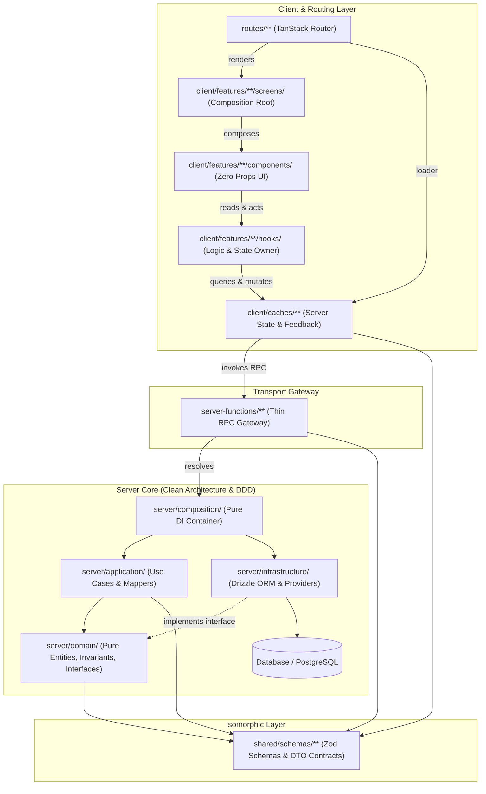
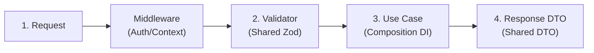
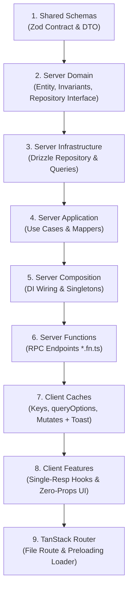

# Simple Start Template Guide & Architecture Specification

ยินดีต้อนรับสู่ **Simple Start** — Full-stack Enterprise TypeScript Starter Kit ที่ผสานขุมพลังของ **TanStack Start**, **TanStack Router**, **TanStack Query**, สถาปัตยกรรมฝั่งเซิร์ฟเวอร์แบบ **Clean Architecture & Domain-Driven Design (Tactical DDD)** และฝั่งฟรอนต์เอนด์แบบ **Zero Props Architecture** เข้าไว้ด้วยกันอย่างลงตัว

เอกสารฉบับนี้สกัดกฎเกณฑ์ ระเบียบวินัย และแนวทางปฏิบัติที่ดีที่สุดจาก `.agents/rules/` เพื่อเป็นคู่มืออ้างอิงหลัก (Single Source of Truth) ในการพัฒนาและต่อยอดระบบ

---

## สารบัญ (Table of Contents)

1. [ภาพรวมสถาปัตยกรรมและทิศทางการพึ่งพา (Architecture & Dependency Flow)](#1-ภาพรวมสถาปัตยกรรมและทิศทางการพึ่งพา)
2. [โครงสร้างไดเรกทอรีและขอบเขตหน้าที่ (Directory Boundaries)](#2-โครงสร้างไดเรกทอรีและขอบเขตหน้าที่)
3. [กฎเหล็กและข้อกำหนดสำคัญ (Core Invariants & Rules)](#3-กฎเหล็กและข้อกำหนดสำคัญ)
   - [Global & Environment Invariants](#31-global--environment-invariants)
   - [Shared Contract (Zod Schemas)](#32-shared-contract-zod-schemas)
   - [Server Boundary (Clean Architecture & DDD)](#33-server-boundary-clean-architecture--ddd)
   - [Server Functions (Thin RPC Gateway)](#34-server-functions-thin-rpc-gateway)
   - [Client Boundary (Zero Props & Single Responsibility Hooks)](#35-client-boundary-zero-props--single-responsibility-hooks)
   - [Design System, UI Styling & SLOP Prevention](#36-design-system-ui-styling--slop-prevention)
   - [Authentication & Navigation](#37-authentication--navigation)
4. [ลำดับขั้นตอนการสร้าง Slice ใหม่ (Step-by-Step Feature Workflow)](#4-ลำดับขั้นตอนการสร้าง-slice-ใหม่)
5. [ตัวอย่างการ Implementation จริง 1 Slice (Customer Feature Reference)](#5-ตัวอย่างการ-implementation-จริง-1-slice-customer-feature-reference)
   - [Layer 1: Shared Contract](#layer-1-shared-contract)
   - [Layer 2: Server Domain](#layer-2-server-domain)
   - [Layer 3: Server Infrastructure](#layer-3-server-infrastructure)
   - [Layer 4: Server Application](#layer-4-server-application)
   - [Layer 5: Server Composition (DI Container)](#layer-5-server-composition-di-container)
   - [Layer 6: Server Functions (RPC Gateway)](#layer-6-server-functions-rpc-gateway)
   - [Layer 7: Client Caches (TanStack Query)](#layer-7-client-caches-tanstack-query)
   - [Layer 8: Client Features (Zero Props Presentation & Hooks)](#layer-8-client-features-zero-props-presentation--hooks)
   - [Layer 9: TanStack Router File Route](#layer-9-tanstack-router-file-route)
6. [คำสั่งพัฒนาและดูแลโค้ด (Developer Tooling & Commands)](#6-คำสั่งพัฒนาและดูแลโค้ด)

---

## 1. ภาพรวมสถาปัตยกรรมและทิศทางการพึ่งพา

สถาปัตยกรรมของโปรเจกต์นี้ถูกออกแบบภายใต้หลักการ **Inward Dependency Rule** และ **Explicit Responsibility Separation**:



> [!IMPORTANT]
> **กฎการพึ่งพาสูงสุด (Dependency Rule):**
>
> 1. `client/` และ `routes/` สื่อสารกับเซิร์ฟเวอร์ผ่าน `server-functions/` เท่านั้น **ห้ามเรียกเข้า `server/` โดยตรง**
> 2. `server/domain/` ต้องบริสุทธิ์ ปราศจาก framework หรือ library ภายนอก (เข้าถึงได้เฉพาะ `shared/schemas/`)
> 3. `server-functions/` เป็นเพียง Thin Gateway ห้ามมี business logic หรือเรียก Drizzle DB โดยตรง

---

## 2. โครงสร้างไดเรกทอรีและขอบเขตหน้าที่

| Path                         | เลเยอร์                   | หน้าที่รับผิดชอบ                                                                                                      |
| :--------------------------- | :----------------------- | :--------------------------------------------------------------------------------------------------------------- |
| `src/shared/`                | **Shared Contract**      | Zod Schemas และ DTO Type Definitions กลางที่ใช้ข้ามฝั่งระหว่าง Client และ Server โดยไร้ผลข้างเคียงของ Framework            |
| `src/server/domain/`         | **Domain Layer**         | Business Entities, Aggregate Roots, Domain Invariants, Repository Interfaces และ Domain Errors                   |
| `src/server/application/`    | **Application Layer**    | Orchestration Use Cases (1 Use Case ต่อ 1 ไฟล์) และ Data Mappers แปลงระหว่าง Entity กับ DTO                          |
| `src/server/infrastructure/` | **Infrastructure Layer** | การเชื่อมต่อระบบภายนอกจริง เช่น PostgreSQL ผ่าน Drizzle ORM, Unit of Work, API Client และ Transaction Context          |
| `src/server/composition/`    | **Composition Layer**    | Manual DI Container สร้างและประกอบ Object Graph แบบ Singleton โดยไม่ต้องพึ่ง Magic Reflection Framework               |
| `src/server/config/`         | **Server Config**        | Zod Schema สำหรับตรวจสอบความถูกต้องของ Server Environment Variables (`env.ts`) แบบ Fail-fast                        |
| `src/server-functions/`      | **RPC Gateway**          | TanStack Start Server Functions ทำหน้าที่เป็น Thin Driving Adapter (Middleware -> Validator -> Use Case -> DTO)      |
| `src/client/caches/`         | **Server State**         | TanStack Query Caches (Query Key Factory, `queryOptions`, Mutations, Cache Invalidation และ Toast Notifications) |
| `src/client/core/`           | **App Root & Shell**     | HTML Shell (`<html>`, `<head>`, `<body>`), Providers, Theme Provider และ Global Screen (Not Found, Error)        |
| `src/client/features/`       | **Feature Modules**      | หน้าจอและคอมโพเนนต์ฟังก์ชันภายใต้กฎ **Zero Props Architecture** (Screens, Components, Hooks, Contexts)                 |
| `src/client/shared/`         | **Shared Primitives**    | คอมโพเนนต์ Layout ร่วม, Wrappers และ Read-Only shadcn primitives                                                   |
| `src/client/styles/`         | **Global Styles**        | Tailwind CSS v4, Variable Fonts, OKLCH Theme Tokens (ห้ามเขียน Custom CSS Classes เอง)                             |
| `src/routes/`                | **TanStack Router**      | File-based Routing, Route Guards (`beforeLoad`), Data Preloading (`loader`), URL Search Params                   |

---

## 3. กฎเหล็กและข้อกำหนดสำคัญ (Core Invariants & Rules)

### 3.1 Global & Environment Invariants

1. **Bun Exclusive Package Manager & Runtime**:
   - บังคับใช้ `bun` เพียงหนึ่งเดียวเท่านั้น (`bun install`, `bun run dev`, `bun x <pkg>`)
   - 🚫 **ห้ามใช้** `npm`, `pnpm`, `yarn`, `npx` หรือ `node` เด็ดขาด เพื่อป้องกันความขัดแย้งของ `bun.lock` และ `node_modules`
2. **Import Path Rules**:
   - อนุญาตให้ใช้ Relative Import ได้เฉพาะระดับ `./` และ `../` เท่านั้น
   - หากต้องอ้างอิงลึกกว่านั้น **บังคับใช้ Path Alias `#/` เสมอ** (เช่น `import { ... } from "#/shared/schemas/user.schema"`)
   - 🚫 **ห้ามใช้ Deep Relative Import** เช่น `../../` หรือมากกว่า
3. **Explicit & Named Imports**:
   - แยก `import type { ... }` ออกจาก Runtime Import อย่างชัดเจนเสมอ
   - ใช้ Named Import เฉพาะสิ่งที่ใช้งานจริง ห้าม Wildcard Import (`import * as React`)
   - 🚫 **ห้ามสร้างหรือขยาย Barrel (`index.ts`)** เพื่อ re-export symbol รวมกันหลายไฟล์

---

### 3.2 Shared Contract (Zod Schemas)

1. **Source of Truth กลาง**:
   - Data Contract ระหว่าง Server และ Client ต้องนิยามไว้ใน `src/shared/schemas/**` เท่านั้น
   - เริ่มต้นจาก Zod Schema เสมอ แล้วจึง derive TypeScript Type ออกมาด้วย `z.infer<typeof ...>`
   - 🚫 ห้ามเขียน TypeScript `interface` หรือ `type` ของ DTO แยกด้วยมือ
2. **ขอบเขตการแชร์ (Boundary Isolation)**:
   - นำเข้าเฉพาะข้อมูลที่ข้าม Application Boundary (Request, Response, Params, DTO)
   - 🚫 ห้ามนำ Server Internal Model, Database Row หรือ Client UI State มาใส่ไว้ใน Shared Schemas

---

### 3.3 Server Boundary (Clean Architecture & DDD)

1. **Tactical DDD & Encapsulated Invariants**:
   - ปกป้อง State ของ Entity / Aggregate Root ด้วย `private` หรือ `protected` fields
   - เปิดให้อ่านผ่าน `readonly getter` และแก้ไขสถานะผ่าน **Domain Methods** เท่านั้น (เช่น `customer.updateStatus(...)`)
   - 🚫 ห้ามสร้าง Public Setters หรือเปิดให้ภายนอกแก้ฟิลด์ได้ตามใจ (ห้าม Anemic Domain Model)
2. **Creation vs. Reconstitution**:
   - สร้าง Entity ตัวใหม่ผ่าน Static Factory Method เสมอ: `Entity.create(...)` เพื่อตั้งค่าเริ่มต้นและตรวจ Invariant
   - คืนสภาพ Entity เก่าจาก Database ใน Repository ผ่าน Constructor หรือ `reconstitute(...)`
   - 🚫 ห้าม Use Case หรือภายนอกเรียก `new Entity(...)` ประกอบฟิลด์เอง
3. **Repository Interface ใน Domain**:
   - Interface ใน `server/domain/<module>/<entity>.repository.interface.ts` ต้องรับและคืนเฉพาะ Domain Entity หรือ Primitives เท่านั้น
   - 🚫 ห้าม Repository Interface อ้างอิง Drizzle Tables, SQL Types หรือ DTO
4. **Use Case Orchestration**:
   - **1 ไฟล์ต่อ 1 Use Case** เช่น `create-customer.use-case.ts` มี 1 คลาส และ 1 เมธอด `execute(...)`
   - Use Case ทำหน้าที่เพียง Orchestration: ดึง Entity -> สั่ง Entity รัน Domain Logic -> บันทึกผ่าน Repository -> แปลงเป็น DTO ผ่าน Mapper
   - 🚫 ห้ามใส่ Business Logic, กฎการคำนวณ หรือเขียน Query Database ลงใน Use Case
5. **High-Performance Persistence (Drizzle ORM)**:
   - ออกแบบ Repository ให้จบใน Single Round-Trip: ใช้ Upsert (`onConflictDoUpdate`) หรือ UPDATE/DELETE ร่วมกับ `.returning()`
   - สำหรับ Read-only / Query Projections อนุญาตให้ Select และ Map เป็น DTO โดยตรงโดยไม่ต้อง Reconstitute ทั้ง Aggregate Root
   - 🚫 ห้ามส่ง Transaction Object (`tx`) ผ่านพารามิเตอร์ของ Domain Repository Interface ให้ใช้ `AsyncLocalStorage` ใน Infrastructure แทน

---

### 3.4 Server Functions (Thin RPC Gateway)

ทุก Server Function ใน `src/server-functions/<module>/*.fn.ts` ต้องปฏิบัติตาม **Standard Pipeline 4 ขั้นตอน**:



- กำหนด 1 RPC Endpoint ต่อ 1 ไฟล์ (`*.fn.ts`) และ export ตัวแปรลงท้ายด้วย `Fn`
- ดึง Use Case มาจาก Composition Container (`#/server/composition/**`) ห้าม new เอง
- 🚫 ห้ามมี Business Logic, Data Mutation หรือ Database Query ภายใน Server Function

---

### 3.5 Client Boundary (Zero Props & Single Responsibility Hooks)

1. **Zero Props Architecture**:
   - Feature Components ใน `src/client/features/**/components/*.tsx` **ต้องไม่รับ Props ใดๆ ทั้งสิ้น** (Zero Props)
   - 🚫 ห้ามส่ง State, Data, Callback, `children` หรือ `className` ผ่าน Props เข้า Feature Component
   - 🚫 ห้ามซ่อน Props ไว้หลัง Inferred Hook Types (เช่น `ReturnType<typeof useHook>`)
2. **Screen คือ Composition Root**:
   - `screens/*.tsx` ทำหน้าที่จัด Layout และเรียก Feature Components มารวมกันแบบ Zero Props
3. **Logic อยู่ใน Single Responsibility Hook**:
   - ทุก State, Event Handler, Filter, Form, Dialog หรือ Query ให้ไปรวมอยู่ใน Single-Responsibility Hook ประจำตัว
   - Component เรียกใช้ Hook ของตนเองโดยตรง
   - 🚫 ห้ามทำ God Hook และห้าม Parent เรียก Hook แล้วกระจาย State ให้ลูก
4. **1 ไฟล์ต่อ 1 Component**:
   - 1 ไฟล์ `.tsx` อนุญาตให้ประกาศได้เพียง 1 Component เท่านั้น (ยกเว้น Shared Primitive Layer)
   - 🚫 ห้ามเขียน Sub-component หรือ Nested Component ซ้อนกันในไฟล์เดียวกัน

---

### 3.6 Design System, UI Styling & SLOP Prevention

1. **Visual Boundaries ผ่าน Primitives เท่านั้น**:
   - จัดการเส้นขอบ กรอบ และเงาผ่าน Primitive ของ shadcn เท่านั้น เช่น ใช้ `<Card>` แทนกรอบ, ใช้ `<Separator />` แทนเส้นคั่น, ใช้ Variant `<Button variant="outline">`
   - 🚫 **ห้ามใส่ `border-*` หรือ `ring-*` ใน `className` เองโดยเด็ดขาด** เพื่อป้องกันสีและเส้นขอบเพี้ยนเมื่อสลับ Theme
2. **SLOP Display Prevention (ห้ามใช้ Emoji บน UI)**:
   - 🚫 **ห้ามใช้ Emoji บน UI เด็ดขาด** เพราะทำให้งานดูด้อยคุณภาพ (SLOP Display) และเรนเดอร์ไม่สม่ำเสมอข้าม OS
   - ✅ ให้ใช้ไอคอน SVG จาก `lucide-react` เท่านั้น
3. **Styles Directory Restriction**:
   - `src/client/styles/*` มีไว้สำหรับ Tailwind CSS v4 directives, Theme CSS Variables (OKLCH) และ Font imports
   - 🚫 ห้ามสร้าง Custom CSS Classes หรือ Custom Animation ขึ้นมาเองในไฟล์สไตล์

---

### 3.7 Authentication & Navigation

1. **Modal-Only Authentication**:
   - การยืนยันตัวตนทั้งหมดในระบบเป็นแบบ Modal Dialog (Clerk Auth Modal)
   - 🚫 **ระบบไม่มีหน้า `/sign-in` หรือ `/sign-up` อยู่จริง** ห้ามสั่ง `redirect({ to: "/sign-in" })`
2. **Polite Auth Gate**:
   - เมื่อผู้ใช้ที่ยังไม่ได้ล็อกอินพยายามเข้าถึงหน้าที่ต้องล็อกอิน ให้แสดง UI เป็น **Polite Auth Gate Component** พร้อมปุ่มเปิด Modal ล็อกอิน เพื่อรักษาบริบทหน้าเดิมของผู้ใช้

---

## 4. ลำดับขั้นตอนการสร้าง Slice ใหม่

เมื่อต้องการสร้างฟีเจอร์หรือ Slice ใหม่ ให้ดำเนินการตามลำดับ 9 ขั้นตอนดังนี้:



---

## 5. ตัวอย่างการ Implementation จริง 1 Slice (Customer Feature Reference)

ตัวอย่างนี้แสดงการสร้าง Slice **"Customer Management" (ระบบจัดการลูกค้า)** แบบสมบูรณ์ที่มีทั้ง **Read (Query)** และ **Write (Mutation with Invariants & Feedback)** ครบทั้ง 9 เลเยอร์ตามกฎเหล็กทุกข้อ

---

### Layer 1: Shared Contract

**File:** `src/shared/schemas/customer.schema.ts`

> กำหนด Source of Truth ของ Data Contract ด้วย Zod Schema สำหรับ DTO, Input และ Mutation Payload

```typescript
import { z } from "zod";

export const customerStatusSchema = z.enum(["active", "inactive", "suspended"]);
export type CustomerStatus = z.infer<typeof customerStatusSchema>;

export const customerSchema = z.object({
  id: z.string().uuid(),
  name: z.string().min(2, "ชื่อต้องมีความยาวอย่างน้อย 2 ตัวอักษร"),
  email: z.string().email("รูปแบบอีเมลไม่ถูกต้อง"),
  status: customerStatusSchema,
  totalSpent: z.number().nonnegative(),
  createdAt: z.string().datetime(),
  updatedAt: z.string().datetime(),
});
export type CustomerDto = z.infer<typeof customerSchema>;

export const createCustomerSchema = z.object({
  name: z.string().min(2, "ชื่อต้องมีความยาวอย่างน้อย 2 ตัวอักษร"),
  email: z.string().email("รูปแบบอีเมลไม่ถูกต้อง"),
});
export type CreateCustomerInput = z.infer<typeof createCustomerSchema>;

export const getCustomerByIdSchema = z.object({
  id: z.string().uuid(),
});
export type GetCustomerByIdInput = z.infer<typeof getCustomerByIdSchema>;
```

---

### Layer 2: Server Domain

#### 2.1 Domain Errors

**File:** `src/server/domain/customers/errors.ts`

```typescript
import { DomainError } from "#/server/domain/common/errors";

export class CustomerNotFoundError extends DomainError {
  constructor(id: string) {
    super(`ไม่พบข้อมูลลูกค้าที่มีรหัส: ${id}`);
    this.name = "CustomerNotFoundError";
  }
}

export class InvalidCustomerStatusTransitionError extends DomainError {
  constructor(from: string, to: string) {
    super(`ไม่สามารถเปลี่ยนสถานะลูกค้าจาก ${from} ไปเป็น ${to} ได้`);
    this.name = "InvalidCustomerStatusTransitionError";
  }
}
```

#### 2.2 Customer Aggregate Root

**File:** `src/server/domain/customers/customer.entity.ts`

> ป้องกัน Invariants ภายในตัว, มี Factory Method, และไม่อนุญาตให้แก้ไข State ตรงๆ

```typescript
import { InvalidCustomerStatusTransitionError } from "./errors";
import type { CustomerStatus } from "#/shared/schemas/customer.schema";

export interface CustomerProps {
  id: string;
  name: string;
  email: string;
  status: CustomerStatus;
  totalSpent: number;
  createdAt: Date;
  updatedAt: Date;
}

export class Customer {
  private _id: string;
  private _name: string;
  private _email: string;
  private _status: CustomerStatus;
  private _totalSpent: number;
  private _createdAt: Date;
  private _updatedAt: Date;

  private constructor(props: CustomerProps) {
    this._id = props.id;
    this._name = props.name;
    this._email = props.email;
    this._status = props.status;
    this._totalSpent = props.totalSpent;
    this._createdAt = props.createdAt;
    this._updatedAt = props.updatedAt;
  }

  // Factory Method สำหรับการสร้างลูกค้าใหม่
  public static create(input: { name: string; email: string }): Customer {
    const now = new Date();
    return new Customer({
      id: crypto.randomUUID(),
      name: input.name.trim(),
      email: input.email.toLowerCase().trim(),
      status: "active",
      totalSpent: 0,
      createdAt: now,
      updatedAt: now,
    });
  }

  // สำหรับ Reconstitute คืนสภาพจาก Database ภายใน Repository
  public static reconstitute(props: CustomerProps): Customer {
    return new Customer(props);
  }

  // Readonly Getters
  public get id(): string {
    return this._id;
  }
  public get name(): string {
    return this._name;
  }
  public get email(): string {
    return this._email;
  }
  public get status(): CustomerStatus {
    return this._status;
  }
  public get totalSpent(): number {
    return this._totalSpent;
  }
  public get createdAt(): Date {
    return this._createdAt;
  }
  public get updatedAt(): Date {
    return this._updatedAt;
  }

  // Domain Business Methods พร้อมตรวจสอบ Invariants
  public suspend(): void {
    if (this._status === "suspended") {
      return;
    }
    this._status = "suspended";
    this._updatedAt = new Date();
  }

  public activate(): void {
    this._status = "active";
    this._updatedAt = new Date();
  }

  public recordPurchase(amount: number): void {
    if (amount <= 0) {
      throw new Error("ยอดการซื้อต้องมากกว่า 0");
    }
    if (this._status !== "active") {
      throw new InvalidCustomerStatusTransitionError(this._status, "purchase");
    }
    this._totalSpent += amount;
    this._updatedAt = new Date();
  }
}
```

#### 2.3 Repository Interface

**File:** `src/server/domain/customers/customer.interface.ts`

> สัญญาบริสุทธิ์ของ Domain ที่ส่งและรับเฉพาะ Domain Entity หรือ Primitives

```typescript
import type { Customer } from "./customer.entity";

export interface ICustomersRepository {
  findById(id: string): Promise<Customer | null>;
  findAll(): Promise<Customer[]>;
  save(customer: Customer): Promise<void>;
  existsByEmail(email: string): Promise<boolean>;
}
```

---

### Layer 3: Server Infrastructure

**File:** `src/server/infrastructure/customers/customer.drizzle.repository.ts`

> เชื่อมต่อ Drizzle ORM ทำ Single Round-Trip และมี Private Method แปลง DB Row กลับเป็น Domain Entity

```typescript
import { eq } from "drizzle-orm";
import { Customer } from "#/server/domain/customers/customer.entity";
import type { ICustomersRepository } from "#/server/domain/customers/customer.repository.interface";
import type { customersTable } from "#/server/infrastructure/drizzle/schema";

type CustomerRow = typeof customersTable.$inferSelect;

export class CustomerDrizzleRepository implements ICustomersRepository {
  constructor(private readonly db: any) {}

  public async findById(id: string): Promise<Customer | null> {
    const row = await this.db.query.customersTable.findFirst({
      where: (table: any, { eq }: any) => eq(table.id, id),
    });

    return row ? this.toEntity(row) : null;
  }

  public async findAll(): Promise<Customer[]> {
    const rows = await this.db.query.customersTable.findMany({
      orderBy: (table: any, { desc }: any) => [desc(table.createdAt)],
    });

    return rows.map((row: CustomerRow) => this.toEntity(row));
  }

  public async existsByEmail(email: string): Promise<boolean> {
    const row = await this.db.query.customersTable.findFirst({
      columns: { id: true },
      where: (table: any, { eq }: any) => eq(table.email, email.toLowerCase().trim()),
    });

    return Boolean(row);
  }

  // Single Round-Trip Upsert
  public async save(customer: Customer): Promise<void> {
    await this.db
      .insert(this.db.schema.customersTable)
      .values({
        id: customer.id,
        name: customer.name,
        email: customer.email,
        status: customer.status,
        totalSpent: customer.totalSpent,
        createdAt: customer.createdAt,
        updatedAt: customer.updatedAt,
      })
      .onConflictDoUpdate({
        target: this.db.schema.customersTable.id,
        set: {
          name: customer.name,
          email: customer.email,
          status: customer.status,
          totalSpent: customer.totalSpent,
          updatedAt: customer.updatedAt,
        },
      });
  }

  private toEntity(row: CustomerRow): Customer {
    return Customer.reconstitute({
      id: row.id,
      name: row.name,
      email: row.email,
      status: row.status as any,
      totalSpent: Number(row.totalSpent),
      createdAt: new Date(row.createdAt),
      updatedAt: new Date(row.updatedAt),
    });
  }
}
```

---

### Layer 4: Server Application

#### 4.1 Data Mapper

**File:** `src/server/application/mappers/customer.mapper.ts`

```typescript
import type { Customer } from "#/server/domain/customers/customer.entity";
import type { CustomerDto } from "#/shared/schemas/customer.schema";

export class CustomerMapper {
  public static toDto(entity: Customer): CustomerDto {
    return {
      id: entity.id,
      name: entity.name,
      email: entity.email,
      status: entity.status,
      totalSpent: entity.totalSpent,
      createdAt: entity.createdAt.toISOString(),
      updatedAt: entity.updatedAt.toISOString(),
    };
  }

  public static toDtoList(entities: Customer[]): CustomerDto[] {
    return entities.map((entity) => CustomerMapper.toDto(entity));
  }
}
```

#### 4.2 Query Use Case

**File:** `src/server/application/customers/get-customers.use-case.ts`

```typescript
import { CustomerMapper } from "#/server/application/mappers/customer.mapper";
import type { ICustomersRepository } from "#/server/domain/customers/customer.repository.interface";
import type { CustomerDto } from "#/shared/schemas/customer.schema";

export class GetCustomersUseCase {
  constructor(private readonly customerRepo: ICustomersRepository) {}

  public async execute(): Promise<CustomerDto[]> {
    const customers = await this.customerRepo.findAll();
    return CustomerMapper.toDtoList(customers);
  }
}
```

#### 4.3 Mutation Use Case

**File:** `src/server/application/customers/create-customer.use-case.ts`

```typescript
import { Customer } from "#/server/domain/customers/customer.entity";
import { CustomerMapper } from "#/server/application/mappers/customer.mapper";
import type { ICustomersRepository } from "#/server/domain/customers/customer.repository.interface";
import type { CreateCustomerInput, CustomerDto } from "#/shared/schemas/customer.schema";

export class CreateCustomerUseCase {
  constructor(private readonly customerRepo: ICustomersRepository) {}

  public async execute(input: CreateCustomerInput): Promise<CustomerDto> {
    const emailExists = await this.customerRepo.existsByEmail(input.email);
    if (emailExists) {
      throw new Error(`อีเมล ${input.email} ถูกใช้งานในระบบแล้ว`);
    }

    const customer = Customer.create(input);
    await this.customerRepo.save(customer);

    return CustomerMapper.toDto(customer);
  }
}
```

---

### Layer 5: Server Composition (DI Container)

**File:** `src/server/composition/customers.container.ts`

```typescript
import { CustomerDrizzleRepository } from "#/server/infrastructure/customers/customer.drizzle.repository";
import { GetCustomersUseCase } from "#/server/application/customers/get-customers.use-case";
import { CreateCustomerUseCase } from "#/server/application/customers/create-customer.use-case";

// จำลองการเข้าถึง db singleton หรือ inject จาก repositories.ts
declare const db: any;

export const customerRepository = new CustomerDrizzleRepository(db);
export const getCustomersUseCase = new GetCustomersUseCase(customerRepository);
export const createCustomerUseCase = new CreateCustomerUseCase(customerRepository);
```

---

### Layer 6: Server Functions (RPC Gateway)

#### 6.1 Get Customers Endpoint (GET)

**File:** `src/server-functions/customers/get-customers.fn.ts`

```typescript
import { createServerFn } from "@tanstack/react-start";
import { getCustomersUseCase } from "#/server/composition/customers.container";
import type { CustomerDto } from "#/shared/schemas/customer.schema";

export const getCustomersFn = createServerFn({ method: "GET" }).handler(
  async (): Promise<CustomerDto[]> => {
    return getCustomersUseCase.execute();
  }
);
```

#### 6.2 Create Customer Endpoint (POST)

**File:** `src/server-functions/customers/create-customer.fn.ts`

```typescript
import { createServerFn } from "@tanstack/react-start";
import { createCustomerSchema } from "#/shared/schemas/customer.schema";
import { createCustomerUseCase } from "#/server/composition/customers.container";
import type { CustomerDto } from "#/shared/schemas/customer.schema";

export const createCustomerFn = createServerFn({ method: "POST" })
  .validator(createCustomerSchema)
  .handler(async ({ data }): Promise<CustomerDto> => {
    return createCustomerUseCase.execute(data);
  });
```

---

### Layer 7: Client Caches (TanStack Query)

#### 7.1 Query Key Factory

**File:** `src/client/caches/customers/keys.ts`

```typescript
export const customerKeys = {
  all: ["customers"] as const,
  lists: () => [...customerKeys.all, "list"] as const,
  details: () => [...customerKeys.all, "detail"] as const,
  detail: (id: string) => [...customerKeys.details(), id] as const,
};
```

#### 7.2 Query Options

**File:** `src/client/caches/customers/queries/customers.query.ts`

```typescript
import { queryOptions } from "@tanstack/react-query";
import { getCustomersFn } from "#/server-functions/customers/get-customers.fn";
import { customerKeys } from "../keys";

export const customersQueryOptions = () =>
  queryOptions({
    queryKey: customerKeys.lists(),
    queryFn: () => getCustomersFn(),
    staleTime: 30_000,
  });
```

#### 7.3 Mutation Hook กับ Toast Feedback

**File:** `src/client/caches/customers/mutates/create-customer.mutate.ts`

> จัดการ Cache Invalidation และ Toast Feedback อัตโนมัติผ่าน `meta` ของ MutationCache กลาง

```typescript
import { useMutation, useQueryClient } from "@tanstack/react-query";
import { createCustomerFn } from "#/server-functions/customers/create-customer.fn";
import { customerKeys } from "../keys";
import type { CreateCustomerInput, CustomerDto } from "#/shared/schemas/customer.schema";

export function useCreateCustomerMutation() {
  const queryClient = useQueryClient();

  return useMutation({
    mutationFn: (data: CreateCustomerInput) => createCustomerFn({ data }),
    meta: {
      successToast: (data: CustomerDto) => `เพิ่มลูกค้า "${data.name}" เรียบร้อยแล้ว`,
      errorToast: (err: Error) => err.message || "เกิดข้อผิดพลาดในการสร้างลูกค้า",
    },
    onSuccess: () => {
      queryClient.invalidateQueries({ queryKey: customerKeys.lists() });
    },
  });
}
```

---

### Layer 8: Client Features (Zero Props Presentation & Hooks)

#### 8.1 Single-Responsibility Hook สำหรับ List

**File:** `src/client/features/customers/hooks/use-customers-list.ts`

```typescript
import { useQuery } from "@tanstack/react-query";
import { customersQueryOptions } from "#/client/caches/customers/queries/customers.query";

export function useCustomersList() {
  const { data: customers, isLoading, isError } = useQuery(customersQueryOptions());

  return {
    customers: customers ?? [],
    isLoading,
    isError,
  };
}
```

#### 8.2 Single-Responsibility Hook สำหรับ Create Form Dialog

**File:** `src/client/features/customers/hooks/use-customer-create-dialog.ts`

```typescript
import { useState } from "react";
import { useCreateCustomerMutation } from "#/client/caches/customers/mutates/create-customer.mutate";

export function useCustomerCreateDialog() {
  const [isOpen, setIsOpen] = useState(false);
  const [name, setName] = useState("");
  const [email, setEmail] = useState("");

  const { mutate, isPending } = useCreateCustomerMutation();

  const handleOpenChange = (open: boolean) => {
    setIsOpen(open);
    if (!open) {
      setName("");
      setEmail("");
    }
  };

  const handleSubmit = (e: React.FormEvent) => {
    e.preventDefault();
    if (!name || !email) return;

    mutate(
      { name, email },
      {
        onSuccess: () => handleOpenChange(false),
      }
    );
  };

  return {
    isOpen,
    handleOpenChange,
    name,
    setName,
    email,
    setEmail,
    handleSubmit,
    isPending,
  };
}
```

#### 8.3 Zero Props Presentation: Customer List Component

**File:** `src/client/features/customers/components/customer-list.tsx`

> 🚫 ห้ามรับ props ใดๆ, ใช้ `<Card>` สำหรับขอบ, ใช้ SVG Icon จาก `lucide-react` (ห้าม Emoji)

```tsx
import { User, Mail, DollarSign } from "lucide-react";
import {
  Card,
  CardHeader,
  CardTitle,
  CardDescription,
  CardContent,
} from "#/client/shared/shadcn/components/ui/card";
import { Badge } from "#/client/shared/shadcn/components/ui/badge";
import { useCustomersList } from "../hooks/use-customers-list";

export function CustomerList() {
  const { customers, isLoading, isError } = useCustomersList();

  if (isLoading) {
    return <p className="text-sm text-muted-foreground">กำลังโหลดรายชื่อลูกค้า...</p>;
  }

  if (isError) {
    return <p className="text-sm text-destructive">ไม่สามารถโหลดข้อมูลลูกค้าได้</p>;
  }

  if (customers.length === 0) {
    return <p className="text-sm text-muted-foreground">ยังไม่มีข้อมูลลูกค้าในระบบ</p>;
  }

  return (
    <div className="grid gap-4 sm:grid-cols-2 lg:grid-cols-3">
      {customers.map((customer) => (
        <Card key={customer.id}>
          <CardHeader className="flex flex-row items-center justify-between pb-2">
            <CardTitle className="flex items-center gap-2 text-base font-medium">
              <User className="size-4 text-muted-foreground" />
              {customer.name}
            </CardTitle>
            <Badge variant={customer.status === "active" ? "default" : "secondary"}>
              {customer.status}
            </Badge>
          </CardHeader>
          <CardContent className="space-y-2 text-sm">
            <div className="flex items-center gap-2 text-muted-foreground">
              <Mail className="size-4" />
              <span>{customer.email}</span>
            </div>
            <div className="flex items-center gap-2 font-medium">
              <DollarSign className="size-4 text-primary" />
              <span>฿{customer.totalSpent.toLocaleString()}</span>
            </div>
          </CardContent>
        </Card>
      ))}
    </div>
  );
}
```

#### 8.4 Zero Props Presentation: Create Customer Dialog Component

**File:** `src/client/features/customers/components/create-customer-dialog.tsx`

```tsx
import { UserPlus } from "lucide-react";
import { Button } from "#/client/shared/shadcn/components/ui/button";
import {
  Dialog,
  DialogContent,
  DialogHeader,
  DialogTitle,
  DialogTrigger,
} from "#/client/shared/shadcn/components/ui/dialog";
import { Input } from "#/client/shared/shadcn/components/ui/input";
import { Label } from "#/client/shared/shadcn/components/ui/label";
import { useCustomerCreateDialog } from "../hooks/use-customer-create-dialog";

export function CreateCustomerDialog() {
  const { isOpen, handleOpenChange, name, setName, email, setEmail, handleSubmit, isPending } =
    useCustomerCreateDialog();

  return (
    <Dialog open={isOpen} onOpenChange={handleOpenChange}>
      <DialogTrigger asChild>
        <Button className="gap-2">
          <UserPlus className="size-4" />
          เพิ่มลูกค้าใหม่
        </Button>
      </DialogTrigger>
      <DialogContent>
        <DialogHeader>
          <DialogTitle>เพิ่มลูกค้ารายใหม่</DialogTitle>
        </DialogHeader>
        <form onSubmit={handleSubmit} className="space-y-4 pt-2">
          <div className="space-y-1.5">
            <Label htmlFor="customer-name">ชื่อ - นามสกุล</Label>
            <Input
              id="customer-name"
              placeholder="ระบุชื่อลูกค้า"
              value={name}
              onChange={(e) => setName(e.target.value)}
              required
            />
          </div>
          <div className="space-y-1.5">
            <Label htmlFor="customer-email">อีเมล</Label>
            <Input
              id="customer-email"
              type="email"
              placeholder="customer@example.com"
              value={email}
              onChange={(e) => setEmail(e.target.value)}
              required
            />
          </div>
          <div className="flex justify-end gap-2 pt-2">
            <Button type="button" variant="outline" onClick={() => handleOpenChange(false)}>
              ยกเลิก
            </Button>
            <Button type="submit" disabled={isPending}>
              {isPending ? "กำลังบันทึก..." : "บันทึกข้อมูล"}
            </Button>
          </div>
        </form>
      </DialogContent>
    </Dialog>
  );
}
```

#### 8.5 Screen: Composition Root

**File:** `src/client/features/customers/screens/customers.screen.tsx`

> Composition Root นำคอมโพเนนต์ Zero Props มารวมกัน

```tsx
import { CustomerList } from "../components/customer-list";
import { CreateCustomerDialog } from "../components/create-customer-dialog";

export function CustomersScreen() {
  return (
    <div className="container mx-auto space-y-6 py-6">
      <div className="flex items-center justify-between">
        <div>
          <h1 className="text-2xl font-bold tracking-tight">รายชื่อลูกค้า</h1>
          <p className="text-sm text-muted-foreground">
            จัดการข้อมูลลูกค้า ประวัติการสั่งซื้อ และสถานะการใช้งาน
          </p>
        </div>
        <CreateCustomerDialog />
      </div>

      <CustomerList />
    </div>
  );
}
```

---

### Layer 9: TanStack Router File Route

**File:** `src/routes/customers.tsx`

> Route รู้แค่ Screen และทำ Data Preload ผ่าน `loader` โดยไม่ยุ่งกับ UI ภายใน

```tsx
import { createFileRoute } from "@tanstack/react-router";
import { CustomersScreen } from "#/client/features/customers/screens/customers.screen";
import { customersQueryOptions } from "#/client/caches/customers/queries/customers.query";

export const Route = createFileRoute("/customers")({
  loader: async ({ context }) => {
    // SSR / Client Data Preload
    await context.queryClient.ensureQueryData(customersQueryOptions());
  },
  component: CustomersScreen,
});
```

---

## 6. คำสั่งพัฒนาและดูแลโค้ด

โครงการนี้ใช้ **Bun** ในการจัดการและรันสคริปต์ทั้งหมด:

```bash
# ติดตั้ง dependencies
bun install

# รัน Development Server (Port 3000)
bun run dev

# สร้าง Route Tree จาก src/routes/ อัตโนมัติ
bun run generate-routes

# ตรวจสอบ TypeScript Types ทั่วทั้งโปรเจกต์
bun run typecheck

# ตรวจสอบ Linting ด้วย Biome
bun run lint

# จัด Format โค้ดทั้งหมดด้วย Biome
bun run format

# ตรวจสอบและแก้ไขอัตโนมัติทั้ง Lint + Format ด้วย Biome
bun run check

# สร้าง Production Build
bun run build

# ทดสอบรัน Production Build
bun run preview
```

---

## สรุปแนวทางเพื่อคุณภาพระดับสูงสุด (Zen of Simple Start)

1. **Never bypass an architectural boundary for convenience.** (ห้ามแหกกฎสถาปัตยกรรมเพียงเพื่อความสะดวกส่วนตัว)
2. **Contract First with Zod**: ออกแบบ Data Contract ระหว่าง Server และ Client ให้ชัดเจนเสมอ
3. **Pure Domain & Behavioral Entities**: ดูแล Business Invariants ใน Entity ไม่ปล่อยให้เป็น Anemic Model
4. **Thin RPC Gateways**: Server Functions มีหน้าที่เพียง Validate, Guard, และ Dispatch
5. **Zero Props Presentation**: ปลดปล่อย UI จาก Prop Drilling ให้ Hook เป็นเจ้าของ State และ Logic เท่านั้น
6. **No Visual SLOP**: ปราศจาก Emoji และการเติม `border-*` เอง — ควบคุมผ่าน Design Tokens และ SVG Icons เสมอ
