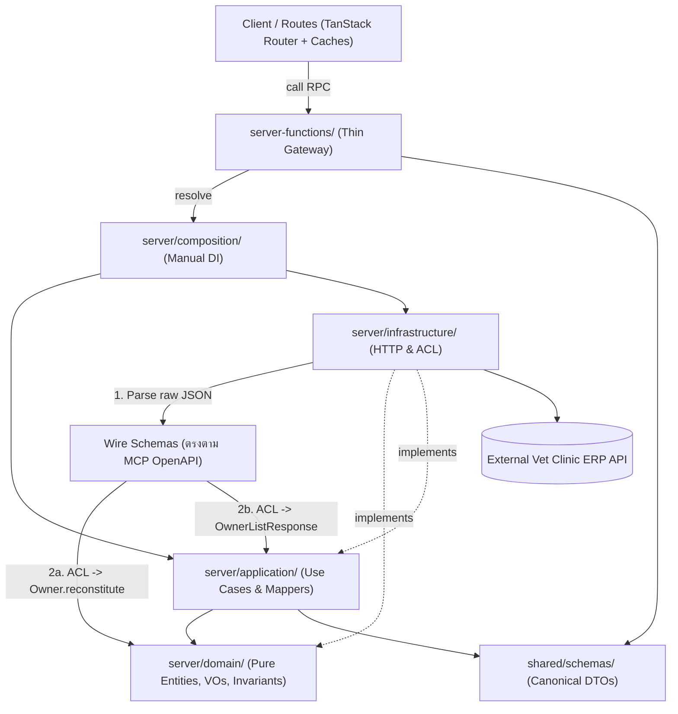

# Development Roadmap: ระบบบริหารจัดการข้อมูลเจ้าของสัตว์ (Owners Module) — ฉบับเริ่มใหม่ตั้งแต่ศูนย์ (Domain-First + Anti-Corruption Layer)

เอกสารนี้คือ **พิมพ์เขียวการพัฒนา (Development Roadmap)** สำหรับสร้างโมดูล `owners` (Scope ปัจจุบัน: `List Owners` และ `Get Owner by ID`) ใหม่ทั้งหมดตั้งแต่เริ่มต้น โดยยึด **Domain Model เป็นศูนย์กลาง (Domain-First / Clean Architecture + Tactical DDD + CQRS)** และใช้ **Anti-Corruption Layer (ACL)** ใน `infrastructure/` เพื่อรับมือกับ Backend API จาก OpenAPI Specification (`apidog_vet_clinic`) ที่ชื่อฟิลด์ โครงสร้าง และกฎข้อมูลไม่ตรงกับ Domain ของเรา

> **หลักยึดสำคัญของเอกสารนี้**
> 1. โค้ดทุกไฟล์สอดคล้องกับกฎใน [architecture.md](../../.agents/rules/architecture.md), [globals.md](../../.agents/rules/globals.md), [server.md](../../.agents/rules/server.md) และ [client.md](../../.agents/rules/client.md)
> 2. อ้างอิง API จริงของเวอร์ชันที่ติดตั้งใน `package.json`: `@tanstack/react-start@1.169.7`, `@tanstack/react-router@1.170.46`, `zod@4.6.7`, `typescript@6.0.2`, `@biomejs/biome@2.6.8`
> 3. สลับการอธิบายเหตุผลเชิงสถาปัตยกรรมควบคู่กับ **โค้ดฉบับสมบูรณ์ 100%** (ไม่มี `...` หรือ TODO) พร้อมจุดตรวจสอบหลังจบบท

---

## 0. ภาพรวมสถาปัตยกรรมและเหตุผลที่ต้องเริ่มใหม่บนแนวทาง Domain-First

### 0.1 ทำไม "เอา API จาก MCP มาใช้ตรงๆ" ถึงพังทั้งระบบและผิด Pattern?

โปรเจกต์ `vet-care` ฝั่ง Web Server (TanStack Start) ทำหน้าที่เป็น **BFF (Backend-for-Frontend) & Application Gateway** ที่คุยกับ Backend ERP API ภายนอกผ่าน HTTP (ตาม `apidog_vet_clinic` OpenAPI Spec) ซึ่งมีปัญหา **ความไม่สอดคล้องของ Contract** หลายจุดเมื่อเทียบกับ Business Domain ใน [01.Owner_and_Pet_Management.md](../BusinessDomain/01.Owner_and_Pet_Management.md) และ [01.owner_and_pet.md](../Database/01.owner_and_pet.md):

| หัวข้อ | Domain ของเรา (Canonical Model) | MCP OpenAPI: `GET /api/v1/owners/{id}` | MCP OpenAPI: `GET /api/v1/owners` |
| --- | --- | --- | --- |
| รูปแบบคีย์ | `camelCase` (`ownerId`, `ownerCode`, `ownerType`) | `snake_case` + ใช้ `id`, `code`, `type`, `phone_no` | `snake_case` + ใช้ `id`, **`owner_code`**, `type`, `phone_no` |
| Query Parameters | `ownerType`, `acquisitionChannel`, `createdFrom`, `createdTo` | — | `type`, `acquisition_channel`, `created_from`, `created_to` |
| เลขประจำตัวผู้เสียภาษี (`taxId`) | `^[0-9]{13}$` (ใน Detail) / รองรับ Masked ใน List | เลข 13 หลักตรง (`8627480061811`) | Mask สำหรับบุคคลธรรมดา (`106XXXXXX7296`) |
| เพศ (`gender`) | `"MALE" \| "FEMALE" \| "NOT_SPECIFIED"` | Individual: `"MALE" \| "FEMALE"`<br>Juristic: `"MALE" \| "FEMALE" \| null` | **ไม่มีฟิลด์นี้ใน List** |
| วันเกิด & เวลาแก้ไข | `dateOfBirth: CalendarDate \| null`, `updatedAt: Date` | Juristic ส่ง `date_of_birth: null` | **ไม่มี `date_of_birth` และ `updated_at` ใน List** |
| ที่อยู่ (`addresses`) | Detail มี `residential` และ `billing` (ไม่มี `isDefault`)<br>List มี `defaultAddress` | `{ residential, billing }` มี `address_line_1`, `address_line_2` (ไม่มี `is_default`) | `address` เดี่ยว (`OwnerDefaultAddress \| null`) **ไม่มี `address_line_2`** |
| ความยินยอม (`consents`) | `privacyPolicy`, `marketing`, `appointment`, `media`, `research` | **Schema** ใช้ `privacy_policy` (lowercase)<br>**Example** ใช้ `PRIVACY_POLICY` (UPPERCASE) | `privacy_policy`, `marketing`, `appointment`, `media`, `research` |

หากปล่อยให้ `infrastructure/` เอา `shared/schemas/` (ของ Client/Application) ไป Parse ผลลัพธ์จาก Backend API ตรงๆ จะเกิดความล้มเหลวทันที 2 ชั้น:
1. **Runtime Crash:** Zod Parse Error เพราะคีย์ไม่ตรง (`code` vs `owner_code`, `total_items` vs `totalItems`, `tax_id` ถูก mask, `date_of_birth: null`)
2. **Domain Corruption:** กฎทางธุรกิจและ UI ต้องไปผูกกับความไม่สม่ำเสมอของ Backend API แทนที่จะยึดภาษาและกฎของ Domain (`Ubiquitous Language`)

### 0.2 สถาปัตยกรรมเป้าหมาย (Dependency Direction & ACL)



### 0.3 การเลือก Design Patterns และข้อกำหนดเชิงปฏิบัติ

- **Domain Building Blocks (`Entity`, `AggregateRoot`, `ValueObject`, `Repository`):** ใช้ตาม [server.md](../../.agents/rules/server.md) โดยให้ `Owner` เป็น Pure Aggregate Root ที่ไม่ import `zod` หรือ DTO จาก `shared/schemas/` และใช้ Discriminated Union ภายในเพื่อทำ **Illegal States Unrepresentable** สำหรับ `INDIVIDUAL` vs `JURISTIC`
- **Adapter (`DP-STR-001`) / Anti-Corruption Layer (ACL):** ขังความต่างของ MCP OpenAPI (ชื่อฟิลด์ `snake_case`, `code` vs `owner_code`, masked `tax_id`, casing ของ `consents`) ไว้ใน `server/infrastructure/owners/` เพียงชั้นเดียว
- **CQRS Direct Query Projection:** แยก `IOwnerRepository` (สำหรับโหลด `Owner` Aggregate เต็มรูปแบบใน `GetOwnerByIdUseCase`) ออกจาก `IOwnerQueryPort` (สำหรับ Query ตาราง `ListOwnersUseCase` โดยตรงเป็น `OwnerListResponse` เบาๆ ตาม [server.md ข้อ 15](../../.agents/rules/server.md#L98-L102))
- **Static Factory Method (`DP-CRE-001`):** แยก `Owner.create(...)` (ตรวจกฎและสร้าง Entity ใหม่) ออกจาก `Owner.reconstitute(...)` (คืนสภาพ Entity จากข้อมูลที่มีอยู่แล้ว)
- **No Pattern (Idiomatic TypeScript):** ไม่สร้าง Strategy/Builder Class เกินจำเป็น ใช้ Pure Mapper Functions และ Zod Discriminated Union ที่สั้นและตรงไปตรงมา

> **ข้อควรระวังเรื่อง Conflict ระหว่างกฎใน Repo (สำคัญมาก):**
> ใน [server.md ข้อ 17](../../.agents/rules/server.md#L118) ระบุให้รวม re-export Use Cases ใน `server/composition/container.ts` แต่ [biome.json](../../biome.json#L64) เปิด `"noBarrelFile": "error"` และ [globals.md ข้อ 5](../../.agents/rules/globals.md#L27-L30) ห้ามสร้าง Barrel File ดังนั้นใน Roadmap นี้ **จง Import Use Case จาก `server/composition/owners.container.ts` โดยตรง** และ **ไม่ต้องสร้าง `container.ts`** เพื่อให้ `biome check` ผ่าน 100%

> **ข้อกำหนด Import & Formatting ของ Repo (`biome.json` + `tsconfig.json`):**
> - Relative import ใช้ได้เฉพาะ `./` และ `../` ลึกกว่านั้นต้องใช้ `#/` (`globals.md` ข้อ 2)
> - แยก `import type { ... }` ออกจาก runtime `import { ... }` เสมอ (`globals.md` ข้อ 3 + `verbatimModuleSyntax: true`)
> - ห้ามใช้ wildcard `import *` (`globals.md` ข้อ 4 + `noNamespaceImport: "error"`)
> - Node built-in ต้องใช้ `node:` protocol เช่น `import { AsyncLocalStorage } from "node:async_hooks";`
> - หลังวางไฟล์โค้ดใน `src/` ให้รัน `bun run format` หรือ `bun x biome check --write src` เพื่อให้ Tab/Quote/Import Order ตรงตาม `biome.json`

---

## 1. แผนผังไฟล์เป้าหมายทั้งหมด (Target File Tree)

```text
src/
├── shared/schemas/
│   ├── pagination.schema.ts                  # Contract กลางสำหรับ Pagination
│   └── owners.schema.ts                      # Canonical DTOs (แยก List Item กับ Detail) & Search Params
├── server/
│   ├── config/
│   │   └── env.ts                            # Zod Fail-fast Env Validation (+ server-only marker)
│   ├── domain/
│   │   ├── common/
│   │   │   ├── entity.base.ts                # Base Entity (แก้ Bug transient ID equality)
│   │   │   ├── aggregate-root.base.ts        # Base AggregateRoot + DomainEvent
│   │   │   ├── value-object.base.ts          # Base ValueObject + Structural Equality
│   │   │   └── errors.ts                     # Pure Domain Errors (ไม่มี Upstream/HTTP errors)
│   │   └── owners/
│   │       ├── owner.value-objects.ts        # OwnerCode, TaxId, CalendarDate, OwnerAddress, OwnerConsents
│   │       ├── owner.entity.ts               # Pure Owner Aggregate Root + Invariants + Behaviors
│   │       └── owner.interface.ts            # IOwnerRepository (รับ/คืน Domain Entity เท่านั้น)
│   ├── application/
│   │   ├── mappers/
│   │   │   └── owner.mapper.ts               # OwnerMapper.toDto(owner) -> OwnerDetailsResponse
│   │   └── owners/
│   │       ├── owner-query.port.ts           # IOwnerQueryPort (CQRS Read Projection Contract)
│   │       ├── get-owner-by-id.use-case.ts   # GetOwnerByIdUseCase
│   │       └── list-owners.use-case.ts       # ListOwnersUseCase
│   ├── infrastructure/
│   │   ├── http/
│   │   │   ├── errors.ts                     # InfrastructureError & UpstreamServiceError
│   │   │   ├── request-context.ts            # AsyncLocalStorage Context (sessionId, signal)
│   │   │   └── api-client.ts                 # HTTP Fetch Client + Error Mapping + Safe Headers
│   │   └── owners/
│   │       ├── owner-api.schemas.ts          # Wire Schemas ตรงตาม MCP OpenAPI Spec
│   │       ├── api-owner.repository.ts       # ACL Adapter: Wire Detail -> Owner.reconstitute
│   │       └── api-owner-query.adapter.ts    # ACL Adapter: Wire List -> OwnerListResponse DTO
│   └── composition/
│       ├── repositories.ts                   # Singleton Infra Adapters (+ server-only marker)
│       └── owners.container.ts               # Manual DI Use Case Instances (+ server-only marker)
├── server-functions/
│   ├── middlewares/
│   │   └── api-context.middleware.ts         # Session Cookie, Auth Policy, ALS, Error Translation
│   └── owners/
│       ├── get-owner-by-id.fn.ts             # Thin RPC Endpoint: getOwnerByIdFn
│       └── list-owners.fn.ts                 # Thin RPC Endpoint: listOwnersFn
└── routes/
    └── __root.tsx                            # ซ่อม broken CSS import ให้ชี้ไป client/styles/global.css
```

---

## 2. Phase 1 — Core Domain Building Blocks (`src/server/domain/common/`)

### คำอธิบายเชิงสถาปัตยกรรม
เลเยอร์ `domain/common/` คือฐานรากของ Tactical DDD ทั้งระบบ ต้องไม่มี dependency ภายนอกใดๆ จุดสำคัญที่ต้องแก้ไขเมื่อเริ่มใหม่จากศูนย์มี 2 เรื่อง:
1. **แก้ Bug `Entity.equals()` สำหรับ Transient Entity:** Entity ใหม่ที่ยังไม่ถูกบันทึกจะได้ `id = 0` (`TRANSIENT_OWNER_ID`) ถ้าไม่เช็ก Transient ID ก่อน Entity ใหม่ 2 ตัวจะถูกมองว่า `equals() === true` ทั้งที่เป็นคนละ Instance
2. **แยก `UpstreamServiceError` ออกจาก `DomainError`:** `errors.ts` ใน Domain ต้องบรรยายเฉพาะความผิดพลาดทางกฎธุรกิจ (เช่น ไม่พบข้อมูล, สถานะไม่ถูกต้อง, ข้อมูลขัดกฎ Domain) ห้ามปนเปื้อนคำศัพท์ของ Network/HTTP/Upstream API

### โค้ด: `src/server/domain/common/entity.base.ts`

```ts
export abstract class Entity<TProps, TId = string> {
  protected readonly _id: TId;
  protected props: TProps;

  protected constructor(id: TId, props: TProps) {
    this._id = id;
    this.props = props;
  }

  get id(): TId {
    return this._id;
  }

  protected isTransientId(): boolean {
    return (
      this._id === undefined ||
      this._id === null ||
      this._id === 0 ||
      this._id === ""
    );
  }

  equals(other?: Entity<TProps, TId>): boolean {
    if (!other) {
      return false;
    }
    if (this === other) {
      return true;
    }
    if (other.constructor !== this.constructor) {
      return false;
    }
    if (this.isTransientId() || other.isTransientId()) {
      return false;
    }
    return this._id === other._id;
  }
}
```

### โค้ด: `src/server/domain/common/aggregate-root.base.ts`

```ts
import { Entity } from "./entity.base";

export interface DomainEvent {
  readonly eventName: string;
  readonly occurredAt: Date;
}

export abstract class AggregateRoot<TProps, TId = string> extends Entity<
  TProps,
  TId
> {
  private readonly _domainEvents: DomainEvent[] = [];

  protected addDomainEvent(event: DomainEvent): void {
    this._domainEvents.push(event);
  }

  pullDomainEvents(): readonly DomainEvent[] {
    const events = [...this._domainEvents];
    this._domainEvents.length = 0;
    return events;
  }
}
```

### โค้ด: `src/server/domain/common/value-object.base.ts`

```ts
function isPlainObject(value: unknown): value is Record<string, unknown> {
  return (
    typeof value === "object" &&
    value !== null &&
    !(value instanceof Date) &&
    !Array.isArray(value)
  );
}

function areValuesEqual(left: unknown, right: unknown): boolean {
  if (Object.is(left, right)) {
    return true;
  }

  if (left instanceof Date && right instanceof Date) {
    return left.getTime() === right.getTime();
  }

  if (Array.isArray(left) && Array.isArray(right)) {
    if (left.length !== right.length) {
      return false;
    }
    return left.every((item, index) => areValuesEqual(item, right[index]));
  }

  if (isPlainObject(left) && isPlainObject(right)) {
    const leftKeys = Object.keys(left);
    const rightKeys = Object.keys(right);
    if (leftKeys.length !== rightKeys.length) {
      return false;
    }
    return leftKeys.every(
      (key) =>
        Object.hasOwn(right, key) && areValuesEqual(left[key], right[key]),
    );
  }

  return false;
}

export abstract class ValueObject<TProps extends object> {
  protected readonly props: Readonly<TProps>;

  protected constructor(props: TProps) {
    this.props = Object.freeze({ ...props });
  }

  equals(other?: ValueObject<TProps>): boolean {
    if (!other) {
      return false;
    }
    if (this === other) {
      return true;
    }
    if (other.constructor !== this.constructor) {
      return false;
    }
    return areValuesEqual(this.props, other.props);
  }
}
```

### โค้ด: `src/server/domain/common/errors.ts`

```ts
export type DomainErrorCode =
  | "DOMAIN_VALIDATION_ERROR"
  | "NOT_FOUND"
  | "CONFLICT"
  | "FORBIDDEN"
  | "UNAUTHORIZED"
  | "INVALID_STATE_TRANSITION";

export abstract class DomainError extends Error {
  readonly code: DomainErrorCode;

  protected constructor(message: string, code: DomainErrorCode) {
    super(message);
    this.name = new.target.name;
    this.code = code;
  }
}

export class ValidationDomainError extends DomainError {
  constructor(message: string) {
    super(message, "DOMAIN_VALIDATION_ERROR");
  }
}

export class NotFoundDomainError extends DomainError {
  constructor(message: string) {
    super(message, "NOT_FOUND");
  }
}

export class ConflictDomainError extends DomainError {
  constructor(message: string) {
    super(message, "CONFLICT");
  }
}

export class ForbiddenDomainError extends DomainError {
  constructor(message: string) {
    super(message, "FORBIDDEN");
  }
}

export class UnauthorizedDomainError extends DomainError {
  constructor(message: string) {
    super(message, "UNAUTHORIZED");
  }
}

export class InvalidStateTransitionError extends DomainError {
  constructor(message: string) {
    super(message, "INVALID_STATE_TRANSITION");
  }
}
```

---

## 3. Phase 2 — Pure Owner Domain Model (`src/server/domain/owners/`)

### คำอธิบายเชิงสถาปัตยกรรม: เอา Domain ตั้งอย่างแท้จริง

นี่คือหัวใจของการออกแบบใหม่ทั้งหมด เราต้องแยกให้ออกว่า **"ความจริงของ Domain"** ในระบบย่อยนี้คืออะไร:
1. **Pure Domain ปราศจาก DTO & Wire Dependency:** `Owner` จะไม่ import type จาก `#/shared/schemas/` (ที่มีฟิลด์หลงมาจาก API/UI เช่น `isDefault`) แต่สร้าง **Value Objects** ของตัวเองใน `owner.value-objects.ts` ได้แก่ `OwnerCode`, `TaxId`, `CalendarDate`, `OwnerAddress`, `OwnerConsents`
2. **แก้ Bug Timezone ใน `dateOfBirth` ด้วย `CalendarDate`:** แทนที่จะเก็บ `dateOfBirth` เป็น JS `Date` แล้วเสี่ยงคลาดเคลื่อน 1 วันเมื่อแปลง `toISOString().slice(0, 10)` ข้าม Timezone `+07:00`, `CalendarDate` เก็บ canonical `YYYY-MM-DD` พร้อมตรวจสอบวันที่จริงในปฏิทิน (เช่น ปฏิเสธ `2025-02-30` หรือเดือน `13`)
3. **ใช้ `gender = "MALE" | "FEMALE" | "NOT_SPECIFIED"` ตาม Ubiquitous Language ใน [01.owner_and_pet.md](../Database/01.owner_and_pet.md#L24):** แม้ MCP API จะส่ง `null` มาเมื่อเป็นนิติบุคคลหรือไม่ได้ระบุ Infrastructure ACL จะแปล `null` -> `"NOT_SPECIFIED"` ให้ Domain เสมอ
4. **Make Illegal States Unrepresentable ด้วย `OwnerClassification` Discriminated Union:**
   - ถ้า `ownerType === "INDIVIDUAL"` คำนำหน้าต้องเป็น `"MR" | "MRS" | "MS"` เท่านั้น
   - ถ้า `ownerType === "JURISTIC"` คำนำหน้าต้องเป็น `"COMMERCIAL" | "NON_PROFIT" | "OTHER"`, `dateOfBirth` ต้องเป็น `null`, และ `gender` ต้องเป็น `"NOT_SPECIFIED"` เท่านั้น
5. **Encapsulation แท้จริง:** ตัด `get value(): OwnerProps` ที่ปล่อย mutable object ออก เปิดเฉพาะ readonly getters และ Domain Methods (`updateProfile`, `updateAddresses`, `updateConsents`) เพื่อไม่ให้เป็น Anemic Domain Model

### โค้ด: `src/server/domain/owners/owner.value-objects.ts`

```ts
import { ValidationDomainError } from "../common/errors";
import { ValueObject } from "../common/value-object.base";

export type OwnerType = "INDIVIDUAL" | "JURISTIC";
export type IndividualPrefix = "MR" | "MRS" | "MS";
export type JuristicPrefix = "COMMERCIAL" | "NON_PROFIT" | "OTHER";
export type OwnerPrefix = IndividualPrefix | JuristicPrefix;
export type OwnerGender = "MALE" | "FEMALE" | "NOT_SPECIFIED";
export type AcquisitionChannel =
  | "WALK_IN"
  | "LINE_OA"
  | "WEB_PORTAL"
  | "REFERRAL"
  | "SOCIAL_MEDIA"
  | "CAMPAIGN";

const INDIVIDUAL_PREFIX_SET: ReadonlySet<string> = new Set([
  "MR",
  "MRS",
  "MS",
]);
const JURISTIC_PREFIX_SET: ReadonlySet<string> = new Set([
  "COMMERCIAL",
  "NON_PROFIT",
  "OTHER",
]);

export function isIndividualPrefix(
  prefix: OwnerPrefix,
): prefix is IndividualPrefix {
  return INDIVIDUAL_PREFIX_SET.has(prefix);
}

export function isJuristicPrefix(
  prefix: OwnerPrefix,
): prefix is JuristicPrefix {
  return JURISTIC_PREFIX_SET.has(prefix);
}

const OWNER_CODE_PATTERN = /^OWN-[0-9]{8}-[0-9]{4}$/;

export class OwnerCode extends ValueObject<{ readonly value: string }> {
  private constructor(value: string) {
    super({ value });
  }

  static create(raw: string): OwnerCode {
    const normalized = raw.trim();
    if (!OWNER_CODE_PATTERN.test(normalized)) {
      throw new ValidationDomainError(
        `Invalid owner code "${raw}". Expected OWN-YYYYMMDD-NNNN format.`,
      );
    }
    return new OwnerCode(normalized);
  }

  get value(): string {
    return this.props.value;
  }
}

const TAX_ID_PATTERN = /^[0-9]{13}$/;

export class TaxId extends ValueObject<{ readonly value: string }> {
  private constructor(value: string) {
    super({ value });
  }

  static create(raw: string): TaxId {
    const normalized = raw.trim();
    if (!TAX_ID_PATTERN.test(normalized)) {
      throw new ValidationDomainError(
        "Tax ID must be exactly 13 numeric digits.",
      );
    }
    return new TaxId(normalized);
  }

  get value(): string {
    return this.props.value;
  }

  get masked(): string {
    return `${this.props.value.slice(0, 3)}XXXXXX${this.props.value.slice(-4)}`;
  }
}

const CALENDAR_DATE_PATTERN = /^(\d{4})-(\d{2})-(\d{2})$/;

export class CalendarDate extends ValueObject<{ readonly isoDate: string }> {
  private constructor(isoDate: string) {
    super({ isoDate });
  }

  static create(raw: string): CalendarDate {
    const normalized = raw.trim();
    const match = CALENDAR_DATE_PATTERN.exec(normalized);
    if (!match) {
      throw new ValidationDomainError(
        `Invalid calendar date "${raw}". Expected YYYY-MM-DD.`,
      );
    }

    const year = Number(match[1]);
    const month = Number(match[2]);
    const day = Number(match[3]);
    const utcCheck = new Date(Date.UTC(year, month - 1, day));

    if (
      utcCheck.getUTCFullYear() !== year ||
      utcCheck.getUTCMonth() !== month - 1 ||
      utcCheck.getUTCDate() !== day
    ) {
      throw new ValidationDomainError(`Non-existent calendar date "${raw}".`);
    }

    return new CalendarDate(normalized);
  }

  get isoDate(): string {
    return this.props.isoDate;
  }
}

export interface OwnerAddressProps {
  readonly addressId: number | null;
  readonly addressLine1: string;
  readonly addressLine2: string | null;
  readonly subdistrict: string;
  readonly district: string;
  readonly province: string;
  readonly postalCode: string;
}

export interface CreateOwnerAddressInput {
  readonly addressId?: number | null;
  readonly addressLine1: string;
  readonly addressLine2?: string | null;
  readonly subdistrict: string;
  readonly district: string;
  readonly province: string;
  readonly postalCode: string;
}

function requireNonEmpty(value: string, fieldName: string, max: number): string {
  const trimmed = value.trim();
  if (trimmed.length === 0 || trimmed.length > max) {
    throw new ValidationDomainError(
      `${fieldName} must be between 1 and ${max} characters.`,
    );
  }
  return trimmed;
}

function normalizeOptionalText(
  value: string | null | undefined,
  fieldName: string,
  max: number,
): string | null {
  if (value === null || value === undefined) {
    return null;
  }
  const trimmed = value.trim();
  if (trimmed.length === 0) {
    return null;
  }
  if (trimmed.length > max) {
    throw new ValidationDomainError(
      `${fieldName} must not exceed ${max} characters.`,
    );
  }
  return trimmed;
}

export class OwnerAddress extends ValueObject<OwnerAddressProps> {
  private constructor(props: OwnerAddressProps) {
    super(props);
  }

  static create(input: CreateOwnerAddressInput): OwnerAddress {
    const addressId = input.addressId ?? null;
    if (
      addressId !== null &&
      (!Number.isInteger(addressId) || addressId <= 0)
    ) {
      throw new ValidationDomainError(
        "addressId must be a positive integer when provided.",
      );
    }

    return new OwnerAddress({
      addressId,
      addressLine1: requireNonEmpty(input.addressLine1, "addressLine1", 255),
      addressLine2: normalizeOptionalText(
        input.addressLine2,
        "addressLine2",
        255,
      ),
      subdistrict: requireNonEmpty(input.subdistrict, "subdistrict", 100),
      district: requireNonEmpty(input.district, "district", 100),
      province: requireNonEmpty(input.province, "province", 100),
      postalCode: requireNonEmpty(input.postalCode, "postalCode", 10),
    });
  }

  get addressId(): number | null {
    return this.props.addressId;
  }

  get addressLine1(): string {
    return this.props.addressLine1;
  }

  get addressLine2(): string | null {
    return this.props.addressLine2;
  }

  get subdistrict(): string {
    return this.props.subdistrict;
  }

  get district(): string {
    return this.props.district;
  }

  get province(): string {
    return this.props.province;
  }

  get postalCode(): string {
    return this.props.postalCode;
  }

  toPlainObject(): OwnerAddressProps {
    return { ...this.props };
  }
}

export interface OwnerConsentsProps {
  readonly privacyPolicy: boolean;
  readonly marketing: boolean;
  readonly appointment: boolean;
  readonly media: boolean;
  readonly research: boolean;
}

export class OwnerConsents extends ValueObject<OwnerConsentsProps> {
  private constructor(props: OwnerConsentsProps) {
    super(props);
  }

  static create(props: OwnerConsentsProps): OwnerConsents {
    return new OwnerConsents({
      privacyPolicy: Boolean(props.privacyPolicy),
      marketing: Boolean(props.marketing),
      appointment: Boolean(props.appointment),
      media: Boolean(props.media),
      research: Boolean(props.research),
    });
  }

  withUpdates(partial: Partial<OwnerConsentsProps>): OwnerConsents {
    return OwnerConsents.create({
      ...this.props,
      ...partial,
    });
  }

  get privacyPolicy(): boolean {
    return this.props.privacyPolicy;
  }

  get marketing(): boolean {
    return this.props.marketing;
  }

  get appointment(): boolean {
    return this.props.appointment;
  }

  get media(): boolean {
    return this.props.media;
  }

  get research(): boolean {
    return this.props.research;
  }

  toPlainObject(): OwnerConsentsProps {
    return { ...this.props };
  }
}
```

### โค้ด: `src/server/domain/owners/owner.entity.ts`

```ts
import { AggregateRoot } from "../common/aggregate-root.base";
import { ValidationDomainError } from "../common/errors";
import type {
  AcquisitionChannel,
  CalendarDate,
  IndividualPrefix,
  JuristicPrefix,
  OwnerAddress,
  OwnerCode,
  OwnerConsents,
  OwnerConsentsProps,
  OwnerGender,
  OwnerPrefix,
  OwnerType,
  TaxId,
} from "./owner.value-objects";
import { isIndividualPrefix, isJuristicPrefix } from "./owner.value-objects";

const TRANSIENT_OWNER_ID = 0;
const BASIC_EMAIL_PATTERN = /^[^\s@]+@[^\s@]+\.[^\s@]+$/;

export type OwnerClassification =
  | {
      readonly ownerType: "INDIVIDUAL";
      readonly prefix: IndividualPrefix;
      readonly lastName: string | null;
      readonly dateOfBirth: CalendarDate | null;
      readonly gender: OwnerGender;
    }
  | {
      readonly ownerType: "JURISTIC";
      readonly prefix: JuristicPrefix;
      readonly lastName: string | null;
      readonly dateOfBirth: null;
      readonly gender: "NOT_SPECIFIED";
    };

export interface OwnerAddresses {
  readonly residential: OwnerAddress | null;
  readonly billing: OwnerAddress | null;
}

export interface OwnerProps {
  readonly ownerCode: OwnerCode;
  readonly classification: OwnerClassification;
  readonly firstName: string;
  readonly taxId: TaxId;
  readonly phoneNumber: string;
  readonly lineId: string | null;
  readonly email: string | null;
  readonly acquisitionChannel: AcquisitionChannel | null;
  readonly addresses: OwnerAddresses;
  readonly consents: OwnerConsents;
  readonly createdAt: Date;
  readonly updatedAt: Date;
}

export interface CreateOwnerParams {
  readonly ownerCode: OwnerCode;
  readonly classification: OwnerClassification;
  readonly firstName: string;
  readonly taxId: TaxId;
  readonly phoneNumber: string;
  readonly lineId: string | null;
  readonly email: string | null;
  readonly acquisitionChannel: AcquisitionChannel | null;
  readonly addresses: OwnerAddresses;
  readonly consents: OwnerConsents;
}

export interface UpdateOwnerContactParams {
  readonly phoneNumber: string;
  readonly lineId: string | null;
  readonly email: string | null;
}

function normalizeRequiredString(
  raw: string,
  fieldName: string,
  maxLength: number,
): string {
  const trimmed = raw.trim();
  if (trimmed.length === 0 || trimmed.length > maxLength) {
    throw new ValidationDomainError(
      `${fieldName} must be between 1 and ${maxLength} characters.`,
    );
  }
  return trimmed;
}

function normalizeNullableString(
  raw: string | null,
  fieldName: string,
  maxLength: number,
): string | null {
  if (raw === null) {
    return null;
  }
  const trimmed = raw.trim();
  if (trimmed.length === 0) {
    return null;
  }
  if (trimmed.length > maxLength) {
    throw new ValidationDomainError(
      `${fieldName} must not exceed ${maxLength} characters.`,
    );
  }
  return trimmed;
}

function normalizeEmail(raw: string | null): string | null {
  const normalized = normalizeNullableString(raw, "email", 255);
  if (normalized === null) {
    return null;
  }
  if (!BASIC_EMAIL_PATTERN.test(normalized)) {
    throw new ValidationDomainError(`Invalid email format "${raw}".`);
  }
  return normalized;
}

function normalizeAndValidateClassification(
  classification: OwnerClassification,
): OwnerClassification {
  const lastName = normalizeNullableString(
    classification.lastName,
    "lastName",
    150,
  );

  if (classification.ownerType === "INDIVIDUAL") {
    if (!isIndividualPrefix(classification.prefix)) {
      throw new ValidationDomainError(
        `Invalid prefix "${classification.prefix}" for INDIVIDUAL owner.`,
      );
    }
    return {
      ownerType: "INDIVIDUAL",
      prefix: classification.prefix,
      lastName,
      dateOfBirth: classification.dateOfBirth,
      gender: classification.gender,
    };
  }

  if (!isJuristicPrefix(classification.prefix)) {
    throw new ValidationDomainError(
      `Invalid prefix "${classification.prefix}" for JURISTIC owner.`,
    );
  }
  if (classification.dateOfBirth !== null) {
    throw new ValidationDomainError(
      "JURISTIC owner cannot have a dateOfBirth.",
    );
  }
  if (classification.gender !== "NOT_SPECIFIED") {
    throw new ValidationDomainError(
      'JURISTIC owner gender must be "NOT_SPECIFIED".',
    );
  }

  return {
    ownerType: "JURISTIC",
    prefix: classification.prefix,
    lastName,
    dateOfBirth: null,
    gender: "NOT_SPECIFIED",
  };
}

function validateAndNormalizeProps(props: OwnerProps): OwnerProps {
  if (
    Number.isNaN(props.createdAt.getTime()) ||
    Number.isNaN(props.updatedAt.getTime())
  ) {
    throw new ValidationDomainError("Owner timestamps must be valid dates.");
  }
  if (props.updatedAt.getTime() < props.createdAt.getTime()) {
    throw new ValidationDomainError(
      "Owner updatedAt cannot be earlier than createdAt.",
    );
  }

  return {
    ownerCode: props.ownerCode,
    classification: normalizeAndValidateClassification(props.classification),
    firstName: normalizeRequiredString(props.firstName, "firstName", 255),
    taxId: props.taxId,
    phoneNumber: normalizeRequiredString(props.phoneNumber, "phoneNumber", 30),
    lineId: normalizeNullableString(props.lineId, "lineId", 100),
    email: normalizeEmail(props.email),
    acquisitionChannel: props.acquisitionChannel,
    addresses: Object.freeze({
      residential: props.addresses.residential,
      billing: props.addresses.billing,
    }),
    consents: props.consents,
    createdAt: new Date(props.createdAt.getTime()),
    updatedAt: new Date(props.updatedAt.getTime()),
  };
}

export class Owner extends AggregateRoot<OwnerProps, number> {
  private constructor(ownerId: number, props: OwnerProps) {
    super(ownerId, props);
  }

  static create(params: CreateOwnerParams): Owner {
    const now = new Date();
    const validated = validateAndNormalizeProps({
      ...params,
      createdAt: now,
      updatedAt: now,
    });

    const owner = new Owner(TRANSIENT_OWNER_ID, validated);
    owner.addDomainEvent({
      eventName: "OwnerCreated",
      occurredAt: now,
    });
    return owner;
  }

  static reconstitute(ownerId: number, props: OwnerProps): Owner {
    if (!Number.isInteger(ownerId) || ownerId <= 0) {
      throw new ValidationDomainError(
        "Persisted ownerId must be a positive integer.",
      );
    }
    return new Owner(ownerId, validateAndNormalizeProps(props));
  }

  updateContact(params: UpdateOwnerContactParams): void {
    this.props = validateAndNormalizeProps({
      ...this.props,
      phoneNumber: params.phoneNumber,
      lineId: params.lineId,
      email: params.email,
      updatedAt: new Date(),
    });
  }

  updateAddresses(addresses: OwnerAddresses): void {
    this.props = validateAndNormalizeProps({
      ...this.props,
      addresses,
      updatedAt: new Date(),
    });
  }

  updateConsents(partial: Partial<OwnerConsentsProps>): void {
    this.props = validateAndNormalizeProps({
      ...this.props,
      consents: this.props.consents.withUpdates(partial),
      updatedAt: new Date(),
    });
  }

  get ownerCode(): OwnerCode {
    return this.props.ownerCode;
  }

  get classification(): OwnerClassification {
    return this.props.classification;
  }

  get ownerType(): OwnerType {
    return this.props.classification.ownerType;
  }

  get prefix(): OwnerPrefix {
    return this.props.classification.prefix;
  }

  get firstName(): string {
    return this.props.firstName;
  }

  get lastName(): string | null {
    return this.props.classification.lastName;
  }

  get taxId(): TaxId {
    return this.props.taxId;
  }

  get dateOfBirth(): CalendarDate | null {
    return this.props.classification.dateOfBirth;
  }

  get gender(): OwnerGender {
    return this.props.classification.gender;
  }

  get phoneNumber(): string {
    return this.props.phoneNumber;
  }

  get lineId(): string | null {
    return this.props.lineId;
  }

  get email(): string | null {
    return this.props.email;
  }

  get acquisitionChannel(): AcquisitionChannel | null {
    return this.props.acquisitionChannel;
  }

  get residentialAddress(): OwnerAddress | null {
    return this.props.addresses.residential;
  }

  get billingAddress(): OwnerAddress | null {
    return this.props.addresses.billing;
  }

  get consents(): OwnerConsents {
    return this.props.consents;
  }

  get createdAt(): Date {
    return new Date(this.props.createdAt.getTime());
  }

  get updatedAt(): Date {
    return new Date(this.props.updatedAt.getTime());
  }
}
```

### โค้ด: `src/server/domain/owners/owner.interface.ts`

```ts
import type { Owner } from "./owner.entity";

export interface IOwnerRepository {
  findById(ownerId: number): Promise<Owner | null>;
}
```

---

## 4. Phase 3 — Shared Contracts (`src/shared/schemas/`)

### คำอธิบายเชิงสถาปัตยกรรม
`src/shared/schemas/` เป็น **Isomorphic Contract Layer** ระหว่าง BFF (`server/`, `server-functions/`) และ Frontend (`client/`) ห้ามนำ Wire Shape ที่สับสนของ Backend API (เช่น `code` vs `owner_code`, `total_items`) มาใส่ที่นี่ และห้ามนำ Server Entity มาใส่ที่นี่เช่นกัน

จุดสำคัญที่แก้จากของเดิม:
1. **แยก `ownerListItemSchema` ออกจาก `ownerDetailsResponseSchema`:** หน้าตาราง List ไม่มี `dateOfBirth`, `gender`, `updatedAt`, `billing` address และ `taxId` มาแบบ masked — การแยก DTO ทำให้ Type System ซื่อสัตย์ต่อความจริง 100%
2. **บังคับคู่ `(ownerType, prefix)` ด้วย `z.discriminatedUnion("ownerType", ...)`:** ป้องกัน payload อย่าง `{ ownerType: "JURISTIC", prefix: "MR" }` หลุดผ่าน Validation
3. **ใช้ชื่อ Canonical `ownerType` ใน `ownersSearchParamsSchema`:** ไม่ใช้ชื่อ `type` ของ Query String จาก Backend API แล้วปล่อยให้ Infrastructure ACL แปลงเป็น `?type=...` ตอนยิง HTTP
4. **แก้ `.optional()` เป็น `.nullable()`** สำหรับ `dateOfBirth`, `acquisitionChannel`, `addressLine2`, `lastName`, `lineId`, `email`

### โค้ด: `src/shared/schemas/pagination.schema.ts`

```ts
import { z } from "zod";

export const paginationParamsSchema = z.object({
  page: z.coerce.number<number | string>().int().min(1).default(1),
  limit: z.coerce.number<number | string>().int().min(1).max(100).default(20),
  search: z.string().trim().max(255).optional(),
});
export type PaginationParams = z.infer<typeof paginationParamsSchema>;

export function createPaginatedResultSchema<TItem extends z.ZodType>(
  itemSchema: TItem,
) {
  return z.object({
    page: z.int().min(1),
    limit: z.int().min(1).max(100),
    totalItems: z.int().min(0),
    totalPages: z.int().min(0),
    hasNext: z.boolean(),
    hasPrev: z.boolean(),
    data: z.array(itemSchema),
  });
}
```

### โค้ด: `src/shared/schemas/owners.schema.ts`

```ts
import { z } from "zod";
import {
  createPaginatedResultSchema,
  paginationParamsSchema,
} from "./pagination.schema";

export const ownerCodeSchema = z
  .string()
  .trim()
  .max(30)
  .regex(/^OWN-[0-9]{8}-[0-9]{4}$/);
export type OwnerCodeDto = z.infer<typeof ownerCodeSchema>;

export const ownerTypeSchema = z.enum(["INDIVIDUAL", "JURISTIC"]);
export type OwnerTypeDto = z.infer<typeof ownerTypeSchema>;

export const ownerIndividualPrefixSchema = z.enum(["MR", "MRS", "MS"]);
export type OwnerIndividualPrefixDto = z.infer<
  typeof ownerIndividualPrefixSchema
>;

export const ownerJuristicPrefixSchema = z.enum([
  "COMMERCIAL",
  "NON_PROFIT",
  "OTHER",
]);
export type OwnerJuristicPrefixDto = z.infer<typeof ownerJuristicPrefixSchema>;

export const ownerPrefixSchema = z.enum([
  ...ownerIndividualPrefixSchema.options,
  ...ownerJuristicPrefixSchema.options,
]);
export type OwnerPrefixDto = z.infer<typeof ownerPrefixSchema>;

export const ownerGenderSchema = z.enum(["MALE", "FEMALE", "NOT_SPECIFIED"]);
export type OwnerGenderDto = z.infer<typeof ownerGenderSchema>;

export const acquisitionChannelSchema = z.enum([
  "WALK_IN",
  "LINE_OA",
  "WEB_PORTAL",
  "REFERRAL",
  "SOCIAL_MEDIA",
  "CAMPAIGN",
]);
export type AcquisitionChannelDto = z.infer<typeof acquisitionChannelSchema>;

export const ownerAddressSchema = z.object({
  addressId: z.int().positive().nullable(),
  addressLine1: z.string().min(1).max(255),
  addressLine2: z.string().max(255).nullable(),
  subdistrict: z.string().min(1).max(100),
  district: z.string().min(1).max(100),
  province: z.string().min(1).max(100),
  postalCode: z.string().min(1).max(10),
});
export type OwnerAddressDto = z.infer<typeof ownerAddressSchema>;

export const ownerSummaryAddressSchema = z.object({
  addressId: z.int().positive(),
  addressLine1: z.string().min(1).max(255),
  subdistrict: z.string().min(1).max(100),
  district: z.string().min(1).max(100),
  province: z.string().min(1).max(100),
  postalCode: z.string().min(1).max(10),
});
export type OwnerSummaryAddressDto = z.infer<typeof ownerSummaryAddressSchema>;

export const ownerConsentsSchema = z.object({
  privacyPolicy: z.boolean(),
  marketing: z.boolean(),
  appointment: z.boolean(),
  media: z.boolean(),
  research: z.boolean(),
});
export type OwnerConsentsDto = z.infer<typeof ownerConsentsSchema>;

const ownerDetailsCommonFields = {
  ownerId: z.int().nonnegative(),
  ownerCode: ownerCodeSchema,
  firstName: z.string().min(1).max(255),
  lastName: z.string().max(150).nullable(),
  taxId: z.string().regex(/^[0-9]{13}$/),
  phoneNumber: z.string().min(1).max(30),
  lineId: z.string().max(100).nullable(),
  email: z.email().max(255).nullable(),
  acquisitionChannel: acquisitionChannelSchema.nullable(),
  addresses: z.object({
    residential: ownerAddressSchema.nullable(),
    billing: ownerAddressSchema.nullable(),
  }),
  consents: ownerConsentsSchema,
  createdAt: z.iso.datetime({ offset: true }),
  updatedAt: z.iso.datetime({ offset: true }),
};

export const ownerIndividualDetailsSchema = z.object({
  ...ownerDetailsCommonFields,
  ownerType: z.literal("INDIVIDUAL"),
  prefix: ownerIndividualPrefixSchema,
  dateOfBirth: z.iso.date().nullable(),
  gender: ownerGenderSchema,
});

export const ownerJuristicDetailsSchema = z.object({
  ...ownerDetailsCommonFields,
  ownerType: z.literal("JURISTIC"),
  prefix: ownerJuristicPrefixSchema,
  dateOfBirth: z.null(),
  gender: z.literal("NOT_SPECIFIED"),
});

export const ownerDetailsResponseSchema = z.discriminatedUnion("ownerType", [
  ownerIndividualDetailsSchema,
  ownerJuristicDetailsSchema,
]);
export type OwnerDetailsResponse = z.infer<typeof ownerDetailsResponseSchema>;

const ownerListItemCommonFields = {
  ownerId: z.int().positive(),
  ownerCode: ownerCodeSchema,
  firstName: z.string().min(1).max(255),
  lastName: z.string().max(150).nullable(),
  phoneNumber: z.string().min(1).max(30),
  lineId: z.string().max(100).nullable(),
  email: z.email().max(255).nullable(),
  taxId: z.string().regex(/^([0-9]{3}X{6}[0-9]{4}|[0-9]{13})$/),
  acquisitionChannel: acquisitionChannelSchema.nullable(),
  defaultAddress: ownerSummaryAddressSchema.nullable(),
  consents: ownerConsentsSchema,
  createdAt: z.iso.datetime({ offset: true }),
};

export const ownerListItemSchema = z.discriminatedUnion("ownerType", [
  z.object({
    ...ownerListItemCommonFields,
    ownerType: z.literal("INDIVIDUAL"),
    prefix: ownerIndividualPrefixSchema,
  }),
  z.object({
    ...ownerListItemCommonFields,
    ownerType: z.literal("JURISTIC"),
    prefix: ownerJuristicPrefixSchema,
  }),
]);
export type OwnerListItem = z.infer<typeof ownerListItemSchema>;

export const ownerListResponseSchema =
  createPaginatedResultSchema(ownerListItemSchema);
export type OwnerListResponse = z.infer<typeof ownerListResponseSchema>;

export const ownersSearchParamsSchema = paginationParamsSchema
  .extend({
    ownerType: ownerTypeSchema.optional(),
    acquisitionChannel: acquisitionChannelSchema.optional(),
    createdFrom: z.iso.datetime({ offset: true }).optional(),
    createdTo: z.iso.datetime({ offset: true }).optional(),
    sort: z
      .enum(["created_at:desc", "created_at:asc"])
      .default("created_at:desc"),
  })
  .refine(
    (value) => {
      if (!value.createdFrom || !value.createdTo) {
        return true;
      }
      return Date.parse(value.createdFrom) <= Date.parse(value.createdTo);
    },
    {
      message: "createdFrom must be less than or equal to createdTo",
      path: ["createdTo"],
    },
  );
export type OwnersSearchParams = z.infer<typeof ownersSearchParamsSchema>;

export const getOwnerByIdInputSchema = z.object({
  ownerId: z.int().positive(),
});
export type GetOwnerByIdInput = z.infer<typeof getOwnerByIdInputSchema>;
```

---

## 5. Phase 4 — Application Layer (`src/server/application/`)

### คำอธิบายเชิงสถาปัตยกรรม
เลเยอร์ Application เป็นเพียง Orchestrator ตาม [server.md ข้อ 8–11](../../.agents/rules/server.md#L50-L79):
- `GetOwnerByIdUseCase` ดึง Aggregate `Owner` ผ่าน `IOwnerRepository` แล้วแปลงเป็น `OwnerDetailsResponse` ผ่าน `OwnerMapper.toDto(owner)` เพื่อไม่ให้ Entity รั่วออกนอก Application
- `OwnerMapper` ใช้ Discriminated Union `owner.classification` จึงแปลง `INDIVIDUAL` และ `JURISTIC` ได้แบบ Type-safe สมบูรณ์โดย**ไม่ต้องใช้ `as` cast แม้แต่จุดเดียว**
- `ListOwnersUseCase` ใช้ CQRS Read Projection ผ่าน `IOwnerQueryPort` (ตั้งชื่อ dependency ว่า `ownerQueryPort` ให้ตรงกับบทบาท)

### โค้ด: `src/server/application/owners/owner-query.port.ts`

```ts
import type {
  OwnerListResponse,
  OwnersSearchParams,
} from "#/shared/schemas/owners.schema";

export interface IOwnerQueryPort {
  listOwners(query: OwnersSearchParams): Promise<OwnerListResponse>;
}
```

### โค้ด: `src/server/application/mappers/owner.mapper.ts`

```ts
import type { Owner } from "#/server/domain/owners/owner.entity";
import type { OwnerAddress } from "#/server/domain/owners/owner.value-objects";
import type {
  OwnerAddressDto,
  OwnerDetailsResponse,
} from "#/shared/schemas/owners.schema";

function mapAddressToDto(address: OwnerAddress | null): OwnerAddressDto | null {
  if (!address) {
    return null;
  }
  return address.toPlainObject();
}

export class OwnerMapper {
  static toDto(owner: Owner): OwnerDetailsResponse {
    const base = {
      ownerId: owner.id,
      ownerCode: owner.ownerCode.value,
      firstName: owner.firstName,
      lastName: owner.lastName,
      taxId: owner.taxId.value,
      phoneNumber: owner.phoneNumber,
      lineId: owner.lineId,
      email: owner.email,
      acquisitionChannel: owner.acquisitionChannel,
      addresses: {
        residential: mapAddressToDto(owner.residentialAddress),
        billing: mapAddressToDto(owner.billingAddress),
      },
      consents: owner.consents.toPlainObject(),
      createdAt: owner.createdAt.toISOString(),
      updatedAt: owner.updatedAt.toISOString(),
    };

    const classification = owner.classification;
    if (classification.ownerType === "INDIVIDUAL") {
      return {
        ...base,
        ownerType: "INDIVIDUAL",
        prefix: classification.prefix,
        dateOfBirth: classification.dateOfBirth?.isoDate ?? null,
        gender: classification.gender,
      };
    }

    return {
      ...base,
      ownerType: "JURISTIC",
      prefix: classification.prefix,
      dateOfBirth: null,
      gender: "NOT_SPECIFIED",
    };
  }
}
```

### โค้ด: `src/server/application/owners/get-owner-by-id.use-case.ts`

```ts
import { NotFoundDomainError } from "#/server/domain/common/errors";
import type { IOwnerRepository } from "#/server/domain/owners/owner.interface";
import type { OwnerDetailsResponse } from "#/shared/schemas/owners.schema";
import { OwnerMapper } from "../mappers/owner.mapper";

export interface GetOwnerByIdUseCaseInput {
  readonly ownerId: number;
}

export class GetOwnerByIdUseCase {
  constructor(private readonly ownerRepository: IOwnerRepository) {}

  async execute(
    input: GetOwnerByIdUseCaseInput,
  ): Promise<OwnerDetailsResponse> {
    const owner = await this.ownerRepository.findById(input.ownerId);
    if (!owner) {
      throw new NotFoundDomainError(`Owner ${input.ownerId} was not found.`);
    }
    return OwnerMapper.toDto(owner);
  }
}
```

### โค้ด: `src/server/application/owners/list-owners.use-case.ts`

```ts
import type {
  OwnerListResponse,
  OwnersSearchParams,
} from "#/shared/schemas/owners.schema";
import type { IOwnerQueryPort } from "./owner-query.port";

export interface ListOwnersUseCaseInput {
  readonly payload: OwnersSearchParams;
}

export class ListOwnersUseCase {
  constructor(private readonly ownerQueryPort: IOwnerQueryPort) {}

  async execute(input: ListOwnersUseCaseInput): Promise<OwnerListResponse> {
    return this.ownerQueryPort.listOwners(input.payload);
  }
}
```

---

## 6. Phase 5 — Infrastructure & Anti-Corruption Layer (`src/server/infrastructure/`)

### คำอธิบายเชิงสถาปัตยกรรม: กำแพงกันความเพี้ยนของ MCP API

นี่คือเลเยอร์ที่แก้ปัญหา **"API จาก MCP ให้มาไม่ตรงกับ Domain"** แบบถอนรากถอนโคน:
1. **`http/errors.ts`:** แยก `UpstreamServiceError` ออกจาก Domain มาอยู่ที่ HTTP Infrastructure
2. **`http/api-client.ts`:**
   - Map HTTP `409` -> `ConflictDomainError` และ `422` -> `ValidationDomainError` เพิ่มเติม (ให้สอดคล้องกับ Gateway Status Map)
   - Validate `sessionId` ไม่ให้มี whitespace หรือ `;` ก่อนประกอบ Cookie Header
   - ไม่ log response/payload ที่มี PII ของลูกค้าใน Production
3. **`owners/owner-api.schemas.ts` (Wire Schemas เฉพาะของ Backend ERP API):**
   - **รับมือความขัดแย้งใน OpenAPI Spec เรื่อง `consents`:** Schema บอก lowercase (`privacy_policy`) แต่ Example ใน `/owners/{id}` เป็น UPPERCASE (`PRIVACY_POLICY`) จึงทำ `ownerApiConsentsSchema` ที่รับได้ทั้ง 2 รูปแบบแล้ว normalize ให้เป็น canonical shape ทันที!
   - **Defensive Nullable Handling:** แม้ Schema ของ `OwnerIndividualResponse` จะลืมใส่ `["string", "null"]` ให้ `email`/`line_id`/`last_name`/`billing` (แต่ใน List Schema และ Business Domain รองรับ `null`) Wire Schema จะรับ `.nullable()` อย่างยืดหยุ่นเพื่อป้องกัน production crash เมื่อข้อมูลลูกค้าจริงไม่มีอีเมลหรือไม่มี Line ID
   - **จัดการความต่างระหว่าง 2 Endpoints:** `/owners/{id}` อ่าน `code` และ `addresses.{residential, billing}` ส่วน `/owners` อ่าน `owner_code`, `address` เดี่ยว และ `tax_id` (masked หรือ 13 หลัก)
4. **`api-owner.repository.ts` & `api-owner-query.adapter.ts`:**
   - ทำหน้าที่เป็น ACL แปล Wire Schema -> `Owner.reconstitute(...)` (แปลง `gender: null` เป็น `"NOT_SPECIFIED"` และ normalize `JURISTIC` ให้สอดคล้องกับ Domain Invariants) และแปลง Query Params `camelCase` -> `snake_case` (`type`, `acquisition_channel`, `created_from`, `created_to`)

### โค้ด: `src/server/infrastructure/http/errors.ts`

```ts
export type InfrastructureErrorCode = "UPSTREAM_SERVICE_ERROR";

export abstract class InfrastructureError extends Error {
  readonly code: InfrastructureErrorCode;

  protected constructor(message: string, code: InfrastructureErrorCode) {
    super(message);
    this.name = new.target.name;
    this.code = code;
  }
}

export class UpstreamServiceError extends InfrastructureError {
  constructor(message: string) {
    super(message, "UPSTREAM_SERVICE_ERROR");
  }
}
```

### โค้ด: `src/server/infrastructure/http/request-context.ts`

```ts
import { AsyncLocalStorage } from "node:async_hooks";

export interface ApiRequestContext {
  readonly sessionId?: string;
  readonly signal?: AbortSignal;
}

const apiRequestContextStorage = new AsyncLocalStorage<ApiRequestContext>();

export function runWithApiRequestContext<T>(
  context: ApiRequestContext,
  callback: () => T,
): T {
  return apiRequestContextStorage.run(context, callback);
}

export function getApiRequestContext(): ApiRequestContext | undefined {
  return apiRequestContextStorage.getStore();
}
```

### โค้ด: `src/server/infrastructure/http/api-client.ts`

```ts
import { z } from "zod";
import {
  ConflictDomainError,
  ForbiddenDomainError,
  NotFoundDomainError,
  UnauthorizedDomainError,
  ValidationDomainError,
} from "#/server/domain/common/errors";
import { UpstreamServiceError } from "./errors";
import { getApiRequestContext } from "./request-context";

const apiErrorResponseSchema = z.object({
  error_message: z.string().min(1),
});

const SAFE_COOKIE_VALUE_PATTERN = /^[^\s;]+$/;

export interface ApiClientConfig {
  readonly baseUrl: string;
  readonly timeoutMs: number;
  readonly apidogToken?: string;
}

export type ApiQueryParams = Record<string, string | number | undefined>;

export interface ApiGetOptions {
  readonly query?: ApiQueryParams;
}

export class ApiClient {
  private readonly baseUrl: string;
  private readonly timeoutMs: number;
  private readonly apidogToken?: string;

  constructor(config: ApiClientConfig) {
    this.baseUrl = config.baseUrl.replace(/\/+$/, "");
    this.timeoutMs = config.timeoutMs;
    this.apidogToken = config.apidogToken;
  }

  async getJson<TOutput>(
    path: string,
    schema: z.ZodType<TOutput>,
    options?: ApiGetOptions,
  ): Promise<TOutput> {
    const response = await this.executeGet(path, options?.query);
    if (!response.ok) {
      throw await this.mapHttpError(path, response);
    }
    return this.parseSuccessResponse(path, response, schema);
  }

  async getOptionalJson<TOutput>(
    path: string,
    schema: z.ZodType<TOutput>,
    options?: ApiGetOptions,
  ): Promise<TOutput | null> {
    const response = await this.executeGet(path, options?.query);
    if (response.status === 404) {
      return null;
    }
    if (!response.ok) {
      throw await this.mapHttpError(path, response);
    }
    return this.parseSuccessResponse(path, response, schema);
  }

  private async executeGet(
    path: string,
    query?: ApiQueryParams,
  ): Promise<Response> {
    const url = this.buildUrl(path, query);
    const requestContext = getApiRequestContext();
    const headers = this.buildHeaders(requestContext?.sessionId);
    const timeoutSignal = AbortSignal.timeout(this.timeoutMs);
    const signal = requestContext?.signal
      ? AbortSignal.any([requestContext.signal, timeoutSignal])
      : timeoutSignal;

    try {
      return await fetch(url, {
        method: "GET",
        headers,
        signal,
      });
    } catch (error) {
      if (error instanceof DOMException && error.name === "TimeoutError") {
        throw new UpstreamServiceError(
          "Upstream API request timed out. Please try again.",
        );
      }
      if (error instanceof DOMException && error.name === "AbortError") {
        throw new UpstreamServiceError("Upstream API request was cancelled.");
      }
      const errorName =
        error instanceof Error ? error.name : "UnknownNetworkError";
      console.error("[ApiClient] Network failure", { path, errorName });
      throw new UpstreamServiceError("Unable to reach upstream API service.");
    }
  }

  private buildUrl(path: string, query?: ApiQueryParams): URL {
    const normalizedPath = path.startsWith("/") ? path : `/${path}`;
    const url = new URL(`${this.baseUrl}${normalizedPath}`);

    if (!query) {
      return url;
    }

    for (const [key, value] of Object.entries(query)) {
      if (value === undefined) {
        continue;
      }
      if (typeof value === "string" && value.length === 0) {
        continue;
      }
      url.searchParams.set(key, String(value));
    }

    return url;
  }

  private buildHeaders(sessionId?: string): Headers {
    const headers = new Headers({
      Accept: "application/json",
    });

    if (sessionId) {
      if (!SAFE_COOKIE_VALUE_PATTERN.test(sessionId)) {
        throw new UnauthorizedDomainError("Invalid session identifier.");
      }
      headers.set("Cookie", `session_id=${sessionId}`);
    }

    if (this.apidogToken) {
      headers.set("apidogToken", this.apidogToken);
    }

    return headers;
  }

  private async parseSuccessResponse<TOutput>(
    path: string,
    response: Response,
    schema: z.ZodType<TOutput>,
  ): Promise<TOutput> {
    let rawBody: unknown;
    try {
      rawBody = await response.json();
    } catch {
      console.error("[ApiClient] Invalid JSON response", {
        path,
        status: response.status,
      });
      throw new UpstreamServiceError(
        "Received malformed JSON from upstream API.",
      );
    }

    const parsed = schema.safeParse(rawBody);
    if (!parsed.success) {
      const issuePaths = parsed.error.issues
        .slice(0, 10)
        .map((issue) => issue.path.join(".") || "<root>");
      console.error("[ApiClient] Response contract validation failed", {
        path,
        issueCount: parsed.error.issues.length,
        issuePaths,
      });
      throw new UpstreamServiceError(
        "Upstream API returned an unexpected payload format.",
      );
    }

    return parsed.data;
  }

  private async mapHttpError(path: string, response: Response): Promise<Error> {
    const message = await this.readErrorMessage(response);

    switch (response.status) {
      case 400:
      case 422:
        return new ValidationDomainError(message);
      case 401:
        return new UnauthorizedDomainError(message);
      case 403:
        return new ForbiddenDomainError(message);
      case 404:
        return new NotFoundDomainError(message);
      case 409:
        return new ConflictDomainError(message);
      default:
        console.error("[ApiClient] Upstream HTTP error", {
          path,
          status: response.status,
        });
        return new UpstreamServiceError(
          "An unexpected upstream service error occurred.",
        );
    }
  }

  private async readErrorMessage(response: Response): Promise<string> {
    try {
      const rawBody: unknown = await response.json();
      const parsed = apiErrorResponseSchema.safeParse(rawBody);
      if (parsed.success) {
        return parsed.data.error_message;
      }
    } catch {
      // Fallback to HTTP status text when error body is not JSON.
    }

    return response.statusText || `HTTP ${response.status}`;
  }
}
```

### โค้ด: `src/server/infrastructure/owners/owner-api.schemas.ts`

```ts
import { z } from "zod";

const apiOwnerCodeSchema = z
  .string()
  .max(30)
  .regex(/^OWN-[0-9]{8}-[0-9]{4}$/);

const apiIndividualPrefixSchema = z.enum(["MR", "MRS", "MS"]);
const apiJuristicPrefixSchema = z.enum([
  "COMMERCIAL",
  "NON_PROFIT",
  "OTHER",
]);

const apiAcquisitionChannelSchema = z.enum([
  "WALK_IN",
  "LINE_OA",
  "WEB_PORTAL",
  "REFERRAL",
  "SOCIAL_MEDIA",
  "CAMPAIGN",
]);

const apiSnakeCaseConsentsSchema = z.object({
  privacy_policy: z.boolean(),
  marketing: z.boolean(),
  appointment: z.boolean(),
  media: z.boolean(),
  research: z.boolean(),
});

const apiUpperCaseConsentsSchema = z
  .object({
    PRIVACY_POLICY: z.boolean(),
    MARKETING: z.boolean(),
    APPOINTMENT: z.boolean(),
    MEDIA: z.boolean(),
    RESEARCH: z.boolean(),
  })
  .transform((value) => ({
    privacy_policy: value.PRIVACY_POLICY,
    marketing: value.MARKETING,
    appointment: value.APPOINTMENT,
    media: value.MEDIA,
    research: value.RESEARCH,
  }));

// Supports both OAS schema keys (snake_case) and OAS example keys (UPPERCASE).
export const ownerApiConsentsSchema = z.union([
  apiSnakeCaseConsentsSchema,
  apiUpperCaseConsentsSchema,
]);
export type OwnerApiConsents = z.infer<typeof ownerApiConsentsSchema>;

export const ownerApiDetailAddressSchema = z.object({
  id: z.int().positive(),
  address_line_1: z.string().min(1).max(255),
  address_line_2: z.string().max(255).nullable().optional(),
  subdistrict: z.string().min(1).max(100),
  district: z.string().min(1).max(100),
  province: z.string().min(1).max(100),
  postal_code: z.string().min(1).max(10),
});
export type OwnerApiDetailAddress = z.infer<typeof ownerApiDetailAddressSchema>;

const ownerApiDetailCommonFields = {
  id: z.int().positive(),
  code: apiOwnerCodeSchema,
  first_name: z.string().min(1).max(255),
  last_name: z.string().nullable(),
  tax_id: z.string().regex(/^[0-9]{13}$/),
  phone_no: z.string().min(1).max(30),
  email: z.email().max(255).nullable(),
  line_id: z.string().max(100).nullable(),
  acquisition_channel: apiAcquisitionChannelSchema.nullable(),
  addresses: z.object({
    residential: ownerApiDetailAddressSchema.nullable(),
    billing: ownerApiDetailAddressSchema.nullable(),
  }),
  consents: ownerApiConsentsSchema,
  created_at: z.iso.datetime({ offset: true }),
  updated_at: z.iso.datetime({ offset: true }),
};

export const ownerApiDetailResponseSchema = z.discriminatedUnion("type", [
  z.object({
    ...ownerApiDetailCommonFields,
    type: z.literal("INDIVIDUAL"),
    prefix: apiIndividualPrefixSchema,
    date_of_birth: z.iso.date().nullable(),
    gender: z.enum(["MALE", "FEMALE"]).nullable(),
  }),
  z.object({
    ...ownerApiDetailCommonFields,
    type: z.literal("JURISTIC"),
    prefix: apiJuristicPrefixSchema,
    date_of_birth: z.iso.date().nullable(),
    gender: z.enum(["MALE", "FEMALE"]).nullable(),
  }),
]);
export type OwnerApiDetailResponse = z.infer<
  typeof ownerApiDetailResponseSchema
>;

export const ownerApiDefaultAddressSchema = z.object({
  id: z.int().positive(),
  address_line_1: z.string().min(1).max(255),
  subdistrict: z.string().min(1).max(100),
  district: z.string().min(1).max(100),
  province: z.string().min(1).max(100),
  postal_code: z.string().min(1).max(10),
});
export type OwnerApiDefaultAddress = z.infer<
  typeof ownerApiDefaultAddressSchema
>;

const ownerApiListItemCommonFields = {
  id: z.int().positive(),
  owner_code: apiOwnerCodeSchema,
  first_name: z.string().min(1).max(255),
  last_name: z.string().nullable(),
  phone_no: z.string().min(1).max(30),
  line_id: z.string().max(100).nullable(),
  email: z.email().max(255).nullable(),
  tax_id: z.string().regex(/^([0-9]{3}X{6}[0-9]{4}|[0-9]{13})$/),
  acquisition_channel: apiAcquisitionChannelSchema.nullable(),
  created_at: z.iso.datetime({ offset: true }),
  address: ownerApiDefaultAddressSchema.nullable(),
  consents: ownerApiConsentsSchema,
};

export const ownerApiListItemSchema = z.discriminatedUnion("type", [
  z.object({
    ...ownerApiListItemCommonFields,
    type: z.literal("INDIVIDUAL"),
    prefix: apiIndividualPrefixSchema,
  }),
  z.object({
    ...ownerApiListItemCommonFields,
    type: z.literal("JURISTIC"),
    prefix: apiJuristicPrefixSchema,
  }),
]);
export type OwnerApiListItem = z.infer<typeof ownerApiListItemSchema>;

export const ownerApiListResponseSchema = z.object({
  page: z.int().min(1),
  limit: z.int().min(1).max(100),
  total_items: z.int().min(0),
  total_pages: z.int().min(0),
  has_next: z.boolean(),
  has_prev: z.boolean(),
  data: z.array(ownerApiListItemSchema),
});
export type OwnerApiListResponse = z.infer<typeof ownerApiListResponseSchema>;
```

### โค้ด: `src/server/infrastructure/owners/api-owner.repository.ts`

```ts
import { ValidationDomainError } from "#/server/domain/common/errors";
import { Owner } from "#/server/domain/owners/owner.entity";
import type { OwnerClassification } from "#/server/domain/owners/owner.entity";
import type { IOwnerRepository } from "#/server/domain/owners/owner.interface";
import {
  CalendarDate,
  OwnerAddress,
  OwnerCode,
  OwnerConsents,
  TaxId,
} from "#/server/domain/owners/owner.value-objects";
import type { ApiClient } from "../http/api-client";
import type {
  OwnerApiDetailAddress,
  OwnerApiDetailResponse,
} from "./owner-api.schemas";
import { ownerApiDetailResponseSchema } from "./owner-api.schemas";

function mapWireAddress(
  wire: OwnerApiDetailAddress | null,
): OwnerAddress | null {
  if (!wire) {
    return null;
  }
  return OwnerAddress.create({
    addressId: wire.id,
    addressLine1: wire.address_line_1,
    addressLine2: wire.address_line_2 ?? null,
    subdistrict: wire.subdistrict,
    district: wire.district,
    province: wire.province,
    postalCode: wire.postal_code,
  });
}

function mapWireClassification(
  wire: OwnerApiDetailResponse,
): OwnerClassification {
  if (wire.type === "INDIVIDUAL") {
    return {
      ownerType: "INDIVIDUAL",
      prefix: wire.prefix,
      lastName: wire.last_name,
      dateOfBirth: wire.date_of_birth
        ? CalendarDate.create(wire.date_of_birth)
        : null,
      gender: wire.gender ?? "NOT_SPECIFIED",
    };
  }

  return {
    ownerType: "JURISTIC",
    prefix: wire.prefix,
    lastName: wire.last_name,
    dateOfBirth: null,
    gender: "NOT_SPECIFIED",
  };
}

export class ApiOwnerRepository implements IOwnerRepository {
  constructor(private readonly apiClient: ApiClient) {}

  async findById(ownerId: number): Promise<Owner | null> {
    if (!Number.isInteger(ownerId) || ownerId <= 0) {
      throw new ValidationDomainError("ownerId must be a positive integer.");
    }

    const wire = await this.apiClient.getOptionalJson(
      `/api/v1/owners/${ownerId}`,
      ownerApiDetailResponseSchema,
    );

    if (!wire) {
      return null;
    }

    return this.toEntity(wire);
  }

  private toEntity(wire: OwnerApiDetailResponse): Owner {
    return Owner.reconstitute(wire.id, {
      ownerCode: OwnerCode.create(wire.code),
      classification: mapWireClassification(wire),
      firstName: wire.first_name,
      taxId: TaxId.create(wire.tax_id),
      phoneNumber: wire.phone_no,
      lineId: wire.line_id,
      email: wire.email,
      acquisitionChannel: wire.acquisition_channel,
      addresses: {
        residential: mapWireAddress(wire.addresses.residential),
        billing: mapWireAddress(wire.addresses.billing),
      },
      consents: OwnerConsents.create({
        privacyPolicy: wire.consents.privacy_policy,
        marketing: wire.consents.marketing,
        appointment: wire.consents.appointment,
        media: wire.consents.media,
        research: wire.consents.research,
      }),
      createdAt: new Date(wire.created_at),
      updatedAt: new Date(wire.updated_at),
    });
  }
}
```

### โค้ด: `src/server/infrastructure/owners/api-owner-query.adapter.ts`

```ts
import type { IOwnerQueryPort } from "#/server/application/owners/owner-query.port";
import type {
  OwnerListItem,
  OwnerListResponse,
  OwnersSearchParams,
  OwnerSummaryAddressDto,
} from "#/shared/schemas/owners.schema";
import type { ApiClient } from "../http/api-client";
import type {
  OwnerApiDefaultAddress,
  OwnerApiListItem,
  OwnerApiListResponse,
} from "./owner-api.schemas";
import { ownerApiListResponseSchema } from "./owner-api.schemas";

function mapWireDefaultAddress(
  wire: OwnerApiDefaultAddress | null,
): OwnerSummaryAddressDto | null {
  if (!wire) {
    return null;
  }
  return {
    addressId: wire.id,
    addressLine1: wire.address_line_1,
    subdistrict: wire.subdistrict,
    district: wire.district,
    province: wire.province,
    postalCode: wire.postal_code,
  };
}

function mapWireListItem(wire: OwnerApiListItem): OwnerListItem {
  const base = {
    ownerId: wire.id,
    ownerCode: wire.owner_code,
    firstName: wire.first_name,
    lastName: wire.last_name,
    phoneNumber: wire.phone_no,
    lineId: wire.line_id,
    email: wire.email,
    taxId: wire.tax_id,
    acquisitionChannel: wire.acquisition_channel,
    defaultAddress: mapWireDefaultAddress(wire.address),
    consents: {
      privacyPolicy: wire.consents.privacy_policy,
      marketing: wire.consents.marketing,
      appointment: wire.consents.appointment,
      media: wire.consents.media,
      research: wire.consents.research,
    },
    createdAt: wire.created_at,
  };

  if (wire.type === "INDIVIDUAL") {
    return {
      ...base,
      ownerType: "INDIVIDUAL",
      prefix: wire.prefix,
    };
  }

  return {
    ...base,
    ownerType: "JURISTIC",
    prefix: wire.prefix,
  };
}

export class ApiOwnerQueryAdapter implements IOwnerQueryPort {
  constructor(private readonly apiClient: ApiClient) {}

  async listOwners(query: OwnersSearchParams): Promise<OwnerListResponse> {
    const wire = await this.apiClient.getJson(
      "/api/v1/owners",
      ownerApiListResponseSchema,
      {
        query: {
          page: query.page,
          limit: query.limit,
          search: query.search,
          type: query.ownerType,
          acquisition_channel: query.acquisitionChannel,
          created_from: query.createdFrom,
          created_to: query.createdTo,
          sort: query.sort,
        },
      },
    );

    return this.toListResponse(wire);
  }

  private toListResponse(wire: OwnerApiListResponse): OwnerListResponse {
    return {
      page: wire.page,
      limit: wire.limit,
      totalItems: wire.total_items,
      totalPages: wire.total_pages,
      hasNext: wire.has_next,
      hasPrev: wire.has_prev,
      data: wire.data.map(mapWireListItem),
    };
  }
}
```

---

## 7. Phase 6 — Config & Pure Manual DI (`src/server/config/` & `src/server/composition/`)

### คำอธิบายเชิงสถาปัตยกรรม
1. **Import Protection ด้วย `@tanstack/react-start/server-only`:** ป้องกันไม่ให้เผลอ import `env.ts`, `repositories.ts`, หรือ `owners.container.ts` เข้าไปใน Client หรือ Route Loader โดยตรง (Build จะแจ้ง error ทันทีหากหลุดขอบเขต)
2. **Environment Policy (`REQUIRE_SESSION_COOKIE`):** เพิ่ม flag เพื่อแยกพฤติกรรมระหว่าง Dev/Mock กับ Production ให้ชัดเจน (ค่า default เป็น `true` เพื่อปลอดภัยแบบ Fail-closed เมื่อขึ้นระบบจริง และตั้งเป็น `false` ใน `.env` เฉพาะตอนทดสอบกับ Apidog Cloud Mock ที่ไม่ต้องใช้ cookie)
3. **ห้ามทำ Barrel `container.ts`:** ให้ `server-functions/` import จาก `#/server/composition/owners.container` โดยตรง เพื่อปฏิบัติตาม `biome.json` (`noBarrelFile: "error"`)

### โค้ด: `src/server/config/env.ts`

```ts
import "@tanstack/react-start/server-only";
import { z } from "zod";

const booleanEnvFlagSchema = z
  .enum(["true", "false"])
  .default("true")
  .transform((value) => value === "true");

const serverEnvSchema = z.object({
  API_BASE_URL: z
    .url("API_BASE_URL must be a valid URL")
    .transform((value) => value.replace(/\/+$/, "")),
  API_TIMEOUT_MS: z.coerce.number().int().min(1000).max(60000).default(10000),
  APIDOG_TOKEN: z.string().min(1).optional(),
  REQUIRE_SESSION_COOKIE: booleanEnvFlagSchema,
});

export type ServerEnv = z.infer<typeof serverEnvSchema>;

function parseServerEnv(): ServerEnv {
  const result = serverEnvSchema.safeParse({
    API_BASE_URL: process.env.API_BASE_URL,
    API_TIMEOUT_MS: process.env.API_TIMEOUT_MS,
    APIDOG_TOKEN: process.env.APIDOG_TOKEN || undefined,
    REQUIRE_SESSION_COOKIE: process.env.REQUIRE_SESSION_COOKIE || undefined,
  });

  if (!result.success) {
    const invalidKeys = result.error.issues
      .map((issue) => `${issue.path.join(".")}: ${issue.message}`)
      .join("; ");
    throw new Error(`Invalid server environment configuration: ${invalidKeys}`);
  }

  return result.data;
}

export const env: ServerEnv = parseServerEnv();
```

### โค้ด: `src/server/composition/repositories.ts`

```ts
import "@tanstack/react-start/server-only";
import { env } from "../config/env";
import { ApiClient } from "../infrastructure/http/api-client";
import { ApiOwnerRepository } from "../infrastructure/owners/api-owner.repository";
import { ApiOwnerQueryAdapter } from "../infrastructure/owners/api-owner-query.adapter";

export const apiClient = new ApiClient({
  baseUrl: env.API_BASE_URL,
  timeoutMs: env.API_TIMEOUT_MS,
  apidogToken: env.APIDOG_TOKEN,
});

export const ownerRepository = new ApiOwnerRepository(apiClient);
export const ownerQueryAdapter = new ApiOwnerQueryAdapter(apiClient);
```

### โค้ด: `src/server/composition/owners.container.ts`

```ts
import "@tanstack/react-start/server-only";
import { GetOwnerByIdUseCase } from "#/server/application/owners/get-owner-by-id.use-case";
import { ListOwnersUseCase } from "#/server/application/owners/list-owners.use-case";
import { ownerQueryAdapter, ownerRepository } from "./repositories";

export const listOwnersUseCase = new ListOwnersUseCase(ownerQueryAdapter);
export const getOwnerByIdUseCase = new GetOwnerByIdUseCase(ownerRepository);
```

---

## 8. Phase 7 — RPC Gateway (`src/server-functions/`)

### คำอธิบายเชิงสถาปัตยกรรม
`server-functions/` เป็น **Thin Driving Adapter** เพียงทางผ่านเดียวจาก Client/Routes เข้าสู่ Server ประกอบด้วย 4 ขั้นตอนตายตัว:
1. **Middleware:** อ่าน `session_id`, บังคับ Auth Guard (`REQUIRE_SESSION_COOKIE`), ตั้ง `Cache-Control: no-store` (ป้องกัน Shared Cache เก็บข้อมูลส่วนบุคคล/PDPA), เปิด `AsyncLocalStorage`, และแปลง Error ทั้ง `DomainError` และ `InfrastructureError` (`502`) พร้อมส่ง Error Message ที่มีรหัส `[CODE]` นำหน้าหรือจัดการสถานะ HTTP อย่างชัดเจน
2. **Validator:** ใช้ `.validator(sharedZodSchema)` จาก `src/shared/schemas/owners.schema.ts`
3. **Execution:** เรียก Use Case ที่ได้รับจาก `owners.container.ts`
4. **Output DTO:** คืนค่า Explicit Return Type ที่เป็น DTO จาก `shared/schemas`

### โค้ด: `src/server-functions/middlewares/api-context.middleware.ts`

```ts
import { createMiddleware } from "@tanstack/react-start";
import {
  getCookie,
  setResponseHeader,
  setResponseStatus,
} from "@tanstack/react-start/server";
import { env } from "#/server/config/env";
import type { DomainErrorCode } from "#/server/domain/common/errors";
import {
  DomainError,
  UnauthorizedDomainError,
} from "#/server/domain/common/errors";
import { InfrastructureError } from "#/server/infrastructure/http/errors";
import { runWithApiRequestContext } from "#/server/infrastructure/http/request-context";

const DOMAIN_ERROR_STATUS_MAP: Record<DomainErrorCode, number> = {
  DOMAIN_VALIDATION_ERROR: 400,
  UNAUTHORIZED: 401,
  FORBIDDEN: 403,
  NOT_FOUND: 404,
  CONFLICT: 409,
  INVALID_STATE_TRANSITION: 422,
};

export const apiContextMiddleware = createMiddleware({
  type: "function",
}).server(async ({ next, signal }) => {
  const sessionId = getCookie("session_id");
  setResponseHeader("Cache-Control", "no-store");

  try {
    if (env.REQUIRE_SESSION_COOKIE && !sessionId) {
      throw new UnauthorizedDomainError(
        "Authentication required. Please sign in.",
      );
    }

    return await runWithApiRequestContext({ sessionId, signal }, () => next());
  } catch (error) {
    if (error instanceof DomainError) {
      setResponseStatus(DOMAIN_ERROR_STATUS_MAP[error.code]);
      throw new Error(`[${error.code}] ${error.message}`);
    }

    if (error instanceof InfrastructureError) {
      setResponseStatus(502);
      throw new Error(`[${error.code}] ${error.message}`);
    }

    throw error;
  }
});
```

### โค้ด: `src/server-functions/owners/get-owner-by-id.fn.ts`

```ts
import { createServerFn } from "@tanstack/react-start";
import { getOwnerByIdUseCase } from "#/server/composition/owners.container";
import type { OwnerDetailsResponse } from "#/shared/schemas/owners.schema";
import { getOwnerByIdInputSchema } from "#/shared/schemas/owners.schema";
import { apiContextMiddleware } from "../middlewares/api-context.middleware";

export const getOwnerByIdFn = createServerFn({ method: "GET" })
  .middleware([apiContextMiddleware])
  .validator(getOwnerByIdInputSchema)
  .handler(async ({ data }): Promise<OwnerDetailsResponse> => {
    return getOwnerByIdUseCase.execute({ ownerId: data.ownerId });
  });
```

### โค้ด: `src/server-functions/owners/list-owners.fn.ts`

```ts
import { createServerFn } from "@tanstack/react-start";
import { listOwnersUseCase } from "#/server/composition/owners.container";
import type { OwnerListResponse } from "#/shared/schemas/owners.schema";
import { ownersSearchParamsSchema } from "#/shared/schemas/owners.schema";
import { apiContextMiddleware } from "../middlewares/api-context.middleware";

export const listOwnersFn = createServerFn({ method: "GET" })
  .middleware([apiContextMiddleware])
  .validator(ownersSearchParamsSchema)
  .handler(async ({ data }): Promise<OwnerListResponse> => {
    return listOwnersUseCase.execute({ payload: data });
  });
```

---

## 9. Phase 8 — ซ่อม Root Route และแผนการสร้าง Frontend Layer (`routes/` & `client/`)

### 9.1 ซ่อมไฟล์ Root Route ที่มี Broken CSS Import (ทำได้ทันทีด้วยแพ็กเกจปัจจุบัน)

ปัจจุบัน [src/routes/__root.tsx](../../src/routes/__root.tsx#L5) import `../styles.css?url` ซึ่งไม่มีไฟล์จริงใน `src/` ต้องเปลี่ยนมาอ้างอิง [src/client/styles/global.css](../../src/client/styles/global.css) และจัด import order ให้ตรง Biome:

```tsx
import { TanStackDevtools } from "@tanstack/react-devtools";
import { createRootRoute, HeadContent, Scripts } from "@tanstack/react-router";
import { TanStackRouterDevtoolsPanel } from "@tanstack/react-router-devtools";
import type { ReactNode } from "react";
import appCss from "#/client/styles/global.css?url";

export const Route = createRootRoute({
  head: () => ({
    meta: [
      {
        charSet: "utf-8",
      },
      {
        name: "viewport",
        content: "width=device-width, initial-scale=1",
      },
      {
        title: "Vet Care ERP",
      },
    ],
    links: [
      {
        rel: "stylesheet",
        href: appCss,
      },
    ],
  }),
  shellComponent: RootDocument,
});

function RootDocument({ children }: { children: ReactNode }) {
  return (
    <html lang="th">
      <head>
        <HeadContent />
      </head>
      <body>
        {children}
        <TanStackDevtools
          config={{
            position: "bottom-right",
          }}
          plugins={[
            {
              name: "Tanstack Router",
              render: <TanStackRouterDevtoolsPanel />,
            },
          ]}
        />
        <Scripts />
      </body>
    </html>
  );
}
```

### 9.2 แผนการขยายสู่ Client Layer ในสเต็ปถัดไป (ตามกฎ `client.md` และ `architecture.md`)

> **หมายเหตุแพ็กเกจ:** ปัจจุบัน `@tanstack/react-query` และ `sonner` **ยังไม่ได้ติดตั้ง** ใน `package.json` ก่อนเริ่มสร้าง `client/caches/` ให้ผู้พัฒนาติดตั้งผ่าน Bun ก่อน:
> ```bash
> bun add @tanstack/react-query sonner
> ```

เมื่อพร้อมพัฒนา UI สำหรับ Owners ให้เรียงลำดับสร้างตาม Boundary ดังนี้:
1. **`src/client/core/`:** สร้าง `app-root.tsx` + `QueryClient` ใน `src/client/caches/global.ts` พร้อม Sonner Toaster
2. **`src/client/caches/owners/`:**
   - `keys.ts`: Query Key Factory (`ownerKeys.all`, `ownerKeys.list(params)`, `ownerKeys.detail(ownerId)`)
   - `queries/list-owners.query.ts`: `queryOptions` เรียก `listOwnersFn({ data: params })`
   - `queries/get-owner-by-id.query.ts`: `queryOptions` เรียก `getOwnerByIdFn({ data: { ownerId } })`
3. **`src/client/features/owners/` (Zero Props Architecture):**
   - `hooks/`: แยก cohesive hooks เช่น `useOwnersFilters()`, `useOwnersList()`, `useOwnerDetail()` (ห้ามรวมเป็น God Hook)
   - `components/`: Pure Presentation Components 1 ไฟล์ต่อ 1 Component **ห้ามรับ props** (เรียกใช้ hook ของตัวเองโดยตรง, ใช้ Hugeicons `@hugeicons/react` ห้ามใช้ Emoji, ห้ามใส่ custom `border-*` นอก shadcn `<Card>`/`<Button>`)
   - `screens/`: `owners-list.screen.tsx` และ `owner-detail.screen.tsx` ทำหน้าที่ Composition Root
4. **`src/routes/owners/`:**
   - `index.tsx`: `validateSearch: ownersSearchParamsSchema`, `loaderDeps`, `loader` (prefetch via query client / cache), `component: OwnersListScreen`
   - `$ownerId.tsx`: parse `ownerId` ด้วย `getOwnerByIdInputSchema`, `loader`, `component: OwnerDetailScreen`

---

## 10. Phase 9 — แผนตรวจสอบและทดสอบหลังลงมือเขียนโค้ดจริง (Verification Checklist)

> ขั้นตอนด้านล่างเป็นแนวทางให้ผู้พัฒนาใช้ตรวจสอบหลังนำโค้ดจาก Roadmap นี้ไปใช้งานจริง

### 10.1 ตรวจสอบความสอดคล้องของ Build, Types & Lint
1. จัดรูปแบบและตรวจสอบ Biome:
   ```bash
   bun x biome check --write src
   bun run check
   ```
2. ตรวจสอบ TypeScript Strict Mode:
   ```bash
   bun x tsc --noEmit
   ```
3. ตรวจสอบ Production Build & Tree-shaking (`server-only` ต้องไม่หลุดเข้า Client Bundle):
   ```bash
   bun run build
   ```

### 10.2 แผน Unit & Contract Tests ที่แนะนำ (ใช้ตัวอย่างจาก MCP OpenAPI เป็น Fixture)
1. **Domain Invariant Tests (`owner.entity.spec.ts`, `owner.value-objects.spec.ts`):**
   - `Owner.create()` ปฏิเสธ `{ ownerType: "JURISTIC", prefix: "MR" }` และ `{ ownerType: "INDIVIDUAL", prefix: "COMMERCIAL" }` ด้วย `ValidationDomainError`
   - `CalendarDate.create("2025-02-30")` โยน `ValidationDomainError` และ `"1990-05-15"` ไม่เลื่อนวันตาม timezone
   - `Entity.equals()` คืนค่า `false` เมื่อเทียบ Transient `Owner.create()` 2 ตัวที่ยังไม่ถูกบันทึก
   - `owner.updateConsents({ marketing: true })` เปลี่ยนค่าได้ผ่าน Domain Method โดยไม่กระทบ instance ก่อนหน้าใน Value Object
2. **Infrastructure ACL Contract Tests (`api-owner.repository.spec.ts`, `api-owner-query.adapter.spec.ts`):**
   - ป้อน Payload ตัวอย่างของ `GET /api/v1/owners/{id}` (`INDIVIDUAL` ที่ใช้ `PRIVACY_POLICY` UPPERCASE และ `JURISTIC` ที่ `last_name: null`, `date_of_birth: null`, `gender: null`, `billing: null`) -> ต้อง Map เป็น `Owner` Entity และผ่าน `OwnerMapper.toDto(owner)` ตรงตาม `ownerDetailsResponseSchema`
   - ป้อน Payload ตัวอย่างของ `GET /api/v1/owners` (`owner_code`, `total_items`, `tax_id` แบบ masked `"106XXXXXX7296"`, `address` เดี่ยว และ `address: null`) -> ต้อง Map เป็น `OwnerListResponse` และส่ง query params แบบ `snake_case` (`acquisition_channel`, `created_from`, `created_to`)
3. **Gateway Security & Error Tests (`api-context.middleware.spec.ts`):**
   - เมื่อ `REQUIRE_SESSION_COOKIE=true` และไม่มี cookie `session_id` -> ต้องปฏิเสธด้วย `401` (`[UNAUTHORIZED]`) ก่อนเรียก Upstream API
   - เมื่อ `session_id` มีอักขระ `;` -> ต้องถูกปฏิเสธใน `ApiClient.buildHeaders` ทันที
