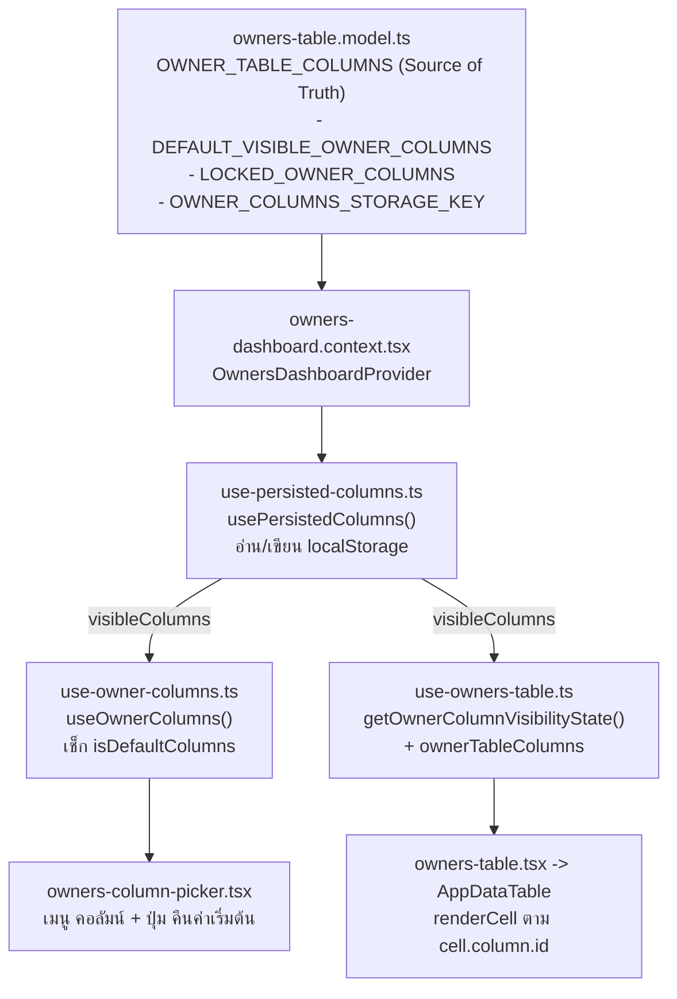

# Advisory Guide (4-1): วิธีเปลี่ยนคอลัมน์เริ่มต้น (Default Visible Columns) ในตาราง Owners

เอกสารนี้ตอบคำถาม **"หากต้องการเปลี่ยนคอลัมน์ที่แสดงเป็นค่าเริ่มต้น (Show by default) จาก `ความยินยอม PDPA` เป็น `วันที่ลงทะเบียน` ต้องทำอย่างไร"** พร้อมอธิบายกลไกการทำงานจริงในโค้ดปัจจุบัน จุดที่มักติดกับดัก (`localStorage` และลำดับคอลัมน์) และโค้ดฉบับสมบูรณ์สำหรับนำไปแก้ไขต่อด้วยตนเอง

> **ลำดับคอลัมน์เริ่มต้นเป้าหมาย (4 คอลัมน์หลัก + คอลัมน์จัดการขวาสุด):**
> 1. เจ้าของสัตว์เลี้ยง (`owner` — locked)
> 2. เบอร์โทรศัพท์ (`contact`)
> 3. สัตว์เลี้ยง (`pets`)
> 4. วันที่ลงทะเบียน (`createdAt`) *(แทนที่ ความยินยอม PDPA `pdpaConsent`)*

---

## 1. สรุปแนวทางที่แนะนำ (Recommendation)

ในสถาปัตยกรรมแบบ Declarative Configuration ของโมดูล Owners คอลัมน์ที่แสดงเป็นค่าเริ่มต้นถูกควบคุมจาก **Single Source of Truth เพียงจุดเดียว** คืออาเรย์ `OWNER_TABLE_COLUMNS` ใน [owners-table.model.ts](../../src/client/features/owners/models/owners-table.model.ts#L25-L49)

อย่างไรก็ตาม การแก้ให้สมบูรณ์ทั้ง UX และไม่ติด Cache ค้างบนเบราว์เซอร์ที่เคยเปิดหน้านี้แล้ว **แนะนำให้ทำ 2 ขั้นตอนหลัก (+ 1 จุดเสริม)** ดังนี้:

1. **สลับค่า `defaultVisible` และ Version ของ `localStorage` Key** ใน [owners-table.model.ts](../../src/client/features/owners/models/owners-table.model.ts#L25-L64):
   - ปรับ `pdpaConsent` จาก `defaultVisible: true` → `false`
   - ปรับ `createdAt` จาก `defaultVisible: false` → `true` (และย้ายขึ้นมาอยู่ลำดับที่ 4 ใน `OWNER_TABLE_COLUMNS` เพื่อให้ลำดับในเมนู `คอลัมน์` ตรงกับหน้าตาราง)
   - เปลี่ยน `OWNER_COLUMNS_STORAGE_KEY` จาก `.v1` → `.v2` เพื่อไม่ให้ค่าเก่าใน `localStorage` ของเบราว์เซอร์มาทับค่าเริ่มต้นใหม่
2. **(แนะนำควบคู่) จัดลำดับ `ownerTableColumns` ใน [use-owners-table.ts](../../src/client/features/owners/hooks/use-owners-table.ts#L50-L131):**
   - เลื่อนคอลัมน์ `createdAt` ขึ้นมาต่อจาก `pets` และกำหนด `meta: { headClassName: "min-w-32" }` เพื่อให้เวลาผู้ใช้เปิดคอลัมน์เสริมอื่น (เช่น `taxId`, `address`) เพิ่มเติมภายหลัง คอลัมน์หลักที่เปิดเป็นค่าเริ่มต้นยังคงเรียงเป็นกลุ่มหน้าสุดอย่างเป็นระเบียบ

> **ไม่ต้องแก้ `owners-table.tsx`:** เพราะการเรนเดอร์เซลล์ใน [owners-table.tsx](../../src/client/features/owners/components/dashboard/owners-table.tsx#L42-L225) ผูกกับ `cell.column.id === "createdAt"` และ `"pdpaConsent"` อยู่แล้ว เมื่อเปลี่ยน visibility หรือสลับลำดับคอลัมน์ เซลล์จะตามไปเรนเดอร์ได้ถูกต้องอัตโนมัติ

---

## 2. สิ่งที่ตรวจพบใน Repo & กลไกการทำงานจริง (Repository Evidence)

จากการตรวจสอบไฟล์จริงในโปรเจกต์ (`TypeScript 6.0.3`, `@tanstack/react-table ^9.3.1`, `zod ^4.6.7`) กลไก Column Visibility ทำงานเชื่อมโยงกัน 5 ส่วนดังนี้:



### จุดอ้างอิงในโค้ดจริงที่ตรวจสอบแล้ว

| ไฟล์ | บทบาทและข้อเท็จจริงที่พบ |
| :--- | :--- |
| [owners-table.model.ts](../../src/client/features/owners/models/owners-table.model.ts#L25-L64) | นิยาม `OWNER_TABLE_COLUMNS` ทั้ง 9 คอลัมน์ ปัจจุบัน `owner`, `contact` (`เบอร์โทรศัพท์`), `pets`, `pdpaConsent` มี `defaultVisible: true` ส่วน `createdAt` มี `defaultVisible: false` (บรรทัด `35` และ `48`) และคำนวณ `DEFAULT_VISIBLE_OWNER_COLUMNS` อัตโนมัติด้วย `.filter((col) => col.defaultVisible)` (บรรทัด `56-57`) |
| [owners-table.model.ts](../../src/client/features/owners/models/owners-table.model.ts#L63-L64) | กำหนด `OWNER_COLUMNS_STORAGE_KEY = "vet-care.owners.list-visible-columns.v1"` |
| [owners-table.model.ts](../../src/client/features/owners/models/owners-table.model.ts#L229-L241) | `getOwnerColumnVisibilityState(visibleColumns)` แปลงรายชื่อคอลัมน์เป็น `ColumnVisibilityState` (`Record<string, boolean>`) ให้ TanStack Table โดยล็อก `col.locked` (`owner`) และ `actions` เป็น `true` เสมอ |
| [use-persisted-columns.ts](../../src/client/shared/hooks/use-persisted-columns.ts#L56-L117) | ใช้ `DEFAULT_VISIBLE_OWNER_COLUMNS` เป็นค่าเริ่มต้นใน `useState` แต่ใน `useEffect` (บรรทัด `66-83`) จะอ่าน `window.localStorage.getItem(storageKey)` มาแทนที่ทันทีหากเคยบันทึกไว้ และ `normalizePersistedColumns` จะคงคีย์เก่าที่ยังอยู่ใน `OWNER_TABLE_COLUMNS` ไว้ทั้งหมด (บรรทัด `33-42`) |
| [owners-dashboard.context.tsx](../../src/client/features/owners/contexts/owners-dashboard.context.tsx#L21-L28) | ส่ง config จาก `owners-table.model.ts` เข้า `usePersistedColumns` แล้วกระจายให้ทั้ง `OwnersColumnPicker` และ `OwnersTable` ใช้ร่วมกัน |
| [use-owner-columns.ts](../../src/client/features/owners/hooks/use-owner-columns.ts#L16-L32) | ใช้ `OWNER_TABLE_COLUMNS` สร้างรายการ checkbox และเทียบ `visibleColumns` กับ `DEFAULT_VISIBLE_OWNER_COLUMNS` เพื่อคำนวณ `isDefaultColumns` (คุมสถานะ disabled ของปุ่ม `"คืนค่าเริ่มต้น"`) |
| [use-owners-table.ts](../../src/client/features/owners/hooks/use-owners-table.ts#L50-L181) | นิยาม `ownerTableColumns` ของ TanStack Table `useTable` ซึ่งกำหนด **ลำดับการเรียงคอลัมน์จากซ้ายไปขวาในตารางจริง** (ปัจจุบัน `createdAt` อยู่ที่ index 8 บรรทัด `113-117` ถัดจาก `acquisitionChannel`) |
| [owners-table.tsx](../../src/client/features/owners/components/dashboard/owners-table.tsx#L103-L215) | `renderCell` ตรวจจาก `cell.column.id` (`"pets"`, `"pdpaConsent"`, `"createdAt"`, ...) และเรียก `rowView.createdAtLabel` ที่เตรียมไว้แล้วใน `useOwnersTable` บรรทัด `200` |

### 2 กับดักสำคัญที่ต้องรู้ก่อนแก้

1. **กับดักที่ 1 — ทำไมแก้ `defaultVisible` แล้วหน้าเว็บเครื่องเราอาจยังไม่เปลี่ยน (`localStorage` Cache Override):**
   - ดูที่ [use-persisted-columns.ts](../../src/client/shared/hooks/use-persisted-columns.ts#L66-L110): เมื่อไรก็ตามที่คุณหรือผู้ใช้เคยคลิกเลือก/ซ่อนคอลัมน์ หรือกดปุ่ม `"คืนค่าเริ่มต้น"` เบราว์เซอร์จะเขียนค่า `"[\"owner\",\"contact\",\"pets\",\"pdpaConsent\"]"` ลง `localStorage` ภายใต้คีย์ `vet-care.owners.list-visible-columns.v1`
   - เพราะ `pdpaConsent` ยังคงเป็นคอลัมน์ที่ถูกต้อง (`validKeys.has("pdpaConsent") === true`) ฟังก์ชัน `normalizePersistedColumns` จึงไม่ถือว่าค่าใน `localStorage` เสีย และจะเอาชุดเก่าใน `localStorage` มาทับค่าเริ่มต้นใหม่ทุกครั้งหลัง mount
   - **วิธีแก้ขาด:** เปลี่ยน suffix ของ `OWNER_COLUMNS_STORAGE_KEY` จาก `.v1` เป็น `.v2` (หรือสำหรับเครื่อง Dev เองสามารถกดปุ่ม `"คืนค่าเริ่มต้น"` ในเมนูคอลัมน์ / ล้าง `localStorage` เพื่อทดสอบได้)
2. **กับดักที่ 2 — ลำดับในเมนูคอลัมน์ vs ลำดับในตารางจริง:**
   - ในตอนแรกที่เปิดเฉพาะ 4 คอลัมน์ (`owner`, `contact`, `pets`, `createdAt`) คอลัมน์ `createdAt` จะแสดงเป็นคอลัมน์ที่ 4 ต่อจาก `pets` อยู่แล้วเพราะคอลัมน์กลาง (`pdpaConsent` ถึง `acquisitionChannel`) ถูกซ่อนไว้
   - แต่ถ้าผู้ใช้ติ๊กเปิด `เลขผู้เสียภาษี` หรือ `ความยินยอม PDPA` เพิ่มขึ้นมา:
     - หากไม่ย้ายตำแหน่งใน `ownerTableColumns` ([use-owners-table.ts](../../src/client/features/owners/hooks/use-owners-table.ts#L50-L131)) คอลัมน์ `วันที่ลงทะเบียน` จะถูกดันไปอยู่ท้ายสุดหลัง `ช่องทางที่รู้จักคลินิก`
     - หากไม่ย้ายตำแหน่งใน `OWNER_TABLE_COLUMNS` ([owners-table.model.ts](../../src/client/features/owners/models/owners-table.model.ts#L25-L49)) เมนู Dropdown `คอลัมน์` จะแสดง `วันที่ลงทะเบียน` อยู่บรรทัดล่างสุด ไม่ได้จับกลุ่มอยู่กับ 4 คอลัมน์เริ่มต้น

---

## 3. เปรียบเทียบทางเลือกและ Trade-offs

| ทางเลือก | สิ่งที่ต้องแก้ | ข้อดี (Pros) | ข้อเสีย / ข้อควรระวัง (Cons) |
| :--- | :--- | :--- | :--- |
| **A. แก้เฉพาะ `defaultVisible` (ไม่แตะ Key และลำดับ)** | เปลี่ยน `defaultVisible` 2 บรรทัดใน `owners-table.model.ts` | - แก้น้อยที่สุด (Minimal diff)<br>- ไม่รีเซ็ตการตั้งค่าคอลัมน์ส่วนตัวของผู้ใช้ที่เคยปรับไว้ก่อนหน้า | - เครื่องที่เคยกด toggle คอลัมน์ไว้ใน `.v1` จะยังเห็น `ความยินยอม PDPA` จนกว่าจะกด `"คืนค่าเริ่มต้น"`<br>- ลำดับ `createdAt` ยังอยู่ท้ายสุดในเมนูและเมื่อเปิดคอลัมน์อื่นเพิ่ม |
| **B. แก้ `defaultVisible` + Bump Storage Key เป็น `.v2` + จัดลำดับใน `OWNER_TABLE_COLUMNS` และ `ownerTableColumns` *(แนะนำ)*** | แก้ `owners-table.model.ts` + ปรับลำดับคอลัมน์ใน `use-owners-table.ts` | - Rollout ให้ทุกเบราว์เซอร์เห็น 4 คอลัมน์เริ่มต้นใหม่ทันที 100%<br>- ลำดับใน Dropdown `คอลัมน์` และตำแหน่งคอลัมน์จริงในตารางสอดคล้องกัน<br>- ยังไม่กระทบ Shared Hook (`usePersistedColumns`) | - ค่าคอลัมน์ที่ผู้ใช้เดิมเคยปรับไว้ใน `.v1` จะถูกรีเซ็ตกลับเป็นค่าเริ่มต้นชุดใหม่ 1 ครั้ง *(เหมาะสมมากในช่วงพัฒนา/เปลี่ยนมาตรฐานเริ่มต้น)* |
| **C. เก็บ `.v1` แต่เขียน Migration ใน `usePersistedColumns`** | เพิ่ม versioned migration callback ใน `client/shared/hooks/use-persisted-columns.ts` | - เลือก migrate เฉพาะคนที่ยังใช้ชุด default เก่าได้ | - Over-engineering และเพิ่มภาระดูแล Shared Primitive ที่โมดูล `Pets` จะนำไปใช้ร่วม |

**คำแนะนำ:** เลือก **ทางเลือก B** เพราะโปรเจกต์ยังอยู่ในช่วงพัฒนาและทดสอบฟีเจอร์ การ bump `.v2` พร้อมจัดลำดับทั้งใน Model และ Table Hook ให้สอดคล้องกันช่วยป้องกันปัญหา Dev/QA เห็นผลไม่ตรงกันและให้ UX ที่เป็นธรรมชาติที่สุด

---

## 4. ขั้นตอนดำเนินการทีละขั้น (Step-by-Step Implementation)

### ขั้นตอนที่ 1: ปรับ Config คอลัมน์และ Storage Key ใน `owners-table.model.ts`

- **Action:**
  1. ย้าย `{ key: "createdAt", label: "วันที่ลงทะเบียน", defaultVisible: true }` ขึ้นมาอยู่ต่อจาก `pets` (ลำดับที่ 4 ของอาเรย์ `OWNER_TABLE_COLUMNS`)
  2. เปลี่ยน `{ key: "pdpaConsent", label: "ความยินยอม PDPA", defaultVisible: false }`
  3. เปลี่ยน `OWNER_COLUMNS_STORAGE_KEY` จาก `"vet-care.owners.list-visible-columns.v1"` เป็น `"vet-care.owners.list-visible-columns.v2"`
- **Location / Boundary:** `src/client/features/owners/models/owners-table.model.ts` (ชั้น View Model ประจำ Feature `owners`)
- **Why:**
  - `DEFAULT_VISIBLE_OWNER_COLUMNS` คำนวณจาก `OWNER_TABLE_COLUMNS.filter((col) => col.defaultVisible)` โดยอัตโนมัติ จึงเปลี่ยนค่าเริ่มต้นจาก `["owner", "contact", "pets", "pdpaConsent"]` เป็น `["owner", "contact", "pets", "createdAt"]` ได้โดยไม่ซ้ำซ้อน
  - การปรับ key เป็น `.v2` ทำให้ `usePersistedColumns` เริ่มต้นด้วยชุดคอลัมน์ใหม่บนทุกเบราว์เซอร์ทันที
- **Expected Outcome:** เมนู `คอลัมน์` และสถานะเริ่มต้นของตารางสลับจาก `ความยินยอม PDPA` เป็น `วันที่ลงทะเบียน` รวมถึงปุ่ม `"คืนค่าเริ่มต้น"` จะคืนค่าเป็น 4 คอลัมน์ใหม่นี้เสมอ

#### โค้ดผลลัพธ์ฉบับสมบูรณ์: `src/client/features/owners/models/owners-table.model.ts`

```ts
import type { ColumnVisibilityState } from "@tanstack/react-table";
import type { TableColumnDefinition } from "#/client/shared/hooks/use-persisted-columns";
import type {
	AcquisitionChannelDto,
	OwnerAddressDto,
	OwnerConsentsDto,
	OwnerGenderDto,
	OwnerListItem,
	OwnerPrefixDto,
	OwnerSummaryAddressDto,
	OwnerTypeDto,
} from "#/shared/schemas/owners.schema";

export type OwnerColumnKey =
	| "owner"
	| "contact"
	| "pets"
	| "pdpaConsent"
	| "taxId"
	| "additionalContacts"
	| "address"
	| "acquisitionChannel"
	| "createdAt";

export const OWNER_TABLE_COLUMNS: readonly TableColumnDefinition<OwnerColumnKey>[] =
	[
		{
			key: "owner",
			label: "เจ้าของสัตว์เลี้ยง",
			locked: true,
			defaultVisible: true,
		},
		{ key: "contact", label: "เบอร์โทรศัพท์", defaultVisible: true },
		{ key: "pets", label: "สัตว์เลี้ยง", defaultVisible: true },
		{ key: "createdAt", label: "วันที่ลงทะเบียน", defaultVisible: true },
		{ key: "pdpaConsent", label: "ความยินยอม PDPA", defaultVisible: false },
		{ key: "taxId", label: "เลขผู้เสียภาษี", defaultVisible: false },
		{
			key: "additionalContacts",
			label: "ช่องทางติดต่อเพิ่มเติม",
			defaultVisible: false,
		},
		{ key: "address", label: "ที่อยู่", defaultVisible: false },
		{
			key: "acquisitionChannel",
			label: "ช่องทางที่รู้จักคลินิก",
			defaultVisible: false,
		},
	] as const;

export const OWNER_COLUMN_LABEL_MAP: Record<OwnerColumnKey, string> =
	Object.fromEntries(
		OWNER_TABLE_COLUMNS.map((col) => [col.key, col.label]),
	) as Record<OwnerColumnKey, string>;

export const DEFAULT_VISIBLE_OWNER_COLUMNS: readonly OwnerColumnKey[] =
	OWNER_TABLE_COLUMNS.filter((col) => col.defaultVisible).map((col) => col.key);

export const LOCKED_OWNER_COLUMNS: ReadonlySet<OwnerColumnKey> = new Set(
	OWNER_TABLE_COLUMNS.filter((col) => col.locked).map((col) => col.key),
);

export const OWNER_COLUMNS_STORAGE_KEY =
	"vet-care.owners.list-visible-columns.v2";

export const OWNER_TYPE_LABEL_MAP: Record<OwnerTypeDto, string> = {
	INDIVIDUAL: "บุคคลธรรมดา",
	JURISTIC: "นิติบุคคล",
};

export const PREFIX_LABEL_MAP: Record<OwnerPrefixDto, string> = {
	MR: "นาย",
	MRS: "นาง",
	MS: "นางสาว",
	COMMERCIAL: "บริษัท / ห้างหุ้นส่วน",
	NON_PROFIT: "มูลนิธิ / สมาคม",
	OTHER: "นิติบุคคลอื่น ๆ",
};

export const GENDER_LABEL_MAP: Record<OwnerGenderDto, string> = {
	MALE: "ชาย",
	FEMALE: "หญิง",
	NOT_SPECIFIED: "ไม่ระบุ",
};

export const ACQUISITION_CHANNEL_LABEL_MAP: Record<
	AcquisitionChannelDto,
	string
> = {
	WALK_IN: "มาที่คลินิกโดยตรง",
	LINE_OA: "LINE OA",
	WEB_PORTAL: "เว็บไซต์",
	REFERRAL: "คนรู้จักแนะนำ",
	SOCIAL_MEDIA: "โซเชียลมีเดีย",
	CAMPAIGN: "แคมเปญ / โฆษณา",
};

export interface PdpaConsentItem {
	key: keyof OwnerConsentsDto;
	label: string;
	granted: boolean;
}

export interface PdpaConsentSummary {
	grantedCount: number;
	totalCount: number;
	isFullConsent: boolean;
	badgeLabel: string;
	items: readonly PdpaConsentItem[];
}

export type OwnerDisplayIdentity = {
	ownerType: OwnerTypeDto;
	prefix: OwnerPrefixDto;
	firstName: string;
	lastName: string | null;
};

export function hasNonEmptyText(
	value: string | null | undefined,
): value is string {
	return typeof value === "string" && value.trim().length > 0;
}

export function getOwnerDisplayName(owner: OwnerDisplayIdentity): string {
	if (owner.ownerType === "JURISTIC") {
		return owner.firstName.trim();
	}

	const parts = [
		PREFIX_LABEL_MAP[owner.prefix],
		owner.firstName,
		owner.lastName ?? "",
	];
	return parts.filter((part) => part.trim().length > 0).join(" ");
}

export function getOwnerInitials(owner: {
	firstName: string;
	lastName: string | null;
}): string {
	const first = Array.from(owner.firstName.trim())[0] ?? "";
	const last = Array.from((owner.lastName ?? "").trim())[0] ?? "";

	if (first && last) {
		return `${first}${last}`.toUpperCase();
	}

	const compact = Array.from(owner.firstName.replace(/\s+/g, ""));
	return compact.slice(0, 2).join("").toUpperCase() || "จข";
}

export function getPdpaConsentSummary(
	consents: OwnerConsentsDto,
): PdpaConsentSummary {
	const items: readonly PdpaConsentItem[] = [
		{
			key: "privacyPolicy",
			label: "นโยบายความเป็นส่วนตัว",
			granted: consents.privacyPolicy,
		},
		{
			key: "appointment",
			label: "แจ้งเตือนนัดหมายและวัคซีน",
			granted: consents.appointment,
		},
		{
			key: "marketing",
			label: "ข่าวสารและโปรโมชัน",
			granted: consents.marketing,
		},
		{
			key: "media",
			label: "ภาพถ่ายและสื่อประชาสัมพันธ์",
			granted: consents.media,
		},
		{
			key: "research",
			label: "ข้อมูลเพื่อการวิจัยทางสัตวแพทย์",
			granted: consents.research,
		},
	];

	const grantedCount = items.filter((item) => item.granted).length;
	const totalCount = items.length;
	const isFullConsent = grantedCount === totalCount;

	return {
		grantedCount,
		totalCount,
		isFullConsent,
		badgeLabel: isFullConsent
			? "ยินยอมครบทุกข้อ"
			: `ยินยอมบางส่วน (${grantedCount}/${totalCount})`,
		items,
	};
}

export function formatAddressArea(
	address: OwnerSummaryAddressDto | OwnerAddressDto | null | undefined,
): string {
	if (!address) return "";
	return [address.district, address.province]
		.filter((part) => part.trim().length > 0)
		.join(", ");
}

export function formatFullAddress(
	address: OwnerSummaryAddressDto | OwnerAddressDto | null | undefined,
): string {
	if (!address) return "—";
	const parts = [
		address.addressLine,
		address.subdistrict,
		address.district,
		address.province,
		address.postalCode,
	].filter((part) => part.trim().length > 0);
	return parts.length > 0 ? parts.join(", ") : "—";
}

export function formatAcquisitionChannelLabel(
	channel: AcquisitionChannelDto | null | undefined,
): string {
	if (!channel) return "—";
	return ACQUISITION_CHANNEL_LABEL_MAP[channel];
}

export function getOwnerColumnVisibilityState(
	visibleColumns: readonly OwnerColumnKey[],
): ColumnVisibilityState {
	const visibleSet = new Set<OwnerColumnKey>(visibleColumns);
	const visibility: ColumnVisibilityState = {};

	for (const col of OWNER_TABLE_COLUMNS) {
		visibility[col.key] = col.locked ? true : visibleSet.has(col.key);
	}
	visibility.actions = true;

	return visibility;
}

export function getOwnerTaxIdCopyHint(owner: OwnerListItem): boolean {
	return !owner.taxId.includes("X");
}
```

---

### ขั้นตอนที่ 2: จัดลำดับ Column Definition ใน `use-owners-table.ts` ให้ตรงกัน

- **Action:**
  1. ย้าย `ownerColumnHelper.accessor("createdAt", ...)` ใน `ownerTableColumns` ขึ้นมาต่อจาก `pets` (ลำดับที่ 4 ของตาราง)
  2. เพิ่ม `meta: { headClassName: "min-w-32" }` ให้ `createdAt` เพื่อกันหัวคอลัมน์หรือวันที่แบบไทย (`26 พ.ย. 2569`) ถูกบีบแคบเกินไปเมื่อมีหลายคอลัมน์
- **Location / Boundary:** `src/client/features/owners/hooks/use-owners-table.ts` (ชั้น Table Hook ของ Feature `owners`)
- **Why:** TanStack Table อ้างอิงลำดับซ้าย-ขวาของคอลัมน์บนตารางจากลำดับสมาชิกใน `ownerTableColumns` ไม่ใช่จาก `OWNER_TABLE_COLUMNS` หากผู้ใช้เปิดคอลัมน์ `ความยินยอม PDPA` หรือ `ที่อยู่` เพิ่มในภายหลัง `วันที่ลงทะเบียน` จะยังคงอยู่ที่ตำแหน่งที่ 4 หน้าคอลัมน์เสริมเสมอ
- **Expected Outcome:** ลำดับคอลัมน์ทั้งตอนเปิดเฉพาะค่าเริ่มต้น และตอนเปิดคอลัมน์เสริมเพิ่มเติม ตรงกับลำดับในเมนู `คอลัมน์` 100%

#### โค้ดผลลัพธ์ฉบับสมบูรณ์: `src/client/features/owners/hooks/use-owners-table.ts`

```ts
import type {
	ColumnVisibilityState,
	OnChangeFn,
	PaginationState,
} from "@tanstack/react-table";
import { functionalUpdate, useTable } from "@tanstack/react-table";
import { useCallback, useMemo } from "react";
import {
	createAppColumnHelper,
	dataTableFeatures,
} from "#/client/shared/components/app-data-table";
import {
	formatPhoneNumber,
	formatRegisteredDate,
	formatTaxId,
} from "#/client/shared/helpers/formatters";
import type { OwnerListItem } from "#/shared/schemas/owners.schema";
import { useOwnersDashboardContext } from "../contexts/owners-dashboard.context";
import {
	formatAcquisitionChannelLabel,
	formatAddressArea,
	formatFullAddress,
	getOwnerColumnVisibilityState,
	getOwnerDisplayName,
	getOwnerInitials,
	getOwnerTaxIdCopyHint,
	hasNonEmptyText,
	OWNER_COLUMN_LABEL_MAP,
} from "../models/owners-table.model";
import { useOwnerClipboard } from "./use-owner-clipboard";
import { useOwnersList } from "./use-owners-list";
import { useOwnersSearch } from "./use-owners-search";

export interface OwnerTableRowPresentation {
	readonly displayName: string;
	readonly initials: string;
	readonly isJuristic: boolean;
	readonly formattedPhone: string;
	readonly formattedTaxId: string;
	readonly canCopyFullTaxId: boolean;
	readonly hasAdditionalContact: boolean;
	readonly addressAreaLabel: string;
	readonly fullAddressLabel: string;
	readonly acquisitionChannelLabel: string;
	readonly createdAtLabel: string;
}

const ownerColumnHelper = createAppColumnHelper<OwnerListItem>();

const ownerTableColumns = ownerColumnHelper.columns([
	ownerColumnHelper.accessor((row) => getOwnerDisplayName(row), {
		id: "owner",
		header: OWNER_COLUMN_LABEL_MAP.owner,
		enableSorting: false,
		enableHiding: false,
		meta: {
			headClassName: "min-w-52",
		},
	}),
	ownerColumnHelper.display({
		id: "contact",
		header: OWNER_COLUMN_LABEL_MAP.contact,
		enableSorting: false,
		meta: {
			headClassName: "min-w-44",
		},
	}),
	ownerColumnHelper.display({
		id: "pets",
		header: OWNER_COLUMN_LABEL_MAP.pets,
		enableSorting: false,
	}),
	ownerColumnHelper.accessor("createdAt", {
		id: "createdAt",
		header: OWNER_COLUMN_LABEL_MAP.createdAt,
		enableSorting: false,
		meta: {
			headClassName: "min-w-32",
		},
	}),
	ownerColumnHelper.display({
		id: "pdpaConsent",
		header: OWNER_COLUMN_LABEL_MAP.pdpaConsent,
		enableSorting: false,
		meta: {
			headClassName: "min-w-36",
		},
	}),
	ownerColumnHelper.accessor("taxId", {
		id: "taxId",
		header: OWNER_COLUMN_LABEL_MAP.taxId,
		enableSorting: false,
		meta: {
			headClassName: "min-w-44",
		},
	}),
	ownerColumnHelper.display({
		id: "additionalContacts",
		header: OWNER_COLUMN_LABEL_MAP.additionalContacts,
		enableSorting: false,
		meta: {
			headClassName: "min-w-48",
		},
	}),
	ownerColumnHelper.display({
		id: "address",
		header: OWNER_COLUMN_LABEL_MAP.address,
		enableSorting: false,
		meta: {
			headClassName: "min-w-44",
		},
	}),
	ownerColumnHelper.accessor("acquisitionChannel", {
		id: "acquisitionChannel",
		header: OWNER_COLUMN_LABEL_MAP.acquisitionChannel,
		enableSorting: false,
		meta: {
			headClassName: "min-w-40",
		},
	}),
	ownerColumnHelper.display({
		id: "actions",
		header: "การดำเนินการ",
		enableSorting: false,
		enableHiding: false,
		meta: {
			headerSrOnly: true,
			headClassName:
				"sticky right-0 z-10 w-0 p-0 pointer-coarse:w-auto pointer-coarse:px-3",
			cellClassName:
				"sticky right-0 z-10 w-0 p-0 text-right align-middle pointer-coarse:w-auto pointer-coarse:px-3",
		},
	}),
]);

export function useOwnersTable() {
	const { apiSearch, updateSearch } = useOwnersSearch();
	const { owners, totalItems, totalPages, isPending, isPlaceholderData } =
		useOwnersList();
	const { visibleColumns } = useOwnersDashboardContext();
	const { copyPhone, isPhoneCopied, copyTaxId, isTaxIdCopied } =
		useOwnerClipboard();

	const pagination = useMemo<PaginationState>(
		() => ({
			pageIndex: Math.max(0, apiSearch.page - 1),
			pageSize: apiSearch.limit,
		}),
		[apiSearch.page, apiSearch.limit],
	);

	const columnVisibility = useMemo<ColumnVisibilityState>(
		() => getOwnerColumnVisibilityState(visibleColumns),
		[visibleColumns],
	);

	const onPaginationChange: OnChangeFn<PaginationState> = useCallback(
		(updater) => {
			const next = functionalUpdate(updater, pagination);
			const isPageSizeChanged = next.pageSize !== pagination.pageSize;

			updateSearch({
				page: isPageSizeChanged ? 1 : next.pageIndex + 1,
				limit: next.pageSize,
			});
		},
		[pagination, updateSearch],
	);

	const table = useTable({
		features: dataTableFeatures,
		columns: ownerTableColumns,
		data: owners,
		manualPagination: true,
		rowCount: totalItems,
		pageCount: Math.max(1, totalPages),
		autoResetPageIndex: false,
		state: {
			pagination,
			columnVisibility,
		},
		onPaginationChange,
		getRowId: (row) => String(row.ownerId),
	});

	const rowPresentationById = useMemo(() => {
		const map = new Map<number, OwnerTableRowPresentation>();
		for (const owner of owners) {
			map.set(owner.ownerId, {
				displayName: getOwnerDisplayName(owner),
				initials: getOwnerInitials(owner),
				isJuristic: owner.ownerType === "JURISTIC",
				formattedPhone: formatPhoneNumber(owner.phoneNumber),
				formattedTaxId: formatTaxId(owner.taxId),
				canCopyFullTaxId: getOwnerTaxIdCopyHint(owner),
				hasAdditionalContact:
					hasNonEmptyText(owner.lineId) || hasNonEmptyText(owner.email),
				addressAreaLabel: formatAddressArea(owner.defaultAddress),
				fullAddressLabel: formatFullAddress(owner.defaultAddress),
				acquisitionChannelLabel: formatAcquisitionChannelLabel(
					owner.acquisitionChannel,
				),
				createdAtLabel: formatRegisteredDate(owner.createdAt),
			});
		}
		return map;
	}, [owners]);

	const getRowPresentation = useCallback(
		(owner: OwnerListItem): OwnerTableRowPresentation =>
			rowPresentationById.get(owner.ownerId) ?? {
				displayName: getOwnerDisplayName(owner),
				initials: getOwnerInitials(owner),
				isJuristic: owner.ownerType === "JURISTIC",
				formattedPhone: formatPhoneNumber(owner.phoneNumber),
				formattedTaxId: formatTaxId(owner.taxId),
				canCopyFullTaxId: getOwnerTaxIdCopyHint(owner),
				hasAdditionalContact:
					hasNonEmptyText(owner.lineId) || hasNonEmptyText(owner.email),
				addressAreaLabel: formatAddressArea(owner.defaultAddress),
				fullAddressLabel: formatFullAddress(owner.defaultAddress),
				acquisitionChannelLabel: formatAcquisitionChannelLabel(
					owner.acquisitionChannel,
				),
				createdAtLabel: formatRegisteredDate(owner.createdAt),
			},
		[rowPresentationById],
	);

	return {
		table,
		isPending,
		isFetchingPlaceholder: isPlaceholderData,
		getRowPresentation,
		copyPhone,
		isPhoneCopied,
		copyTaxId,
		isTaxIdCopied,
	};
}
```

---

## 5. การทบทวน 4 มุมมองทางวิศวกรรม (Four Engineering Angles)

| มุมมอง | ผลการประเมินและข้อสังเกต |
| :--- | :--- |
| **Correctness** | - `DEFAULT_VISIBLE_OWNER_COLUMNS`, `OWNER_COLUMN_LABEL_MAP`, `getOwnerColumnVisibilityState`, และ `useOwnerColumns` คำนวณจาก `OWNER_TABLE_COLUMNS` ทั้งหมด จึงสอดคล้องกันโดยอัตโนมัติ<br>- SSR Hydration ปลอดภัย เพราะ `usePersistedColumns` เริ่ม `useState` ด้วย `DEFAULT_VISIBLE_OWNER_COLUMNS` ทั้งฝั่ง SSR และ Client แล้วจึง sync `localStorage` ใน `useEffect` (มี `try/catch` รองรับ Private Mode)<br>- หมายเหตุสำหรับ Mobile (`MobileView`): หน้าจอขนาดเล็กใช้ Layout แบบ Card เฉพาะตัว ไม่ได้ผูกกับ Column Visibility ของตาราง Desktop จึงไม่ได้รับผลกระทบ |
| **Performance** | - ไม่มีการยิง Network Request เพิ่มเติม เพราะ `createdAt` ถูกส่งมาใน `OwnerListItem` (`GET /api/v1/owners`) อยู่แล้ว<br>- `rowPresentationById` ฟอร์แมต `createdAtLabel` ด้วย `formatRegisteredDate` สำหรับแถวในหน้าปัจจุบัน (`useMemo` บน `[owners]`) อยู่แล้ว ไม่เกิดการคำนวณซ้ำ |
| **Security** | - คอลัมน์ `createdAt` แสดงเฉพาะวันที่ลงทะเบียน ไม่ใช่ข้อมูลส่วนบุคคลอ่อนไหว (และลดการเปิดเผยสรุปความยินยอม PDPA บนตารางตั้งต้น)<br>- การเปิดดู/แก้ไข PDPA ยังเข้าถึงได้ตามสิทธิ์เดิมผ่าน Dropdown `คอลัมน์` (เลือกเปิด `ความยินยอม PDPA`) และหน้า `/owners/$ownerId` ไม่มีการเปลี่ยน auth/trust boundary |
| **Maintainability** | - จำกัดการแก้ไขไว้เฉพาะชั้น `models/` และ `hooks/` ภายใน Feature `owners` ไม่แตะ Shared Layer (`usePersistedColumns`, `AppDataTable`) และไม่ต้องแก้ UI Component (`owners-table.tsx`, `owners-column-picker.tsx`)<br>- ปัญหาเพียงเล็กน้อยที่ต้องรับทราบคือการใช้ `v2` จะล้างการตั้งค่าคอลัมน์ที่ผู้ใช้เก่าเคยบันทึกไว้ใน `v1` 1 ครั้ง (ไม่มีผลกับ `Pets` ในอนาคตเพราะคนละ storage key) |

---

## 6. สถานะการตรวจสอบ (Validation Status) & วิธีเช็กผลหลังลงมือทำ

### สถานะ Baseline ปัจจุบัน (ตรวจสอบแบบ Read-only ก่อนแก้ไฟล์)
- ตรวจโค้ดเดิมทั้งหมดด้วย `bun node_modules/typescript/bin/tsc --noEmit --incremental false` → ผ่าน (`0` errors)
- **หมายเหตุ:** เอกสารนี้เป็นการให้คำแนะนำเชิงอ่านอย่างเดียว ไม่ได้แก้ไขไฟล์ใดๆ ใน `src/` ดังนั้นโค้ดตัวอย่างในหัวข้อที่ 4 ยังไม่ได้ถูกรัน `tsc` หรือ `biome check` บนไฟล์จริงของโปรเจกต์

### คำสั่งตรวจสอบหลังคุณนำโค้ดไปแก้ลงไฟล์จริงแล้ว

```bash
# 1. ตรวจจัดรูปและกฎ Biome ของโมดูล owners
bun x biome check src/client/features/owners

# 2. ตรวจ Type Safety ทั้งโปรเจกต์
bun node_modules/typescript/bin/tsc --noEmit --incremental false
```

### รายการทดสอบบนเบราว์เซอร์ (`bun run dev` → `/owners`)
1. เปิดหน้า `/owners` บนจอ Desktop:
   - ตารางต้องแสดง 4 คอลัมน์เรียงจากซ้ายไปขวา: **เจ้าของสัตว์เลี้ยง → เบอร์โทรศัพท์ → สัตว์เลี้ยง → วันที่ลงทะเบียน** (พร้อมปุ่ม action ขวาสุด)
2. คลิกปุ่ม **`คอลัมน์`** บน Toolbar:
   - Badge จำนวนคอลัมน์ต้องแสดงเลข **`4`**
   - รายการที่ติ๊กเลือกอยู่คือ 4 คอลัมน์ด้านบน โดย `เจ้าของสัตว์เลี้ยง` มีไอคอนล็อก (`disabled`)
   - ปุ่ม **`คืนค่าเริ่มต้น`** ต้องอยู่ในสถานะ disabled (`isDefaultColumns === true`)
3. ทดลองติ๊กเปิด **`ความยินยอม PDPA`** และ **`ที่อยู่`** เพิ่ม:
   - Badge เปลี่ยนเป็น `6`, คอลัมน์ `วันที่ลงทะเบียน` ยังอยู่ตำแหน่งที่ 4 นำหน้าคอลัมน์ที่เปิดเพิ่ม, และกด **`คืนค่าเริ่มต้น`** แล้วต้องกลับมาเหลือ 4 คอลัมน์ใหม่ตามลำดับเดิมพร้อมบันทึก key `vet-care.owners.list-visible-columns.v2` ใน DevTools → Application → Local Storage
