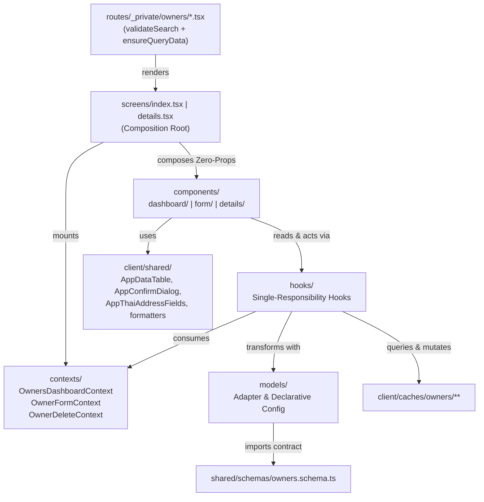

# Development Roadmap (Part 4): Frontend UI, Multi-Step Form & Routes สำหรับโมดูล Owners (เชื่อม Real API + ต้นแบบสำหรับ Pets)

เอกสารนี้คือ **คู่มือพิมพ์เขียวการพัฒนา (Implementation Blueprint)** สำหรับสร้างชั้น **`client/features/owners/**`**, **`routes/_private/owners/**`** และ **Shared UI Primitives (`client/shared/**`)** ในโปรเจกต์ `vet-care` ตั้งแต่ต้นจนจบ โดยมีเป้าหมาย 4 ประการร่วมกัน:

1. **เชื่อมต่อ Backend API จริงครบทั้ง 5 Operations** (`List`, `Get By ID`, `Register`, `Update`, `Delete`) ผ่าน `client/caches/owners/**` ที่วางโครงสร้างไว้แล้วใน [docs/owners/3.md](./3.md)
2. **คง Layout และ Visual Design Language เดียวกับต้นแบบ `vet-clinic-web`** ([owners.screen.tsx](../../../vet-clinic-web/src/client/features/reception/owners/screen/owners.screen.tsx), [owner-details.screen.tsx](../../../vet-clinic-web/src/client/features/reception/owners/screen/owner-details.screen.tsx) และ Multi-Step Sheet Form) โดยเปลี่ยนส่วนที่ยังไม่มี API (`RecentVisits`, `NewCustomers`, คอลัมน์/แท็บ `สัตว์เลี้ยง`, `นัดหมาย`, `การชำระเงิน`) เป็น Empty / Upcoming State ที่สะอาด
3. **ขจัด Code Smells และข้อจำกัดของ Repo เก่าทั้งหมด** ให้ผ่านกฎของ Repo นี้ 100%:
   - [architecture.md](../../.agents/rules/architecture.md) — แยก Boundary ชัดเจน (`Route -> Screen -> Context/Hook -> Cache -> Server Function`)
   - [globals.md](../../.agents/rules/globals.md) — Shared Contract จาก `shared/schemas/**`, แยก `import type`, ห้าม Barrel File, ห้าม Namespace Import
   - [client.md](../../.agents/rules/client.md) — **Zero Props Architecture** บน Feature Components, Logic อยู่ใน `hooks/*.ts` เท่านั้น, 1 Component ต่อ 1 ไฟล์, ห้ามใส่ `border-*`/`ring-*` โดยพลการใน Feature UI, ห้ามใช้ Emoji
   - [biome.json](../../biome.json) — `separatedType`, `noBarrelFile`, `noNamespaceImport`, `useImportsFirst`, `useTailwindSortedClasses`
4. **วาง Separation of Concern และ Design Patterns ที่พร้อมถอดแบบไปสร้างโมดูล `Pets`** ในอนาคตได้อย่างเป็นระบบโดยไม่ต้องรื้อโครงสร้างใหม่

> **หมายเหตุสำคัญก่อนลงมือทำ:**
> - **อย่าเพิ่งแก้ไฟล์ใน `server/` หรือ `shared/schemas/owners.schema.ts`:** ชั้น Backend + ACL + Caches ทำงานครบแล้วตาม [1.md](./1.md)–[3.md](./3.md)
> - **ทำตามทีละ Phase:** แต่ละ Phase มีคำอธิบาย "ทำไมต้องออกแบบแบบนี้" ควบคู่กับ **โค้ดฉบับสมบูรณ์ 100%** และจุดตรวจท้ายบทเพื่อให้คุณลงมือพิมพ์/วางโค้ดและเรียนรู้ได้ทีละขั้น

---

## 0. วิเคราะห์ความต่างจาก Repo เก่า & สถาปัตยกรรมเป้าหมาย

### 0.1 แก้ไข Gap และ Code Smells จาก `vet-clinic-web` สู่ `vet-care`

| ประเด็น | สิ่งที่ทำไว้ใน `vet-clinic-web` (เก่า) | ปัญหา / Gap เมื่อเทียบกับ Real API & กฎ `vet-care` | แนวทางแก้ไขใน `vet-care` (ใหม่) |
| :--- | :--- | :--- | :--- |
| **การค้นหา & แบ่งหน้า** | ดึงรายชื่อทั้งหมดมา filter & paginate ใน Browser | Backend API จริง (`GET /api/v1/owners`) เป็น **Server-side Pagination & Filtering** ผ่าน `OwnersSearchParams` (`page`, `limit`, `search`, `ownerType`, `acquisitionChannel`, `sort`) | ผูก Toolbar (`Search`, `Quick Filters`, `Sort`) และ `AppDataTable` (`manualPagination`, `rowCount`) เข้ากับ URL Search Params + Route `loader` |
| **Route Search vs Query Key** | ผสม UI state ใน search schema เดียว | หากใส่ `openAddNewForm` / `editOwnerId` ลงใน `ownersSearchParamsSchema` (`shared/schemas/`) จะผิดกฎ `globals.md` ข้อ 4 และทำให้เปิด/ปิด Sheet แล้ว `ownersKeys.list` ยิง API ซ้ำ | แยก `ownersRouteSearchSchema` ไว้ใน `client/features/owners/models/` และใช้ `loaderDeps` คัดเฉพาะ `OwnersSearchParams` ส่งเข้า `ownersListQuery` |
| **ข้อมูลโหมด Edit** | ใช้ `OwnerDto` จากตารางส่งเข้าฟอร์ม Edit โดยตรง | `OwnerListItem` จาก API มีการ **Mask `taxId`** (`106XXXXXX7296`) และไม่มี `dateOfBirth`, `gender`, `billing` address | เมื่อเปิดฟอร์ม Edit ต้องดึงข้อมูลเต็มจาก **`getOwnerByIdQuery(ownerId)`** (`OwnerDetailsResponse`) และแสดง Loading Skeleton ระหว่างรอ |
| **โครงสร้าง Create vs Edit Form** | แยก `AddNewOwnerForm` กับ `EditOwnerForm` + `EditOwnerFormBody` ซ้ำซ้อนกัน 2 ชุด และส่ง props ข้ามไฟล์ | โค้ด Sheet ซ้ำซ้อน, `EditOwnerForm` ส่ง prop `mode`/`owner` เข้า Provider และใช้ซ้ำในหน้า `OwnerDetailsScreen` ลำบาก | รวมเป็น **Unified `OwnerFormSheet` เดียว** + แยก `AddNewOwnerTrigger` ควบคุมผ่าน `OwnerFormContext` (ใช้ได้ทั้งหน้า List และ Detail แบบ Zero Props) |
| **โมเดลข้อมูลที่อยู่ & Contact** | ที่อยู่เดี่ยว, มี `phoneSecondary`, `preferredChannel`, `preferredTime`, `preferredLanguage`, PDPA 4 ข้อ | API จริงมี `addresses.residential` (บังคับ) + `addresses.billing` (optional/nullable) + `isDefault`, ตัด `phoneSecondary` และ preferences เดิมออก, เปลี่ยนเป็น `acquisitionChannel` และ **PDPA 5 ข้อ** (เพิ่ม `research`) | ออกแบบ `OwnerFormValues` แบบ Flat View Model ใน `models/` เพื่อไม่ติดข้อจำกัด `keyof` ของ Discriminated Union และรองรับ Residential + Switch เปิด/ปิด Billing + `isDefault` |
| **Format เลขผู้เสียภาษี** | `formatTaxId` ใช้ `.replace(/\D/g, "")` | เมื่อเจอ `taxId` แบบ masked (`106XXXXXX7296`) ตัว `X` ถูกลบทิ้งหมด เหลือแค่ `1067296` | แก้ `formatTaxId` ใน `client/shared/helpers/formatters.ts` ให้คงตัวอักษร `X` ไว้ (`1-06XX-XXXXX-XX-6`) |
| **การตรวจข้อมูลซ้ำ & Error `409`** | ค้นหาเบอร์ซ้ำจาก array ใน memory และไม่มีการ map HTTP `409` | ข้อมูลใน memory มีแค่หน้าปัจจุบัน และ Backend ตรวจซ้ำ 4 ฟิลด์ (`taxId`, `phoneNumber`, `email`, `lineId`) คืน `409 Conflict` | ใช้ Server `409` เป็นแหล่งยืนยันหลัก + map `[CONFLICT]` ลง Inline Field Error ใน Step 1 พร้อม Debounced Live Check ผ่าน `ownersListQuery` |
| **การลบข้อมูล (Soft-Delete)** | มีเมนู `"จัดเก็บถาวร"` ที่ยังไม่ผูก action | `vet-care` มี `useDeleteOwnerMutation()` พร้อมใช้งานแล้ว | เพิ่ม `OwnerDeleteProvider` + `OwnerDeleteAlertDialog` ใช้ได้ทั้งจาก Row Actions และหน้า `OwnerDetailsScreen` (ลบจาก Detail แล้วนำทางกลับ `/owners`) |
| **Zero Props & Style Rules** | มี `<OwnerRowProvider owner={owner}>`, มี `dark:ring-1 dark:ring-border` ใน feature UI และเรียก `context.queryClient.query` ที่ผิดใน route | ผิดกฎ `client.md` ข้อ 2–5, ข้อ 15, ข้อ 19 และ `routes/_private/owners/index.tsx` ปัจจุบันเรียก `.query` ที่ไม่มีอยู่จริง + `pendingMinMs: 10000` | ใช้ Context + Hook ที่แยกสัดส่วนชัดเจน, ยึด Zero Props 100% บน Feature Components, ลบ `border-*`/`ring-*` ส่วนเกิน, แก้ Route เป็น `ensureQueryData` |

---

### 0.2 สถาปัตยกรรมและ Design Patterns (พร้อมใช้ซ้ำกับโมดูล `Pets`)



การเลือก Pattern ตามหลัก **"No Pattern เป็นค่าเริ่มต้น ใช้ `DP-*` เฉพาะจุดที่มีแรงกดดันเชิงโครงสร้างจริง"**:

1. **`DP-STR-001` Adapter (Paradigm Translation → Pure Mapper Functions)** ใน `models/owner-form.model.ts`:
   - **ปัญหา:** `RegisterOwnerInput` เป็น Discriminated Union (`keyof` เหลือเฉพาะคีย์ร่วม ทำให้ใช้กับ `useWizardForm` ตรงๆ ลำบาก) และมีโครงสร้าง nested (`addresses.residential`, `addresses.billing`) ต่างจาก `OwnerDetailsResponse` (ที่ `JURISTIC` มี `lastName: null, gender: "NOT_SPECIFIED"` แต่ขาเขียนห้ามส่ง)
   - **ทางแก้:** สร้าง `OwnerFormValues` (Flat UI Model) + ฟังก์ชันแปลงบริสุทธิ์ `mapOwnerDetailsToFormValues` และ `mapFormValuesToWritePayload` แปลงเข้า-ออกที่ Boundary ตอนเปิดฟอร์มแก้ไขและตอน Submit (`RegisterOwnerInput` / `UpdateOwnerInput`)
   - **ผลดีต่อ `Pets`:** โมดูล `Pets` จะใช้ Pattern เดียวกันเป๊ะใน `features/pets/models/pet-form.model.ts` (แปลงระหว่าง `PetFormValues` ที่รวมฟิลด์ทุก Species กับ `RegisterPetInput` / `PetDetailsResponse`)
2. **`DP-STR-005` Facade (Paradigm Translation → Compound Context + Scoped Hooks)** ใน `contexts/` + `hooks/`:
   - **ปัญหา:** Feature Component ห้ามรับ props (`client.md` ข้อ 2–3) แต่ข้อมูลต้องใช้ข้ามหลายจุด (เช่น Toolbar คุยกับ Table, Row Actions คุยกับ Form Sheet และ Delete Dialog, Details Page เรียก Edit/Delete Sheet เดียวกัน)
   - **ทางแก้:** แยก Context ตาม Lifecycle (`OwnersDashboardContext`, `OwnerRowContext`, `OwnerFormContext`, `OwnerDeleteContext`) แล้วให้ Component เรียกเฉพาะ Hook ประจำตัว (เช่น `useOwnerRowActions()`, `useOwnerIdentityContactForm()`)
   - **ผลดีต่อ `Pets`:** โมดูล `Pets` ถอดแบบได้ทันทีเป็น `PetsDashboardContext`, `PetRowContext`, `PetFormContext`, `PetDeleteContext`
3. **No Pattern (Idiomatic Declarative Config & Shared Primitives)** ใน `models/owners-table.model.ts` และ `client/shared/`:
   - ไม่สร้าง Class Hierarchy สำหรับตารางหรือ Step แต่ใช้ Config Arrays (`OWNER_TABLE_COLUMNS`, `OWNER_QUICK_FILTER_OPTIONS`) ร่วมกับ `usePersistedColumns`, `useClipboardCopy`, `useThaiAddressFields`, `AppDataTable` (`manualPagination`), และ `AppConfirmDialog`

---

### 0.3 แผนผังไฟล์เป้าหมายทั้งหมด (Target File Tree)

```text
src/
├── shared/schemas/
│   └── pagination.schema.ts                                      # [Modify] เพิ่ม 20 ใน PAGE_SIZE_OPTIONS
├── client/
│   ├── shared/
│   │   ├── components/
│   │   │   ├── app-confirm-dialog.tsx                            # [New] AlertDialog กลางสำหรับยืนยันการลบ
│   │   │   ├── app-data-table.tsx                                # [Modify] เพิ่ม isFetchingPlaceholder สำหรับ server pagination
│   │   │   └── app-thai-address-fields.tsx                       # [New] UI ค้นหา/กรอกที่อยู่ไทย (ใช้ซ้ำ Residential & Billing)
│   │   ├── helpers/
│   │   │   └── formatters.ts                                     # [New] Format เบอร์โทร, Tax ID (รองรับ masked), วันที่ไทย
│   │   └── hooks/
│   │       ├── use-clipboard-copy.ts                             # [New] Hook คัดลอกข้อความพร้อม timeout cleanup
│   │       ├── use-persisted-columns.ts                          # [New] Hook จำคอลัมน์ตารางใน localStorage
│   │       └── use-thai-address-fields.ts                        # [New] Hook GeoThai cascading & reverse lookup
│   └── features/owners/
│       ├── models/
│       │   ├── owner-form.model.ts                               # [New] Flat Form Schema, Step Schemas, Adapter, Conflict Parser
│       │   ├── owners-table.model.ts                             # [New] Columns, Quick Filters, Labels, Display Helpers
│       │   └── owners-route-search.model.ts                      # [New] Route Search Schema แยก UI state ออกจาก API Params
│       ├── contexts/
│       │   ├── owners-dashboard.context.tsx                      # [New] Dashboard state (columns)
│       │   ├── owner-row.context.tsx                             # [New] Row context สำหรับ Zero-Props cells
│       │   ├── owner-form.context.tsx                            # [New] Unified Create/Edit Form Provider
│       │   └── owner-delete.context.tsx                          # [New] Global Delete Confirm Provider
│       ├── hooks/
│       │   ├── use-owners-search.ts                              # [New] อ่าน/อัปเดต URL search params
│       │   ├── use-owners-search-input.ts                        # [New] Debounce 300ms ช่องค้นหา
│       │   ├── use-owners-quick-filters.ts                       # [New] Filter ประเภท/ช่องทาง/เรียงลำดับบน URL
│       │   ├── use-owners-list.ts                                # [New] Query รายการ + keepPreviousData
│       │   ├── use-owner-columns.ts                              # [New] Hook จัดการแสดง/ซ่อนคอลัมน์
│       │   ├── use-owners-table.ts                               # [New] TanStack Table (manualPagination) + Row View Models
│       │   ├── use-owners-mobile.ts                              # [New] Mobile cards + Server-side pagination
│       │   ├── use-owners-metrics.ts                             # [New] ตัวเลข summary จาก API
│       │   ├── use-owners-screen.ts                              # [New] Responsive screen state
│       │   ├── use-owner-clipboard.ts                            # [New] คัดลอกเบอร์ / Tax ID
│       │   ├── use-owner-pdpa-popover.ts                         # [New] Popover PDPA 5 ข้อ + ปุ่มแก้ไข
│       │   ├── use-owner-row-actions.ts                          # [New] ดูประวัติ / แก้ไข / คัดลอก / ลบ
│       │   ├── use-owner-delete-dialog.ts                        # [New] State & action ของ AlertDialog ลบ
│       │   ├── use-owner-form.ts                                 # [New] Orchestrator Create/Edit + getOwnerByIdQuery + 409
│       │   ├── use-owner-form-shell.ts                           # [New] จัดการ form submit/step shell
│       │   ├── use-owner-identity-contact-form.ts                # [New] Step 1 + Debounced duplicate check
│       │   ├── use-owner-address-form.ts                         # [New] Step 2 (Residential + Billing + isDefault)
│       │   ├── use-owner-preferences-pdpa-form.ts                # [New] Step 3 (Acquisition Channel + 5 Consents)
│       │   └── use-owner-details.ts                              # [New] Details screen query + Edit/Delete
│       ├── components/
│       │   ├── dashboard/
│       │   │   ├── owners-toolbar.tsx                            # [New] Toolbar รวม
│       │   │   ├── owners-search-input.tsx                       # [New] ช่องค้นหา
│       │   │   ├── owners-column-picker.tsx                      # [New] เลือกคอลัมน์
│       │   │   ├── owners-quick-filters.tsx                      # [New] ตัวกรอง & Sort
│       │   │   ├── owners-table.tsx                              # [New] ตาราง Desktop
│       │   │   ├── owners-table-empty.tsx                        # [New] Empty state ตาราง
│       │   │   ├── mobile-view.tsx                               # [New] การ์ด Mobile + Pagination
│       │   │   ├── owner-pdpa-popover.tsx                        # [New] Popover ความยินยอม PDPA
│       │   │   ├── owner-row-actions.tsx                         # [New] เมนูจัดการแต่ละแถว
│       │   │   ├── owner-delete-alert-dialog.tsx                 # [New] Dialog ยืนยันการลบ
│       │   │   ├── recent-visits.tsx                             # [New] Card ประวัติล่าสุด (Upcoming State)
│       │   │   ├── new-customers.tsx                             # [New] Card ลูกค้าใหม่ (Upcoming State)
│       │   │   └── total-customers.tsx                           # [New] Card ลูกค้าทั้งหมด (เชื่อม totalItems จริง)
│       │   ├── form/
│       │   │   ├── add-new-owner-trigger.tsx                     # [Modify] ปุ่มเปิดฟอร์มสร้างเจ้าของใหม่
│       │   │   ├── owner-form-sheet.tsx                          # [New] Unified Sheet (Create & Edit + Loading Skeleton)
│       │   │   ├── owner-step-indicator.tsx                      # [New] แถบแสดงขั้นตอน 1-2-3
│       │   │   ├── owner-form-actions.tsx                        # [New] ปุ่มท้ายฟอร์ม
│       │   │   ├── owner-step-identity-contact.tsx               # [New] ขั้นที่ 1: ข้อมูลระบุตัวตน & ติดต่อ
│       │   │   ├── owner-step-address.tsx                        # [New] ขั้นที่ 2: Residential + Billing + isDefault
│       │   │   └── owner-step-preferences-pdpa.tsx               # [New] ขั้นที่ 3: Acquisition Channel & PDPA
│       │   └── details/
│       │       ├── owner-details-header.tsx                      # [New] Header + Breadcrumb กลับหน้ารายชื่อ
│       │       ├── owner-details-actions.tsx                     # [New] ปุ่มแก้ไข/ลบ/เพิ่มสัตว์เลี้ยง (Upcoming) บนหัวหน้า Detail
│       │       ├── owner-general-info.tsx                        # [New] ข้อมูลทั่วไป + Residential/Billing + PDPA
│       │       ├── owner-pets-owned.tsx                          # [New] Tab สัตว์เลี้ยง (Upcoming State)
│       │       ├── owner-appointments.tsx                        # [New] Tab นัดหมาย (Upcoming State)
│       │       └── owner-billing-records.tsx                     # [New] Tab การชำระเงิน (Upcoming State)
│       └── screens/
│           ├── index.tsx                                         # [Modify] OwnersScreen
│           ├── details.tsx                                       # [Modify] OwnerDetailsScreen
│           ├── loader.tsx                                        # [Modify] OwnersScreenLoader
│           └── details-loader.tsx                                # [New] OwnerDetailsScreenLoader
└── routes/_private/owners/
    ├── index.tsx                                                 # [Modify] ensureQueryData + ownersRouteSearchSchema
    └── $ownerId.tsx                                              # [Modify] validate ownerId + ensureQueryData + notFound()
```

---

## Phase 0 — เตรียมสภาพแวดล้อม: ติดตั้ง shadcn UI Components และล้างไฟล์ Stub เดิม

### คำอธิบายเชิงสถาปัตยกรรม
โปรเจกต์ `vet-care` ตั้งค่า [components.json](../../components.json) เป็น `"style": "base-maia"` (Base UI `@base-ui/react`) และชี้ `ui` alias ไปยัง `#/client/shared/shadcn/components/ui` ปัจจุบันยังขาด primitive สำคัญ 9 ตัวที่ UI หน้า Owners และ Multi-Step Form ต้องใช้

### 0.1 คำสั่งติดตั้ง shadcn UI ที่ขาด (รันด้วย `bun` เท่านั้น)

```bash
bun x shadcn@latest add alert alert-dialog breadcrumb checkbox combobox item popover radio-group tabs
```

> **ข้อสังเกต:** หลังติดตั้งแล้ว ห้ามแก้ไขไฟล์ใน `src/client/shared/shadcn/**` โดยตรง ([client.md ข้อ 14](../../.agents/rules/client.md#L89-L93)) หากต้องการปรับพฤติกรรมหรือ style ระดับแอป ให้สร้าง Wrapper ใน `src/client/shared/components/`

### 0.2 ทำความสะอาดไฟล์ Stub เดิมใน `src/client/features/owners/`

ก่อนเริ่มวางโค้ดใหม่ ให้ลบไฟล์โครงร่างเก่าที่ถูกแทนที่ด้วยโครงสร้างใหม่เพื่อป้องกันชื่อซ้ำหรือ dead imports:
- ลบ `src/client/features/owners/components/owners-table.tsx` *(ย้ายไปอยู่ที่ `components/dashboard/owners-table.tsx`)*
- ลบ `src/client/features/owners/contexts/add-new-owner-provider.tsx` *(เปลี่ยนเป็น Unified `contexts/owner-form.context.tsx`)*
- ลบ `src/client/features/owners/hooks/use-owners.ts` *(แยกเป็น `use-owners-list.ts`, `use-owners-table.ts`, `use-owners-search.ts` ตาม SRP)*

---

## Phase 1 — อัปเกรด Shared Layer (`shared/` & `client/shared/`)

### คำอธิบายเชิงสถาปัตยกรรม
1. **`pagination.schema.ts`:** ค่าเริ่มต้นใน `paginationParamsSchema.limit` คือ `20` แต่ `PAGE_SIZE_OPTIONS` เดิมมีแค่ `[10, 25, 50]` ทำให้ `<Select>` ใน `AppRowsPerPageSelector` ไม่เจอตัวเลือก `20` ตอนเปิดหน้าครั้งแรก จึงเพิ่ม `20` เข้าไปเป็น `[10, 20, 25, 50]`
2. **`formatters.ts`:** แก้ Bug สำคัญจาก `vet-clinic-web` ที่ `formatTaxId` ลบตัว `X` ออกจาก `106XXXXXX7296` ด้วย `.replace(/\D/g, "")` โดยปรับ regex ให้เก็บทั้งตัวเลข `0-9` และตัวอักษร `X` ไว้เพื่อให้ตาราง List แสดง `1-06XX-XXXXX-XX-6` ได้ถูกต้อง
3. **`use-clipboard-copy.ts` & `use-persisted-columns.ts`:** แยก Logic กลางระดับ Shared ให้ใช้ซ้ำได้ทั้ง `Owners` และ `Pets` โดย `usePersistedColumns` อ่าน `localStorage` ใน `useEffect` เพื่อไม่ให้เกิด SSR Hydration Mismatch
4. **`use-thai-address-fields.ts` & `app-thai-address-fields.tsx`:** ใน Step 2 เราต้องกรอกทั้ง `residential` และ `billing` หากเขียน hook/UI แยกกัน 2 ชุดโค้ดจะซ้ำกันกว่า 300 บรรทัด การยกออกมาเป็น Shared Hook + Shared Primitive (รับ `idPrefix` เพื่อแยก DOM `id` ไม่ให้ชนกัน) ช่วยให้ Step 2 เหลือโค้ดที่สะอาดและตรงหลัก DRY
5. **`app-confirm-dialog.tsx`:** Dialog ยืนยันกลางสำหรับงานลบแบบ Destructive ใช้ได้ทั้ง Delete Owner และ Delete Pet ในอนาคต
6. **`app-data-table.tsx`:** เพิ่ม optional prop `isFetchingPlaceholder` เพื่อทำให้ `TableBody` จางลงเล็กน้อยระหว่างเปลี่ยนหน้าด้วย `keepPreviousData` (Server-side pagination) โดยไม่ทำให้ผู้ใช้งงว่าหน้าจอค้าง

### 1.1 อัปเดต: `src/shared/schemas/pagination.schema.ts`

```ts
import { z } from "zod";

export const DEFAULT_PAGE = 1;
export const DEFAULT_PAGE_SIZE = 20;
export const PAGE_SIZE_OPTIONS = [10, 20, 25, 50] as const;

export const sortOrderSchema = z
	.enum(["created_at:desc", "created_at:asc"])
	.default("created_at:desc");
export type SortOrder = z.infer<typeof sortOrderSchema>;

export const paginationParamsSchema = z.object({
	page: z.coerce.number<number | string>().int().min(1).default(1),
	limit: z.coerce.number<number | string>().int().min(1).max(100).default(20),
	search: z.string().trim().max(255).optional(),
	sort: sortOrderSchema,
});
export type PaginationParams = z.infer<typeof paginationParamsSchema>;

export function createPaginatedResultSchema<TItem extends z.ZodType>(
	itemSchema: TItem,
) {
	return z.object({
		page: z.int().min(1),
		limit: z.int().min(1).max(100),
		totalItems: z.int().min(0),
		totalPages: z.int().min(0),
		hasNext: z.boolean(),
		hasPrev: z.boolean(),
		data: z.array(itemSchema),
	});
}
```

### 1.2 สร้างใหม่: `src/client/shared/helpers/formatters.ts`

```ts
const THAI_SHORT_DATE_FORMATTER = new Intl.DateTimeFormat("th-TH", {
	day: "numeric",
	month: "short",
	year: "numeric",
});

const THAI_LONG_DATE_FORMATTER = new Intl.DateTimeFormat("th-TH", {
	day: "numeric",
	month: "long",
	year: "numeric",
});

function parseDateInput(value: Date | string): Date | null {
	if (value instanceof Date) {
		return Number.isNaN(value.getTime()) ? null : value;
	}

	const trimmed = value.trim();
	if (!trimmed) return null;

	const dateOnlyMatch = /^(\d{4})-(\d{2})-(\d{2})$/.exec(trimmed);
	if (dateOnlyMatch) {
		const year = Number(dateOnlyMatch[1]);
		const month = Number(dateOnlyMatch[2]);
		const day = Number(dateOnlyMatch[3]);
		const parsed = new Date(year, month - 1, day);
		return Number.isNaN(parsed.getTime()) ? null : parsed;
	}

	const parsed = new Date(trimmed);
	return Number.isNaN(parsed.getTime()) ? null : parsed;
}

export function formatPhoneNumber(value: string | undefined | null): string {
	if (!value) return "";
	const digits = value.replace(/\D/g, "");

	if (digits.startsWith("02")) {
		if (digits.length <= 2) return digits;
		if (digits.length <= 5) return `${digits.slice(0, 2)}-${digits.slice(2)}`;
		return `${digits.slice(0, 2)}-${digits.slice(2, 5)}-${digits.slice(5, 9)}`;
	}

	if (digits.length <= 3) return digits;
	if (digits.length <= 6) return `${digits.slice(0, 3)}-${digits.slice(3)}`;
	return `${digits.slice(0, 3)}-${digits.slice(3, 6)}-${digits.slice(6, 10)}`;
}

/**
 * Format 13-character Citizen / Tax ID (supports both plain digits and masked "106XXXXXX7296").
 */
export function formatTaxId(value: string | undefined | null): string {
	if (!value) return "";
	const tokens = value.toUpperCase().replace(/[^0-9X]/g, "");

	if (tokens.length <= 1) return tokens;
	if (tokens.length <= 5) return `${tokens.slice(0, 1)}-${tokens.slice(1)}`;
	if (tokens.length <= 10) {
		return `${tokens.slice(0, 1)}-${tokens.slice(1, 5)}-${tokens.slice(5)}`;
	}
	if (tokens.length <= 12) {
		return `${tokens.slice(0, 1)}-${tokens.slice(1, 5)}-${tokens.slice(5, 10)}-${tokens.slice(10)}`;
	}
	return `${tokens.slice(0, 1)}-${tokens.slice(1, 5)}-${tokens.slice(5, 10)}-${tokens.slice(10, 12)}-${tokens.slice(12, 13)}`;
}

export function formatThaiShortDate(
	value: Date | string | null | undefined,
	invalidFallback = "—",
): string {
	if (!value) return invalidFallback;
	const parsed = parseDateInput(value);
	if (!parsed) return invalidFallback;
	return THAI_SHORT_DATE_FORMATTER.format(parsed);
}

export function formatThaiLongDate(
	value: Date | string | null | undefined,
	invalidFallback = "—",
): string {
	if (!value) return invalidFallback;
	const parsed = parseDateInput(value);
	if (!parsed) return invalidFallback;
	return THAI_LONG_DATE_FORMATTER.format(parsed);
}

export function formatRegisteredDate(
	isoDate: string | null | undefined,
	invalidFallback = "—",
): string {
	return formatThaiShortDate(isoDate, invalidFallback);
}
```

### 1.3 สร้างใหม่: `src/client/shared/hooks/use-clipboard-copy.ts`

```ts
import { useCallback, useEffect, useRef, useState } from "react";

export interface ClipboardCopyReturn<TKey extends string | number = string> {
	copiedKey: TKey | null;
	copyValue: (key: TKey, rawValue: string) => Promise<void>;
	isCopied: (key: TKey) => boolean;
}

export function useClipboardCopy<TKey extends string | number = string>(
	resetDelayMs = 1500,
): ClipboardCopyReturn<TKey> {
	const [copiedKey, setCopiedKey] = useState<TKey | null>(null);
	const copyTimerRef = useRef<ReturnType<typeof setTimeout> | null>(null);

	useEffect(() => {
		return () => {
			if (copyTimerRef.current) {
				clearTimeout(copyTimerRef.current);
			}
		};
	}, []);

	const copyValue = useCallback(
		async (key: TKey, rawValue: string) => {
			const cleanValue = rawValue.trim();
			if (!cleanValue) return;

			try {
				await navigator.clipboard.writeText(cleanValue);
				setCopiedKey(key);
				if (copyTimerRef.current) {
					clearTimeout(copyTimerRef.current);
				}
				copyTimerRef.current = setTimeout(() => {
					setCopiedKey(null);
				}, resetDelayMs);
			} catch {
				// Ignore clipboard write rejection in restricted browser contexts
			}
		},
		[resetDelayMs],
	);

	const isCopied = useCallback((key: TKey) => copiedKey === key, [copiedKey]);

	return {
		copiedKey,
		copyValue,
		isCopied,
	};
}
```

### 1.4 สร้างใหม่: `src/client/shared/hooks/use-persisted-columns.ts`

```ts
import { useCallback, useEffect, useState } from "react";

export interface TableColumnDefinition<TKey extends string> {
	key: TKey;
	label: string;
	locked?: boolean;
	defaultVisible: boolean;
}

export interface UsePersistedColumnsOptions<TKey extends string> {
	storageKey: string;
	columns: readonly TableColumnDefinition<TKey>[];
	defaultVisibleColumns: readonly TKey[];
	lockedColumns: ReadonlySet<TKey>;
}

export interface UsePersistedColumnsReturn<TKey extends string> {
	visibleColumns: TKey[];
	toggleColumn: (column: TKey) => void;
	resetColumns: () => void;
}

export function normalizePersistedColumns<TKey extends string>(
	raw: unknown,
	columns: readonly TableColumnDefinition<TKey>[],
	defaultVisibleColumns: readonly TKey[],
	lockedColumns: ReadonlySet<TKey>,
): TKey[] {
	if (!Array.isArray(raw)) {
		return [...defaultVisibleColumns];
	}

	const validKeys = new Set<string>(columns.map((col) => col.key));
	const selected = new Set<TKey>(lockedColumns);

	for (const item of raw) {
		if (typeof item === "string" && validKeys.has(item)) {
			selected.add(item as TKey);
		}
	}

	return columns.filter((col) => selected.has(col.key)).map((col) => col.key);
}

function persistColumnsToStorage<TKey extends string>(
	storageKey: string,
	columns: readonly TKey[],
) {
	try {
		window.localStorage.setItem(storageKey, JSON.stringify(columns));
	} catch {
		// Ignore storage quota or private-mode errors
	}
}

export function usePersistedColumns<TKey extends string>({
	storageKey,
	columns,
	defaultVisibleColumns,
	lockedColumns,
}: UsePersistedColumnsOptions<TKey>): UsePersistedColumnsReturn<TKey> {
	const [visibleColumns, setVisibleColumns] = useState<TKey[]>(() => [
		...defaultVisibleColumns,
	]);

	useEffect(() => {
		try {
			const raw = window.localStorage.getItem(storageKey);
			if (raw) {
				const parsed: unknown = JSON.parse(raw);
				setVisibleColumns(
					normalizePersistedColumns(
						parsed,
						columns,
						defaultVisibleColumns,
						lockedColumns,
					),
				);
			}
		} catch {
			// Fallback safely to default columns when localStorage is unavailable or invalid
		}
	}, [storageKey, columns, defaultVisibleColumns, lockedColumns]);

	const toggleColumn = useCallback(
		(column: TKey) => {
			if (lockedColumns.has(column)) return;

			setVisibleColumns((prev) => {
				const next = prev.includes(column)
					? prev.filter((item) => item !== column)
					: [...prev, column];
				const normalized = normalizePersistedColumns(
					next,
					columns,
					defaultVisibleColumns,
					lockedColumns,
				);
				persistColumnsToStorage(storageKey, normalized);
				return normalized;
			});
		},
		[storageKey, columns, defaultVisibleColumns, lockedColumns],
	);

	const resetColumns = useCallback(() => {
		const defaults = [...defaultVisibleColumns];
		setVisibleColumns(defaults);
		persistColumnsToStorage(storageKey, defaults);
	}, [storageKey, defaultVisibleColumns]);

	return {
		visibleColumns,
		toggleColumn,
		resetColumns,
	};
}
```

### 1.5 สร้างใหม่: `src/client/shared/hooks/use-thai-address-fields.ts`

```ts
import { address, byPostalCode, search } from "@geothai/core";
import type { ChangeEvent } from "react";
import { useCallback, useMemo, useState } from "react";
import type { GeoAddressSuggestion } from "./use-geo-thai";
import {
	allProvinces,
	getAllDistrictsWithProvince,
	getDistrictsForProvince,
	getSubdistrictsForDistrict,
	useGeoThai,
} from "./use-geo-thai";

export interface ThaiAddressFieldValues {
	addressLine: string;
	subdistrict: string;
	district: string;
	province: string;
	postalCode: string;
}

export type ThaiAddressFieldErrors = Partial<
	Record<keyof ThaiAddressFieldValues, string>
>;

export interface ThaiSubdistrictItem {
	id: string;
	nameEn: string;
	nameTh: string;
	districtNameEn: string;
	districtNameTh: string;
	provinceNameEn: string;
	provinceNameTh: string;
	postalCode: string;
	displayText: string;
}

export interface ThaiDistrictItem {
	id: string;
	nameEn: string;
	nameTh: string;
	provinceNameEn: string;
	provinceNameTh: string;
	displayText: string;
}

export interface UseThaiAddressFieldsOptions {
	values: ThaiAddressFieldValues;
	errors: ThaiAddressFieldErrors;
	onChangeField: <TKey extends keyof ThaiAddressFieldValues>(
		field: TKey,
		value: ThaiAddressFieldValues[TKey],
	) => void;
	onPatchFields: (patch: Partial<ThaiAddressFieldValues>) => void;
}

export interface UseThaiAddressFieldsReturn {
	values: ThaiAddressFieldValues;
	errors: ThaiAddressFieldErrors;
	query: string;
	setQuery: (value: string) => void;
	suggestions: GeoAddressSuggestion[];
	provinceOptions: string[];
	districtItems: ThaiDistrictItem[];
	subdistrictItems: ThaiSubdistrictItem[];
	selectedDistrictItem: ThaiDistrictItem | null;
	selectedSubdistrictItem: ThaiSubdistrictItem | null;
	setProvinceSearchInput: (value: string) => void;
	setDistrictSearchInput: (value: string) => void;
	setSubdistrictSearchInput: (value: string) => void;
	handleSuggestionSelect: (item: GeoAddressSuggestion | null) => void;
	handleAddressLineChange: (event: ChangeEvent<HTMLInputElement>) => void;
	handleProvinceChange: (newProvince: string | null) => void;
	handleDistrictSelect: (item: ThaiDistrictItem | null) => void;
	handleSubdistrictSelect: (item: ThaiSubdistrictItem | null) => void;
	handlePostalCodeChange: (event: ChangeEvent<HTMLInputElement>) => void;
}

export function useThaiAddressFields({
	values,
	errors,
	onChangeField,
	onPatchFields,
}: UseThaiAddressFieldsOptions): UseThaiAddressFieldsReturn {
	const { query, setQuery, suggestions } = useGeoThai();

	const [provinceSearchInput, setProvinceSearchInput] = useState("");
	const [districtSearchInput, setDistrictSearchInput] = useState("");
	const [subdistrictSearchInput, setSubdistrictSearchInput] = useState("");

	const provinceOptions = useMemo(() => {
		const trimmed = provinceSearchInput.trim().toLowerCase();
		if (!trimmed) {
			return allProvinces.map((p) => p.nameTh);
		}
		return allProvinces
			.filter(
				(p) =>
					p.nameTh.includes(trimmed) ||
					p.nameEn.toLowerCase().includes(trimmed),
			)
			.map((p) => p.nameTh);
	}, [provinceSearchInput]);

	const allDistricts = useMemo<ThaiDistrictItem[]>(
		() => getAllDistrictsWithProvince(),
		[],
	);

	const districtItems = useMemo<ThaiDistrictItem[]>(() => {
		const trimmed = districtSearchInput.trim().toLowerCase();

		if (values.province) {
			const scoped = getDistrictsForProvince(values.province).map((d) => ({
				id: d.code,
				nameEn: d.nameEn,
				nameTh: d.nameTh,
				provinceNameEn: "",
				provinceNameTh: values.province,
				displayText: d.nameTh || d.nameEn,
			}));

			if (!trimmed) return scoped;

			return scoped.filter(
				(d) =>
					d.nameTh.includes(trimmed) ||
					d.nameEn.toLowerCase().includes(trimmed),
			);
		}

		if (!trimmed) {
			return allDistricts.slice(0, 50);
		}

		return allDistricts
			.filter(
				(d) =>
					d.nameTh.includes(trimmed) ||
					d.nameEn.toLowerCase().includes(trimmed) ||
					d.provinceNameTh.includes(trimmed) ||
					d.provinceNameEn.toLowerCase().includes(trimmed),
			)
			.slice(0, 30);
	}, [allDistricts, districtSearchInput, values.province]);

	const scopedSubdistricts = useMemo(() => {
		if (!values.province || !values.district) return [];
		return getSubdistrictsForDistrict(values.province, values.district);
	}, [values.province, values.district]);

	const subdistrictItems = useMemo<ThaiSubdistrictItem[]>(() => {
		const trimmed = subdistrictSearchInput.trim().toLowerCase();

		if (scopedSubdistricts.length > 0) {
			const scoped = scopedSubdistricts.map((s) => ({
				id: `${s.code}-${s.postalCode}`,
				nameEn: s.nameEn,
				nameTh: s.nameTh,
				districtNameEn: "",
				districtNameTh: values.district,
				provinceNameEn: "",
				provinceNameTh: values.province,
				postalCode: s.postalCode,
				displayText: s.nameTh || s.nameEn,
			}));

			if (!trimmed) return scoped;

			return scoped.filter(
				(s) =>
					s.nameTh.includes(trimmed) ||
					s.nameEn.toLowerCase().includes(trimmed),
			);
		}

		if (trimmed.length < 2) return [];

		const searchResults = search(trimmed, { limit: 10 });
		const items: ThaiSubdistrictItem[] = [];

		for (const res of searchResults) {
			if (res.level === "subdistrict") {
				const fullAddr = address(res.area.code);
				if (!fullAddr) continue;

				const subNameEn =
					fullAddr.subdistrict.name_en || fullAddr.subdistrict.name_th;
				const subNameTh =
					fullAddr.subdistrict.name_th || fullAddr.subdistrict.name_en;
				const distNameEn =
					fullAddr.district.name_en || fullAddr.district.name_th;
				const distNameTh =
					fullAddr.district.name_th || fullAddr.district.name_en;
				const provNameEn =
					fullAddr.province.name_en || fullAddr.province.name_th;
				const provNameTh =
					fullAddr.province.name_th || fullAddr.province.name_en;
				const postal = fullAddr.subdistrict.postal_codes[0] ?? "";

				items.push({
					id: `${fullAddr.subdistrict.code}-${postal}`,
					nameEn: subNameEn,
					nameTh: subNameTh,
					districtNameEn: distNameEn,
					districtNameTh: distNameTh,
					provinceNameEn: provNameEn,
					provinceNameTh: provNameTh,
					postalCode: postal,
					displayText: `${subNameTh} (${distNameTh}, ${provNameTh})`,
				});
			}
		}

		return items;
	}, [
		scopedSubdistricts,
		values.district,
		values.province,
		subdistrictSearchInput,
	]);

	const selectedDistrictItem = useMemo<ThaiDistrictItem | null>(() => {
		if (!values.district) return null;
		const targetLower = values.district.toLowerCase();
		return (
			districtItems.find(
				(item) =>
					item.nameTh === values.district ||
					item.nameEn.toLowerCase() === targetLower,
			) ?? {
				id: values.district,
				nameEn: values.district,
				nameTh: values.district,
				provinceNameEn: values.province,
				provinceNameTh: values.province,
				displayText: values.district,
			}
		);
	}, [districtItems, values.district, values.province]);

	const selectedSubdistrictItem = useMemo<ThaiSubdistrictItem | null>(() => {
		if (!values.subdistrict) return null;
		const targetLower = values.subdistrict.toLowerCase();
		return (
			subdistrictItems.find(
				(item) =>
					item.nameTh === values.subdistrict ||
					item.nameEn.toLowerCase() === targetLower,
			) ?? {
				id: values.subdistrict,
				nameEn: values.subdistrict,
				nameTh: values.subdistrict,
				districtNameEn: values.district,
				districtNameTh: values.district,
				provinceNameEn: values.province,
				provinceNameTh: values.province,
				postalCode: values.postalCode,
				displayText: values.subdistrict,
			}
		);
	}, [
		subdistrictItems,
		values.subdistrict,
		values.district,
		values.province,
		values.postalCode,
	]);

	const handleSuggestionSelect = useCallback(
		(item: GeoAddressSuggestion | null) => {
			if (!item) return;
			onPatchFields({
				subdistrict: item.subdistrict,
				district: item.district,
				province: item.province,
				postalCode: item.postalCode,
			});
		},
		[onPatchFields],
	);

	const handleAddressLineChange = useCallback(
		(event: ChangeEvent<HTMLInputElement>) => {
			onChangeField("addressLine", event.target.value);
		},
		[onChangeField],
	);

	const handleProvinceChange = useCallback(
		(newProvince: string | null) => {
			const val = newProvince ?? "";
			if (val !== values.province) {
				onPatchFields({
					province: val,
					district: "",
					subdistrict: "",
					postalCode: "",
				});
				setSubdistrictSearchInput("");
				setDistrictSearchInput("");
			} else {
				onChangeField("province", val);
			}
		},
		[onChangeField, onPatchFields, values.province],
	);

	const handleDistrictSelect = useCallback(
		(item: ThaiDistrictItem | null) => {
			if (!item) {
				onPatchFields({
					district: "",
					subdistrict: "",
					postalCode: "",
				});
				return;
			}

			const nextProvince = item.provinceNameTh || item.provinceNameEn;
			onPatchFields({
				district: item.nameTh || item.nameEn,
				...(nextProvince && nextProvince !== values.province
					? { province: nextProvince }
					: {}),
				subdistrict: "",
				postalCode: "",
			});
			setSubdistrictSearchInput("");
		},
		[onPatchFields, values.province],
	);

	const handleSubdistrictSelect = useCallback(
		(item: ThaiSubdistrictItem | null) => {
			if (!item) {
				onPatchFields({
					subdistrict: "",
					postalCode: "",
				});
				return;
			}

			const nextDistrict = item.districtNameTh || item.districtNameEn;
			const nextProvince = item.provinceNameTh || item.provinceNameEn;
			onPatchFields({
				subdistrict: item.nameTh || item.nameEn,
				...(nextDistrict ? { district: nextDistrict } : {}),
				...(nextProvince ? { province: nextProvince } : {}),
				...(item.postalCode ? { postalCode: item.postalCode } : {}),
			});
		},
		[onPatchFields],
	);

	const handlePostalCodeChange = useCallback(
		(event: ChangeEvent<HTMLInputElement>) => {
			const rawDigits = event.target.value.replace(/\D/g, "").slice(0, 5);

			if (rawDigits.length === 5) {
				const matches = byPostalCode(rawDigits);
				if (matches.length > 0) {
					const sampleAddr = address(matches[0].code);
					if (sampleAddr) {
						const provName =
							sampleAddr.province.name_th || sampleAddr.province.name_en;
						const distName =
							sampleAddr.district.name_th || sampleAddr.district.name_en;

						const uniqueDistricts = new Set<string>();
						for (const match of matches) {
							const found = address(match.code);
							if (found) {
								uniqueDistricts.add(
									found.district.name_th || found.district.name_en,
								);
							}
						}

						onPatchFields({
							postalCode: rawDigits,
							...(provName ? { province: provName } : {}),
							...(uniqueDistricts.size === 1 && distName
								? { district: distName }
								: {}),
						});
						return;
					}
				}
			}

			onChangeField("postalCode", rawDigits);
		},
		[onChangeField, onPatchFields],
	);

	return {
		values,
		errors,
		query,
		setQuery,
		suggestions,
		provinceOptions,
		districtItems,
		subdistrictItems,
		selectedDistrictItem,
		selectedSubdistrictItem,
		setProvinceSearchInput,
		setDistrictSearchInput,
		setSubdistrictSearchInput,
		handleSuggestionSelect,
		handleAddressLineChange,
		handleProvinceChange,
		handleDistrictSelect,
		handleSubdistrictSelect,
		handlePostalCodeChange,
	};
}
```

### 1.6 สร้างใหม่: `src/client/shared/components/app-thai-address-fields.tsx`

```tsx
import { Search, SparklesIcon } from "lucide-react";
import type { GeoAddressSuggestion } from "#/client/shared/hooks/use-geo-thai";
import type {
	ThaiDistrictItem,
	ThaiSubdistrictItem,
	UseThaiAddressFieldsReturn,
} from "#/client/shared/hooks/use-thai-address-fields";
import {
	Combobox,
	ComboboxContent,
	ComboboxEmpty,
	ComboboxInput,
	ComboboxItem,
	ComboboxList,
} from "../shadcn/components/ui/combobox";
import { Field, FieldContent, FieldGroup } from "../shadcn/components/ui/field";
import { Input } from "../shadcn/components/ui/input";
import { InputGroupAddon } from "../shadcn/components/ui/input-group";
import { AppFieldDescription, AppFieldError, AppFieldLabel } from "./app-field";

export interface AppThaiAddressFieldsProps {
	idPrefix: string;
	controller: UseThaiAddressFieldsReturn;
	addressLinePlaceholder?: string;
}

export function AppThaiAddressFields({
	idPrefix,
	controller,
	addressLinePlaceholder = "เช่น 88/12 ซ.ทองหล่อ 13 ถ.สุขุมวิท 55",
}: AppThaiAddressFieldsProps) {
	const {
		values,
		errors,
		query,
		setQuery,
		suggestions,
		provinceOptions,
		districtItems,
		subdistrictItems,
		selectedDistrictItem,
		selectedSubdistrictItem,
		setProvinceSearchInput,
		setDistrictSearchInput,
		setSubdistrictSearchInput,
		handleSuggestionSelect,
		handleAddressLineChange,
		handleProvinceChange,
		handleDistrictSelect,
		handleSubdistrictSelect,
		handlePostalCodeChange,
	} = controller;

	return (
		<div className="flex flex-col gap-6">
			<FieldContent className="gap-2">
				<AppFieldLabel htmlFor={`${idPrefix}-geo-search`}>
					<SparklesIcon
						className="size-3.5 text-amber-500"
						aria-hidden="true"
					/>
					<span>ค้นหาที่อยู่อัตโนมัติ (รหัสไปรษณีย์ / แขวง / เขต)</span>
				</AppFieldLabel>
				<Combobox<GeoAddressSuggestion>
					items={suggestions}
					filter={null}
					onInputValueChange={setQuery}
					onValueChange={handleSuggestionSelect}
					itemToStringLabel={(item) => item.displayText}
					isItemEqualToValue={(a, b) => a.id === b.id}
				>
					<ComboboxInput
						id={`${idPrefix}-geo-search`}
						placeholder="เช่น 10110, วัฒนา หรือ คลองตันเหนือ..."
						showClear
						className="w-full text-xs placeholder:text-xs!"
					>
						<InputGroupAddon align="inline-start">
							<Search className="text-muted-foreground size-4" />
						</InputGroupAddon>
					</ComboboxInput>

					<ComboboxContent
						align="start"
						sideOffset={4}
						className="bg-popover/95 z-50 w-(--anchor-width) backdrop-blur-md"
					>
						<ComboboxList>
							<ComboboxEmpty className="text-muted-foreground py-3 text-center text-xs">
								{query.trim().length < 2
									? "พิมพ์อย่างน้อย 2 ตัวอักษรเพื่อค้นหาที่อยู่..."
									: "ไม่พบข้อมูลที่อยู่ที่ตรงกัน"}
							</ComboboxEmpty>
							{suggestions.map((item) => (
								<ComboboxItem key={item.id} value={item} className="text-xs">
									{item.displayText}
								</ComboboxItem>
							))}
						</ComboboxList>
					</ComboboxContent>
				</Combobox>
			</FieldContent>

			<Field data-invalid={Boolean(errors.addressLine)}>
				<AppFieldLabel htmlFor={`${idPrefix}-address-line`}>
					<span>ที่อยู่ (บ้านเลขที่ อาคาร หมู่บ้าน ซอย ถนน)</span>
					<span className="text-destructive font-bold">*</span>
				</AppFieldLabel>
				<Input
					id={`${idPrefix}-address-line`}
					value={values.addressLine}
					onChange={handleAddressLineChange}
					placeholder={addressLinePlaceholder}
					aria-invalid={Boolean(errors.addressLine)}
				/>
				{errors.addressLine ? (
					<AppFieldError>{errors.addressLine}</AppFieldError>
				) : (
					<AppFieldDescription>
						ระบุบ้านเลขที่ อาคาร หมู่บ้าน ซอย และถนน
					</AppFieldDescription>
				)}
			</Field>

			<FieldGroup className="grid grid-cols-1 gap-x-3 gap-y-6 sm:grid-cols-2">
				<Field data-invalid={Boolean(errors.subdistrict)}>
					<AppFieldLabel htmlFor={`${idPrefix}-subdistrict`}>
						<span>แขวง / ตำบล</span>
						<span className="text-destructive font-bold">*</span>
					</AppFieldLabel>
					<Combobox<ThaiSubdistrictItem>
						items={subdistrictItems}
						value={selectedSubdistrictItem}
						onInputValueChange={setSubdistrictSearchInput}
						onValueChange={handleSubdistrictSelect}
						itemToStringLabel={(item) => item.displayText}
						isItemEqualToValue={(a, b) => a.id === b.id}
					>
						<ComboboxInput
							id={`${idPrefix}-subdistrict`}
							placeholder="เลือกหรือค้นหาแขวง / ตำบล..."
							showClear
							className="w-full"
							aria-invalid={Boolean(errors.subdistrict)}
						/>
						<ComboboxContent
							align="start"
							sideOffset={4}
							className="bg-popover/95 z-50 w-(--anchor-width) backdrop-blur-md"
						>
							<ComboboxList>
								<ComboboxEmpty className="text-muted-foreground py-3 text-center text-xs">
									พิมพ์อย่างน้อย 2 ตัวอักษรเพื่อค้นหาแขวง / ตำบล...
								</ComboboxEmpty>
								{subdistrictItems.map((sub) => (
									<ComboboxItem key={sub.id} value={sub} className="text-xs">
										{sub.displayText}
									</ComboboxItem>
								))}
							</ComboboxList>
						</ComboboxContent>
					</Combobox>
					{errors.subdistrict ? (
						<AppFieldError>{errors.subdistrict}</AppFieldError>
					) : null}
				</Field>

				<Field data-invalid={Boolean(errors.district)}>
					<AppFieldLabel htmlFor={`${idPrefix}-district`}>
						<span>เขต / อำเภอ</span>
						<span className="text-destructive font-bold">*</span>
					</AppFieldLabel>
					<Combobox<ThaiDistrictItem>
						items={districtItems}
						value={selectedDistrictItem}
						onInputValueChange={setDistrictSearchInput}
						onValueChange={handleDistrictSelect}
						itemToStringLabel={(item) => item.displayText}
						isItemEqualToValue={(a, b) => a.id === b.id}
					>
						<ComboboxInput
							id={`${idPrefix}-district`}
							placeholder="เลือกหรือค้นหาเขต / อำเภอ..."
							showClear
							className="w-full"
							aria-invalid={Boolean(errors.district)}
						/>
						<ComboboxContent
							align="start"
							sideOffset={4}
							className="bg-popover/95 z-50 w-(--anchor-width) backdrop-blur-md"
						>
							<ComboboxList>
								<ComboboxEmpty className="text-muted-foreground py-3 text-center text-xs">
									ไม่พบเขต / อำเภอที่ตรงกัน
								</ComboboxEmpty>
								{districtItems.map((dist) => (
									<ComboboxItem key={dist.id} value={dist} className="text-xs">
										{dist.displayText}
									</ComboboxItem>
								))}
							</ComboboxList>
						</ComboboxContent>
					</Combobox>
					{errors.district ? (
						<AppFieldError>{errors.district}</AppFieldError>
					) : null}
				</Field>

				<Field data-invalid={Boolean(errors.province)}>
					<AppFieldLabel htmlFor={`${idPrefix}-province`}>
						<span>จังหวัด</span>
						<span className="text-destructive font-bold">*</span>
					</AppFieldLabel>
					<Combobox<string>
						items={provinceOptions}
						value={values.province || null}
						onInputValueChange={setProvinceSearchInput}
						onValueChange={handleProvinceChange}
					>
						<ComboboxInput
							id={`${idPrefix}-province`}
							placeholder="เลือกหรือค้นหาจังหวัด..."
							showClear
							className="w-full"
							aria-invalid={Boolean(errors.province)}
						/>
						<ComboboxContent
							align="start"
							sideOffset={4}
							className="bg-popover/95 z-50 w-(--anchor-width) backdrop-blur-md"
						>
							<ComboboxList>
								<ComboboxEmpty className="text-muted-foreground py-3 text-center text-xs">
									ไม่พบจังหวัดที่ตรงกัน
								</ComboboxEmpty>
								{provinceOptions.map((prov) => (
									<ComboboxItem key={prov} value={prov} className="text-xs">
										{prov}
									</ComboboxItem>
								))}
							</ComboboxList>
						</ComboboxContent>
					</Combobox>
					{errors.province ? (
						<AppFieldError>{errors.province}</AppFieldError>
					) : null}
				</Field>

				<Field data-invalid={Boolean(errors.postalCode)}>
					<AppFieldLabel htmlFor={`${idPrefix}-postal-code`}>
						<span>รหัสไปรษณีย์</span>
						<span className="text-destructive font-bold">*</span>
					</AppFieldLabel>
					<Input
						id={`${idPrefix}-postal-code`}
						inputMode="numeric"
						maxLength={5}
						value={values.postalCode}
						onChange={handlePostalCodeChange}
						placeholder="เช่น 10110"
						aria-invalid={Boolean(errors.postalCode)}
						className="tracking-wider"
					/>
					{errors.postalCode ? (
						<AppFieldError>{errors.postalCode}</AppFieldError>
					) : null}
				</Field>
			</FieldGroup>
		</div>
	);
}
```

### 1.7 สร้างใหม่: `src/client/shared/components/app-confirm-dialog.tsx`

```tsx
import { Loader2 } from "lucide-react";
import {
	AlertDialog,
	AlertDialogCancel,
	AlertDialogContent,
	AlertDialogDescription,
	AlertDialogFooter,
	AlertDialogHeader,
	AlertDialogTitle,
} from "../shadcn/components/ui/alert-dialog";
import { Button } from "../shadcn/components/ui/button";

export interface AppConfirmDialogProps {
	open: boolean;
	onOpenChange: (open: boolean) => void;
	title: string;
	description: string;
	confirmLabel?: string;
	cancelLabel?: string;
	isPending?: boolean;
	variant?: "default" | "destructive";
	onConfirm: () => Promise<void> | void;
}

export function AppConfirmDialog({
	open,
	onOpenChange,
	title,
	description,
	confirmLabel = "ยืนยัน",
	cancelLabel = "ยกเลิก",
	isPending = false,
	variant = "destructive",
	onConfirm,
}: AppConfirmDialogProps) {
	return (
		<AlertDialog
			open={open}
			onOpenChange={(nextOpen) => {
				if (isPending && !nextOpen) return;
				onOpenChange(nextOpen);
			}}
		>
			<AlertDialogContent>
				<AlertDialogHeader>
					<AlertDialogTitle>{title}</AlertDialogTitle>
					<AlertDialogDescription>{description}</AlertDialogDescription>
				</AlertDialogHeader>
				<AlertDialogFooter>
					<AlertDialogCancel disabled={isPending}>
						{cancelLabel}
					</AlertDialogCancel>
					<Button
						type="button"
						variant={variant}
						disabled={isPending}
						onClick={() => void onConfirm()}
					>
						{isPending ? (
							<>
								<Loader2
									className="mr-1.5 size-4 animate-spin"
									aria-hidden="true"
								/>
								<span>กำลังดำเนินการ...</span>
							</>
						) : (
							confirmLabel
						)}
					</Button>
				</AlertDialogFooter>
			</AlertDialogContent>
		</AlertDialog>
	);
}
```

### 1.8 อัปเดต: `src/client/shared/components/app-data-table.tsx`

```tsx
import type { Cell, ReactTable, RowData } from "@tanstack/react-table";
import {
	columnVisibilityFeature,
	createColumnHelper,
	createPaginatedRowModel,
	createSortedRowModel,
	rowPaginationFeature,
	rowSortingFeature,
	sortFn_alphanumeric,
	sortFn_datetime,
	sortFn_text,
	tableFeatures,
} from "@tanstack/react-table";
import { cn } from "cn";
import { ArrowDown, ArrowUp, ArrowUpDown } from "lucide-react";
import type { ReactNode } from "react";
import { useMemo } from "react";
import {
	DEFAULT_PAGE_SIZE,
	PAGE_SIZE_OPTIONS,
} from "#/shared/schemas/pagination.schema";
import { Button } from "../shadcn/components/ui/button";
import { Skeleton } from "../shadcn/components/ui/skeleton";
import {
	Table,
	TableBody,
	TableCell,
	TableHead,
	TableHeader,
	TableRow,
} from "../shadcn/components/ui/table";
import { AppCard, AppCardContent, AppCardFooter } from "./app-card";
import type { PaginationReturn } from "./app-pagination";
import { AppPagination } from "./app-pagination";
import type { PageSizeOption } from "./app-rows-per-page-selector";
import { AppRowsPerPageSelector } from "./app-rows-per-page-selector";

export interface AppDataTableColumnMeta {
	headClassName?: string;
	cellClassName?: string;
	headerSrOnly?: boolean;
}

export const dataTableFeatures = tableFeatures({
	columnVisibilityFeature,
	rowPaginationFeature,
	rowSortingFeature,
	paginatedRowModel: createPaginatedRowModel(),
	sortedRowModel: createSortedRowModel(),
	sortFns: {
		alphanumeric: sortFn_alphanumeric,
		datetime: sortFn_datetime,
		text: sortFn_text,
	},
	columnMeta: {} as AppDataTableColumnMeta,
});

export function createAppColumnHelper<TData extends RowData>() {
	return createColumnHelper<typeof dataTableFeatures, TData>();
}

interface AppDataTableProps<TData extends RowData> {
	table: ReactTable<typeof dataTableFeatures, TData>;
	isLoading?: boolean;
	isFetchingPlaceholder?: boolean;
	emptyState?: ReactNode;
	emptyMessage?: string;
	itemLabel?: string;
	pageSizeOptions?: readonly number[];
	className?: string;
	rowClassName?: string;
	renderCell?: (
		cell: Cell<typeof dataTableFeatures, TData, unknown>,
	) => ReactNode;
}

export function AppDataTable<TData extends RowData>({
	table,
	isLoading = false,
	isFetchingPlaceholder = false,
	emptyState,
	emptyMessage = "ไม่พบข้อมูล",
	itemLabel = "รายการ",
	pageSizeOptions = PAGE_SIZE_OPTIONS,
	className,
	rowClassName = "group/row",
	renderCell,
}: AppDataTableProps<TData>) {
	const { pageIndex, pageSize } = table.state.pagination;
	const currentPageSize = pageSize || DEFAULT_PAGE_SIZE;
	const totalRows = table.getRowCount();
	const pageCount = Math.max(1, table.getPageCount());
	const canGoPrevious = table.getCanPreviousPage();
	const canGoNext = table.getCanNextPage();

	const pageSizeItems = useMemo<PageSizeOption[]>(
		() =>
			pageSizeOptions.map((size) => ({
				label: String(size),
				value: size,
			})),
		[pageSizeOptions],
	);

	const paginationAdapter = useMemo<PaginationReturn>(() => {
		const startIndex = pageIndex * currentPageSize;
		const endIndex = Math.min((pageIndex + 1) * currentPageSize, totalRows);
		const startItemIndex = totalRows === 0 ? 0 : startIndex + 1;
		const endItemIndex = endIndex;

		return {
			currentPage: pageIndex + 1,
			pageSize: currentPageSize,
			totalPages: pageCount,
			totalCount: totalRows,
			startIndex,
			endIndex,
			startItemIndex,
			endItemIndex,
			canGoPrevious,
			canGoNext,
			goToPreviousPage: () => table.previousPage(),
			goToNextPage: () => table.nextPage(),
			goToPage: (page: number) => table.setPageIndex(page - 1),
			resetPage: () => table.setPageIndex(0),
			setPageSize: (newSize: number) => table.setPageSize(newSize),
			summaryText:
				totalRows === 0
					? "0 จาก 0 รายการ"
					: `${startItemIndex} - ${endItemIndex} จาก ${totalRows} รายการ`,
		};
	}, [
		pageIndex,
		currentPageSize,
		pageCount,
		totalRows,
		canGoPrevious,
		canGoNext,
		table,
	]);

	if (isLoading) {
		return (
			<AppCard className={className}>
				<AppCardContent className="gap-2">
					<Skeleton className="h-10 w-full" />
					<Skeleton className="h-12 w-full" />
					<Skeleton className="h-12 w-full" />
					<Skeleton className="h-12 w-full" />
				</AppCardContent>
			</AppCard>
		);
	}

	const rows = table.getRowModel().rows;
	const visibleColumnCount = Math.max(1, table.getVisibleLeafColumns().length);

	return (
		<AppCard className={className}>
			<AppCardContent className="p-0">
				<Table>
					<TableHeader>
						{table.getHeaderGroups().map((headerGroup) => (
							<TableRow key={headerGroup.id}>
								{headerGroup.headers.map((header) => {
									const meta = header.column.columnDef.meta;

									if (header.isPlaceholder) {
										return (
											<TableHead
												key={header.id}
												className={meta?.headClassName}
											/>
										);
									}

									const canSort = header.column.getCanSort();
									const sortedState = header.column.getIsSorted();

									return (
										<TableHead key={header.id} className={meta?.headClassName}>
											{meta?.headerSrOnly ? (
												<span className="sr-only">
													<table.FlexRender header={header} />
												</span>
											) : canSort ? (
												<Button
													type="button"
													variant="ghost"
													size="sm"
													className="-ml-2 h-8 px-2 font-medium"
													onClick={header.column.getToggleSortingHandler()}
												>
													<table.FlexRender header={header} />
													{sortedState === "asc" ? (
														<ArrowUp className="size-3.5" aria-hidden="true" />
													) : sortedState === "desc" ? (
														<ArrowDown
															className="size-3.5"
															aria-hidden="true"
														/>
													) : (
														<ArrowUpDown
															className="text-muted-foreground size-3.5"
															aria-hidden="true"
														/>
													)}
												</Button>
											) : (
												<table.FlexRender header={header} />
											)}
										</TableHead>
									);
								})}
							</TableRow>
						))}
					</TableHeader>
					<TableBody
						className={cn(
							isFetchingPlaceholder && "opacity-60 transition-opacity",
						)}
					>
						{rows.length === 0 ? (
							<TableRow>
								<TableCell colSpan={visibleColumnCount} className="p-0">
									{emptyState ?? (
										<div className="text-muted-foreground flex h-24 items-center justify-center text-sm">
											{emptyMessage}
										</div>
									)}
								</TableCell>
							</TableRow>
						) : (
							rows.map((row) => (
								<TableRow key={row.id} className={rowClassName}>
									{row.getVisibleCells().map((cell) => (
										<TableCell
											key={cell.id}
											className={cell.column.columnDef.meta?.cellClassName}
										>
											{renderCell ? (
												renderCell(cell)
											) : (
												<table.FlexRender cell={cell} />
											)}
										</TableCell>
									))}
								</TableRow>
							))
						)}
					</TableBody>
				</Table>
			</AppCardContent>

			{totalRows > 0 ? (
				<AppCardFooter className="flex-wrap gap-3 py-3">
					<AppRowsPerPageSelector
						pagination={paginationAdapter}
						pageSizeItems={pageSizeItems}
						itemLabel={itemLabel}
					/>

					<AppPagination
						className="ml-auto"
						currentPage={paginationAdapter.currentPage}
						totalPages={paginationAdapter.totalPages}
						canGoPrevious={paginationAdapter.canGoPrevious}
						canGoNext={paginationAdapter.canGoNext}
						onPageChange={paginationAdapter.goToPage}
						goToPreviousPage={paginationAdapter.goToPreviousPage}
						goToNextPage={paginationAdapter.goToNextPage}
					/>
				</AppCardFooter>
			) : null}
		</AppCard>
	);
}
```

---

## Phase 2 — Feature Models (`src/client/features/owners/models/`)

### คำอธิบายเชิงสถาปัตยกรรม
เลเยอร์ `models/` ใน `client/features/owners/` ทำหน้าที่เป็น **View Model, Pure Adapter (`DP-STR-001`) และ Declarative Configuration** เฉพาะฝั่ง UI โดยยึดหลักสำคัญ 3 ข้อ:
1. **Shared Contract เป็น Source of Truth สำหรับ Enums และ Rules:** `owner-form.model.ts` นำเข้า Enum/Pattern schemas จาก `#/shared/schemas/owners.schema` โดยตรง ห้ามประกาศซ้ำ
2. **Flat Form Model ป้องกันปัญหา `keyof` ของ Discriminated Union:** แปลงระหว่างโครงสร้าง Nested + Discriminated Union (`RegisterOwnerInput`, `OwnerDetailsResponse`) กับ `OwnerFormValues` ที่แบนราบ (`residentialAddressLine`, `hasBillingAddress`, `billingAddressLine`, ...) เพื่อให้ `useWizardForm` และ `createZodStepValidatorErrors` ทำงานแบบ type-safe เต็มรูปแบบ
3. **แยก Route UI State ออกจาก API Query Params:** `owners-route-search.model.ts` ขยาย `ownersSearchParamsSchema` ด้วย `openAddNewForm` และ `editOwnerId` เฉพาะฝั่ง Client/Router โดยไม่ให้คีย์เหล่านี้ปนเข้า Query Key ของ `ownersKeys.list`

### 2.1 สร้างใหม่: `src/client/features/owners/models/owner-form.model.ts`

```ts
import { z } from "zod";
import type { WizardStepNumber } from "#/client/shared/hooks/use-wizard-form";
import type {
	AcquisitionChannelDto,
	OwnerDetailsResponse,
	OwnerGenderDto,
	OwnerIndividualPrefixDto,
	OwnerJuristicPrefixDto,
	OwnerPrefixDto,
	OwnerTypeDto,
	RegisterOwnerInput,
} from "#/shared/schemas/owners.schema";
import {
	acquisitionChannelSchema,
	ownerGenderSchema,
	ownerIndividualPrefixSchema,
	ownerJuristicPrefixSchema,
	ownerPrefixSchema,
	ownerTypeSchema,
	registerOwnerInputSchema,
} from "#/shared/schemas/owners.schema";

export type DefaultAddressType = "residential" | "billing";

export interface OwnerFormValues extends Record<string, unknown> {
	ownerType: OwnerTypeDto;
	prefix: OwnerPrefixDto;
	firstName: string;
	lastName: string;
	taxId: string;
	dateOfBirth: string;
	gender: OwnerGenderDto;
	phoneNumber: string;
	lineId: string;
	email: string;
	residentialAddressLine: string;
	residentialSubdistrict: string;
	residentialDistrict: string;
	residentialProvince: string;
	residentialPostalCode: string;
	hasBillingAddress: boolean;
	billingAddressLine: string;
	billingSubdistrict: string;
	billingDistrict: string;
	billingProvince: string;
	billingPostalCode: string;
	defaultAddressType: DefaultAddressType;
	acquisitionChannel: AcquisitionChannelDto;
	privacyPolicy: boolean;
	appointment: boolean;
	marketing: boolean;
	media: boolean;
	research: boolean;
}

export const INDIVIDUAL_PREFIX_SELECT_ITEMS: readonly {
	value: OwnerIndividualPrefixDto;
	label: string;
}[] = [
	{ value: "MR", label: "นาย" },
	{ value: "MRS", label: "นาง" },
	{ value: "MS", label: "นางสาว" },
] as const;

export const JURISTIC_PREFIX_SELECT_ITEMS: readonly {
	value: OwnerJuristicPrefixDto;
	label: string;
}[] = [
	{ value: "COMMERCIAL", label: "บริษัท / ห้างหุ้นส่วน" },
	{ value: "NON_PROFIT", label: "มูลนิธิ / สมาคม" },
	{ value: "OTHER", label: "นิติบุคคลอื่น ๆ" },
] as const;

export const GENDER_SELECT_ITEMS: readonly {
	value: OwnerGenderDto;
	label: string;
}[] = [
	{ value: "NOT_SPECIFIED", label: "ไม่ระบุ" },
	{ value: "MALE", label: "ชาย" },
	{ value: "FEMALE", label: "หญิง" },
] as const;

export const ACQUISITION_CHANNEL_SELECT_ITEMS: readonly {
	value: AcquisitionChannelDto;
	label: string;
}[] = [
	{ value: "WALK_IN", label: "มาที่คลินิกโดยตรง (Walk-in)" },
	{ value: "LINE_OA", label: "LINE Official Account" },
	{ value: "WEB_PORTAL", label: "เว็บไซต์ / พอร์ทัลคลินิก" },
	{ value: "REFERRAL", label: "เพื่อนหรือคนรู้จักแนะนำ" },
	{ value: "SOCIAL_MEDIA", label: "โซเชียลมีเดีย (Facebook / Instagram)" },
	{ value: "CAMPAIGN", label: "แคมเปญ / โฆษณา" },
] as const;

const INDIVIDUAL_PREFIX_SET = new Set<string>(
	ownerIndividualPrefixSchema.options,
);
const JURISTIC_PREFIX_SET = new Set<string>(ownerJuristicPrefixSchema.options);

const TAX_ID_REGEX = /^[0-9]{13}$/;
const THAI_PHONE_REGEX = /^[0-9]{9,10}$/;
const OPTIONAL_EMAIL_SCHEMA = z.email({ error: "รูปแบบอีเมลไม่ถูกต้อง" }).max(255);
const CALENDAR_DATE_SCHEMA = z.iso.date({ error: "กรุณาเลือกวันเกิดให้ถูกต้อง" });

export const INITIAL_OWNER_FORM_VALUES: OwnerFormValues = {
	ownerType: "INDIVIDUAL",
	prefix: "MR",
	firstName: "",
	lastName: "",
	taxId: "",
	dateOfBirth: "",
	gender: "NOT_SPECIFIED",
	phoneNumber: "",
	lineId: "",
	email: "",
	residentialAddressLine: "",
	residentialSubdistrict: "",
	residentialDistrict: "",
	residentialProvince: "",
	residentialPostalCode: "",
	hasBillingAddress: false,
	billingAddressLine: "",
	billingSubdistrict: "",
	billingDistrict: "",
	billingProvince: "",
	billingPostalCode: "",
	defaultAddressType: "residential",
	acquisitionChannel: "WALK_IN",
	privacyPolicy: true,
	appointment: false,
	marketing: false,
	media: false,
	research: false,
};

function requireNonEmptyField(
	value: string,
	max: number,
	path: keyof OwnerFormValues,
	emptyMessage: string,
	maxMessage: string,
	ctx: z.RefinementCtx,
): void {
	const trimmed = value.trim();
	if (trimmed.length === 0) {
		ctx.addIssue({
			code: "custom",
			message: emptyMessage,
			path: [path],
		});
		return;
	}
	if (trimmed.length > max) {
		ctx.addIssue({
			code: "custom",
			message: maxMessage,
			path: [path],
		});
	}
}

function validateStep1Rules(
	data: Pick<
		OwnerFormValues,
		| "ownerType"
		| "prefix"
		| "firstName"
		| "lastName"
		| "taxId"
		| "dateOfBirth"
		| "gender"
		| "phoneNumber"
		| "lineId"
		| "email"
	>,
	ctx: z.RefinementCtx,
): void {
	requireNonEmptyField(
		data.firstName,
		255,
		"firstName",
		data.ownerType === "JURISTIC"
			? "กรุณากรอกชื่อองค์กร / นิติบุคคล"
			: "กรุณากรอกชื่อจริง",
		"ชื่อต้องไม่เกิน 255 ตัวอักษร",
		ctx,
	);

	if (!TAX_ID_REGEX.test(data.taxId.trim())) {
		ctx.addIssue({
			code: "custom",
			message: "กรุณากรอกเลขประจำตัวผู้เสียภาษี / บัตรประชาชน 13 หลักให้ครบถ้วน",
			path: ["taxId"],
		});
	}

	if (!THAI_PHONE_REGEX.test(data.phoneNumber.trim())) {
		ctx.addIssue({
			code: "custom",
			message: "กรุณากรอกเบอร์โทรศัพท์ 9-10 หลักให้ถูกต้อง",
			path: ["phoneNumber"],
		});
	}

	if (data.lineId.trim().length > 100) {
		ctx.addIssue({
			code: "custom",
			message: "LINE ID ต้องไม่เกิน 100 ตัวอักษร",
			path: ["lineId"],
		});
	}

	const trimmedEmail = data.email.trim();
	if (trimmedEmail.length > 0) {
		const emailCheck = OPTIONAL_EMAIL_SCHEMA.safeParse(trimmedEmail);
		if (!emailCheck.success) {
			ctx.addIssue({
				code: "custom",
				message: "รูปแบบอีเมลไม่ถูกต้อง",
				path: ["email"],
			});
		}
	}

	if (data.ownerType === "INDIVIDUAL") {
		if (!INDIVIDUAL_PREFIX_SET.has(data.prefix)) {
			ctx.addIssue({
				code: "custom",
				message: "กรุณาเลือกคำนำหน้าชื่อสำหรับบุคคลธรรมดา",
				path: ["prefix"],
			});
		}

		requireNonEmptyField(
			data.lastName,
			100,
			"lastName",
			"กรุณากรอกนามสกุล",
			"นามสกุลต้องไม่เกิน 100 ตัวอักษร",
			ctx,
		);

		const dobResult = CALENDAR_DATE_SCHEMA.safeParse(data.dateOfBirth.trim());
		if (!dobResult.success) {
			ctx.addIssue({
				code: "custom",
				message: "กรุณาเลือกวันเกิด",
				path: ["dateOfBirth"],
			});
		}
		return;
	}

	if (!JURISTIC_PREFIX_SET.has(data.prefix)) {
		ctx.addIssue({
			code: "custom",
			message: "กรุณาเลือกประเภทองค์กร / คำนำหน้านิติบุคคล",
			path: ["prefix"],
		});
	}
}

function validateStep2Rules(
	data: Pick<
		OwnerFormValues,
		| "residentialAddressLine"
		| "residentialSubdistrict"
		| "residentialDistrict"
		| "residentialProvince"
		| "residentialPostalCode"
		| "hasBillingAddress"
		| "billingAddressLine"
		| "billingSubdistrict"
		| "billingDistrict"
		| "billingProvince"
		| "billingPostalCode"
	>,
	ctx: z.RefinementCtx,
): void {
	requireNonEmptyField(
		data.residentialAddressLine,
		255,
		"residentialAddressLine",
		"กรุณากรอกรายละเอียดที่อยู่ปัจจุบัน",
		"ที่อยู่ต้องไม่เกิน 255 ตัวอักษร",
		ctx,
	);
	requireNonEmptyField(
		data.residentialSubdistrict,
		100,
		"residentialSubdistrict",
		"กรุณาระบุแขวง / ตำบล",
		"แขวง / ตำบลต้องไม่เกิน 100 ตัวอักษร",
		ctx,
	);
	requireNonEmptyField(
		data.residentialDistrict,
		100,
		"residentialDistrict",
		"กรุณาระบุเขต / อำเภอ",
		"เขต / อำเภอต้องไม่เกิน 100 ตัวอักษร",
		ctx,
	);
	requireNonEmptyField(
		data.residentialProvince,
		100,
		"residentialProvince",
		"กรุณาระบุจังหวัด",
		"จังหวัดต้องไม่เกิน 100 ตัวอักษร",
		ctx,
	);
	requireNonEmptyField(
		data.residentialPostalCode,
		10,
		"residentialPostalCode",
		"กรุณากรอกรหัสไปรษณีย์",
		"รหัสไปรษณีย์ต้องไม่เกิน 10 ตัวอักษร",
		ctx,
	);

	if (!data.hasBillingAddress) {
		return;
	}

	requireNonEmptyField(
		data.billingAddressLine,
		255,
		"billingAddressLine",
		"กรุณากรอกรายละเอียดที่อยู่สำหรับออกใบเสร็จ",
		"ที่อยู่ออกใบเสร็จต้องไม่เกิน 255 ตัวอักษร",
		ctx,
	);
	requireNonEmptyField(
		data.billingSubdistrict,
		100,
		"billingSubdistrict",
		"กรุณาระบุแขวง / ตำบลของที่อยู่ออกใบเสร็จ",
		"แขวง / ตำบลต้องไม่เกิน 100 ตัวอักษร",
		ctx,
	);
	requireNonEmptyField(
		data.billingDistrict,
		100,
		"billingDistrict",
		"กรุณาระบุเขต / อำเภอของที่อยู่ออกใบเสร็จ",
		"เขต / อำเภอต้องไม่เกิน 100 ตัวอักษร",
		ctx,
	);
	requireNonEmptyField(
		data.billingProvince,
		100,
		"billingProvince",
		"กรุณาระบุจังหวัดของที่อยู่ออกใบเสร็จ",
		"จังหวัดต้องไม่เกิน 100 ตัวอักษร",
		ctx,
	);
	requireNonEmptyField(
		data.billingPostalCode,
		10,
		"billingPostalCode",
		"กรุณากรอกรหัสไปรษณีย์ของที่อยู่ออกใบเสร็จ",
		"รหัสไปรษณีย์ต้องไม่เกิน 10 ตัวอักษร",
		ctx,
	);
}

function validateStep3Rules(
	data: Pick<OwnerFormValues, "privacyPolicy">,
	ctx: z.RefinementCtx,
): void {
	if (!data.privacyPolicy) {
		ctx.addIssue({
			code: "custom",
			message: "ต้องยอมรับนโยบายความเป็นส่วนตัวก่อนบันทึกข้อมูล",
			path: ["privacyPolicy"],
		});
	}
}

const step1Shape = {
	ownerType: ownerTypeSchema,
	prefix: ownerPrefixSchema,
	firstName: z.string(),
	lastName: z.string(),
	taxId: z.string(),
	dateOfBirth: z.string(),
	gender: ownerGenderSchema,
	phoneNumber: z.string(),
	lineId: z.string(),
	email: z.string(),
};

const step2Shape = {
	residentialAddressLine: z.string(),
	residentialSubdistrict: z.string(),
	residentialDistrict: z.string(),
	residentialProvince: z.string(),
	residentialPostalCode: z.string(),
	hasBillingAddress: z.boolean(),
	billingAddressLine: z.string(),
	billingSubdistrict: z.string(),
	billingDistrict: z.string(),
	billingProvince: z.string(),
	billingPostalCode: z.string(),
	defaultAddressType: z.enum(["residential", "billing"]),
};

const step3Shape = {
	acquisitionChannel: acquisitionChannelSchema,
	privacyPolicy: z.boolean(),
	appointment: z.boolean(),
	marketing: z.boolean(),
	media: z.boolean(),
	research: z.boolean(),
};

export const ownerStep1FormSchema = z
	.object(step1Shape)
	.superRefine(validateStep1Rules);

export const ownerStep2FormSchema = z
	.object(step2Shape)
	.superRefine(validateStep2Rules);

export const ownerStep3FormSchema = z
	.object(step3Shape)
	.superRefine(validateStep3Rules);

export const ownerFormFullSchema: z.ZodType<OwnerFormValues> = z
	.object({
		...step1Shape,
		...step2Shape,
		...step3Shape,
	})
	.superRefine((data, ctx) => {
		validateStep1Rules(data, ctx);
		validateStep2Rules(data, ctx);
		validateStep3Rules(data, ctx);
	});

export const OWNER_STEP_SCHEMAS = {
	1: ownerStep1FormSchema,
	2: ownerStep2FormSchema,
	3: ownerStep3FormSchema,
} as const;

const OWNER_STEP_1_FIELDS = new Set<string>(Object.keys(step1Shape));
const OWNER_STEP_2_FIELDS = new Set<string>(Object.keys(step2Shape));

export function resolveOwnerFieldStep(fieldKey: string): WizardStepNumber {
	if (OWNER_STEP_1_FIELDS.has(fieldKey)) return 1;
	if (OWNER_STEP_2_FIELDS.has(fieldKey)) return 2;
	return 3;
}

export function applyOwnerFormFieldSideEffects<
	TField extends keyof OwnerFormValues,
>(
	prev: OwnerFormValues,
	field: TField,
	value: OwnerFormValues[TField],
): OwnerFormValues {
	const next: OwnerFormValues = { ...prev, [field]: value };

	if (field === "ownerType") {
		if (value === "JURISTIC") {
			next.lastName = "";
			next.dateOfBirth = "";
			next.gender = "NOT_SPECIFIED";
			if (!JURISTIC_PREFIX_SET.has(prev.prefix)) {
				next.prefix = "COMMERCIAL";
			}
		} else if (value === "INDIVIDUAL") {
			if (!INDIVIDUAL_PREFIX_SET.has(prev.prefix)) {
				next.prefix = "MR";
			}
		}
	}

	if (field === "hasBillingAddress" && value === false) {
		next.defaultAddressType = "residential";
	}

	return next;
}

export function mapOwnerDetailsToFormValues(
	owner: OwnerDetailsResponse,
): OwnerFormValues {
	const residential = owner.addresses.residential;
	const billing = owner.addresses.billing;
	const hasBillingAddress = Boolean(billing);

	return {
		ownerType: owner.ownerType,
		prefix: owner.prefix,
		firstName: owner.firstName,
		lastName: owner.lastName ?? "",
		taxId: owner.taxId,
		dateOfBirth: owner.dateOfBirth ?? "",
		gender: owner.gender,
		phoneNumber: owner.phoneNumber,
		lineId: owner.lineId ?? "",
		email: owner.email ?? "",
		residentialAddressLine: residential?.addressLine ?? "",
		residentialSubdistrict: residential?.subdistrict ?? "",
		residentialDistrict: residential?.district ?? "",
		residentialProvince: residential?.province ?? "",
		residentialPostalCode: residential?.postalCode ?? "",
		hasBillingAddress,
		billingAddressLine: billing?.addressLine ?? "",
		billingSubdistrict: billing?.subdistrict ?? "",
		billingDistrict: billing?.district ?? "",
		billingProvince: billing?.province ?? "",
		billingPostalCode: billing?.postalCode ?? "",
		defaultAddressType:
			hasBillingAddress && billing?.isDefault ? "billing" : "residential",
		acquisitionChannel: owner.acquisitionChannel ?? "WALK_IN",
		privacyPolicy: true,
		appointment: owner.consents.appointment,
		marketing: owner.consents.marketing,
		media: owner.consents.media,
		research: owner.consents.research,
	};
}

export function mapFormValuesToWritePayload(
	values: OwnerFormValues,
): RegisterOwnerInput {
	const trimmedLineId = values.lineId.trim();
	const trimmedEmail = values.email.trim();
	const billingIsDefault =
		values.hasBillingAddress && values.defaultAddressType === "billing";

	const addresses = {
		residential: {
			isDefault: !billingIsDefault,
			addressLine: values.residentialAddressLine.trim(),
			subdistrict: values.residentialSubdistrict.trim(),
			district: values.residentialDistrict.trim(),
			province: values.residentialProvince.trim(),
			postalCode: values.residentialPostalCode.trim(),
		},
		billing: values.hasBillingAddress
			? {
					isDefault: billingIsDefault,
					addressLine: values.billingAddressLine.trim(),
					subdistrict: values.billingSubdistrict.trim(),
					district: values.billingDistrict.trim(),
					province: values.billingProvince.trim(),
					postalCode: values.billingPostalCode.trim(),
				}
			: null,
	};

	const commonPayload = {
		firstName: values.firstName.trim(),
		taxId: values.taxId.trim(),
		phoneNumber: values.phoneNumber.trim(),
		lineId: trimmedLineId.length > 0 ? trimmedLineId : null,
		email: trimmedEmail.length > 0 ? trimmedEmail : null,
		acquisitionChannel: values.acquisitionChannel,
		addresses,
		consents: {
			privacyPolicy: true as const,
			marketing: values.marketing,
			appointment: values.appointment,
			media: values.media,
			research: values.research,
		},
	};

	if (values.ownerType === "INDIVIDUAL") {
		const individualPrefix = ownerIndividualPrefixSchema.parse(values.prefix);
		return registerOwnerInputSchema.parse({
			...commonPayload,
			ownerType: "INDIVIDUAL",
			prefix: individualPrefix,
			lastName: values.lastName.trim(),
			dateOfBirth: values.dateOfBirth.trim(),
			gender: values.gender,
		});
	}

	const juristicPrefix = ownerJuristicPrefixSchema.parse(values.prefix);
	return registerOwnerInputSchema.parse({
		...commonPayload,
		ownerType: "JURISTIC",
		prefix: juristicPrefix,
	});
}

export interface OwnerConflictFieldError {
	readonly field: "taxId" | "phoneNumber" | "email" | "lineId";
	readonly message: string;
}

export function parseOwnerConflictError(
	detail: string,
): OwnerConflictFieldError | null {
	const normalized = detail.toLowerCase();

	if (normalized.includes("tax_id") || normalized.includes("taxid")) {
		return {
			field: "taxId",
			message: "เลขประจำตัวผู้เสียภาษีนี้มีอยู่ในระบบแล้ว",
		};
	}
	if (normalized.includes("phone_no") || normalized.includes("phone")) {
		return {
			field: "phoneNumber",
			message: "เบอร์โทรศัพท์นี้มีอยู่ในระบบแล้ว",
		};
	}
	if (normalized.includes("email")) {
		return {
			field: "email",
			message: "อีเมลนี้มีอยู่ในระบบแล้ว",
		};
	}
	if (normalized.includes("line_id") || normalized.includes("lineid")) {
		return {
			field: "lineId",
			message: "LINE ID นี้มีอยู่ในระบบแล้ว",
		};
	}

	return null;
}
```

### 2.2 สร้างใหม่: `src/client/features/owners/models/owners-table.model.ts`

```ts
import type { ColumnVisibilityState } from "@tanstack/react-table";
import type { TableColumnDefinition } from "#/client/shared/hooks/use-persisted-columns";
import type {
	AcquisitionChannelDto,
	OwnerAddressDto,
	OwnerConsentsDto,
	OwnerGenderDto,
	OwnerListItem,
	OwnerPrefixDto,
	OwnerSummaryAddressDto,
	OwnerTypeDto,
} from "#/shared/schemas/owners.schema";

export type OwnerColumnKey =
	| "owner"
	| "contact"
	| "pets"
	| "pdpaConsent"
	| "taxId"
	| "additionalContacts"
	| "address"
	| "acquisitionChannel"
	| "createdAt";

export const OWNER_TABLE_COLUMNS: readonly TableColumnDefinition<OwnerColumnKey>[] =
	[
		{
			key: "owner",
			label: "เจ้าของสัตว์เลี้ยง",
			locked: true,
			defaultVisible: true,
		},
		{ key: "contact", label: "ช่องทางติดต่อ", defaultVisible: true },
		{ key: "pets", label: "สัตว์เลี้ยง", defaultVisible: true },
		{ key: "pdpaConsent", label: "ความยินยอม PDPA", defaultVisible: true },
		{ key: "taxId", label: "เลขผู้เสียภาษี", defaultVisible: false },
		{
			key: "additionalContacts",
			label: "ช่องทางติดต่อเพิ่มเติม",
			defaultVisible: false,
		},
		{ key: "address", label: "ที่อยู่", defaultVisible: false },
		{
			key: "acquisitionChannel",
			label: "ช่องทางที่รู้จักคลินิก",
			defaultVisible: false,
		},
		{ key: "createdAt", label: "วันที่ลงทะเบียน", defaultVisible: false },
	] as const;

export const OWNER_COLUMN_LABEL_MAP: Record<OwnerColumnKey, string> =
	Object.fromEntries(
		OWNER_TABLE_COLUMNS.map((col) => [col.key, col.label]),
	) as Record<OwnerColumnKey, string>;

export const DEFAULT_VISIBLE_OWNER_COLUMNS: readonly OwnerColumnKey[] =
	OWNER_TABLE_COLUMNS.filter((col) => col.defaultVisible).map((col) => col.key);

export const LOCKED_OWNER_COLUMNS: ReadonlySet<OwnerColumnKey> = new Set(
	OWNER_TABLE_COLUMNS.filter((col) => col.locked).map((col) => col.key),
);

export const OWNER_COLUMNS_STORAGE_KEY =
	"vet-care.owners.list-visible-columns.v1";

export const OWNER_TYPE_LABEL_MAP: Record<OwnerTypeDto, string> = {
	INDIVIDUAL: "บุคคลธรรมดา",
	JURISTIC: "นิติบุคคล",
};

export const PREFIX_LABEL_MAP: Record<OwnerPrefixDto, string> = {
	MR: "นาย",
	MRS: "นาง",
	MS: "นางสาว",
	COMMERCIAL: "บริษัท / ห้างหุ้นส่วน",
	NON_PROFIT: "มูลนิธิ / สมาคม",
	OTHER: "นิติบุคคลอื่น ๆ",
};

export const GENDER_LABEL_MAP: Record<OwnerGenderDto, string> = {
	MALE: "ชาย",
	FEMALE: "หญิง",
	NOT_SPECIFIED: "ไม่ระบุ",
};

export const ACQUISITION_CHANNEL_LABEL_MAP: Record<
	AcquisitionChannelDto,
	string
> = {
	WALK_IN: "มาที่คลินิกโดยตรง",
	LINE_OA: "LINE OA",
	WEB_PORTAL: "เว็บไซต์",
	REFERRAL: "คนรู้จักแนะนำ",
	SOCIAL_MEDIA: "โซเชียลมีเดีย",
	CAMPAIGN: "แคมเปญ / โฆษณา",
};

export interface PdpaConsentItem {
	key: keyof OwnerConsentsDto;
	label: string;
	granted: boolean;
}

export interface PdpaConsentSummary {
	grantedCount: number;
	totalCount: number;
	isFullConsent: boolean;
	badgeLabel: string;
	items: readonly PdpaConsentItem[];
}

export type OwnerDisplayIdentity = {
	ownerType: OwnerTypeDto;
	prefix: OwnerPrefixDto;
	firstName: string;
	lastName: string | null;
};

export function hasNonEmptyText(
	value: string | null | undefined,
): value is string {
	return typeof value === "string" && value.trim().length > 0;
}

export function getOwnerDisplayName(owner: OwnerDisplayIdentity): string {
	if (owner.ownerType === "JURISTIC") {
		return owner.firstName.trim();
	}

	const parts = [
		PREFIX_LABEL_MAP[owner.prefix],
		owner.firstName,
		owner.lastName ?? "",
	];
	return parts.filter((part) => part.trim().length > 0).join(" ");
}

export function getOwnerInitials(owner: {
	firstName: string;
	lastName: string | null;
}): string {
	const first = Array.from(owner.firstName.trim())[0] ?? "";
	const last = Array.from((owner.lastName ?? "").trim())[0] ?? "";

	if (first && last) {
		return `${first}${last}`.toUpperCase();
	}

	const compact = Array.from(owner.firstName.replace(/\s+/g, ""));
	return compact.slice(0, 2).join("").toUpperCase() || "จข";
}

export function getPdpaConsentSummary(
	consents: OwnerConsentsDto,
): PdpaConsentSummary {
	const items: readonly PdpaConsentItem[] = [
		{
			key: "privacyPolicy",
			label: "นโยบายความเป็นส่วนตัว",
			granted: consents.privacyPolicy,
		},
		{
			key: "appointment",
			label: "แจ้งเตือนนัดหมายและวัคซีน",
			granted: consents.appointment,
		},
		{
			key: "marketing",
			label: "ข่าวสารและโปรโมชัน",
			granted: consents.marketing,
		},
		{
			key: "media",
			label: "ภาพถ่ายและสื่อประชาสัมพันธ์",
			granted: consents.media,
		},
		{
			key: "research",
			label: "ข้อมูลเพื่อการวิจัยทางสัตวแพทย์",
			granted: consents.research,
		},
	];

	const grantedCount = items.filter((item) => item.granted).length;
	const totalCount = items.length;
	const isFullConsent = grantedCount === totalCount;

	return {
		grantedCount,
		totalCount,
		isFullConsent,
		badgeLabel: isFullConsent
			? "ยินยอมครบทุกข้อ"
			: `ยินยอมบางส่วน (${grantedCount}/${totalCount})`,
		items,
	};
}

export function formatAddressArea(
	address: OwnerSummaryAddressDto | OwnerAddressDto | null | undefined,
): string {
	if (!address) return "";
	return [address.district, address.province]
		.filter((part) => part.trim().length > 0)
		.join(", ");
}

export function formatFullAddress(
	address: OwnerSummaryAddressDto | OwnerAddressDto | null | undefined,
): string {
	if (!address) return "—";
	const parts = [
		address.addressLine,
		address.subdistrict,
		address.district,
		address.province,
		address.postalCode,
	].filter((part) => part.trim().length > 0);
	return parts.length > 0 ? parts.join(", ") : "—";
}

export function formatAcquisitionChannelLabel(
	channel: AcquisitionChannelDto | null | undefined,
): string {
	if (!channel) return "—";
	return ACQUISITION_CHANNEL_LABEL_MAP[channel];
}

export function getOwnerColumnVisibilityState(
	visibleColumns: readonly OwnerColumnKey[],
): ColumnVisibilityState {
	const visibleSet = new Set<OwnerColumnKey>(visibleColumns);
	const visibility: ColumnVisibilityState = {};

	for (const col of OWNER_TABLE_COLUMNS) {
		visibility[col.key] = col.locked ? true : visibleSet.has(col.key);
	}
	visibility.actions = true;

	return visibility;
}

export function getOwnerTaxIdCopyHint(owner: OwnerListItem): boolean {
	return !owner.taxId.includes("X");
}
```

### 2.3 สร้างใหม่: `src/client/features/owners/models/owners-route-search.model.ts`

```ts
import { z } from "zod";
import type { OwnersSearchParams } from "#/shared/schemas/owners.schema";
import { ownersSearchParamsSchema } from "#/shared/schemas/owners.schema";

export const ownersRouteSearchSchema = ownersSearchParamsSchema.extend({
	openAddNewForm: z.boolean().optional(),
	editOwnerId: z.coerce.number<number | string>().int().positive().optional(),
});

export type OwnersRouteSearch = z.infer<typeof ownersRouteSearchSchema>;

export function pickOwnersApiSearchParams(
	routeSearch: OwnersRouteSearch,
): OwnersSearchParams {
	return {
		page: routeSearch.page,
		limit: routeSearch.limit,
		search: routeSearch.search,
		ownerType: routeSearch.ownerType,
		acquisitionChannel: routeSearch.acquisitionChannel,
		createdFrom: routeSearch.createdFrom,
		createdTo: routeSearch.createdTo,
		sort: routeSearch.sort,
	};
}
```

---

## Phase 3 — Feature Contexts (`src/client/features/owners/contexts/`)

### คำอธิบายเชิงสถาปัตยกรรม
แทนที่จะจับ state ทุกอย่างไปยัดใน Context เดียว (God Context) เราแยก 4 Context ตาม **Lifetime และ Ownership** ที่แท้จริง:
1. **`OwnersDashboardContext`:** เฉพาะหน้า List (`visibleColumns` บนตาราง Desktop)
2. **`OwnerRowContext`:** ครอบเฉพาะแต่ละแถว/การ์ด เพื่อให้ `OwnerPdpaPopover` และ `OwnerRowActions` เป็น Zero Props 100%
3. **`OwnerFormContext`:** Unified Create/Edit Form Context ที่ห่อด้วย `<form.AppForm>` — หากอยู่บนหน้า `/owners` จะอ่าน/ซิงก์ URL Search (`?openAddNewForm` / `?editOwnerId`) แต่ถ้าอยู่บนหน้า `/owners/$ownerId` (`OwnerDetailsScreen`) ก็สามารถเปิดโหมด Edit ด้วย local state ได้ทันทีโดยไม่ต้องมี `OwnersDashboardProvider`
4. **`OwnerDeleteContext`:** จัดการ Confirm Dialog ลบเจ้าของสัตว์เลี้ยงแบบรวมศูนย์ ใช้ได้ทั้งจากหน้า List และหน้า Detail

### 3.1 สร้างใหม่: `src/client/features/owners/contexts/owners-dashboard.context.tsx`

```tsx
import type { ReactNode } from "react";
import { createContext, useContext, useMemo } from "react";
import { usePersistedColumns } from "#/client/shared/hooks/use-persisted-columns";
import type { OwnerColumnKey } from "../models/owners-table.model";
import {
	DEFAULT_VISIBLE_OWNER_COLUMNS,
	LOCKED_OWNER_COLUMNS,
	OWNER_COLUMNS_STORAGE_KEY,
	OWNER_TABLE_COLUMNS,
} from "../models/owners-table.model";

interface OwnersDashboardContextValue {
	visibleColumns: OwnerColumnKey[];
	toggleColumn: (column: OwnerColumnKey) => void;
	resetColumns: () => void;
}

const OwnersDashboardContext =
	createContext<OwnersDashboardContextValue | null>(null);

export function OwnersDashboardProvider({ children }: { children: ReactNode }) {
	const { visibleColumns, toggleColumn, resetColumns } =
		usePersistedColumns<OwnerColumnKey>({
			storageKey: OWNER_COLUMNS_STORAGE_KEY,
			columns: OWNER_TABLE_COLUMNS,
			defaultVisibleColumns: DEFAULT_VISIBLE_OWNER_COLUMNS,
			lockedColumns: LOCKED_OWNER_COLUMNS,
		});

	const value = useMemo<OwnersDashboardContextValue>(
		() => ({
			visibleColumns,
			toggleColumn,
			resetColumns,
		}),
		[visibleColumns, toggleColumn, resetColumns],
	);

	return (
		<OwnersDashboardContext.Provider value={value}>
			{children}
		</OwnersDashboardContext.Provider>
	);
}

export function useOwnersDashboardContext(): OwnersDashboardContextValue {
	const context = useContext(OwnersDashboardContext);
	if (!context) {
		throw new Error(
			"useOwnersDashboardContext must be used inside <OwnersDashboardProvider>",
		);
	}
	return context;
}
```

### 3.2 สร้างใหม่: `src/client/features/owners/contexts/owner-row.context.tsx`

```tsx
import type { ReactNode } from "react";
import { createContext, useContext } from "react";
import type { OwnerListItem } from "#/shared/schemas/owners.schema";

const OwnerRowContext = createContext<OwnerListItem | null>(null);

export function OwnerRowProvider({
	owner,
	children,
}: {
	owner: OwnerListItem;
	children: ReactNode;
}) {
	return (
		<OwnerRowContext.Provider value={owner}>
			{children}
		</OwnerRowContext.Provider>
	);
}

export function useOwnerRow(): OwnerListItem {
	const owner = useContext(OwnerRowContext);
	if (!owner) {
		throw new Error("useOwnerRow must be used inside <OwnerRowProvider>");
	}
	return owner;
}
```

### 3.3 สร้างใหม่: `src/client/features/owners/contexts/owner-form.context.tsx`

> **หมายเหตุ:** Context นี้เรียก `useOwnerForm()` ที่จะสร้างใน Phase 4 และคืน `form.AppForm` เพื่อครอบลูกๆ ทั้ง Create และ Edit Form

```tsx
import type { ReactNode } from "react";
import { createContext, useContext, useMemo } from "react";
import type {
	WizardFormApi,
	WizardStepNumber,
} from "#/client/shared/hooks/use-wizard-form";
import { useOwnerForm } from "../hooks/use-owner-form";
import type { OwnerFormValues } from "../models/owner-form.model";

export interface OwnerFormContextValue {
	form: WizardFormApi<OwnerFormValues>;
	mode: "create" | "edit";
	isEdit: boolean;
	editingOwnerId: number | null;
	ownerCode: string | null;
	isOpen: boolean;
	isLoadingOwner: boolean;
	isLoadOwnerError: boolean;
	conflictBanner: string | null;
	currentStep: WizardStepNumber;
	isSubmitting: boolean;
	openCreate: () => void;
	openEdit: (ownerId: number) => void;
	setIsOpen: (open: boolean) => void;
	setFieldValue: <TField extends keyof OwnerFormValues>(
		field: TField,
		value: OwnerFormValues[TField],
	) => void;
	setMultipleFields: (patch: Partial<OwnerFormValues>) => void;
	nextStep: () => boolean;
	prevStep: () => void;
	goToStep: (step: WizardStepNumber) => void;
	submitForm: () => Promise<void>;
	resetForm: () => void;
	retryLoadOwner: () => void;
}

const OwnerFormContext = createContext<OwnerFormContextValue | null>(null);

export function OwnerFormProvider({ children }: { children: ReactNode }) {
	const formController = useOwnerForm();

	const value = useMemo<OwnerFormContextValue>(
		() => formController,
		[formController],
	);

	return (
		<OwnerFormContext.Provider value={value}>
			<formController.form.AppForm>{children}</formController.form.AppForm>
		</OwnerFormContext.Provider>
	);
}

export function useOwnerFormContext(): OwnerFormContextValue {
	const context = useContext(OwnerFormContext);
	if (!context) {
		throw new Error(
			"useOwnerFormContext must be used inside <OwnerFormProvider>",
		);
	}
	return context;
}
```

### 3.4 สร้างใหม่: `src/client/features/owners/contexts/owner-delete.context.tsx`

```tsx
import { useNavigate } from "@tanstack/react-router";
import type { ReactNode } from "react";
import {
	createContext,
	useCallback,
	useContext,
	useMemo,
	useState,
} from "react";
import { useDeleteOwnerMutation } from "#/client/caches/owners/mutates/delete-owner.mutate";

export interface DeleteOwnerTarget {
	readonly ownerId: number;
	readonly displayName: string;
	readonly ownerCode?: string;
	readonly redirectToList?: boolean;
}

interface OwnerDeleteContextValue {
	deletingTarget: DeleteOwnerTarget | null;
	isPending: boolean;
	requestDelete: (target: DeleteOwnerTarget) => void;
	closeDeleteDialog: () => void;
	confirmDelete: () => Promise<void>;
}

const OwnerDeleteContext = createContext<OwnerDeleteContextValue | null>(null);

export function OwnerDeleteProvider({ children }: { children: ReactNode }) {
	const navigate = useNavigate();
	const deleteMutation = useDeleteOwnerMutation();
	const [deletingTarget, setDeletingTarget] =
		useState<DeleteOwnerTarget | null>(null);

	const requestDelete = useCallback((target: DeleteOwnerTarget) => {
		setDeletingTarget(target);
	}, []);

	const closeDeleteDialog = useCallback(() => {
		if (deleteMutation.isPending) return;
		setDeletingTarget(null);
	}, [deleteMutation.isPending]);

	const confirmDelete = useCallback(async () => {
		if (!deletingTarget) return;
		const { ownerId, redirectToList } = deletingTarget;

		try {
			await deleteMutation.mutateAsync({ ownerId });
			setDeletingTarget(null);
			if (redirectToList) {
				await navigate({ to: "/owners", replace: true });
			}
		} catch {
			// Error toast is centrally handled by MutationCache in client/caches/global.ts
		}
	}, [deleteMutation, deletingTarget, navigate]);

	const value = useMemo<OwnerDeleteContextValue>(
		() => ({
			deletingTarget,
			isPending: deleteMutation.isPending,
			requestDelete,
			closeDeleteDialog,
			confirmDelete,
		}),
		[
			deletingTarget,
			deleteMutation.isPending,
			requestDelete,
			closeDeleteDialog,
			confirmDelete,
		],
	);

	return (
		<OwnerDeleteContext.Provider value={value}>
			{children}
		</OwnerDeleteContext.Provider>
	);
}

export function useOwnerDeleteContext(): OwnerDeleteContextValue {
	const context = useContext(OwnerDeleteContext);
	if (!context) {
		throw new Error(
			"useOwnerDeleteContext must be used inside <OwnerDeleteProvider>",
		);
	}
	return context;
}
```

---

## Phase 4 — Single-Responsibility Feature Hooks (`src/client/features/owners/hooks/`)

### คำอธิบายเชิงสถาปัตยกรรม
ตามกฎ [client.md ข้อ 3–7](../../.agents/rules/client.md#L21-L51):
- **Component ห้ามมี Logic หรือ State ของตัวเอง:** การคำนวณ การจัดรูปแบบข้อมูล (Formatting), Debounce, Query, Mutation และ Event Handlers ทั้งหมดอยู่ภายใน `hooks/`
- **1 Hook ต่อ 1 Cohesive Scope:** แยก Hook ของ Search, Quick Filters, Table, Mobile View, Form Shell, Step 1, Step 2, Step 3, Delete Dialog และ Details Page ออกจากกันอย่างชัดเจน เพื่อให้ดูแลและทดสอบได้ง่าย

### 4.1 สร้างใหม่: `src/client/features/owners/hooks/use-owners-search.ts`

```ts
import { useNavigate, useSearch } from "@tanstack/react-router";
import { useCallback, useMemo } from "react";
import type { OwnersRouteSearch } from "../models/owners-route-search.model";
import {
	ownersRouteSearchSchema,
	pickOwnersApiSearchParams,
} from "../models/owners-route-search.model";

export function useOwnersSearch() {
	const navigate = useNavigate();
	const rawSearch = useSearch({ strict: false });

	const routeSearch = useMemo<OwnersRouteSearch>(() => {
		const parsed = ownersRouteSearchSchema.safeParse(rawSearch);
		return parsed.success ? parsed.data : ownersRouteSearchSchema.parse({});
	}, [rawSearch]);

	const apiSearch = useMemo(
		() => pickOwnersApiSearchParams(routeSearch),
		[routeSearch],
	);

	const updateSearch = useCallback(
		(patch: Partial<OwnersRouteSearch>, options?: { replace?: boolean }) => {
			void navigate({
				to: "/owners",
				search: (prev) => {
					const currentParsed = ownersRouteSearchSchema.safeParse(prev);
					const current = currentParsed.success
						? currentParsed.data
						: ownersRouteSearchSchema.parse({});
					return {
						...current,
						...patch,
					};
				},
				replace: options?.replace ?? true,
			});
		},
		[navigate],
	);

	const resetFilters = useCallback(() => {
		updateSearch({
			search: undefined,
			ownerType: undefined,
			acquisitionChannel: undefined,
			createdFrom: undefined,
			createdTo: undefined,
			sort: "created_at:desc",
			page: 1,
		});
	}, [updateSearch]);

	return {
		routeSearch,
		apiSearch,
		updateSearch,
		resetFilters,
	};
}
```

### 4.2 สร้างใหม่: `src/client/features/owners/hooks/use-owners-search-input.ts`

```ts
import type { ChangeEvent } from "react";
import { useCallback, useEffect, useRef, useState } from "react";
import { useOwnersSearch } from "./use-owners-search";

export function useOwnersSearchInput() {
	const { apiSearch, updateSearch } = useOwnersSearch();
	const inputRef = useRef<HTMLInputElement | null>(null);
	const currentQuerySearch = apiSearch.search ?? "";
	const [searchInput, setSearchInput] = useState(currentQuerySearch);

	useEffect(() => {
		setSearchInput(currentQuerySearch);
	}, [currentQuerySearch]);

	useEffect(() => {
		const trimmed = searchInput.trim();
		if (trimmed === currentQuerySearch) {
			return;
		}

		const timer = setTimeout(() => {
			updateSearch({
				search: trimmed.length > 0 ? trimmed : undefined,
				page: 1,
			});
		}, 300);

		return () => clearTimeout(timer);
	}, [searchInput, currentQuerySearch, updateSearch]);

	const handleSearchChange = useCallback(
		(event: ChangeEvent<HTMLInputElement>) => {
			setSearchInput(event.target.value);
		},
		[],
	);

	const clearSearch = useCallback(() => {
		setSearchInput("");
		if (currentQuerySearch !== "") {
			updateSearch({ search: undefined, page: 1 });
		}
		inputRef.current?.focus();
	}, [currentQuerySearch, updateSearch]);

	return {
		inputRef,
		searchInput,
		hasSearchTerm: searchInput.length > 0,
		handleSearchChange,
		clearSearch,
	};
}
```

### 4.3 สร้างใหม่: `src/client/features/owners/hooks/use-owners-list.ts`

```ts
import { keepPreviousData, useQuery } from "@tanstack/react-query";
import { useMemo } from "react";
import { ownersListQuery } from "#/client/caches/owners/queries/get-owners.query";
import { useOwnersSearch } from "./use-owners-search";

export function useOwnersList() {
	const { apiSearch } = useOwnersSearch();

	const query = useQuery({
		...ownersListQuery(apiSearch),
		placeholderData: keepPreviousData,
	});

	const owners = query.data?.data ?? [];
	const totalItems = query.data?.totalItems ?? 0;
	const totalPages = query.data?.totalPages ?? 0;
	const hasNext = query.data?.hasNext ?? false;
	const hasPrev = query.data?.hasPrev ?? false;

	const activeFilterCount = useMemo(() => {
		let count = 0;
		if (apiSearch.search && apiSearch.search.trim().length > 0) count += 1;
		if (apiSearch.ownerType) count += 1;
		if (apiSearch.acquisitionChannel) count += 1;
		if (apiSearch.createdFrom || apiSearch.createdTo) count += 1;
		return count;
	}, [
		apiSearch.search,
		apiSearch.ownerType,
		apiSearch.acquisitionChannel,
		apiSearch.createdFrom,
		apiSearch.createdTo,
	]);

	const hasActiveFilter = activeFilterCount > 0;

	return {
		owners,
		totalItems,
		totalPages,
		hasNext,
		hasPrev,
		isPending: query.isPending,
		isPlaceholderData: query.isPlaceholderData,
		isError: query.isError,
		refetch: query.refetch,
		activeFilterCount,
		hasActiveFilter,
		isEmptyDataset: !query.isPending && totalItems === 0 && !hasActiveFilter,
	};
}
```

### 4.4 สร้างใหม่: `src/client/features/owners/hooks/use-owners-quick-filters.ts`

```ts
import { useCallback, useMemo } from "react";
import type {
	AcquisitionChannelDto,
	OwnerTypeDto,
} from "#/shared/schemas/owners.schema";
import {
	acquisitionChannelSchema,
	ownerTypeSchema,
} from "#/shared/schemas/owners.schema";
import type { SortOrder } from "#/shared/schemas/pagination.schema";
import { sortOrderSchema } from "#/shared/schemas/pagination.schema";
import { ACQUISITION_CHANNEL_SELECT_ITEMS } from "../models/owner-form.model";
import { useOwnersList } from "./use-owners-list";
import { useOwnersSearch } from "./use-owners-search";

export type OwnerTypeFilterOption = {
	readonly value: OwnerTypeDto;
	readonly label: string;
};

export const OWNER_TYPE_FILTER_OPTIONS: readonly OwnerTypeFilterOption[] = [
	{ value: "INDIVIDUAL", label: "บุคคลธรรมดา" },
	{ value: "JURISTIC", label: "นิติบุคคล" },
] as const;

export const OWNER_SORT_OPTIONS: readonly {
	value: SortOrder;
	label: string;
}[] = [
	{ value: "created_at:desc", label: "ล่าสุดก่อน" },
	{ value: "created_at:asc", label: "เก่าสุดก่อน" },
] as const;

export const ACQUISITION_CHANNEL_FILTER_ITEMS: readonly {
	value: AcquisitionChannelDto | "ALL";
	label: string;
}[] = [
	{ value: "ALL", label: "ทุกช่องทางที่รู้จัก" },
	...ACQUISITION_CHANNEL_SELECT_ITEMS,
];

export function useOwnersQuickFilters() {
	const { apiSearch, updateSearch, resetFilters } = useOwnersSearch();
	const { totalItems, activeFilterCount, hasActiveFilter } = useOwnersList();

	const selectedOwnerTypeValues = useMemo<string[]>(
		() => (apiSearch.ownerType ? [apiSearch.ownerType] : []),
		[apiSearch.ownerType],
	);

	const selectedAcquisitionChannel = apiSearch.acquisitionChannel ?? "ALL";
	const selectedSort = apiSearch.sort;

	const handleOwnerTypeToggleChange = useCallback(
		(values: string[]) => {
			const nextRaw = values[0];
			const parsed = ownerTypeSchema.safeParse(nextRaw);
			updateSearch({
				ownerType: parsed.success ? parsed.data : undefined,
				page: 1,
			});
		},
		[updateSearch],
	);

	const handleAcquisitionChannelChange = useCallback(
		(value: string | null) => {
			if (!value || value === "ALL") {
				updateSearch({ acquisitionChannel: undefined, page: 1 });
				return;
			}
			const parsed = acquisitionChannelSchema.safeParse(value);
			if (parsed.success) {
				updateSearch({ acquisitionChannel: parsed.data, page: 1 });
			}
		},
		[updateSearch],
	);

	const handleSortChange = useCallback(
		(value: string | null) => {
			const parsed = sortOrderSchema.safeParse(value);
			if (parsed.success) {
				updateSearch({ sort: parsed.data, page: 1 });
			}
		},
		[updateSearch],
	);

	return {
		selectedOwnerTypeValues,
		selectedAcquisitionChannel,
		selectedSort,
		activeFilterCount,
		hasActiveFilter,
		totalItems,
		handleOwnerTypeToggleChange,
		handleAcquisitionChannelChange,
		handleSortChange,
		clearAllFilters: resetFilters,
	};
}
```

### 4.5 สร้างใหม่: `src/client/features/owners/hooks/use-owner-columns.ts`

```ts
import { useMemo } from "react";
import { useIsMobile } from "#/client/shared/shadcn/hooks/use-mobile";
import { useOwnersDashboardContext } from "../contexts/owners-dashboard.context";
import {
	DEFAULT_VISIBLE_OWNER_COLUMNS,
	OWNER_TABLE_COLUMNS,
} from "../models/owners-table.model";

export function useOwnerColumns() {
	const isMobile = useIsMobile();
	const { visibleColumns, toggleColumn, resetColumns } =
		useOwnersDashboardContext();

	const isDesktop = !isMobile;

	const columns = useMemo(
		() =>
			OWNER_TABLE_COLUMNS.map((col) => ({
				...col,
				checked: visibleColumns.includes(col.key),
			})),
		[visibleColumns],
	);

	const isDefaultColumns = useMemo(() => {
		if (visibleColumns.length !== DEFAULT_VISIBLE_OWNER_COLUMNS.length) {
			return false;
		}
		return DEFAULT_VISIBLE_OWNER_COLUMNS.every(
			(key, index) => visibleColumns[index] === key,
		);
	}, [visibleColumns]);

	return {
		columns,
		visibleColumnsCount: visibleColumns.length,
		isDefaultColumns,
		isDesktop,
		toggleColumn,
		resetColumns,
	};
}
```

### 4.6 สร้างใหม่: `src/client/features/owners/hooks/use-owner-clipboard.ts`

```ts
import { useCallback } from "react";
import { useClipboardCopy } from "#/client/shared/hooks/use-clipboard-copy";

export function useOwnerClipboard() {
	const { copyValue, isCopied } = useClipboardCopy<string>();

	const copyPhone = useCallback(
		(ownerId: number, phone: string) => copyValue(`phone:${ownerId}`, phone),
		[copyValue],
	);

	const isPhoneCopied = useCallback(
		(ownerId: number) => isCopied(`phone:${ownerId}`),
		[isCopied],
	);

	const copyTaxId = useCallback(
		(ownerId: number, taxId: string) => copyValue(`tax:${ownerId}`, taxId),
		[copyValue],
	);

	const isTaxIdCopied = useCallback(
		(ownerId: number) => isCopied(`tax:${ownerId}`),
		[isCopied],
	);

	return {
		copyPhone,
		isPhoneCopied,
		copyTaxId,
		isTaxIdCopied,
	};
}
```

### 4.7 สร้างใหม่: `src/client/features/owners/hooks/use-owners-table.ts`

```ts
import type {
	ColumnVisibilityState,
	OnChangeFn,
	PaginationState,
} from "@tanstack/react-table";
import { functionalUpdate, useTable } from "@tanstack/react-table";
import { useCallback, useMemo } from "react";
import {
	createAppColumnHelper,
	dataTableFeatures,
} from "#/client/shared/components/app-data-table";
import {
	formatPhoneNumber,
	formatRegisteredDate,
	formatTaxId,
} from "#/client/shared/helpers/formatters";
import type { OwnerListItem } from "#/shared/schemas/owners.schema";
import { useOwnersDashboardContext } from "../contexts/owners-dashboard.context";
import {
	formatAcquisitionChannelLabel,
	formatAddressArea,
	formatFullAddress,
	getOwnerColumnVisibilityState,
	getOwnerDisplayName,
	getOwnerInitials,
	getOwnerTaxIdCopyHint,
	hasNonEmptyText,
	OWNER_COLUMN_LABEL_MAP,
} from "../models/owners-table.model";
import { useOwnerClipboard } from "./use-owner-clipboard";
import { useOwnersList } from "./use-owners-list";
import { useOwnersSearch } from "./use-owners-search";

export interface OwnerTableRowPresentation {
	readonly displayName: string;
	readonly initials: string;
	readonly isJuristic: boolean;
	readonly formattedPhone: string;
	readonly formattedTaxId: string;
	readonly canCopyFullTaxId: boolean;
	readonly hasAdditionalContact: boolean;
	readonly addressAreaLabel: string;
	readonly fullAddressLabel: string;
	readonly acquisitionChannelLabel: string;
	readonly createdAtLabel: string;
}

const ownerColumnHelper = createAppColumnHelper<OwnerListItem>();

const ownerTableColumns = ownerColumnHelper.columns([
	ownerColumnHelper.accessor((row) => getOwnerDisplayName(row), {
		id: "owner",
		header: OWNER_COLUMN_LABEL_MAP.owner,
		enableSorting: false,
		enableHiding: false,
		meta: {
			headClassName: "min-w-52",
		},
	}),
	ownerColumnHelper.display({
		id: "contact",
		header: OWNER_COLUMN_LABEL_MAP.contact,
		enableSorting: false,
		meta: {
			headClassName: "min-w-44",
		},
	}),
	ownerColumnHelper.display({
		id: "pets",
		header: OWNER_COLUMN_LABEL_MAP.pets,
		enableSorting: false,
	}),
	ownerColumnHelper.display({
		id: "pdpaConsent",
		header: OWNER_COLUMN_LABEL_MAP.pdpaConsent,
		enableSorting: false,
		meta: {
			headClassName: "min-w-36",
		},
	}),
	ownerColumnHelper.accessor("taxId", {
		id: "taxId",
		header: OWNER_COLUMN_LABEL_MAP.taxId,
		enableSorting: false,
		meta: {
			headClassName: "min-w-44",
		},
	}),
	ownerColumnHelper.display({
		id: "additionalContacts",
		header: OWNER_COLUMN_LABEL_MAP.additionalContacts,
		enableSorting: false,
		meta: {
			headClassName: "min-w-48",
		},
	}),
	ownerColumnHelper.display({
		id: "address",
		header: OWNER_COLUMN_LABEL_MAP.address,
		enableSorting: false,
		meta: {
			headClassName: "min-w-44",
		},
	}),
	ownerColumnHelper.accessor("acquisitionChannel", {
		id: "acquisitionChannel",
		header: OWNER_COLUMN_LABEL_MAP.acquisitionChannel,
		enableSorting: false,
		meta: {
			headClassName: "min-w-40",
		},
	}),
	ownerColumnHelper.accessor("createdAt", {
		id: "createdAt",
		header: OWNER_COLUMN_LABEL_MAP.createdAt,
		enableSorting: false,
	}),
	ownerColumnHelper.display({
		id: "actions",
		header: "การดำเนินการ",
		enableSorting: false,
		enableHiding: false,
		meta: {
			headerSrOnly: true,
			headClassName:
				"sticky right-0 z-10 w-0 p-0 pointer-coarse:w-auto pointer-coarse:px-3",
			cellClassName:
				"sticky right-0 z-10 w-0 p-0 text-right align-middle pointer-coarse:w-auto pointer-coarse:px-3",
		},
	}),
]);

export function useOwnersTable() {
	const { apiSearch, updateSearch } = useOwnersSearch();
	const { owners, totalItems, totalPages, isPending, isPlaceholderData } =
		useOwnersList();
	const { visibleColumns } = useOwnersDashboardContext();
	const { copyPhone, isPhoneCopied, copyTaxId, isTaxIdCopied } =
		useOwnerClipboard();

	const pagination = useMemo<PaginationState>(
		() => ({
			pageIndex: Math.max(0, apiSearch.page - 1),
			pageSize: apiSearch.limit,
		}),
		[apiSearch.page, apiSearch.limit],
	);

	const columnVisibility = useMemo<ColumnVisibilityState>(
		() => getOwnerColumnVisibilityState(visibleColumns),
		[visibleColumns],
	);

	const onPaginationChange: OnChangeFn<PaginationState> = useCallback(
		(updater) => {
			const next = functionalUpdate(updater, pagination);
			const isPageSizeChanged = next.pageSize !== pagination.pageSize;

			updateSearch({
				page: isPageSizeChanged ? 1 : next.pageIndex + 1,
				limit: next.pageSize,
			});
		},
		[pagination, updateSearch],
	);

	const table = useTable({
		features: dataTableFeatures,
		columns: ownerTableColumns,
		data: owners,
		manualPagination: true,
		rowCount: totalItems,
		pageCount: Math.max(1, totalPages),
		autoResetPageIndex: false,
		state: {
			pagination,
			columnVisibility,
		},
		onPaginationChange,
		getRowId: (row) => String(row.ownerId),
	});

	const rowPresentationById = useMemo(() => {
		const map = new Map<number, OwnerTableRowPresentation>();
		for (const owner of owners) {
			map.set(owner.ownerId, {
				displayName: getOwnerDisplayName(owner),
				initials: getOwnerInitials(owner),
				isJuristic: owner.ownerType === "JURISTIC",
				formattedPhone: formatPhoneNumber(owner.phoneNumber),
				formattedTaxId: formatTaxId(owner.taxId),
				canCopyFullTaxId: getOwnerTaxIdCopyHint(owner),
				hasAdditionalContact:
					hasNonEmptyText(owner.lineId) || hasNonEmptyText(owner.email),
				addressAreaLabel: formatAddressArea(owner.defaultAddress),
				fullAddressLabel: formatFullAddress(owner.defaultAddress),
				acquisitionChannelLabel: formatAcquisitionChannelLabel(
					owner.acquisitionChannel,
				),
				createdAtLabel: formatRegisteredDate(owner.createdAt),
			});
		}
		return map;
	}, [owners]);

	const getRowPresentation = useCallback(
		(owner: OwnerListItem): OwnerTableRowPresentation =>
			rowPresentationById.get(owner.ownerId) ?? {
				displayName: getOwnerDisplayName(owner),
				initials: getOwnerInitials(owner),
				isJuristic: owner.ownerType === "JURISTIC",
				formattedPhone: formatPhoneNumber(owner.phoneNumber),
				formattedTaxId: formatTaxId(owner.taxId),
				canCopyFullTaxId: getOwnerTaxIdCopyHint(owner),
				hasAdditionalContact:
					hasNonEmptyText(owner.lineId) || hasNonEmptyText(owner.email),
				addressAreaLabel: formatAddressArea(owner.defaultAddress),
				fullAddressLabel: formatFullAddress(owner.defaultAddress),
				acquisitionChannelLabel: formatAcquisitionChannelLabel(
					owner.acquisitionChannel,
				),
				createdAtLabel: formatRegisteredDate(owner.createdAt),
			},
		[rowPresentationById],
	);

	return {
		table,
		isPending,
		isFetchingPlaceholder: isPlaceholderData,
		getRowPresentation,
		copyPhone,
		isPhoneCopied,
		copyTaxId,
		isTaxIdCopied,
	};
}
```

### 4.8 สร้างใหม่: `src/client/features/owners/hooks/use-owners-mobile.ts`

```ts
import { useCallback, useMemo } from "react";
import {
	formatPhoneNumber,
	formatTaxId,
} from "#/client/shared/helpers/formatters";
import type { OwnerListItem } from "#/shared/schemas/owners.schema";
import { useOwnerDeleteContext } from "../contexts/owner-delete.context";
import { useOwnerFormContext } from "../contexts/owner-form.context";
import {
	formatAcquisitionChannelLabel,
	formatFullAddress,
	getOwnerDisplayName,
	getOwnerInitials,
} from "../models/owners-table.model";
import { useOwnerClipboard } from "./use-owner-clipboard";
import { useOwnersList } from "./use-owners-list";
import { useOwnersSearch } from "./use-owners-search";

export interface OwnerMobileCardItem {
	readonly raw: OwnerListItem;
	readonly ownerId: number;
	readonly ownerCode: string;
	readonly displayName: string;
	readonly initials: string;
	readonly isJuristic: boolean;
	readonly formattedTaxId: string;
	readonly formattedPhone: string;
	readonly acquisitionChannelLabel: string;
	readonly fullAddressLabel: string;
}

export function useOwnersMobile() {
	const { apiSearch, updateSearch, resetFilters } = useOwnersSearch();
	const {
		owners,
		totalItems,
		totalPages,
		hasNext,
		hasPrev,
		isPending,
		isPlaceholderData,
		hasActiveFilter,
		isEmptyDataset,
	} = useOwnersList();
	const { openEdit } = useOwnerFormContext();
	const { requestDelete } = useOwnerDeleteContext();
	const { copyPhone, isPhoneCopied } = useOwnerClipboard();

	const cards = useMemo<OwnerMobileCardItem[]>(
		() =>
			owners.map((owner) => ({
				raw: owner,
				ownerId: owner.ownerId,
				ownerCode: owner.ownerCode,
				displayName: getOwnerDisplayName(owner),
				initials: getOwnerInitials(owner),
				isJuristic: owner.ownerType === "JURISTIC",
				formattedTaxId: formatTaxId(owner.taxId),
				formattedPhone: formatPhoneNumber(owner.phoneNumber),
				acquisitionChannelLabel: formatAcquisitionChannelLabel(
					owner.acquisitionChannel,
				),
				fullAddressLabel: formatFullAddress(owner.defaultAddress),
			})),
		[owners],
	);

	const goToPage = useCallback(
		(page: number) => {
			updateSearch({ page: Math.max(1, page) });
		},
		[updateSearch],
	);

	const goToPreviousPage = useCallback(() => {
		if (hasPrev) {
			goToPage(apiSearch.page - 1);
		}
	}, [apiSearch.page, goToPage, hasPrev]);

	const goToNextPage = useCallback(() => {
		if (hasNext) {
			goToPage(apiSearch.page + 1);
		}
	}, [apiSearch.page, goToPage, hasNext]);

	const requestDeleteOwner = useCallback(
		(card: OwnerMobileCardItem) => {
			requestDelete({
				ownerId: card.ownerId,
				displayName: card.displayName,
				ownerCode: card.ownerCode,
			});
		},
		[requestDelete],
	);

	return {
		cards,
		currentPage: apiSearch.page,
		totalPages: Math.max(1, totalPages),
		totalItems,
		canGoPrevious: hasPrev,
		canGoNext: hasNext,
		goToPage,
		goToPreviousPage,
		goToNextPage,
		isPending,
		isPlaceholderData,
		isEmptyDataset,
		hasActiveFilter,
		clearFilters: resetFilters,
		copyPhone,
		isPhoneCopied,
		openEditOwner: openEdit,
		requestDeleteOwner,
	};
}
```

### 4.9 สร้างใหม่: Hooks ประจำ Metrics และ Screen

**`src/client/features/owners/hooks/use-owners-metrics.ts`**

```ts
import { useQuery } from "@tanstack/react-query";
import { ownersListQuery } from "#/client/caches/owners/queries/get-owners.query";

export function useOwnersMetrics() {
	// Query lightweight count (limit: 1, unfiltered) so total count remains accurate even when searching table.
	const summaryQuery = useQuery({
		...ownersListQuery({
			page: 1,
			limit: 1,
			sort: "created_at:desc",
		}),
		staleTime: 60_000,
	});

	return {
		totalOwnersCount: summaryQuery.data?.totalItems ?? null,
		isPending: summaryQuery.isPending,
	};
}
```

**`src/client/features/owners/hooks/use-owners-screen.ts`**

```ts
import { useIsMobile } from "#/client/shared/shadcn/hooks/use-mobile";

export function useOwnersScreen() {
	const isMobile = useIsMobile();

	return {
		isMobile,
	};
}
```

### 4.10 สร้างใหม่: Hooks ประจำ Row, PDPA Popover และ Delete Dialog

**`src/client/features/owners/hooks/use-owner-pdpa-popover.ts`**

```ts
import { useCallback, useMemo, useState } from "react";
import { useOwnerFormContext } from "../contexts/owner-form.context";
import { useOwnerRow } from "../contexts/owner-row.context";
import {
	getOwnerDisplayName,
	getPdpaConsentSummary,
} from "../models/owners-table.model";

export function useOwnerPdpaPopover() {
	const owner = useOwnerRow();
	const { openEdit } = useOwnerFormContext();
	const [isOpen, setIsOpen] = useState(false);

	const displayName = useMemo(() => getOwnerDisplayName(owner), [owner]);
	const pdpa = useMemo(
		() => getPdpaConsentSummary(owner.consents),
		[owner.consents],
	);

	const handleEditConsent = useCallback(() => {
		setIsOpen(false);
		openEdit(owner.ownerId);
	}, [openEdit, owner.ownerId]);

	return {
		isOpen,
		setIsOpen,
		displayName,
		pdpa,
		handleEditConsent,
	};
}
```

**`src/client/features/owners/hooks/use-owner-row-actions.ts`**

```ts
import { useCallback } from "react";
import { useOwnerDeleteContext } from "../contexts/owner-delete.context";
import { useOwnerFormContext } from "../contexts/owner-form.context";
import { useOwnerRow } from "../contexts/owner-row.context";
import { getOwnerDisplayName } from "../models/owners-table.model";
import { useOwnerClipboard } from "./use-owner-clipboard";

export function useOwnerRowActions() {
	const owner = useOwnerRow();
	const { openEdit } = useOwnerFormContext();
	const { requestDelete } = useOwnerDeleteContext();
	const { copyPhone, isPhoneCopied } = useOwnerClipboard();

	const displayName = getOwnerDisplayName(owner);
	const phoneCopied = isPhoneCopied(owner.ownerId);

	const handleEditProfile = useCallback(() => {
		openEdit(owner.ownerId);
	}, [openEdit, owner.ownerId]);

	const handleCopyPhone = useCallback(() => {
		void copyPhone(owner.ownerId, owner.phoneNumber);
	}, [copyPhone, owner.ownerId, owner.phoneNumber]);

	const handleRequestDelete = useCallback(() => {
		requestDelete({
			ownerId: owner.ownerId,
			displayName,
			ownerCode: owner.ownerCode,
		});
	}, [displayName, owner.ownerCode, owner.ownerId, requestDelete]);

	return {
		ownerIdParam: String(owner.ownerId),
		displayName,
		phoneCopied,
		handleEditProfile,
		handleCopyPhone,
		handleRequestDelete,
	};
}
```

**`src/client/features/owners/hooks/use-owner-delete-dialog.ts`**

```ts
import { useOwnerDeleteContext } from "../contexts/owner-delete.context";

export function useOwnerDeleteDialog() {
	const { deletingTarget, isPending, closeDeleteDialog, confirmDelete } =
		useOwnerDeleteContext();

	const isOpen = deletingTarget !== null;
	const targetLabel = deletingTarget
		? deletingTarget.ownerCode
			? `${deletingTarget.displayName} (${deletingTarget.ownerCode})`
			: deletingTarget.displayName
		: "";

	return {
		isOpen,
		isPending,
		title: "ยืนยันการลบข้อมูลเจ้าของสัตว์เลี้ยง",
		description: `คุณต้องการลบข้อมูลของ "${targetLabel}" ออกจากรายการที่ใช้งานอยู่ใช่หรือไม่? ข้อมูลประวัติ PDPA เดิมจะยังคงถูกเก็บรักษาตามข้อกำหนด`,
		onOpenChange: (nextOpen: boolean) => {
			if (!nextOpen) {
				closeDeleteDialog();
			}
		},
		onConfirm: confirmDelete,
	};
}
```

### 4.11 สร้างใหม่: Unified Multi-Step Form Hooks (`use-owner-form.ts` และสหาย)

**`src/client/features/owners/hooks/use-owner-form.ts`**

```ts
import { useQuery } from "@tanstack/react-query";
import { useLocation, useNavigate, useSearch } from "@tanstack/react-router";
import { useCallback, useEffect, useMemo, useRef, useState } from "react";
import { useRegisterOwnerMutation } from "#/client/caches/owners/mutates/register-owner.mutate";
import { useUpdateOwnerMutation } from "#/client/caches/owners/mutates/update-owner.mutate";
import { getOwnerByIdQuery } from "#/client/caches/owners/queries/get-owner-by-id.query";
import { parseRpcError } from "#/client/shared/helpers/rpc-error";
import { useWizardForm } from "#/client/shared/hooks/use-wizard-form";
import type { OwnerFormValues } from "../models/owner-form.model";
import {
	applyOwnerFormFieldSideEffects,
	INITIAL_OWNER_FORM_VALUES,
	mapFormValuesToWritePayload,
	mapOwnerDetailsToFormValues,
	OWNER_STEP_SCHEMAS,
	ownerFormFullSchema,
	parseOwnerConflictError,
	resolveOwnerFieldStep,
} from "../models/owner-form.model";
import { ownersRouteSearchSchema } from "../models/owners-route-search.model";

export function useOwnerForm() {
	const location = useLocation();
	const navigate = useNavigate();
	const rawSearch = useSearch({ strict: false });

	const isOwnersListRoute = location.pathname === "/owners";
	const parsedRouteSearch = ownersRouteSearchSchema.safeParse(rawSearch);
	const routeOpenCreate = isOwnersListRoute
		? Boolean(
				parsedRouteSearch.success && parsedRouteSearch.data.openAddNewForm,
			)
		: false;
	const routeEditOwnerId =
		isOwnersListRoute && parsedRouteSearch.success
			? (parsedRouteSearch.data.editOwnerId ?? null)
			: null;

	const [localOpen, setLocalOpen] = useState(false);
	const [localMode, setLocalMode] = useState<"create" | "edit">("create");
	const [localEditOwnerId, setLocalEditOwnerId] = useState<number | null>(null);
	const [conflictBanner, setConflictBanner] = useState<string | null>(null);

	const editingOwnerId = isOwnersListRoute
		? routeEditOwnerId
		: localEditOwnerId;
	const mode: "create" | "edit" = isOwnersListRoute
		? routeEditOwnerId !== null
			? "edit"
			: "create"
		: localMode;
	const isEdit = mode === "edit";
	const isOpen = isOwnersListRoute
		? routeOpenCreate || routeEditOwnerId !== null
		: localOpen;

	const ownerQuery = useQuery({
		...getOwnerByIdQuery(editingOwnerId ?? 0),
		enabled: isOpen && isEdit && editingOwnerId !== null && editingOwnerId > 0,
	});

	const registerMutation = useRegisterOwnerMutation();
	const updateMutation = useUpdateOwnerMutation();
	const submitHandlerRef = useRef<
		((values: OwnerFormValues) => Promise<void>) | null
	>(null);
	const hydratedKeyRef = useRef<string | null>(null);

	const handleControlledOpenChange = useCallback(
		(nextOpen: boolean) => {
			if (!nextOpen) {
				setConflictBanner(null);
			}

			if (isOwnersListRoute) {
				void navigate({
					to: "/owners",
					search: (prev) => {
						const parsed = ownersRouteSearchSchema.safeParse(prev);
						const current = parsed.success
							? parsed.data
							: ownersRouteSearchSchema.parse({});
						return {
							...current,
							openAddNewForm: nextOpen ? current.openAddNewForm : undefined,
							editOwnerId: nextOpen ? current.editOwnerId : undefined,
						};
					},
					replace: true,
				});
				return;
			}

			setLocalOpen(nextOpen);
			if (!nextOpen) {
				setLocalEditOwnerId(null);
			}
		},
		[isOwnersListRoute, navigate],
	);

	const wizard = useWizardForm<OwnerFormValues>({
		initialValues: INITIAL_OWNER_FORM_VALUES,
		resetValues: INITIAL_OWNER_FORM_VALUES,
		routePath: "/owners",
		isOpenControlled: isOpen,
		onOpenChangeControlled: handleControlledOpenChange,
		stepSchemas: OWNER_STEP_SCHEMAS,
		fullSchema: ownerFormFullSchema,
		resolveFieldStep: resolveOwnerFieldStep,
		onFieldChangeSideEffects: applyOwnerFormFieldSideEffects,
		onSubmit: async (values) => {
			await submitHandlerRef.current?.(values);
		},
	});

	const {
		form,
		setIsOpen,
		goToStep,
		resetWizardState,
		setFieldValue,
		setMultipleFields,
	} = wizard;

	const resetForm = useCallback(() => {
		setConflictBanner(null);
		resetWizardState(INITIAL_OWNER_FORM_VALUES);
	}, [resetWizardState]);

	const openCreate = useCallback(() => {
		setConflictBanner(null);
		hydratedKeyRef.current = "create";
		resetWizardState(INITIAL_OWNER_FORM_VALUES);

		if (isOwnersListRoute) {
			void navigate({
				to: "/owners",
				search: (prev) => {
					const parsed = ownersRouteSearchSchema.safeParse(prev);
					const current = parsed.success
						? parsed.data
						: ownersRouteSearchSchema.parse({});
					return {
						...current,
						openAddNewForm: true,
						editOwnerId: undefined,
					};
				},
				replace: true,
			});
			return;
		}

		setLocalMode("create");
		setLocalEditOwnerId(null);
		setLocalOpen(true);
	}, [isOwnersListRoute, navigate, resetWizardState]);

	const openEdit = useCallback(
		(ownerId: number) => {
			setConflictBanner(null);
			hydratedKeyRef.current = null;

			if (isOwnersListRoute) {
				void navigate({
					to: "/owners",
					search: (prev) => {
						const parsed = ownersRouteSearchSchema.safeParse(prev);
						const current = parsed.success
							? parsed.data
							: ownersRouteSearchSchema.parse({});
						return {
							...current,
							openAddNewForm: undefined,
							editOwnerId: ownerId,
						};
					},
					replace: true,
				});
				return;
			}

			setLocalMode("edit");
			setLocalEditOwnerId(ownerId);
			setLocalOpen(true);
		},
		[isOwnersListRoute, navigate],
	);

	useEffect(() => {
		if (!isOpen) {
			hydratedKeyRef.current = null;
			return;
		}

		if (isEdit && ownerQuery.data && editingOwnerId !== null) {
			const nextHydrationKey = `${editingOwnerId}:${ownerQuery.dataUpdatedAt}`;
			if (hydratedKeyRef.current !== nextHydrationKey) {
				hydratedKeyRef.current = nextHydrationKey;
				resetWizardState(mapOwnerDetailsToFormValues(ownerQuery.data));
			}
			return;
		}

		if (!isEdit && hydratedKeyRef.current !== "create") {
			hydratedKeyRef.current = "create";
			resetWizardState(INITIAL_OWNER_FORM_VALUES);
		}
	}, [
		isOpen,
		isEdit,
		editingOwnerId,
		ownerQuery.data,
		ownerQuery.dataUpdatedAt,
		resetWizardState,
	]);

	submitHandlerRef.current = async (values: OwnerFormValues) => {
		setConflictBanner(null);
		const payload = mapFormValuesToWritePayload(values);

		try {
			if (isEdit && editingOwnerId !== null) {
				await updateMutation.mutateAsync({
					ownerId: editingOwnerId,
					payload,
				});
				setIsOpen(false);
				return;
			}

			await registerMutation.mutateAsync(payload);
			setIsOpen(false);
			resetForm();
		} catch (error) {
			const parsed = parseRpcError(error);
			if (parsed?.code === "CONFLICT") {
				const mapped = parseOwnerConflictError(parsed.detail);
				if (mapped) {
					form.setFieldMeta(mapped.field, (prev) => ({
						isValidating: prev?.isValidating ?? false,
						isTouched: true,
						isBlurred: prev?.isBlurred ?? false,
						isDirty: prev?.isDirty ?? false,
						errorSourceMap: {
							...prev?.errorSourceMap,
							onSubmit: "form" as const,
						},
						_arrayVersion: prev?._arrayVersion ?? 0,
						_pendingValidationsCount: prev?._pendingValidationsCount ?? 0,
						errorMap: { ...prev?.errorMap, onSubmit: mapped.message },
					}));
					setConflictBanner(mapped.message);
					goToStep(1);
					return;
				}
				setConflictBanner(parsed.detail);
			}
		}
	};

	const { refetch: refetchOwner } = ownerQuery;

	const retryLoadOwner = useCallback(() => {
		void refetchOwner();
	}, [refetchOwner]);

	const ownerCode = isEdit ? (ownerQuery.data?.ownerCode ?? null) : null;
	const isLoadingOwner = isEdit && isOpen && ownerQuery.isPending;
	const isLoadOwnerError = isEdit && isOpen && ownerQuery.isError;
	const isSubmitting =
		wizard.isSubmitting ||
		registerMutation.isPending ||
		updateMutation.isPending;

	return useMemo(
		() => ({
			form,
			mode,
			isEdit,
			editingOwnerId,
			ownerCode,
			isOpen,
			isLoadingOwner,
			isLoadOwnerError,
			conflictBanner,
			currentStep: wizard.currentStep,
			isSubmitting,
			openCreate,
			openEdit,
			setIsOpen,
			setFieldValue,
			setMultipleFields,
			nextStep: wizard.nextStep,
			prevStep: wizard.prevStep,
			goToStep,
			submitForm: wizard.submitForm,
			resetForm,
			retryLoadOwner,
		}),
		[
			form,
			mode,
			isEdit,
			editingOwnerId,
			ownerCode,
			isOpen,
			isLoadingOwner,
			isLoadOwnerError,
			conflictBanner,
			wizard.currentStep,
			isSubmitting,
			openCreate,
			openEdit,
			setIsOpen,
			setFieldValue,
			setMultipleFields,
			wizard.nextStep,
			wizard.prevStep,
			goToStep,
			wizard.submitForm,
			resetForm,
			retryLoadOwner,
		],
	);
}
```

**`src/client/features/owners/hooks/use-owner-form-shell.ts`**

```ts
import type { FormEvent } from "react";
import { useCallback } from "react";
import { useOwnerFormContext } from "../contexts/owner-form.context";

export function useOwnerFormShell() {
	const {
		mode,
		isEdit,
		ownerCode,
		isOpen,
		isLoadingOwner,
		isLoadOwnerError,
		currentStep,
		isSubmitting,
		openCreate,
		setIsOpen,
		nextStep,
		prevStep,
		goToStep,
		submitForm,
		resetForm,
		retryLoadOwner,
	} = useOwnerFormContext();

	const handleFormSubmit = useCallback(
		(event: FormEvent<HTMLFormElement>) => {
			event.preventDefault();
			event.stopPropagation();

			if (!isEdit && currentStep < 3) {
				nextStep();
				return;
			}

			void submitForm();
		},
		[isEdit, currentStep, nextStep, submitForm],
	);

	return {
		mode,
		isEdit,
		ownerCode,
		isOpen,
		isLoadingOwner,
		isLoadOwnerError,
		currentStep,
		isSubmitting,
		openCreate,
		setIsOpen,
		nextStep,
		prevStep,
		goToStep,
		submitForm,
		resetForm,
		retryLoadOwner,
		handleFormSubmit,
	};
}
```

**`src/client/features/owners/hooks/use-owner-identity-contact-form.ts`**

```ts
import { useQuery } from "@tanstack/react-query";
import type { ChangeEvent } from "react";
import { useCallback, useEffect, useMemo, useState } from "react";
import { ownersListQuery } from "#/client/caches/owners/queries/get-owners.query";
import { formatThaiShortDate } from "#/client/shared/helpers/formatters";
import {
	useFormErrors,
	useFormValues,
} from "#/client/shared/hooks/use-wizard-form";
import {
	ownerGenderSchema,
	ownerPrefixSchema,
	ownerTypeSchema,
} from "#/shared/schemas/owners.schema";
import { useOwnerFormContext } from "../contexts/owner-form.context";
import { getOwnerDisplayName } from "../models/owners-table.model";

const OWNER_STEP_1_KEYS = [
	"ownerType",
	"prefix",
	"firstName",
	"lastName",
	"taxId",
	"dateOfBirth",
	"gender",
	"phoneNumber",
	"lineId",
	"email",
] as const;

function parseLocalCalendarDate(isoDate: string): Date | undefined {
	const match = /^(\d{4})-(\d{2})-(\d{2})$/.exec(isoDate.trim());
	if (!match) return undefined;
	const year = Number(match[1]);
	const month = Number(match[2]);
	const day = Number(match[3]);
	const parsed = new Date(year, month - 1, day);
	return Number.isNaN(parsed.getTime()) ? undefined : parsed;
}

function useDebouncedValue(value: string, delayMs: number): string {
	const [debounced, setDebounced] = useState(value);

	useEffect(() => {
		const timer = setTimeout(() => {
			setDebounced(value);
		}, delayMs);
		return () => clearTimeout(timer);
	}, [value, delayMs]);

	return debounced;
}

export function useOwnerIdentityContactForm() {
	const {
		form,
		isOpen,
		isEdit,
		editingOwnerId,
		conflictBanner,
		setFieldValue,
	} = useOwnerFormContext();
	const values = useFormValues(form, OWNER_STEP_1_KEYS);
	const errors = useFormErrors(form, OWNER_STEP_1_KEYS);
	const [isCalendarOpen, setIsCalendarOpen] = useState(false);

	const trimmedPhone = values.phoneNumber.trim();
	const trimmedTaxId = values.taxId.trim();
	const debouncedPhone = useDebouncedValue(trimmedPhone, 400);
	const debouncedTaxId = useDebouncedValue(trimmedTaxId, 400);

	const isPhoneSearchEnabled = isOpen && /^[0-9]{9,10}$/.test(debouncedPhone);
	const isTaxIdSearchEnabled = isOpen && /^[0-9]{13}$/.test(debouncedTaxId);

	const phoneCheckQuery = useQuery({
		...ownersListQuery({
			page: 1,
			limit: 5,
			search: debouncedPhone,
			sort: "created_at:desc",
		}),
		enabled: isPhoneSearchEnabled,
		staleTime: 10_000,
	});

	const taxIdCheckQuery = useQuery({
		...ownersListQuery({
			page: 1,
			limit: 5,
			search: debouncedTaxId,
			sort: "created_at:desc",
		}),
		enabled: isTaxIdSearchEnabled,
		staleTime: 10_000,
	});

	const duplicatePhoneOwner = useMemo(() => {
		if (!isPhoneSearchEnabled || !phoneCheckQuery.data) return null;
		const matched = phoneCheckQuery.data.data.find(
			(item) =>
				item.phoneNumber === debouncedPhone &&
				(!isEdit || item.ownerId !== editingOwnerId),
		);
		if (!matched) return null;
		return {
			displayName: getOwnerDisplayName(matched),
			ownerCode: matched.ownerCode,
		};
	}, [
		isPhoneSearchEnabled,
		phoneCheckQuery.data,
		debouncedPhone,
		isEdit,
		editingOwnerId,
	]);

	const duplicateTaxIdOwner = useMemo(() => {
		if (!isTaxIdSearchEnabled || !taxIdCheckQuery.data) return null;
		const matched = taxIdCheckQuery.data.data.find((item) => {
			if (isEdit && item.ownerId === editingOwnerId) return false;
			if (item.taxId === debouncedTaxId) return true;
			// Handle INDIVIDUAL masked taxId (e.g. 106XXXXXX7296) matched via server HMAC-SHA256 blind index
			return (
				item.taxId.includes("X") &&
				item.taxId.slice(0, 3) === debouncedTaxId.slice(0, 3) &&
				item.taxId.slice(-4) === debouncedTaxId.slice(-4)
			);
		});
		if (!matched) return null;
		return {
			displayName: getOwnerDisplayName(matched),
			ownerCode: matched.ownerCode,
		};
	}, [
		isTaxIdSearchEnabled,
		taxIdCheckQuery.data,
		debouncedTaxId,
		isEdit,
		editingOwnerId,
	]);

	const isJuristic = values.ownerType === "JURISTIC";

	const selectedDobDate = useMemo(
		() =>
			values.dateOfBirth
				? parseLocalCalendarDate(values.dateOfBirth)
				: undefined,
		[values.dateOfBirth],
	);

	const formattedDobLabel = useMemo(() => {
		if (!values.dateOfBirth) return null;
		return formatThaiShortDate(values.dateOfBirth, "");
	}, [values.dateOfBirth]);

	const calendarStartMonth = useMemo(() => new Date(1940, 0), []);
	const calendarEndMonth = useMemo(() => {
		const now = new Date();
		return new Date(now.getFullYear(), now.getMonth());
	}, []);
	const defaultDobMonth = useMemo(
		() => selectedDobDate ?? new Date(new Date().getFullYear() - 25, 0),
		[selectedDobDate],
	);

	const handleOwnerTypeChange = useCallback(
		(nextValue: unknown) => {
			if (isEdit) return;
			const parsed = ownerTypeSchema.safeParse(nextValue);
			if (parsed.success) {
				setFieldValue("ownerType", parsed.data);
			}
		},
		[isEdit, setFieldValue],
	);

	const handlePrefixChange = useCallback(
		(nextValue: string | null) => {
			const parsed = ownerPrefixSchema.safeParse(nextValue);
			if (parsed.success) {
				setFieldValue("prefix", parsed.data);
			}
		},
		[setFieldValue],
	);

	const handleFirstNameChange = useCallback(
		(event: ChangeEvent<HTMLInputElement>) => {
			setFieldValue("firstName", event.target.value);
		},
		[setFieldValue],
	);

	const handleLastNameChange = useCallback(
		(event: ChangeEvent<HTMLInputElement>) => {
			setFieldValue("lastName", event.target.value);
		},
		[setFieldValue],
	);

	const handleTaxIdChange = useCallback(
		(event: ChangeEvent<HTMLInputElement>) => {
			setFieldValue(
				"taxId",
				event.target.value.replace(/\D/g, "").slice(0, 13),
			);
		},
		[setFieldValue],
	);

	const handleDobSelect = useCallback(
		(date: Date | undefined) => {
			if (date) {
				const year = date.getFullYear();
				const month = String(date.getMonth() + 1).padStart(2, "0");
				const day = String(date.getDate()).padStart(2, "0");
				setFieldValue("dateOfBirth", `${year}-${month}-${day}`);
			} else {
				setFieldValue("dateOfBirth", "");
			}
			setIsCalendarOpen(false);
		},
		[setFieldValue],
	);

	const handleGenderChange = useCallback(
		(nextValue: string | null) => {
			const parsed = ownerGenderSchema.safeParse(nextValue);
			if (parsed.success) {
				setFieldValue("gender", parsed.data);
			}
		},
		[setFieldValue],
	);

	const handlePhoneNumberChange = useCallback(
		(event: ChangeEvent<HTMLInputElement>) => {
			setFieldValue(
				"phoneNumber",
				event.target.value.replace(/\D/g, "").slice(0, 10),
			);
		},
		[setFieldValue],
	);

	const handleLineIdChange = useCallback(
		(event: ChangeEvent<HTMLInputElement>) => {
			setFieldValue("lineId", event.target.value);
		},
		[setFieldValue],
	);

	const handleEmailChange = useCallback(
		(event: ChangeEvent<HTMLInputElement>) => {
			setFieldValue("email", event.target.value);
		},
		[setFieldValue],
	);

	return {
		values,
		errors,
		isEdit,
		isJuristic,
		conflictBanner,
		duplicatePhoneOwner,
		duplicateTaxIdOwner,
		isCalendarOpen,
		setIsCalendarOpen,
		selectedDobDate,
		formattedDobLabel,
		calendarStartMonth,
		calendarEndMonth,
		defaultDobMonth,
		handleOwnerTypeChange,
		handlePrefixChange,
		handleFirstNameChange,
		handleLastNameChange,
		handleTaxIdChange,
		handleDobSelect,
		handleGenderChange,
		handlePhoneNumberChange,
		handleLineIdChange,
		handleEmailChange,
	};
}
```

**`src/client/features/owners/hooks/use-owner-address-form.ts`**

```ts
import { useCallback, useMemo } from "react";
import type { ThaiAddressFieldValues } from "#/client/shared/hooks/use-thai-address-fields";
import { useThaiAddressFields } from "#/client/shared/hooks/use-thai-address-fields";
import {
	useFormErrors,
	useFormValues,
} from "#/client/shared/hooks/use-wizard-form";
import { useOwnerFormContext } from "../contexts/owner-form.context";
import type { DefaultAddressType } from "../models/owner-form.model";

const OWNER_STEP_2_KEYS = [
	"residentialAddressLine",
	"residentialSubdistrict",
	"residentialDistrict",
	"residentialProvince",
	"residentialPostalCode",
	"hasBillingAddress",
	"billingAddressLine",
	"billingSubdistrict",
	"billingDistrict",
	"billingProvince",
	"billingPostalCode",
	"defaultAddressType",
] as const;

type OwnerAddressFormFieldKey = Exclude<
	(typeof OWNER_STEP_2_KEYS)[number],
	"hasBillingAddress" | "defaultAddressType"
>;

const RESIDENTIAL_FIELD_MAP: Record<
	keyof ThaiAddressFieldValues,
	OwnerAddressFormFieldKey
> = {
	addressLine: "residentialAddressLine",
	subdistrict: "residentialSubdistrict",
	district: "residentialDistrict",
	province: "residentialProvince",
	postalCode: "residentialPostalCode",
};

const BILLING_FIELD_MAP: Record<
	keyof ThaiAddressFieldValues,
	OwnerAddressFormFieldKey
> = {
	addressLine: "billingAddressLine",
	subdistrict: "billingSubdistrict",
	district: "billingDistrict",
	province: "billingProvince",
	postalCode: "billingPostalCode",
};

export function useOwnerAddressForm() {
	const { form, setFieldValue, setMultipleFields } = useOwnerFormContext();
	const values = useFormValues(form, OWNER_STEP_2_KEYS);
	const errors = useFormErrors(form, OWNER_STEP_2_KEYS);

	const residentialValues = useMemo<ThaiAddressFieldValues>(
		() => ({
			addressLine: values.residentialAddressLine,
			subdistrict: values.residentialSubdistrict,
			district: values.residentialDistrict,
			province: values.residentialProvince,
			postalCode: values.residentialPostalCode,
		}),
		[
			values.residentialAddressLine,
			values.residentialSubdistrict,
			values.residentialDistrict,
			values.residentialProvince,
			values.residentialPostalCode,
		],
	);

	const residentialErrors = useMemo(
		() => ({
			addressLine: errors.residentialAddressLine,
			subdistrict: errors.residentialSubdistrict,
			district: errors.residentialDistrict,
			province: errors.residentialProvince,
			postalCode: errors.residentialPostalCode,
		}),
		[
			errors.residentialAddressLine,
			errors.residentialSubdistrict,
			errors.residentialDistrict,
			errors.residentialProvince,
			errors.residentialPostalCode,
		],
	);

	const handleResidentialFieldChange = useCallback(
		<TKey extends keyof ThaiAddressFieldValues>(
			field: TKey,
			value: ThaiAddressFieldValues[TKey],
		) => {
			setFieldValue<OwnerAddressFormFieldKey>(
				RESIDENTIAL_FIELD_MAP[field],
				value,
			);
		},
		[setFieldValue],
	);

	const handleResidentialPatch = useCallback(
		(patch: Partial<ThaiAddressFieldValues>) => {
			setMultipleFields({
				...(patch.addressLine !== undefined
					? { residentialAddressLine: patch.addressLine }
					: {}),
				...(patch.subdistrict !== undefined
					? { residentialSubdistrict: patch.subdistrict }
					: {}),
				...(patch.district !== undefined
					? { residentialDistrict: patch.district }
					: {}),
				...(patch.province !== undefined
					? { residentialProvince: patch.province }
					: {}),
				...(patch.postalCode !== undefined
					? { residentialPostalCode: patch.postalCode }
					: {}),
			});
		},
		[setMultipleFields],
	);

	const billingValues = useMemo<ThaiAddressFieldValues>(
		() => ({
			addressLine: values.billingAddressLine,
			subdistrict: values.billingSubdistrict,
			district: values.billingDistrict,
			province: values.billingProvince,
			postalCode: values.billingPostalCode,
		}),
		[
			values.billingAddressLine,
			values.billingSubdistrict,
			values.billingDistrict,
			values.billingProvince,
			values.billingPostalCode,
		],
	);

	const billingErrors = useMemo(
		() => ({
			addressLine: errors.billingAddressLine,
			subdistrict: errors.billingSubdistrict,
			district: errors.billingDistrict,
			province: errors.billingProvince,
			postalCode: errors.billingPostalCode,
		}),
		[
			errors.billingAddressLine,
			errors.billingSubdistrict,
			errors.billingDistrict,
			errors.billingProvince,
			errors.billingPostalCode,
		],
	);

	const handleBillingFieldChange = useCallback(
		<TKey extends keyof ThaiAddressFieldValues>(
			field: TKey,
			value: ThaiAddressFieldValues[TKey],
		) => {
			setFieldValue<OwnerAddressFormFieldKey>(BILLING_FIELD_MAP[field], value);
		},
		[setFieldValue],
	);

	const handleBillingPatch = useCallback(
		(patch: Partial<ThaiAddressFieldValues>) => {
			setMultipleFields({
				...(patch.addressLine !== undefined
					? { billingAddressLine: patch.addressLine }
					: {}),
				...(patch.subdistrict !== undefined
					? { billingSubdistrict: patch.subdistrict }
					: {}),
				...(patch.district !== undefined
					? { billingDistrict: patch.district }
					: {}),
				...(patch.province !== undefined
					? { billingProvince: patch.province }
					: {}),
				...(patch.postalCode !== undefined
					? { billingPostalCode: patch.postalCode }
					: {}),
			});
		},
		[setMultipleFields],
	);

	const residentialController = useThaiAddressFields({
		values: residentialValues,
		errors: residentialErrors,
		onChangeField: handleResidentialFieldChange,
		onPatchFields: handleResidentialPatch,
	});

	const billingController = useThaiAddressFields({
		values: billingValues,
		errors: billingErrors,
		onChangeField: handleBillingFieldChange,
		onPatchFields: handleBillingPatch,
	});

	const handleHasBillingAddressChange = useCallback(
		(checked: boolean) => {
			setFieldValue("hasBillingAddress", checked);
		},
		[setFieldValue],
	);

	const handleCopyResidentialToBilling = useCallback(() => {
		setMultipleFields({
			billingAddressLine: values.residentialAddressLine,
			billingSubdistrict: values.residentialSubdistrict,
			billingDistrict: values.residentialDistrict,
			billingProvince: values.residentialProvince,
			billingPostalCode: values.residentialPostalCode,
		});
	}, [
		setMultipleFields,
		values.residentialAddressLine,
		values.residentialSubdistrict,
		values.residentialDistrict,
		values.residentialProvince,
		values.residentialPostalCode,
	]);

	const handleDefaultAddressTypeChange = useCallback(
		(value: unknown) => {
			if (value === "residential" || value === "billing") {
				setFieldValue("defaultAddressType", value as DefaultAddressType);
			}
		},
		[setFieldValue],
	);

	return {
		hasBillingAddress: values.hasBillingAddress,
		defaultAddressType: values.defaultAddressType,
		residentialController,
		billingController,
		handleHasBillingAddressChange,
		handleCopyResidentialToBilling,
		handleDefaultAddressTypeChange,
	};
}
```

**`src/client/features/owners/hooks/use-owner-preferences-pdpa-form.ts`**

```ts
import { useCallback } from "react";
import {
	useFormErrors,
	useFormValues,
} from "#/client/shared/hooks/use-wizard-form";
import { acquisitionChannelSchema } from "#/shared/schemas/owners.schema";
import { useOwnerFormContext } from "../contexts/owner-form.context";

const OWNER_STEP_3_KEYS = [
	"acquisitionChannel",
	"privacyPolicy",
	"appointment",
	"marketing",
	"media",
	"research",
] as const;

export function useOwnerPreferencesPdpaForm() {
	const { form, setFieldValue } = useOwnerFormContext();
	const values = useFormValues(form, OWNER_STEP_3_KEYS);
	const errors = useFormErrors(form, OWNER_STEP_3_KEYS);

	const handleAcquisitionChannelChange = useCallback(
		(nextValue: string | null) => {
			const parsed = acquisitionChannelSchema.safeParse(nextValue);
			if (parsed.success) {
				setFieldValue("acquisitionChannel", parsed.data);
			}
		},
		[setFieldValue],
	);

	const handleAppointmentChange = useCallback(
		(checked: boolean) => {
			setFieldValue("appointment", checked === true);
		},
		[setFieldValue],
	);

	const handleMarketingChange = useCallback(
		(checked: boolean) => {
			setFieldValue("marketing", checked === true);
		},
		[setFieldValue],
	);

	const handleMediaChange = useCallback(
		(checked: boolean) => {
			setFieldValue("media", checked === true);
		},
		[setFieldValue],
	);

	const handleResearchChange = useCallback(
		(checked: boolean) => {
			setFieldValue("research", checked === true);
		},
		[setFieldValue],
	);

	return {
		values,
		errors,
		handleAcquisitionChannelChange,
		handleAppointmentChange,
		handleMarketingChange,
		handleMediaChange,
		handleResearchChange,
	};
}
```

### 4.12 สร้างใหม่: `src/client/features/owners/hooks/use-owner-details.ts`

```ts
import { useSuspenseQuery } from "@tanstack/react-query";
import { notFound, useParams } from "@tanstack/react-router";
import { useCallback, useMemo } from "react";
import { getOwnerByIdQuery } from "#/client/caches/owners/queries/get-owner-by-id.query";
import {
	formatPhoneNumber,
	formatTaxId,
	formatThaiLongDate,
} from "#/client/shared/helpers/formatters";
import { toast } from "#/client/shared/shadcn/components/ui/toast";
import { useOwnerDeleteContext } from "../contexts/owner-delete.context";
import { useOwnerFormContext } from "../contexts/owner-form.context";
import {
	formatAcquisitionChannelLabel,
	formatFullAddress,
	GENDER_LABEL_MAP,
	getOwnerDisplayName,
	getPdpaConsentSummary,
	OWNER_TYPE_LABEL_MAP,
	PREFIX_LABEL_MAP,
} from "../models/owners-table.model";

export function useOwnerDetails() {
	const { ownerId: rawOwnerId } = useParams({
		from: "/_private/owners/$ownerId",
	});
	const numericOwnerId = Number(rawOwnerId);

	if (!Number.isInteger(numericOwnerId) || numericOwnerId <= 0) {
		throw notFound();
	}

	const { data: owner } = useSuspenseQuery(getOwnerByIdQuery(numericOwnerId));
	const { openEdit } = useOwnerFormContext();
	const { requestDelete } = useOwnerDeleteContext();

	const displayName = useMemo(() => getOwnerDisplayName(owner), [owner]);
	const formattedPhone = useMemo(
		() => formatPhoneNumber(owner.phoneNumber),
		[owner.phoneNumber],
	);
	const formattedTaxId = useMemo(() => formatTaxId(owner.taxId), [owner.taxId]);
	const formattedDob = useMemo(
		() => formatThaiLongDate(owner.dateOfBirth),
		[owner.dateOfBirth],
	);
	const formattedCreatedAt = useMemo(
		() => formatThaiLongDate(owner.createdAt),
		[owner.createdAt],
	);
	const formattedUpdatedAt = useMemo(
		() => formatThaiLongDate(owner.updatedAt),
		[owner.updatedAt],
	);
	const residentialFullAddress = useMemo(
		() => formatFullAddress(owner.addresses.residential),
		[owner.addresses.residential],
	);
	const billingFullAddress = useMemo(
		() =>
			owner.addresses.billing
				? formatFullAddress(owner.addresses.billing)
				: null,
		[owner.addresses.billing],
	);
	const pdpaSummary = useMemo(
		() => getPdpaConsentSummary(owner.consents),
		[owner.consents],
	);

	const handleEditOwner = useCallback(() => {
		openEdit(owner.ownerId);
	}, [openEdit, owner.ownerId]);

	const handleDeleteOwner = useCallback(() => {
		requestDelete({
			ownerId: owner.ownerId,
			displayName,
			ownerCode: owner.ownerCode,
			redirectToList: true,
		});
	}, [displayName, owner.ownerCode, owner.ownerId, requestDelete]);

	const handleAddPetComingSoon = useCallback(() => {
		toast.add({
			description: "ระบบลงทะเบียนสัตว์เลี้ยงกำลังอยู่ในระหว่างพัฒนา API",
			type: "info",
		});
	}, []);

	return {
		owner,
		displayName,
		ownerTypeLabel: OWNER_TYPE_LABEL_MAP[owner.ownerType],
		prefixLabel: PREFIX_LABEL_MAP[owner.prefix],
		genderLabel: GENDER_LABEL_MAP[owner.gender],
		acquisitionChannelLabel: formatAcquisitionChannelLabel(
			owner.acquisitionChannel,
		),
		formattedPhone,
		formattedTaxId,
		formattedDob,
		formattedCreatedAt,
		formattedUpdatedAt,
		residentialFullAddress,
		billingFullAddress,
		isResidentialDefault: owner.addresses.residential?.isDefault ?? false,
		isBillingDefault: owner.addresses.billing?.isDefault ?? false,
		pdpaSummary,
		handleEditOwner,
		handleDeleteOwner,
		handleAddPetComingSoon,
	};
}
```

---

## Phase 5 — Zero-Props UI Components & Screens (`components/` & `screens/`)

### คำอธิบายเชิงสถาปัตยกรรม
ทุก Component ภายใต้ `src/client/features/owners/components/**` และ `screens/**` ยึดกฎต่อไปนี้อย่างเคร่งครัด:
1. **Zero Props:** ไม่รับ `props` หรือ destructure parameter ใดๆ ทุกไฟล์อ่านข้อมูลและ callback ผ่าน Hook ประจำจุดของตัวเองเท่านั้น ([client.md ข้อ 2–3](../../.agents/rules/client.md#L15-L27))
2. **1 Component ต่อ 1 ไฟล์:** ไม่มี Sub-component ซ้อนหรือหลาย Component ในไฟล์เดียวกัน ([client.md ข้อ 19](../../.agents/rules/client.md#L120-L125))
3. **Visual Consistency ตาม [client.md ข้อ 15](../../.agents/rules/client.md#L95-L100) และ [ข้อ 18](../../.agents/rules/client.md#L114-L118):**
   - ห้ามเติม `border-*` หรือ `ring-*` เองใน `className` ของ Feature Components (ใช้ `<AppCard>`, `<AppFieldSet>`, `<Separator />`, `<Button variant="outline">`, `<Badge variant="outline">`, `<Item variant="outline">`)
   - ห้ามใช้ Emoji ใน UI ให้ใช้ไอคอน SVG จาก `lucide-react` เท่านั้น

### 5.1 Dashboard & Table Components (`src/client/features/owners/components/dashboard/`)

#### สร้างใหม่: `src/client/features/owners/components/dashboard/owners-search-input.tsx`

```tsx
import { Search, X } from "lucide-react";
import { useOwnersSearchInput } from "#/client/features/owners/hooks/use-owners-search-input";
import {
	AppInputGroup,
	AppInputGroupInput,
} from "#/client/shared/components/app-input-group";
import {
	InputGroupAddon,
	InputGroupButton,
} from "#/client/shared/shadcn/components/ui/input-group";

export function OwnersSearchInput() {
	const {
		inputRef,
		searchInput,
		handleSearchChange,
		hasSearchTerm,
		clearSearch,
	} = useOwnersSearchInput();

	return (
		<AppInputGroup className="w-full">
			<AppInputGroupInput
				ref={inputRef}
				value={searchInput}
				onChange={handleSearchChange}
				placeholder="ค้นหาด้วยรหัสลูกค้า, ชื่อ, เบอร์โทร หรือเลขผู้เสียภาษี 13 หลัก..."
				aria-label="ค้นหาเจ้าของสัตว์เลี้ยง"
			/>
			<InputGroupAddon>
				<Search
					className="text-muted-foreground size-3.5 sm:size-4"
					aria-hidden="true"
				/>
			</InputGroupAddon>
			{hasSearchTerm ? (
				<InputGroupAddon align="inline-end">
					<InputGroupButton
						type="button"
						size="icon-xs"
						variant="ghost"
						aria-label="ล้างคำค้นหา"
						onClick={clearSearch}
					>
						<X aria-hidden="true" />
					</InputGroupButton>
				</InputGroupAddon>
			) : null}
		</AppInputGroup>
	);
}
```

#### สร้างใหม่: `src/client/features/owners/components/dashboard/owners-column-picker.tsx`

```tsx
import { Columns3, Lock, RotateCcw } from "lucide-react";
import { useOwnerColumns } from "#/client/features/owners/hooks/use-owner-columns";
import { Badge } from "#/client/shared/shadcn/components/ui/badge";
import { Button } from "#/client/shared/shadcn/components/ui/button";
import {
	DropdownMenu,
	DropdownMenuCheckboxItem,
	DropdownMenuContent,
	DropdownMenuGroup,
	DropdownMenuItem,
	DropdownMenuLabel,
	DropdownMenuSeparator,
	DropdownMenuTrigger,
} from "#/client/shared/shadcn/components/ui/dropdown-menu";

export function OwnersColumnPicker() {
	const {
		columns,
		visibleColumnsCount,
		isDefaultColumns,
		isDesktop,
		toggleColumn,
		resetColumns,
	} = useOwnerColumns();

	if (!isDesktop) {
		return null;
	}

	return (
		<DropdownMenu>
			<DropdownMenuTrigger
				render={<Button type="button" variant="outline" size="sm" />}
			>
				<Columns3 data-icon="inline-start" aria-hidden="true" />
				<span>คอลัมน์</span>
				<Badge variant="secondary">{visibleColumnsCount}</Badge>
			</DropdownMenuTrigger>
			<DropdownMenuContent align="end" className="w-56">
				<DropdownMenuGroup>
					<DropdownMenuLabel>คอลัมน์ที่แสดง</DropdownMenuLabel>
					{columns.map((column) => (
						<DropdownMenuCheckboxItem
							key={column.key}
							checked={column.checked}
							disabled={column.locked}
							closeOnClick={false}
							onCheckedChange={() => toggleColumn(column.key)}
						>
							<span className="flex items-center gap-1.5">
								{column.locked ? (
									<Lock
										className="text-muted-foreground size-3"
										aria-hidden="true"
									/>
								) : null}
								<span>{column.label}</span>
							</span>
						</DropdownMenuCheckboxItem>
					))}
				</DropdownMenuGroup>
				<DropdownMenuSeparator />
				<DropdownMenuGroup>
					<DropdownMenuItem
						disabled={isDefaultColumns}
						closeOnClick={false}
						onClick={resetColumns}
					>
						<RotateCcw aria-hidden="true" />
						<span>คืนค่าเริ่มต้น</span>
					</DropdownMenuItem>
				</DropdownMenuGroup>
			</DropdownMenuContent>
		</DropdownMenu>
	);
}
```

#### สร้างใหม่: `src/client/features/owners/components/dashboard/owners-quick-filters.tsx`

```tsx
import { ArrowDownUp, Building2, Check, UserRound, X } from "lucide-react";
import {
	ACQUISITION_CHANNEL_FILTER_ITEMS,
	OWNER_SORT_OPTIONS,
	OWNER_TYPE_FILTER_OPTIONS,
	useOwnersQuickFilters,
} from "#/client/features/owners/hooks/use-owners-quick-filters";
import { Badge } from "#/client/shared/shadcn/components/ui/badge";
import { Button } from "#/client/shared/shadcn/components/ui/button";
import {
	Select,
	SelectContent,
	SelectItem,
	SelectTrigger,
	SelectValue,
} from "#/client/shared/shadcn/components/ui/select";
import {
	ToggleGroup,
	ToggleGroupItem,
} from "#/client/shared/shadcn/components/ui/toggle-group";

export function OwnersQuickFilters() {
	const {
		selectedOwnerTypeValues,
		selectedAcquisitionChannel,
		selectedSort,
		activeFilterCount,
		hasActiveFilter,
		totalItems,
		handleOwnerTypeToggleChange,
		handleAcquisitionChannelChange,
		handleSortChange,
		clearAllFilters,
	} = useOwnersQuickFilters();

	return (
		<div className="flex w-full flex-wrap items-center gap-3">
			<ToggleGroup
				size="sm"
				value={selectedOwnerTypeValues}
				onValueChange={handleOwnerTypeToggleChange}
				aria-label="กรองตามประเภทเจ้าของสัตว์เลี้ยง"
				className="flex flex-wrap gap-2"
			>
				{OWNER_TYPE_FILTER_OPTIONS.map((item) => {
					const isSelected = selectedOwnerTypeValues.includes(item.value);
					const TypeIcon = item.value === "JURISTIC" ? Building2 : UserRound;

					return (
						<ToggleGroupItem
							key={item.value}
							value={item.value}
							aria-label={`กรองเฉพาะ${item.label}`}
							className="aria-pressed:bg-primary/15 aria-pressed:text-primary w-fit gap-1.5 rounded-full px-3 text-xs shadow-sm"
						>
							{isSelected ? (
								<Check className="size-3.5" aria-hidden="true" />
							) : (
								<TypeIcon className="size-3.5" aria-hidden="true" />
							)}
							<span>{item.label}</span>
						</ToggleGroupItem>
					);
				})}
			</ToggleGroup>

			<Select
				value={selectedAcquisitionChannel}
				items={ACQUISITION_CHANNEL_FILTER_ITEMS}
				onValueChange={handleAcquisitionChannelChange}
			>
				<SelectTrigger
					size="sm"
					aria-label="กรองตามช่องทางที่รู้จักคลินิก"
					className="w-48 text-xs"
				>
					<SelectValue />
				</SelectTrigger>
				<SelectContent align="start" alignItemWithTrigger={false}>
					{ACQUISITION_CHANNEL_FILTER_ITEMS.map((item) => (
						<SelectItem key={item.value} value={item.value} className="text-xs">
							{item.label}
						</SelectItem>
					))}
				</SelectContent>
			</Select>

			<Select
				value={selectedSort}
				items={OWNER_SORT_OPTIONS}
				onValueChange={handleSortChange}
			>
				<SelectTrigger
					size="sm"
					aria-label="เรียงลำดับรายการ"
					className="w-36 text-xs"
				>
					<ArrowDownUp
						className="text-muted-foreground size-3.5"
						aria-hidden="true"
					/>
					<SelectValue />
				</SelectTrigger>
				<SelectContent align="start" alignItemWithTrigger={false}>
					{OWNER_SORT_OPTIONS.map((item) => (
						<SelectItem key={item.value} value={item.value} className="text-xs">
							{item.label}
						</SelectItem>
					))}
				</SelectContent>
			</Select>

			{hasActiveFilter ? (
				<div className="ml-auto flex items-center gap-2">
					<Badge variant="secondary" className="gap-1.5">
						<span>ตัวกรอง ({activeFilterCount})</span>
						<span className="text-muted-foreground">
							· พบ {totalItems} รายการ
						</span>
					</Badge>
					<Button
						type="button"
						size="xs"
						variant="ghost"
						onClick={clearAllFilters}
					>
						<X data-icon="inline-start" aria-hidden="true" />
						<span>ล้างทั้งหมด</span>
					</Button>
				</div>
			) : null}
		</div>
	);
}
```

#### สร้างใหม่: `src/client/features/owners/components/dashboard/owners-toolbar.tsx`

```tsx
import { UserRoundSearch } from "lucide-react";
import {
	AppCard,
	AppCardAction,
	AppCardContent,
	AppCardDescription,
	AppCardFooter,
	AppCardHeader,
	AppCardTitle,
} from "#/client/shared/components/app-card";
import { OwnersColumnPicker } from "./owners-column-picker";
import { OwnersQuickFilters } from "./owners-quick-filters";
import { OwnersSearchInput } from "./owners-search-input";

export function OwnersToolbar() {
	return (
		<AppCard className="h-fit">
			<AppCardHeader>
				<AppCardTitle>
					<UserRoundSearch className="text-primary size-4" aria-hidden="true" />
					<span>ค้นหาเจ้าของสัตว์เลี้ยง</span>
				</AppCardTitle>
				<AppCardDescription>
					ค้นหาและกรองรายชื่อเจ้าของสัตว์เลี้ยงจากฐานข้อมูลจริง
				</AppCardDescription>
				<AppCardAction>
					<OwnersColumnPicker />
				</AppCardAction>
			</AppCardHeader>
			<AppCardContent>
				<OwnersSearchInput />
			</AppCardContent>
			<AppCardFooter>
				<OwnersQuickFilters />
			</AppCardFooter>
		</AppCard>
	);
}
```

#### สร้างใหม่: `src/client/features/owners/components/dashboard/owners-table-empty.tsx`

```tsx
import { UsersRound } from "lucide-react";
import { useOwnersList } from "#/client/features/owners/hooks/use-owners-list";
import { useOwnersSearch } from "#/client/features/owners/hooks/use-owners-search";
import { Button } from "#/client/shared/shadcn/components/ui/button";
import {
	Empty,
	EmptyContent,
	EmptyDescription,
	EmptyHeader,
	EmptyMedia,
	EmptyTitle,
} from "#/client/shared/shadcn/components/ui/empty";

export function OwnersTableEmpty() {
	const { isEmptyDataset, hasActiveFilter } = useOwnersList();
	const { resetFilters } = useOwnersSearch();

	return (
		<Empty className="py-10">
			<EmptyHeader>
				<EmptyMedia variant="icon">
					<UsersRound aria-hidden="true" />
				</EmptyMedia>
				<EmptyTitle>
					{isEmptyDataset
						? "ยังไม่มีข้อมูลเจ้าของสัตว์เลี้ยงในระบบ"
						: "ไม่พบข้อมูลเจ้าของสัตว์เลี้ยงที่ตรงกับตัวกรอง"}
				</EmptyTitle>
				<EmptyDescription>
					{isEmptyDataset
						? "เริ่มต้นด้วยการลงทะเบียนเจ้าของสัตว์เลี้ยงใหม่จากปุ่มด้านบน"
						: "ลองปรับคำค้นหา ประเภทลูกค้า หรือช่องทางที่รู้จักใหม่อีกครั้ง"}
				</EmptyDescription>
			</EmptyHeader>
			{hasActiveFilter ? (
				<EmptyContent>
					<Button
						type="button"
						size="sm"
						variant="outline"
						onClick={resetFilters}
					>
						ล้างตัวกรองทั้งหมด
					</Button>
				</EmptyContent>
			) : null}
		</Empty>
	);
}
```

#### สร้างใหม่: `src/client/features/owners/components/dashboard/owner-pdpa-popover.tsx`

```tsx
import { Check, Pencil, ShieldAlert, ShieldCheck, X } from "lucide-react";
import { useOwnerPdpaPopover } from "#/client/features/owners/hooks/use-owner-pdpa-popover";
import {
	SuccessBadge,
	WarningBadge,
} from "#/client/shared/components/app-badge";
import { Button } from "#/client/shared/shadcn/components/ui/button";
import {
	Popover,
	PopoverContent,
	PopoverDescription,
	PopoverHeader,
	PopoverTitle,
	PopoverTrigger,
} from "#/client/shared/shadcn/components/ui/popover";
import { Separator } from "#/client/shared/shadcn/components/ui/separator";

export function OwnerPdpaPopover() {
	const { isOpen, setIsOpen, displayName, pdpa, handleEditConsent } =
		useOwnerPdpaPopover();

	return (
		<Popover open={isOpen} onOpenChange={setIsOpen}>
			<PopoverTrigger
				render={
					<Button
						type="button"
						variant="ghost"
						size="xs"
						className="h-auto rounded-full p-0 hover:bg-transparent aria-expanded:bg-transparent"
						aria-label={`ตรวจสอบรายละเอียดความยินยอม PDPA ของ ${displayName}`}
					/>
				}
			>
				{pdpa.isFullConsent ? (
					<SuccessBadge>
						<ShieldCheck data-icon="inline-start" aria-hidden="true" />
						<span>{pdpa.badgeLabel}</span>
					</SuccessBadge>
				) : (
					<WarningBadge>
						<ShieldAlert data-icon="inline-start" aria-hidden="true" />
						<span>{pdpa.badgeLabel}</span>
					</WarningBadge>
				)}
			</PopoverTrigger>
			<PopoverContent align="start" className="w-76 gap-3">
				<PopoverHeader>
					<PopoverTitle className="text-sm">สถานะความยินยอม PDPA</PopoverTitle>
					<PopoverDescription className="text-xs">
						ยินยอมแล้ว {pdpa.grantedCount} จาก {pdpa.totalCount} รายการ
					</PopoverDescription>
				</PopoverHeader>
				<Separator />
				<ul className="flex flex-col gap-2 text-xs">
					{pdpa.items.map((item) => (
						<li
							key={item.key}
							className="flex items-center justify-between gap-2"
						>
							<span className="text-foreground flex items-center gap-2">
								{item.granted ? (
									<Check className="text-primary size-3.5" aria-hidden="true" />
								) : (
									<X
										className="text-muted-foreground size-3.5"
										aria-hidden="true"
									/>
								)}
								<span>{item.label}</span>
							</span>
							<span
								className={
									item.granted
										? "text-foreground font-medium"
										: "text-muted-foreground"
								}
							>
								{item.granted ? "ยินยอม" : "ไม่ยินยอม"}
							</span>
						</li>
					))}
				</ul>
				<Separator />
				<Button
					type="button"
					size="xs"
					variant="outline"
					className="w-full"
					onClick={handleEditConsent}
				>
					<Pencil data-icon="inline-start" aria-hidden="true" />
					<span>แก้ไขความยินยอม</span>
				</Button>
			</PopoverContent>
		</Popover>
	);
}
```

#### สร้างใหม่: `src/client/features/owners/components/dashboard/owner-row-actions.tsx`

```tsx
import { cn } from "cn";
import { Copy, EllipsisVertical, Eye, Pencil, Trash2 } from "lucide-react";
import { useOwnerRowActions } from "#/client/features/owners/hooks/use-owner-row-actions";
import { AppButtonLink } from "#/client/shared/components/app-link";
import { Button } from "#/client/shared/shadcn/components/ui/button";
import {
	DropdownMenu,
	DropdownMenuContent,
	DropdownMenuGroup,
	DropdownMenuItem,
	DropdownMenuSeparator,
	DropdownMenuTrigger,
} from "#/client/shared/shadcn/components/ui/dropdown-menu";

export function OwnerRowActions() {
	const {
		ownerIdParam,
		displayName,
		phoneCopied,
		handleEditProfile,
		handleCopyPhone,
		handleRequestDelete,
	} = useOwnerRowActions();

	return (
		<div className="relative flex items-center justify-end">
			<div
				className={cn(
					"bg-popover/95 pointer-events-none absolute right-3 flex translate-x-1 items-center gap-1 rounded-full p-1 opacity-0 shadow-md backdrop-blur-xs transition duration-150 ease-out motion-reduce:transition-none",
					"group-hover/row:pointer-events-auto group-hover/row:translate-x-0 group-hover/row:opacity-100",
					"group-focus-within/row:pointer-events-auto group-focus-within/row:translate-x-0 group-focus-within/row:opacity-100",
					"group-has-[[data-slot=dropdown-menu-trigger][aria-expanded=true]]/row:pointer-events-auto group-has-[[data-slot=dropdown-menu-trigger][aria-expanded=true]]/row:translate-x-0 group-has-[[data-slot=dropdown-menu-trigger][aria-expanded=true]]/row:opacity-100",
					"pointer-coarse:pointer-events-auto pointer-coarse:static pointer-coarse:translate-x-0 pointer-coarse:bg-transparent pointer-coarse:p-0.5 pointer-coarse:opacity-100 pointer-coarse:shadow-none",
				)}
			>
				<AppButtonLink
					to="/owners/$ownerId"
					params={{ ownerId: ownerIdParam }}
					size="xs"
					variant="secondary"
				>
					<Eye data-icon="inline-start" aria-hidden="true" />
					<span>ดูประวัติ</span>
				</AppButtonLink>
				<DropdownMenu>
					<DropdownMenuTrigger
						render={
							<Button
								type="button"
								size="icon-xs"
								variant="ghost"
								aria-label={`ตัวเลือกเพิ่มเติมสำหรับ ${displayName}`}
							/>
						}
					>
						<EllipsisVertical aria-hidden="true" />
					</DropdownMenuTrigger>
					<DropdownMenuContent align="end">
						<DropdownMenuGroup>
							<DropdownMenuItem onClick={handleEditProfile}>
								<Pencil aria-hidden="true" />
								<span>แก้ไขข้อมูล</span>
							</DropdownMenuItem>
							<DropdownMenuItem onClick={handleCopyPhone}>
								<Copy aria-hidden="true" />
								<span>{phoneCopied ? "คัดลอกเบอร์โทรแล้ว" : "คัดลอกเบอร์โทร"}</span>
							</DropdownMenuItem>
						</DropdownMenuGroup>
						<DropdownMenuSeparator />
						<DropdownMenuGroup>
							<DropdownMenuItem
								variant="destructive"
								onClick={handleRequestDelete}
							>
								<Trash2 aria-hidden="true" />
								<span>ลบข้อมูลเจ้าของ</span>
							</DropdownMenuItem>
						</DropdownMenuGroup>
					</DropdownMenuContent>
				</DropdownMenu>
			</div>
		</div>
	);
}
```

#### สร้างใหม่: `src/client/features/owners/components/dashboard/owners-table.tsx`

```tsx
import { Building2, Check, Copy, MapPin, PawPrint } from "lucide-react";
import { OwnerRowProvider } from "#/client/features/owners/contexts/owner-row.context";
import { useOwnersTable } from "#/client/features/owners/hooks/use-owners-table";
import { AppDataTable } from "#/client/shared/components/app-data-table";
import {
	Avatar,
	AvatarFallback,
} from "#/client/shared/shadcn/components/ui/avatar";
import { Badge } from "#/client/shared/shadcn/components/ui/badge";
import { Button } from "#/client/shared/shadcn/components/ui/button";
import {
	Popover,
	PopoverContent,
	PopoverDescription,
	PopoverHeader,
	PopoverTitle,
	PopoverTrigger,
} from "#/client/shared/shadcn/components/ui/popover";
import { OwnerPdpaPopover } from "./owner-pdpa-popover";
import { OwnerRowActions } from "./owner-row-actions";
import { OwnersTableEmpty } from "./owners-table-empty";

export function OwnersTable() {
	const {
		table,
		isPending,
		isFetchingPlaceholder,
		getRowPresentation,
		copyPhone,
		isPhoneCopied,
		copyTaxId,
		isTaxIdCopied,
	} = useOwnersTable();

	return (
		<AppDataTable
			table={table}
			isLoading={isPending}
			isFetchingPlaceholder={isFetchingPlaceholder}
			itemLabel="รายการ"
			emptyState={<OwnersTableEmpty />}
			renderCell={(cell) => {
				const owner = cell.row.original;
				const rowView = getRowPresentation(owner);

				if (cell.column.id === "owner") {
					return (
						<div className="flex items-center gap-3">
							<Avatar className="size-9 shrink-0">
								<AvatarFallback className="text-xs font-medium">
									{rowView.isJuristic ? (
										<Building2
											className="text-muted-foreground size-4"
											aria-hidden="true"
										/>
									) : (
										rowView.initials
									)}
								</AvatarFallback>
							</Avatar>
							<div className="flex min-w-0 flex-col gap-0.5">
								<div className="flex items-center gap-1.5">
									<span className="text-foreground truncate font-medium">
										{rowView.displayName}
									</span>
									{rowView.isJuristic ? (
										<Badge variant="outline">นิติบุคคล</Badge>
									) : null}
								</div>
								<span className="text-muted-foreground font-mono text-xs">
									{owner.ownerCode}
								</span>
							</div>
						</div>
					);
				}

				if (cell.column.id === "contact") {
					const phoneCopied = isPhoneCopied(owner.ownerId);
					return (
						<div className="flex flex-col gap-0.5">
							<div className="flex items-center gap-1">
								<span className="text-foreground font-mono text-xs">
									{rowView.formattedPhone}
								</span>
								<Button
									type="button"
									size="icon-xs"
									variant="ghost"
									aria-label={`คัดลอกเบอร์โทรศัพท์ของ ${rowView.displayName}`}
									onClick={() =>
										void copyPhone(owner.ownerId, owner.phoneNumber)
									}
								>
									{phoneCopied ? (
										<Check className="text-primary" aria-hidden="true" />
									) : (
										<Copy aria-hidden="true" />
									)}
								</Button>
							</div>
							<span className="text-muted-foreground truncate text-xs">
								{rowView.acquisitionChannelLabel}
							</span>
						</div>
					);
				}

				if (cell.column.id === "pets") {
					return (
						<Badge variant="secondary" className="text-muted-foreground">
							<PawPrint data-icon="inline-start" aria-hidden="true" />
							<span>รอเชื่อม API</span>
						</Badge>
					);
				}

				if (cell.column.id === "pdpaConsent") {
					return (
						<OwnerRowProvider owner={owner}>
							<OwnerPdpaPopover />
						</OwnerRowProvider>
					);
				}

				if (cell.column.id === "taxId") {
					const taxIdCopied = isTaxIdCopied(owner.ownerId);
					return (
						<div className="flex items-center gap-1">
							<span className="text-foreground font-mono text-xs">
								{rowView.formattedTaxId}
							</span>
							{rowView.canCopyFullTaxId ? (
								<Button
									type="button"
									size="icon-xs"
									variant="ghost"
									aria-label={`คัดลอกเลขประจำตัวผู้เสียภาษีของ ${rowView.displayName}`}
									onClick={() => void copyTaxId(owner.ownerId, owner.taxId)}
								>
									{taxIdCopied ? (
										<Check className="text-primary" aria-hidden="true" />
									) : (
										<Copy aria-hidden="true" />
									)}
								</Button>
							) : null}
						</div>
					);
				}

				if (cell.column.id === "additionalContacts") {
					return rowView.hasAdditionalContact ? (
						<div className="flex max-w-48 flex-col gap-0.5 text-xs">
							{owner.lineId ? (
								<span className="text-muted-foreground truncate">
									LINE: {owner.lineId}
								</span>
							) : null}
							{owner.email ? (
								<span className="text-muted-foreground truncate">
									{owner.email}
								</span>
							) : null}
						</div>
					) : (
						<span className="text-muted-foreground text-xs">—</span>
					);
				}

				if (cell.column.id === "address") {
					return rowView.addressAreaLabel ? (
						<Popover>
							<PopoverTrigger
								render={
									<Button
										type="button"
										variant="ghost"
										size="xs"
										className="h-auto max-w-44 justify-start px-1.5 py-0.5 text-left font-normal"
										aria-label={`ดูที่อยู่เต็มของ ${rowView.displayName}`}
									/>
								}
							>
								<MapPin data-icon="inline-start" aria-hidden="true" />
								<span className="text-foreground truncate text-xs">
									{rowView.addressAreaLabel}
								</span>
							</PopoverTrigger>
							<PopoverContent align="start" className="w-80">
								<PopoverHeader>
									<PopoverTitle className="text-sm">
										ที่อยู่หลัก — {rowView.displayName}
									</PopoverTitle>
									<PopoverDescription className="text-foreground text-xs whitespace-pre-wrap">
										{rowView.fullAddressLabel}
									</PopoverDescription>
								</PopoverHeader>
							</PopoverContent>
						</Popover>
					) : (
						<span className="text-muted-foreground text-xs">—</span>
					);
				}

				if (cell.column.id === "acquisitionChannel") {
					return (
						<span className="text-muted-foreground text-xs">
							{rowView.acquisitionChannelLabel}
						</span>
					);
				}

				if (cell.column.id === "createdAt") {
					return (
						<span className="text-muted-foreground text-xs">
							{rowView.createdAtLabel}
						</span>
					);
				}

				if (cell.column.id === "actions") {
					return (
						<OwnerRowProvider owner={owner}>
							<OwnerRowActions />
						</OwnerRowProvider>
					);
				}

				return <table.FlexRender cell={cell} />;
			}}
		/>
	);
}
```

#### สร้างใหม่: `src/client/features/owners/components/dashboard/mobile-view.tsx`

```tsx
import { cn } from "cn";
import {
	Building2,
	Check,
	Copy,
	Eye,
	PawPrint,
	Pencil,
	Phone,
	Trash2,
	UsersRound,
} from "lucide-react";
import { OwnerRowProvider } from "#/client/features/owners/contexts/owner-row.context";
import { useOwnersMobile } from "#/client/features/owners/hooks/use-owners-mobile";
import { AppButtonLink } from "#/client/shared/components/app-link";
import { AppPagination } from "#/client/shared/components/app-pagination";
import {
	Avatar,
	AvatarFallback,
} from "#/client/shared/shadcn/components/ui/avatar";
import { Badge } from "#/client/shared/shadcn/components/ui/badge";
import { Button } from "#/client/shared/shadcn/components/ui/button";
import {
	Card,
	CardContent,
	CardDescription,
	CardFooter,
	CardHeader,
	CardTitle,
} from "#/client/shared/shadcn/components/ui/card";
import {
	Empty,
	EmptyContent,
	EmptyDescription,
	EmptyHeader,
	EmptyMedia,
	EmptyTitle,
} from "#/client/shared/shadcn/components/ui/empty";
import {
	Item,
	ItemActions,
	ItemContent,
	ItemDescription,
	ItemTitle,
} from "#/client/shared/shadcn/components/ui/item";
import { Skeleton } from "#/client/shared/shadcn/components/ui/skeleton";
import { OwnerPdpaPopover } from "./owner-pdpa-popover";

export function MobileView() {
	const {
		cards,
		currentPage,
		totalPages,
		totalItems,
		canGoPrevious,
		canGoNext,
		goToPage,
		goToPreviousPage,
		goToNextPage,
		isPending,
		isPlaceholderData,
		isEmptyDataset,
		hasActiveFilter,
		clearFilters,
		copyPhone,
		isPhoneCopied,
		openEditOwner,
		requestDeleteOwner,
	} = useOwnersMobile();

	if (isPending) {
		return (
			<div className="col-span-full flex flex-col gap-4">
				<Skeleton className="h-44 w-full rounded-2xl" />
				<Skeleton className="h-44 w-full rounded-2xl" />
				<Skeleton className="h-44 w-full rounded-2xl" />
			</div>
		);
	}

	if (cards.length === 0) {
		return (
			<Card className="col-span-full py-6">
				<Empty>
					<EmptyHeader>
						<EmptyMedia variant="icon">
							<UsersRound aria-hidden="true" />
						</EmptyMedia>
						<EmptyTitle>
							{isEmptyDataset
								? "ยังไม่มีข้อมูลเจ้าของสัตว์เลี้ยงในระบบ"
								: "ไม่พบข้อมูลเจ้าของสัตว์เลี้ยงที่ตรงกับตัวกรอง"}
						</EmptyTitle>
						<EmptyDescription>
							{isEmptyDataset
								? "เริ่มต้นด้วยการลงทะเบียนเจ้าของสัตว์เลี้ยงใหม่จากปุ่มด้านบน"
								: "ลองปรับคำค้นหา ประเภทลูกค้า หรือช่องทางที่รู้จักใหม่อีกครั้ง"}
						</EmptyDescription>
					</EmptyHeader>
					{hasActiveFilter ? (
						<EmptyContent>
							<Button
								type="button"
								variant="outline"
								className="min-h-11"
								onClick={clearFilters}
							>
								ล้างตัวกรองทั้งหมด
							</Button>
						</EmptyContent>
					) : null}
				</Empty>
			</Card>
		);
	}

	return (
		<div
			className={cn(
				"col-span-full flex flex-col gap-4",
				isPlaceholderData && "opacity-60 transition-opacity",
			)}
		>
			{cards.map((card) => {
				const phoneCopied = isPhoneCopied(card.ownerId);

				return (
					<Card key={card.ownerId} className="py-3">
						<CardHeader className="px-4.5">
							<div className="flex items-start gap-3">
								<Avatar className="size-9 shrink-0">
									<AvatarFallback className="text-xs font-medium">
										{card.isJuristic ? (
											<Building2
												className="text-muted-foreground size-4"
												aria-hidden="true"
											/>
										) : (
											card.initials
										)}
									</AvatarFallback>
								</Avatar>
								<div className="flex min-w-0 flex-1 flex-col gap-1.5">
									<CardTitle className="flex flex-wrap items-center gap-1.5 text-base">
										<span>{card.displayName}</span>
										{card.isJuristic ? (
											<Badge variant="outline">นิติบุคคล</Badge>
										) : null}
									</CardTitle>
									<CardDescription className="flex flex-wrap items-center gap-2">
										<Badge variant="outline" className="font-mono text-xs">
											{card.ownerCode}
										</Badge>
										<Badge
											variant="outline"
											className="text-muted-foreground font-normal"
										>
											เลขผู้เสียภาษี: {card.formattedTaxId}
										</Badge>
									</CardDescription>
								</div>
							</div>
						</CardHeader>

						<CardContent className="flex flex-col gap-2.5 px-4">
							<Item className="p-2.5" variant="muted">
								<ItemContent>
									<ItemTitle className="flex flex-wrap items-center gap-2">
										<span className="flex items-center gap-1.5 font-mono text-sm">
											<Phone
												className="text-muted-foreground size-3.5"
												aria-hidden="true"
											/>
											<span>{card.formattedPhone}</span>
										</span>
										<span className="text-muted-foreground text-xs font-normal">
											· {card.acquisitionChannelLabel}
										</span>
									</ItemTitle>
									<ItemDescription className="text-xs leading-relaxed">
										{card.fullAddressLabel}
									</ItemDescription>
								</ItemContent>
								<ItemActions>
									<Button
										type="button"
										size="icon"
										variant="ghost"
										className="min-h-11 min-w-11"
										aria-label={`คัดลอกเบอร์โทรศัพท์ของ ${card.displayName}`}
										onClick={() =>
											void copyPhone(card.ownerId, card.raw.phoneNumber)
										}
									>
										{phoneCopied ? (
											<Check className="text-primary" aria-hidden="true" />
										) : (
											<Copy aria-hidden="true" />
										)}
									</Button>
								</ItemActions>
							</Item>

							<div className="text-muted-foreground flex items-center gap-1.5 px-2 py-1 text-xs">
								<PawPrint className="size-3.5" aria-hidden="true" />
								<span>ข้อมูลสัตว์เลี้ยง: รอเชื่อมต่อ API</span>
							</div>
						</CardContent>

						<CardFooter className="flex-wrap gap-2 px-4 pt-1">
							<OwnerRowProvider owner={card.raw}>
								<OwnerPdpaPopover />
							</OwnerRowProvider>

							<div className="ml-auto flex items-center gap-1.5">
								<Button
									type="button"
									size="icon-xs"
									variant="ghost"
									aria-label={`ลบข้อมูล ${card.displayName}`}
									onClick={() => requestDeleteOwner(card)}
								>
									<Trash2 className="text-destructive" aria-hidden="true" />
								</Button>
								<Button
									type="button"
									size="xs"
									variant="outline"
									onClick={() => openEditOwner(card.ownerId)}
								>
									<Pencil data-icon="inline-start" aria-hidden="true" />
									<span>แก้ไข</span>
								</Button>
								<AppButtonLink
									to="/owners/$ownerId"
									params={{ ownerId: String(card.ownerId) }}
									size="xs"
									variant="link"
								>
									<Eye data-icon="inline-start" aria-hidden="true" />
									<span>ดูประวัติ</span>
								</AppButtonLink>
							</div>
						</CardFooter>
					</Card>
				);
			})}

			<div className="flex flex-col items-center gap-2 pt-2">
				<span className="text-muted-foreground text-xs">
					ทั้งหมด {totalItems} รายการ
				</span>
				<AppPagination
					currentPage={currentPage}
					totalPages={totalPages}
					canGoPrevious={canGoPrevious}
					canGoNext={canGoNext}
					onPageChange={goToPage}
					goToPreviousPage={goToPreviousPage}
					goToNextPage={goToNextPage}
				/>
			</div>
		</div>
	);
}
```

#### สร้างใหม่: `src/client/features/owners/components/dashboard/owner-delete-alert-dialog.tsx`

```tsx
import { useOwnerDeleteDialog } from "#/client/features/owners/hooks/use-owner-delete-dialog";
import { AppConfirmDialog } from "#/client/shared/components/app-confirm-dialog";

export function OwnerDeleteAlertDialog() {
	const { isOpen, isPending, title, description, onOpenChange, onConfirm } =
		useOwnerDeleteDialog();

	return (
		<AppConfirmDialog
			open={isOpen}
			onOpenChange={onOpenChange}
			title={title}
			description={description}
			confirmLabel="ยืนยันการลบ"
			cancelLabel="ยกเลิก"
			isPending={isPending}
			variant="destructive"
			onConfirm={onConfirm}
		/>
	);
}
```

#### สร้างใหม่: Sidebar Cards (`recent-visits.tsx`, `new-customers.tsx`, `total-customers.tsx`)

**`src/client/features/owners/components/dashboard/recent-visits.tsx`** *(คงดีไซน์ Card + Upcoming Empty State)*

```tsx
import { History } from "lucide-react";
import { InfoBadge } from "#/client/shared/components/app-badge";
import {
	AppCard,
	AppCardAction,
	AppCardContent,
	AppCardDescription,
	AppCardHeader,
	AppCardTitle,
} from "#/client/shared/components/app-card";
import {
	Empty,
	EmptyDescription,
	EmptyHeader,
	EmptyMedia,
	EmptyTitle,
} from "#/client/shared/shadcn/components/ui/empty";

export function RecentVisits() {
	return (
		<AppCard className="flex flex-col">
			<AppCardHeader>
				<AppCardTitle>
					<History className="text-primary size-4" aria-hidden="true" />
					<span>การเข้ารับบริการล่าสุด</span>
				</AppCardTitle>
				<AppCardDescription>
					รายการตรวจและเข้ารับบริการล่าสุดของคลินิก
				</AppCardDescription>
				<AppCardAction>
					<InfoBadge>รอเชื่อม API</InfoBadge>
				</AppCardAction>
			</AppCardHeader>
			<AppCardContent>
				<Empty className="py-6">
					<EmptyHeader>
						<EmptyMedia variant="icon">
							<History aria-hidden="true" />
						</EmptyMedia>
						<EmptyTitle className="text-base">
							ยังไม่มีข้อมูลการเข้ารับบริการ
						</EmptyTitle>
						<EmptyDescription className="text-xs">
							รายการตรวจและประวัติเข้าพบสัตวแพทย์จะแสดงที่นี่เมื่อโมดูลนัดหมายและเวชระเบียนพร้อมใช้งาน
						</EmptyDescription>
					</EmptyHeader>
				</Empty>
			</AppCardContent>
		</AppCard>
	);
}
```

**`src/client/features/owners/components/dashboard/new-customers.tsx`** *(คงดีไซน์ Card + Upcoming Empty State)*

```tsx
import { UserRoundCheck } from "lucide-react";
import { InfoBadge } from "#/client/shared/components/app-badge";
import {
	AppCard,
	AppCardAction,
	AppCardContent,
	AppCardDescription,
	AppCardHeader,
	AppCardTitle,
} from "#/client/shared/components/app-card";
import {
	Empty,
	EmptyDescription,
	EmptyHeader,
	EmptyMedia,
	EmptyTitle,
} from "#/client/shared/shadcn/components/ui/empty";

export function NewCustomers() {
	return (
		<AppCard>
			<AppCardHeader>
				<AppCardTitle>
					<UserRoundCheck className="text-primary size-4" aria-hidden="true" />
					<span>ลูกค้าใหม่</span>
				</AppCardTitle>
				<AppCardDescription>ลงทะเบียนในช่วง 7 วันที่ผ่านมา</AppCardDescription>
				<AppCardAction>
					<InfoBadge>รอเชื่อม API</InfoBadge>
				</AppCardAction>
			</AppCardHeader>
			<AppCardContent>
				<Empty className="py-6">
					<EmptyHeader>
						<EmptyMedia variant="icon">
							<UserRoundCheck aria-hidden="true" />
						</EmptyMedia>
						<EmptyTitle className="text-base">สถิติลูกค้าใหม่รายสัปดาห์</EmptyTitle>
						<EmptyDescription className="text-xs">
							ตัวเลขแนวโน้มลูกค้าใหม่จะแสดงที่นี่เมื่อ Endpoint Summary Analytics
							พร้อมให้บริการ
						</EmptyDescription>
					</EmptyHeader>
				</Empty>
			</AppCardContent>
		</AppCard>
	);
}
```

**`src/client/features/owners/components/dashboard/total-customers.tsx`** *(แสดงยอด `totalItems` จริงจาก API)*

```tsx
import { UsersRound } from "lucide-react";
import { useOwnersMetrics } from "#/client/features/owners/hooks/use-owners-metrics";
import {
	AppCard,
	AppCardContent,
	AppCardDescription,
	AppCardFooter,
	AppCardFooterDescription,
	AppCardHeader,
	AppCardTitle,
} from "#/client/shared/components/app-card";
import {
	Item,
	ItemContent,
	ItemDescription,
	ItemGroup,
	ItemTitle,
} from "#/client/shared/shadcn/components/ui/item";
import { Skeleton } from "#/client/shared/shadcn/components/ui/skeleton";

export function TotalCustomers() {
	const { totalOwnersCount, isPending } = useOwnersMetrics();

	return (
		<AppCard>
			<AppCardHeader>
				<AppCardTitle>
					<UsersRound className="text-primary size-4" aria-hidden="true" />
					<span>ลูกค้าทั้งหมด</span>
				</AppCardTitle>
				<AppCardDescription>สรุปจำนวนเจ้าของสัตว์เลี้ยงที่ใช้งานอยู่</AppCardDescription>
			</AppCardHeader>
			<AppCardContent className="justify-between">
				<div className="flex items-baseline justify-between">
					{isPending ? (
						<Skeleton className="h-9 w-20" />
					) : (
						<div className="text-foreground text-3xl font-bold tracking-tight">
							{totalOwnersCount ?? 0}
						</div>
					)}
					<span className="text-muted-foreground text-xs font-medium">
						ข้อมูลจริงจาก API
					</span>
				</div>

				<ItemGroup className="grid grid-cols-2 gap-2 text-xs">
					<Item variant="outline" size="xs" className="rounded-xl">
						<ItemContent className="flex flex-row justify-between">
							<ItemDescription className="text-sm">บุคคลธรรมดา</ItemDescription>
							<ItemTitle className="text-muted-foreground text-sm">—</ItemTitle>
						</ItemContent>
					</Item>
					<Item variant="outline" size="xs" className="rounded-xl">
						<ItemContent className="flex flex-row justify-between">
							<ItemDescription className="text-sm">นิติบุคคล</ItemDescription>
							<ItemTitle className="text-muted-foreground text-sm">—</ItemTitle>
						</ItemContent>
					</Item>
				</ItemGroup>
			</AppCardContent>
			<AppCardFooter>
				<AppCardFooterDescription>
					สัดส่วนแยกประเภทและ PDPA ครบทุกข้อจะแสดงเมื่อ Summary API พร้อมใช้งาน
				</AppCardFooterDescription>
			</AppCardFooter>
		</AppCard>
	);
}
```

### 5.2 Multi-Step Form Components (`src/client/features/owners/components/form/`)

#### อัปเดต: `src/client/features/owners/components/form/add-new-owner-trigger.tsx`

```tsx
import { UserRoundPlus } from "lucide-react";
import { useOwnerFormShell } from "#/client/features/owners/hooks/use-owner-form-shell";
import { Button } from "#/client/shared/shadcn/components/ui/button";
import { useIsMobile } from "#/client/shared/shadcn/hooks/use-mobile";

export function AddNewOwnerTrigger() {
	const isMobile = useIsMobile();
	const { openCreate } = useOwnerFormShell();

	return (
		<Button
			type="button"
			size={isMobile ? "icon-sm" : "sm"}
			onClick={(event) => {
				event.currentTarget.blur();
				openCreate();
			}}
		>
			<UserRoundPlus className="size-4" aria-hidden="true" />
			<span className="sr-only md:not-sr-only md:text-xs lg:text-sm">
				เพิ่มเจ้าของใหม่
			</span>
		</Button>
	);
}
```

#### สร้างใหม่: `src/client/features/owners/components/form/owner-step-indicator.tsx`

```tsx
import { cn } from "cn";
import {
	CheckIcon,
	ChevronRightIcon,
	MapPinIcon,
	ShieldCheckIcon,
	UserRoundIcon,
} from "lucide-react";
import { Fragment } from "react";
import { useOwnerFormShell } from "#/client/features/owners/hooks/use-owner-form-shell";
import {
	Breadcrumb,
	BreadcrumbItem,
	BreadcrumbList,
	BreadcrumbSeparator,
} from "#/client/shared/shadcn/components/ui/breadcrumb";

const OWNER_FORM_STEPS = [
	{
		step: 1,
		label: "ข้อมูลส่วนตัวและติดต่อ",
		description: "ชื่อ-สกุล เลขภาษี และเบอร์โทร",
		icon: UserRoundIcon,
	},
	{
		step: 2,
		label: "ที่อยู่",
		description: "ที่อยู่ปัจจุบันและใบเสร็จ",
		icon: MapPinIcon,
	},
	{
		step: 3,
		label: "ช่องทางรู้จักและ PDPA",
		description: "ช่องทางรับทราบและความยินยอม",
		icon: ShieldCheckIcon,
	},
] as const;

export function OwnerStepIndicator() {
	const { currentStep, goToStep, isEdit } = useOwnerFormShell();

	return (
		<Breadcrumb aria-label="ขั้นตอนการกรอกข้อมูลเจ้าของสัตว์เลี้ยง" className="w-full">
			<BreadcrumbList className="flex flex-col items-start gap-1 md:flex-row md:items-center md:justify-evenly md:gap-2">
				{OWNER_FORM_STEPS.map((item, index) => {
					const isDone = currentStep > item.step;
					const isCurrent = currentStep === item.step;
					const isClickable = isEdit || isDone;
					const StepIcon = item.icon;

					return (
						<Fragment key={item.step}>
							<BreadcrumbItem className="min-w-0">
								<button
									type="button"
									onClick={() => isClickable && goToStep(item.step)}
									disabled={!isClickable}
									aria-current={isCurrent ? "step" : undefined}
									className={cn(
										"flex items-center gap-2.5 text-left transition-opacity",
										isClickable
											? "cursor-pointer hover:opacity-80"
											: "cursor-default",
									)}
								>
									<span
										className={cn(
											"flex size-8.5 shrink-0 items-center justify-center rounded-full transition-colors sm:size-9",
											isCurrent
												? "bg-primary text-primary-foreground shadow-xs"
												: isDone
													? "bg-primary/15 text-primary"
													: "bg-muted text-muted-foreground",
										)}
									>
										{isDone ? (
											<CheckIcon className="size-4" aria-hidden="true" />
										) : (
											<StepIcon className="size-4" aria-hidden="true" />
										)}
									</span>

									<div className="flex min-w-0 flex-col">
										<span
											className={cn(
												"truncate text-xs transition-colors",
												isCurrent
													? "text-foreground font-semibold"
													: isDone
														? "text-foreground font-medium"
														: "text-muted-foreground",
											)}
										>
											{item.label}
										</span>
										<span className="text-muted-foreground truncate text-[11px] leading-tight">
											{item.description}
										</span>
									</div>
								</button>
							</BreadcrumbItem>

							{index < OWNER_FORM_STEPS.length - 1 ? (
								<BreadcrumbSeparator className="text-muted-foreground/60 flex items-center">
									<ChevronRightIcon
										className="hidden md:block"
										aria-hidden="true"
									/>
									<div
										className={cn(
											"ml-4 block h-3.5 w-0.5 rounded-full transition-colors md:hidden",
											isDone ? "bg-primary/40" : "bg-muted",
										)}
										aria-hidden="true"
									/>
								</BreadcrumbSeparator>
							) : null}
						</Fragment>
					);
				})}
			</BreadcrumbList>
		</Breadcrumb>
	);
}
```

#### สร้างใหม่: `src/client/features/owners/components/form/owner-form-actions.tsx`

```tsx
import {
	ArrowLeftIcon,
	ArrowRightIcon,
	CheckIcon,
	Loader2Icon,
} from "lucide-react";
import { useOwnerFormShell } from "#/client/features/owners/hooks/use-owner-form-shell";
import { Button } from "#/client/shared/shadcn/components/ui/button";

export function OwnerFormActions() {
	const { currentStep, nextStep, prevStep, isSubmitting, setIsOpen, isEdit } =
		useOwnerFormShell();

	return (
		<div className="flex w-full items-center justify-between gap-3">
			<div>
				{currentStep > 1 ? (
					<Button
						type="button"
						variant="outline"
						size="sm"
						onClick={prevStep}
						disabled={isSubmitting}
					>
						<ArrowLeftIcon className="mr-1.5 size-4" aria-hidden="true" />
						<span>ย้อนกลับ</span>
					</Button>
				) : (
					<Button
						type="button"
						variant="ghost"
						size="sm"
						onClick={() => setIsOpen(false)}
						disabled={isSubmitting}
					>
						<span>ยกเลิก</span>
					</Button>
				)}
			</div>

			<div className="flex items-center gap-2">
				{isEdit ? (
					<>
						{currentStep < 3 ? (
							<Button
								type="button"
								variant="outline"
								size="sm"
								onClick={nextStep}
								disabled={isSubmitting}
							>
								<span>ถัดไป</span>
								<ArrowRightIcon className="ml-1.5 size-4" aria-hidden="true" />
							</Button>
						) : null}
						<Button type="submit" size="sm" disabled={isSubmitting}>
							{isSubmitting ? (
								<>
									<Loader2Icon
										className="mr-1.5 size-4 animate-spin"
										aria-hidden="true"
									/>
									<span>กำลังบันทึก...</span>
								</>
							) : (
								<>
									<CheckIcon className="mr-1.5 size-4" aria-hidden="true" />
									<span>บันทึกการเปลี่ยนแปลง</span>
								</>
							)}
						</Button>
					</>
				) : currentStep < 3 ? (
					<Button
						type="button"
						size="sm"
						onClick={nextStep}
						disabled={isSubmitting}
					>
						<span>ขั้นตอนถัดไป</span>
						<ArrowRightIcon className="ml-1.5 size-4" aria-hidden="true" />
					</Button>
				) : (
					<Button type="submit" size="sm" disabled={isSubmitting}>
						{isSubmitting ? (
							<>
								<Loader2Icon
									className="mr-1.5 size-4 animate-spin"
									aria-hidden="true"
								/>
								<span>กำลังลงทะเบียน...</span>
							</>
						) : (
							<>
								<CheckIcon className="mr-1.5 size-4" aria-hidden="true" />
								<span>ลงทะเบียนเจ้าของสัตว์เลี้ยง</span>
							</>
						)}
					</Button>
				)}
			</div>
		</div>
	);
}
```

#### สร้างใหม่: `src/client/features/owners/components/form/owner-step-identity-contact.tsx`

```tsx
import { cn } from "cn";
import {
	AlertTriangle,
	Building2,
	CalendarIcon,
	ContactRound,
	Phone,
	UserRound,
	UsersRoundCollaboration,
} from "lucide-react";
import { useOwnerIdentityContactForm } from "#/client/features/owners/hooks/use-owner-identity-contact-form";
import {
	GENDER_SELECT_ITEMS,
	INDIVIDUAL_PREFIX_SELECT_ITEMS,
	JURISTIC_PREFIX_SELECT_ITEMS,
} from "#/client/features/owners/models/owner-form.model";
import { AppCalendar } from "#/client/shared/components/app-calendar";
import {
	AppFieldDescription,
	AppFieldError,
	AppFieldLabel,
	AppFieldLegend,
	AppFieldSet,
	AppFieldTitle,
} from "#/client/shared/components/app-field";
import {
	formatPhoneNumber,
	formatTaxId,
} from "#/client/shared/helpers/formatters";
import {
	Alert,
	AlertDescription,
	AlertTitle,
} from "#/client/shared/shadcn/components/ui/alert";
import { Button } from "#/client/shared/shadcn/components/ui/button";
import {
	Field,
	FieldContent,
	FieldGroup,
} from "#/client/shared/shadcn/components/ui/field";
import { Input } from "#/client/shared/shadcn/components/ui/input";
import {
	Popover,
	PopoverContent,
	PopoverTrigger,
} from "#/client/shared/shadcn/components/ui/popover";
import {
	RadioGroup,
	RadioGroupItem,
} from "#/client/shared/shadcn/components/ui/radio-group";
import {
	Select,
	SelectContent,
	SelectItem,
	SelectTrigger,
	SelectValue,
} from "#/client/shared/shadcn/components/ui/select";

export function OwnerStepIdentityContact() {
	const {
		values,
		errors,
		isEdit,
		isJuristic,
		conflictBanner,
		duplicatePhoneOwner,
		duplicateTaxIdOwner,
		isCalendarOpen,
		setIsCalendarOpen,
		selectedDobDate,
		formattedDobLabel,
		calendarStartMonth,
		calendarEndMonth,
		defaultDobMonth,
		handleOwnerTypeChange,
		handlePrefixChange,
		handleFirstNameChange,
		handleLastNameChange,
		handleTaxIdChange,
		handleDobSelect,
		handleGenderChange,
		handlePhoneNumberChange,
		handleLineIdChange,
		handleEmailChange,
	} = useOwnerIdentityContactForm();

	const prefixItems = isJuristic
		? JURISTIC_PREFIX_SELECT_ITEMS
		: INDIVIDUAL_PREFIX_SELECT_ITEMS;

	return (
		<div className="flex flex-col gap-8">
			{conflictBanner ? (
				<Alert variant="destructive">
					<AlertTriangle className="size-4" aria-hidden="true" />
					<AlertTitle>พบข้อมูลซ้ำกับรายการที่มีอยู่แล้วในระบบ</AlertTitle>
					<AlertDescription>{conflictBanner}</AlertDescription>
				</Alert>
			) : null}

			<AppFieldSet>
				<AppFieldLegend>
					<UsersRoundCollaboration aria-hidden="true" />
					<span>ประเภทลูกค้า</span>
				</AppFieldLegend>
				<RadioGroup
					value={values.ownerType}
					onValueChange={handleOwnerTypeChange}
					disabled={isEdit}
					className="grid grid-cols-1 gap-3 md:grid-cols-2"
				>
					<AppFieldLabel
						htmlFor="owner-type-individual"
						className="cursor-pointer"
					>
						<Field
							orientation="horizontal"
							className="w-full items-center justify-between"
						>
							<div className="flex items-center gap-3">
								<div
									className={cn(
										"flex size-9 items-center justify-center rounded-full transition-colors",
										!isJuristic
											? "bg-primary text-primary-foreground"
											: "bg-muted text-muted-foreground",
									)}
								>
									<UserRound className="size-4" aria-hidden="true" />
								</div>
								<FieldContent className="gap-0.5">
									<AppFieldTitle>บุคคลธรรมดา</AppFieldTitle>
									<AppFieldDescription>ลูกค้าทั่วไป</AppFieldDescription>
								</FieldContent>
							</div>
							<RadioGroupItem value="INDIVIDUAL" id="owner-type-individual" />
						</Field>
					</AppFieldLabel>

					<AppFieldLabel
						htmlFor="owner-type-juristic"
						className="cursor-pointer"
					>
						<Field
							orientation="horizontal"
							className="w-full items-center justify-between"
						>
							<div className="flex items-center gap-3">
								<div
									className={cn(
										"flex size-9 items-center justify-center rounded-full transition-colors",
										isJuristic
											? "bg-primary text-primary-foreground"
											: "bg-muted text-muted-foreground",
									)}
								>
									<Building2 className="size-4" aria-hidden="true" />
								</div>
								<FieldContent className="gap-0.5">
									<AppFieldTitle>นิติบุคคล / องค์กร</AppFieldTitle>
									<AppFieldDescription>
										บริษัท / ห้างหุ้นส่วน / มูลนิธิ
									</AppFieldDescription>
								</FieldContent>
							</div>
							<RadioGroupItem value="JURISTIC" id="owner-type-juristic" />
						</Field>
					</AppFieldLabel>
				</RadioGroup>
				{isEdit ? (
					<AppFieldDescription>
						ประเภทลูกค้าไม่สามารถเปลี่ยนแปลงได้หลังจากลงทะเบียนแล้ว
					</AppFieldDescription>
				) : null}
			</AppFieldSet>

			<AppFieldSet>
				<AppFieldLegend>
					<ContactRound aria-hidden="true" />
					<span>ข้อมูลระบุตัวตน</span>
				</AppFieldLegend>

				<div className="grid grid-cols-1 gap-x-4 gap-y-6 sm:grid-cols-12">
					<Field
						data-invalid={Boolean(errors.prefix)}
						className={cn("sm:col-span-3", isJuristic && "sm:col-span-4")}
					>
						<AppFieldLabel htmlFor="owner-prefix">
							<span>{isJuristic ? "ประเภทองค์กร" : "คำนำหน้า"}</span>
							<span className="text-destructive font-bold">*</span>
						</AppFieldLabel>
						<Select
							key={isJuristic ? "prefix-juristic" : "prefix-individual"}
							value={values.prefix}
							items={prefixItems}
							onValueChange={handlePrefixChange}
						>
							<SelectTrigger id="owner-prefix" className="w-full">
								<SelectValue />
							</SelectTrigger>
							<SelectContent alignItemWithTrigger={false} align="start">
								{prefixItems.map((item) => (
									<SelectItem key={item.value} value={item.value}>
										{item.label}
									</SelectItem>
								))}
							</SelectContent>
						</Select>
						{errors.prefix ? (
							<AppFieldError>{errors.prefix}</AppFieldError>
						) : null}
					</Field>

					<Field
						data-invalid={Boolean(errors.firstName)}
						className={cn(isJuristic ? "sm:col-span-8" : "sm:col-span-4")}
					>
						<AppFieldLabel htmlFor="owner-first-name">
							<span>{isJuristic ? "ชื่อองค์กร / นิติบุคคล" : "ชื่อจริง"}</span>
							<span className="text-destructive font-bold">*</span>
						</AppFieldLabel>
						<Input
							id="owner-first-name"
							value={values.firstName}
							onChange={handleFirstNameChange}
							placeholder={isJuristic ? "เช่น บริษัท สยามเพ็ท จำกัด" : "เช่น เอกนิติ"}
							aria-invalid={Boolean(errors.firstName)}
							className="placeholder:text-sm"
						/>
						{errors.firstName ? (
							<AppFieldError>{errors.firstName}</AppFieldError>
						) : null}
					</Field>

					{!isJuristic ? (
						<Field
							data-invalid={Boolean(errors.lastName)}
							className="sm:col-span-5"
						>
							<AppFieldLabel htmlFor="owner-last-name">
								<span>นามสกุล</span>
								<span className="text-destructive font-bold">*</span>
							</AppFieldLabel>
							<Input
								id="owner-last-name"
								value={values.lastName}
								onChange={handleLastNameChange}
								placeholder="เช่น เลี้ยงหมา"
								aria-invalid={Boolean(errors.lastName)}
								className="placeholder:text-sm"
							/>
							{errors.lastName ? (
								<AppFieldError>{errors.lastName}</AppFieldError>
							) : null}
						</Field>
					) : null}

					<Field data-invalid={Boolean(errors.taxId)} className="col-span-full">
						<AppFieldLabel htmlFor="owner-tax-id">
							<span>
								{isJuristic
									? "เลขประจำตัวผู้เสียภาษีนิติบุคคล (13 หลัก)"
									: "เลขบัตรประชาชน / เลขประจำตัวผู้เสียภาษี (13 หลัก)"}
							</span>
							<span className="text-destructive font-bold">*</span>
						</AppFieldLabel>
						<Input
							id="owner-tax-id"
							value={formatTaxId(values.taxId)}
							inputMode="numeric"
							maxLength={17}
							onChange={handleTaxIdChange}
							placeholder={
								isJuristic ? "0-XXXX-XXXXX-XX-X" : "X-XXXX-XXXXX-XX-X"
							}
							aria-invalid={Boolean(errors.taxId)}
							className="tracking-wide placeholder:text-sm"
						/>
						{errors.taxId ? (
							<AppFieldError>{errors.taxId}</AppFieldError>
						) : null}
						{duplicateTaxIdOwner ? (
							<Alert variant="destructive" className="mt-2">
								<AlertTriangle className="size-4" aria-hidden="true" />
								<AlertTitle>พบเลขประจำตัวผู้เสียภาษีซ้ำในระบบ</AlertTitle>
								<AlertDescription>
									ตรงกับลูกค้า: <strong>{duplicateTaxIdOwner.displayName}</strong>{" "}
									({duplicateTaxIdOwner.ownerCode}) กรุณาตรวจสอบก่อนบันทึก
								</AlertDescription>
							</Alert>
						) : null}
					</Field>
				</div>

				{!isJuristic ? (
					<div className="grid grid-cols-1 gap-x-4 gap-y-6 sm:grid-cols-2">
						<Field data-invalid={Boolean(errors.dateOfBirth)}>
							<AppFieldLabel htmlFor="owner-dob">
								<span>วันเกิด</span>
								<span className="text-destructive font-bold">*</span>
							</AppFieldLabel>
							<Popover open={isCalendarOpen} onOpenChange={setIsCalendarOpen}>
								<PopoverTrigger
									id="owner-dob"
									render={
										<Button
											type="button"
											variant="secondary"
											className={cn(
												"h-9 w-full justify-start px-3 text-left font-normal",
												!values.dateOfBirth && "text-muted-foreground",
											)}
										/>
									}
								>
									<CalendarIcon
										className="text-muted-foreground mr-2 size-4"
										aria-hidden="true"
									/>
									{formattedDobLabel || (
										<span className="text-muted-foreground">เลือกวันเกิด</span>
									)}
								</PopoverTrigger>
								<PopoverContent
									className="bg-popover/95 w-auto p-0 backdrop-blur-md"
									align="start"
								>
									<AppCalendar
										mode="single"
										captionLayout="dropdown"
										selected={selectedDobDate}
										onSelect={handleDobSelect}
										startMonth={calendarStartMonth}
										endMonth={calendarEndMonth}
										defaultMonth={defaultDobMonth}
									/>
								</PopoverContent>
							</Popover>
							{errors.dateOfBirth ? (
								<AppFieldError>{errors.dateOfBirth}</AppFieldError>
							) : null}
						</Field>

						<Field data-invalid={Boolean(errors.gender)}>
							<AppFieldLabel htmlFor="owner-gender">
								<span>เพศ</span>
								<span className="text-destructive font-bold">*</span>
							</AppFieldLabel>
							<Select
								value={values.gender}
								items={GENDER_SELECT_ITEMS}
								onValueChange={handleGenderChange}
							>
								<SelectTrigger id="owner-gender" className="w-full">
									<SelectValue />
								</SelectTrigger>
								<SelectContent
									alignItemWithTrigger={false}
									className="bg-popover/95 backdrop-blur-md"
								>
									{GENDER_SELECT_ITEMS.map((item) => (
										<SelectItem key={item.value} value={item.value}>
											{item.label}
										</SelectItem>
									))}
								</SelectContent>
							</Select>
							{errors.gender ? (
								<AppFieldError>{errors.gender}</AppFieldError>
							) : null}
						</Field>
					</div>
				) : null}
			</AppFieldSet>

			<AppFieldSet>
				<AppFieldLegend>
					<Phone aria-hidden="true" />
					<span>ช่องทางการติดต่อ</span>
				</AppFieldLegend>
				<FieldContent className="flex flex-col gap-4">
					{duplicatePhoneOwner ? (
						<Alert variant="destructive">
							<AlertTriangle className="size-4" aria-hidden="true" />
							<AlertTitle>พบเบอร์โทรศัพท์ซ้ำในระบบ</AlertTitle>
							<AlertDescription>
								เบอร์โทรศัพท์นี้ตรงกับลูกค้า:{" "}
								<strong>{duplicatePhoneOwner.displayName}</strong> (
								{duplicatePhoneOwner.ownerCode}) กรุณาตรวจสอบก่อนสร้างหรือบันทึกข้อมูล
							</AlertDescription>
						</Alert>
					) : null}
					<FieldGroup className="grid grid-cols-1 gap-x-4 gap-y-6 sm:grid-cols-2">
						<Field
							data-invalid={Boolean(errors.phoneNumber)}
							className="sm:col-span-2"
						>
							<AppFieldLabel htmlFor="owner-phone-number">
								<span>เบอร์โทรศัพท์</span>
								<span className="text-destructive font-bold">*</span>
							</AppFieldLabel>
							<Input
								id="owner-phone-number"
								type="tel"
								inputMode="numeric"
								maxLength={12}
								value={formatPhoneNumber(values.phoneNumber)}
								onChange={handlePhoneNumberChange}
								placeholder="08X-XXX-XXXX"
								aria-invalid={Boolean(errors.phoneNumber)}
								className="tracking-wide placeholder:text-sm"
							/>
							{errors.phoneNumber ? (
								<AppFieldError>{errors.phoneNumber}</AppFieldError>
							) : null}
						</Field>

						<Field data-invalid={Boolean(errors.lineId)}>
							<AppFieldLabel htmlFor="owner-line-id">LINE ID</AppFieldLabel>
							<Input
								id="owner-line-id"
								value={values.lineId}
								onChange={handleLineIdChange}
								placeholder="เช่น a.line"
								aria-invalid={Boolean(errors.lineId)}
							/>
							{errors.lineId ? (
								<AppFieldError>{errors.lineId}</AppFieldError>
							) : null}
						</Field>

						<Field data-invalid={Boolean(errors.email)}>
							<AppFieldLabel htmlFor="owner-email">อีเมล</AppFieldLabel>
							<Input
								id="owner-email"
								type="email"
								value={values.email}
								onChange={handleEmailChange}
								placeholder="example@email.com"
								aria-invalid={Boolean(errors.email)}
							/>
							{errors.email ? (
								<AppFieldError>{errors.email}</AppFieldError>
							) : null}
						</Field>
					</FieldGroup>
				</FieldContent>
			</AppFieldSet>
		</div>
	);
}
```

#### สร้างใหม่: `src/client/features/owners/components/form/owner-step-address.tsx`

```tsx
import { Copy, Home, MapPinIcon, Receipt } from "lucide-react";
import { useOwnerAddressForm } from "#/client/features/owners/hooks/use-owner-address-form";
import {
	AppFieldDescription,
	AppFieldLabel,
	AppFieldLegend,
	AppFieldSet,
	AppFieldTitle,
} from "#/client/shared/components/app-field";
import { AppThaiAddressFields } from "#/client/shared/components/app-thai-address-fields";
import { Button } from "#/client/shared/shadcn/components/ui/button";
import {
	Field,
	FieldContent,
} from "#/client/shared/shadcn/components/ui/field";
import {
	RadioGroup,
	RadioGroupItem,
} from "#/client/shared/shadcn/components/ui/radio-group";
import { Separator } from "#/client/shared/shadcn/components/ui/separator";
import { Switch } from "#/client/shared/shadcn/components/ui/switch";

export function OwnerStepAddress() {
	const {
		hasBillingAddress,
		defaultAddressType,
		residentialController,
		billingController,
		handleHasBillingAddressChange,
		handleCopyResidentialToBilling,
		handleDefaultAddressTypeChange,
	} = useOwnerAddressForm();

	return (
		<div className="flex flex-col gap-8">
			<AppFieldSet>
				<AppFieldLegend>
					<Home aria-hidden="true" />
					<span>ที่อยู่ปัจจุบัน (Residential)</span>
				</AppFieldLegend>
				<AppThaiAddressFields
					idPrefix="residential"
					controller={residentialController}
				/>
			</AppFieldSet>

			<AppFieldSet>
				<div className="flex flex-wrap items-center justify-between gap-3">
					<AppFieldLegend>
						<Receipt aria-hidden="true" />
						<span>ที่อยู่สำหรับออกใบเสร็จ (Billing)</span>
					</AppFieldLegend>
					<div className="flex items-center gap-2">
						<AppFieldLabel
							htmlFor="owner-has-billing-address"
							className="cursor-pointer"
						>
							เพิ่มที่อยู่ออกใบเสร็จแยกต่างหาก
						</AppFieldLabel>
						<Switch
							id="owner-has-billing-address"
							checked={hasBillingAddress}
							onCheckedChange={handleHasBillingAddressChange}
						/>
					</div>
				</div>

				{hasBillingAddress ? (
					<div className="flex flex-col gap-6">
						<div className="flex justify-end">
							<Button
								type="button"
								size="xs"
								variant="outline"
								onClick={handleCopyResidentialToBilling}
							>
								<Copy data-icon="inline-start" aria-hidden="true" />
								<span>คัดลอกจากที่อยู่ปัจจุบัน</span>
							</Button>
						</div>

						<AppThaiAddressFields
							idPrefix="billing"
							controller={billingController}
							addressLinePlaceholder="เช่น เลขที่อาคาร / สำนักงานสำหรับออกใบเสร็จ..."
						/>

						<Separator />

						<Field>
							<AppFieldLabel>
								<MapPinIcon className="size-3.5" aria-hidden="true" />
								<span>กำหนดที่อยู่หลักในการติดต่อ (isDefault)</span>
							</AppFieldLabel>
							<RadioGroup
								value={defaultAddressType}
								onValueChange={handleDefaultAddressTypeChange}
								className="grid grid-cols-1 gap-3 sm:grid-cols-2"
							>
								<AppFieldLabel
									htmlFor="default-address-residential"
									className="cursor-pointer"
								>
									<Field
										orientation="horizontal"
										className="w-full items-center justify-between"
									>
										<FieldContent className="gap-0.5">
											<AppFieldTitle>ที่อยู่ปัจจุบัน</AppFieldTitle>
											<AppFieldDescription>
												ใช้เป็นค่าเริ่มต้นในการติดต่อ
											</AppFieldDescription>
										</FieldContent>
										<RadioGroupItem
											value="residential"
											id="default-address-residential"
										/>
									</Field>
								</AppFieldLabel>

								<AppFieldLabel
									htmlFor="default-address-billing"
									className="cursor-pointer"
								>
									<Field
										orientation="horizontal"
										className="w-full items-center justify-between"
									>
										<FieldContent className="gap-0.5">
											<AppFieldTitle>ที่อยู่ออกใบเสร็จ</AppFieldTitle>
											<AppFieldDescription>
												ใช้เป็นค่าเริ่มต้นแทนที่อยู่ปัจจุบัน
											</AppFieldDescription>
										</FieldContent>
										<RadioGroupItem
											value="billing"
											id="default-address-billing"
										/>
									</Field>
								</AppFieldLabel>
							</RadioGroup>
						</Field>
					</div>
				) : (
					<AppFieldDescription>
						หากไม่เปิดใช้งาน ระบบจะกำหนดให้ที่อยู่ปัจจุบันเป็นที่อยู่หลัก (isDefault)
						และหากอยู่ในโหมดแก้ไข ที่อยู่ใบเสร็จเดิม (ถ้ามี) จะถูกยกเลิกเมื่อบันทึก
					</AppFieldDescription>
				)}
			</AppFieldSet>
		</div>
	);
}
```

#### สร้างใหม่: `src/client/features/owners/components/form/owner-step-preferences-pdpa.tsx`

```tsx
import { Settings2, ShieldCheck } from "lucide-react";
import { useOwnerPreferencesPdpaForm } from "#/client/features/owners/hooks/use-owner-preferences-pdpa-form";
import { ACQUISITION_CHANNEL_SELECT_ITEMS } from "#/client/features/owners/models/owner-form.model";
import {
	AppFieldDescription,
	AppFieldError,
	AppFieldLabel,
	AppFieldLegend,
	AppFieldSet,
	AppFieldTitle,
} from "#/client/shared/components/app-field";
import { Checkbox } from "#/client/shared/shadcn/components/ui/checkbox";
import {
	Field,
	FieldContent,
	FieldGroup,
} from "#/client/shared/shadcn/components/ui/field";
import {
	Select,
	SelectContent,
	SelectItem,
	SelectTrigger,
	SelectValue,
} from "#/client/shared/shadcn/components/ui/select";

export function OwnerStepPreferencesPdpa() {
	const {
		values,
		errors,
		handleAcquisitionChannelChange,
		handleAppointmentChange,
		handleMarketingChange,
		handleMediaChange,
		handleResearchChange,
	} = useOwnerPreferencesPdpaForm();

	return (
		<div className="flex flex-col gap-8">
			<AppFieldSet>
				<AppFieldLegend>
					<Settings2 aria-hidden="true" />
					<span>ช่องทางที่รู้จักคลินิก</span>
				</AppFieldLegend>
				<FieldContent className="gap-4">
					<Field data-invalid={Boolean(errors.acquisitionChannel)}>
						<AppFieldLabel htmlFor="owner-acquisition-channel">
							<span>รู้จักคลินิกจากช่องทางใด?</span>
							<span className="text-destructive font-bold">*</span>
						</AppFieldLabel>
						<Select
							value={values.acquisitionChannel}
							items={ACQUISITION_CHANNEL_SELECT_ITEMS}
							onValueChange={handleAcquisitionChannelChange}
						>
							<SelectTrigger id="owner-acquisition-channel" className="w-full">
								<SelectValue />
							</SelectTrigger>
							<SelectContent
								alignItemWithTrigger={false}
								className="bg-popover/95 backdrop-blur-md"
							>
								{ACQUISITION_CHANNEL_SELECT_ITEMS.map((item) => (
									<SelectItem key={item.value} value={item.value}>
										{item.label}
									</SelectItem>
								))}
							</SelectContent>
						</Select>
						{errors.acquisitionChannel ? (
							<AppFieldError>{errors.acquisitionChannel}</AppFieldError>
						) : null}
					</Field>
				</FieldContent>
			</AppFieldSet>

			<AppFieldSet>
				<AppFieldLegend>
					<ShieldCheck aria-hidden="true" />
					<span>
						การคุ้มครองข้อมูลส่วนบุคคล{" "}
						<span className="hidden md:inline">(ความยินยอม PDPA 5 ด้าน)</span>
					</span>
				</AppFieldLegend>
				<FieldGroup className="gap-4">
					<Field orientation="horizontal" className="items-start">
						<Checkbox
							id="pdpa-privacy-policy"
							checked={values.privacyPolicy}
							disabled
							className="mt-1"
						/>
						<AppFieldLabel
							htmlFor="pdpa-privacy-policy"
							className="flex cursor-not-allowed flex-col items-start gap-0"
						>
							<AppFieldTitle>
								รับทราบนโยบายความเป็นส่วนตัวและนโยบายการรักษาพยาบาลสัตว์
							</AppFieldTitle>
							<AppFieldDescription>
								จำเป็นสำหรับการเปิดประวัติเวชระเบียนสัตว์เลี้ยงตามมาตรฐานของคลินิก
							</AppFieldDescription>
						</AppFieldLabel>
						{errors.privacyPolicy ? (
							<AppFieldError>{errors.privacyPolicy}</AppFieldError>
						) : null}
					</Field>

					<Field orientation="horizontal" className="items-start">
						<Checkbox
							id="pdpa-appointment"
							checked={values.appointment}
							onCheckedChange={handleAppointmentChange}
							className="mt-1"
						/>
						<AppFieldLabel
							htmlFor="pdpa-appointment"
							className="cursor-pointer"
						>
							<AppFieldTitle>
								ยินยอมให้แจ้งเตือนนัดหมาย การฉีดวัคซีน และผลตรวจทางห้องปฏิบัติการ
							</AppFieldTitle>
						</AppFieldLabel>
					</Field>

					<Field orientation="horizontal" className="items-start">
						<Checkbox
							id="pdpa-marketing"
							checked={values.marketing}
							onCheckedChange={handleMarketingChange}
							className="mt-1"
						/>
						<AppFieldLabel htmlFor="pdpa-marketing" className="cursor-pointer">
							<AppFieldTitle>
								ยินยอมรับข่าวสาร โปรโมชัน และสิทธิพิเศษจากคลินิก
							</AppFieldTitle>
						</AppFieldLabel>
					</Field>

					<Field orientation="horizontal" className="items-start">
						<Checkbox
							id="pdpa-media"
							checked={values.media}
							onCheckedChange={handleMediaChange}
							className="mt-1"
						/>
						<AppFieldLabel htmlFor="pdpa-media" className="cursor-pointer">
							<AppFieldTitle>
								ยินยอมให้บันทึกภาพถ่ายและสื่อของสัตว์เลี้ยงเพื่อการสื่อสารของคลินิก
							</AppFieldTitle>
						</AppFieldLabel>
					</Field>

					<Field orientation="horizontal" className="items-start">
						<Checkbox
							id="pdpa-research"
							checked={values.research}
							onCheckedChange={handleResearchChange}
							className="mt-1"
						/>
						<AppFieldLabel htmlFor="pdpa-research" className="cursor-pointer">
							<AppFieldTitle>
								ยินยอมให้นำข้อมูลทางคลินิกแบบไม่ระบุตัวตนไปใช้เพื่อการศึกษาและวิจัยทางสัตวแพทย์
							</AppFieldTitle>
						</AppFieldLabel>
					</Field>
				</FieldGroup>
			</AppFieldSet>
		</div>
	);
}
```

#### สร้างใหม่: `src/client/features/owners/components/form/owner-form-sheet.tsx`

```tsx
import { AlertTriangle, RotateCcw } from "lucide-react";
import { useOwnerFormShell } from "#/client/features/owners/hooks/use-owner-form-shell";
import { AppSheetContent } from "#/client/shared/components/app-sheet";
import {
	Alert,
	AlertDescription,
	AlertTitle,
} from "#/client/shared/shadcn/components/ui/alert";
import { Badge } from "#/client/shared/shadcn/components/ui/badge";
import { Button } from "#/client/shared/shadcn/components/ui/button";
import {
	Sheet,
	SheetDescription,
	SheetFooter,
	SheetHeader,
	SheetTitle,
} from "#/client/shared/shadcn/components/ui/sheet";
import { Skeleton } from "#/client/shared/shadcn/components/ui/skeleton";
import { OwnerFormActions } from "./owner-form-actions";
import { OwnerStepAddress } from "./owner-step-address";
import { OwnerStepIdentityContact } from "./owner-step-identity-contact";
import { OwnerStepIndicator } from "./owner-step-indicator";
import { OwnerStepPreferencesPdpa } from "./owner-step-preferences-pdpa";

export function OwnerFormSheet() {
	const {
		isOpen,
		setIsOpen,
		isEdit,
		ownerCode,
		isLoadingOwner,
		isLoadOwnerError,
		currentStep,
		handleFormSubmit,
		retryLoadOwner,
	} = useOwnerFormShell();

	return (
		<Sheet open={isOpen} onOpenChange={setIsOpen}>
			<AppSheetContent className="bg-secondary flex h-full w-full! gap-0 sm:max-w-md! md:max-w-xl! lg:max-w-2xl!">
				<form className="contents" noValidate onSubmit={handleFormSubmit}>
					<SheetHeader className="pt-6 pb-3 text-left">
						<div className="flex flex-wrap items-center gap-2">
							<SheetTitle className="text-base sm:text-lg">
								{isEdit ? "แก้ไขข้อมูลเจ้าของสัตว์เลี้ยง" : "ลงทะเบียนเจ้าของสัตว์เลี้ยงใหม่"}
							</SheetTitle>
							{isEdit && ownerCode ? (
								<Badge variant="outline" className="font-mono text-xs">
									{ownerCode}
								</Badge>
							) : null}
						</div>
						<SheetDescription className="text-xs">
							{isEdit
								? "อัปเดตข้อมูลระบุตัวตน ช่องทางการติดต่อ ที่อยู่ และความยินยอม PDPA"
								: "กรอกข้อมูลส่วนตัว ช่องทางติดต่อ ที่อยู่ และความยินยอม PDPA ของเจ้าของสัตว์เลี้ยง"}
						</SheetDescription>
					</SheetHeader>

					<div className="flex flex-col p-4">
						<OwnerStepIndicator />
					</div>

					<div className="flex-1 overflow-y-auto px-4 py-4">
						{isLoadingOwner ? (
							<div className="flex flex-col gap-4">
								<Skeleton className="h-32 w-full rounded-3xl" />
								<Skeleton className="h-56 w-full rounded-3xl" />
								<Skeleton className="h-44 w-full rounded-3xl" />
							</div>
						) : isLoadOwnerError ? (
							<Alert variant="destructive">
								<AlertTriangle className="size-4" aria-hidden="true" />
								<AlertTitle>ไม่สามารถโหลดข้อมูลเจ้าของสัตว์เลี้ยงได้</AlertTitle>
								<AlertDescription className="flex flex-col gap-3">
									<span>กรุณาลองโหลดใหม่อีกครั้ง หรือปิดหน้าต่างแล้วเลือกใหม่</span>
									<Button
										type="button"
										size="xs"
										variant="outline"
										className="w-fit"
										onClick={retryLoadOwner}
									>
										<RotateCcw data-icon="inline-start" aria-hidden="true" />
										<span>ลองใหม่</span>
									</Button>
								</AlertDescription>
							</Alert>
						) : (
							<>
								{currentStep === 1 ? <OwnerStepIdentityContact /> : null}
								{currentStep === 2 ? <OwnerStepAddress /> : null}
								{currentStep === 3 ? <OwnerStepPreferencesPdpa /> : null}
							</>
						)}
					</div>

					{!isLoadingOwner && !isLoadOwnerError ? (
						<SheetFooter>
							<OwnerFormActions />
						</SheetFooter>
					) : null}
				</form>
			</AppSheetContent>
		</Sheet>
	);
}
```

---

### 5.3 Details Components (`src/client/features/owners/components/details/`)

#### สร้างใหม่: `src/client/features/owners/components/details/owner-details-header.tsx`

```tsx
import { PhoneCall, Undo2 } from "lucide-react";
import { useOwnerDetails } from "#/client/features/owners/hooks/use-owner-details";
import { InfoBadge } from "#/client/shared/components/app-badge";
import {
	AppDashboardActions,
	AppDashboardDescription,
	AppDashboardHeader,
	AppDashboardTitle,
} from "#/client/shared/components/app-dashboard";
import { AppButtonLink } from "#/client/shared/components/app-link";
import { useIsMobile } from "#/client/shared/shadcn/hooks/use-mobile";
import { OwnerDetailsActions } from "./owner-details-actions";

export function OwnerDetailsHeader() {
	const isMobile = useIsMobile();
	const { owner, displayName, formattedPhone, ownerTypeLabel } =
		useOwnerDetails();

	return (
		<>
			{!isMobile ? (
				<AppButtonLink
					to="/owners"
					size="xs"
					variant="outline"
					className="w-fit"
				>
					<Undo2 aria-hidden="true" />
					<span>กลับไปหน้ารายชื่อเจ้าของ</span>
				</AppButtonLink>
			) : null}
			<AppDashboardHeader>
				<AppDashboardTitle className="flex flex-wrap items-center gap-2">
					<span>{displayName}</span>
					<InfoBadge className="flex gap-2 p-2 text-xs md:p-3 md:text-sm">
						<PhoneCall aria-hidden="true" />
						<span className="text-foreground font-semibold tracking-wider">
							{formattedPhone}
						</span>
					</InfoBadge>
				</AppDashboardTitle>
				<AppDashboardDescription className="flex items-center gap-2">
					<span className="font-mono">{owner.ownerCode}</span>
					<span>·</span>
					<span>{ownerTypeLabel}</span>
				</AppDashboardDescription>
				<AppDashboardActions>
					<OwnerDetailsActions />
				</AppDashboardActions>
			</AppDashboardHeader>
		</>
	);
}
```

#### สร้างใหม่: `src/client/features/owners/components/details/owner-details-actions.tsx`

```tsx
import { Edit, Plus, Trash2 } from "lucide-react";
import { useOwnerDetails } from "#/client/features/owners/hooks/use-owner-details";
import { Button } from "#/client/shared/shadcn/components/ui/button";
import { useIsMobile } from "#/client/shared/shadcn/hooks/use-mobile";

export function OwnerDetailsActions() {
	const isMobile = useIsMobile();
	const { handleEditOwner, handleDeleteOwner, handleAddPetComingSoon } =
		useOwnerDetails();

	return (
		<>
			<Button
				type="button"
				size={isMobile ? "icon-sm" : "sm"}
				variant="destructive"
				onClick={handleDeleteOwner}
			>
				<Trash2 aria-hidden="true" />
				<span className="sr-only md:not-sr-only">ลบข้อมูล</span>
			</Button>
			<Button
				type="button"
				size={isMobile ? "icon-sm" : "sm"}
				variant="outline"
				onClick={handleEditOwner}
			>
				<Edit aria-hidden="true" />
				<span className="sr-only md:not-sr-only">แก้ไขข้อมูลเจ้าของ</span>
			</Button>
			<Button
				type="button"
				size={isMobile ? "icon-sm" : "sm"}
				onClick={handleAddPetComingSoon}
			>
				<Plus aria-hidden="true" />
				<span className="sr-only md:not-sr-only">เพิ่มสัตว์เลี้ยงใหม่</span>
			</Button>
		</>
	);
}
```

#### สร้างใหม่: `src/client/features/owners/components/details/owner-general-info.tsx`

```tsx
import {
	Check,
	ClipboardList,
	Home,
	Receipt,
	ShieldCheck,
	X,
} from "lucide-react";
import { useOwnerDetails } from "#/client/features/owners/hooks/use-owner-details";
import {
	InfoBadge,
	SuccessBadge,
	WarningBadge,
} from "#/client/shared/components/app-badge";
import {
	AppCard,
	AppCardAction,
	AppCardContent,
	AppCardHeader,
	AppCardTitle,
} from "#/client/shared/components/app-card";
import {
	Item,
	ItemContent,
	ItemDescription,
	ItemGroup,
	ItemTitle,
} from "#/client/shared/shadcn/components/ui/item";

export function OwnerGeneralInfo() {
	const {
		owner,
		ownerTypeLabel,
		prefixLabel,
		genderLabel,
		acquisitionChannelLabel,
		formattedTaxId,
		formattedDob,
		formattedCreatedAt,
		formattedUpdatedAt,
		residentialFullAddress,
		billingFullAddress,
		isResidentialDefault,
		isBillingDefault,
		pdpaSummary,
	} = useOwnerDetails();

	return (
		<div className="flex flex-col gap-4 pt-4 lg:gap-6">
			<div className="grid grid-cols-1 gap-4 lg:grid-cols-2">
				<AppCard>
					<AppCardHeader>
						<AppCardTitle>
							<Home className="text-primary size-4" aria-hidden="true" />
							<span>ที่อยู่ปัจจุบัน (Residential)</span>
						</AppCardTitle>
						{isResidentialDefault ? (
							<AppCardAction>
								<InfoBadge>ที่อยู่หลัก</InfoBadge>
							</AppCardAction>
						) : null}
					</AppCardHeader>
					<AppCardContent>
						<p className="text-foreground text-sm leading-relaxed">
							{residentialFullAddress}
						</p>
					</AppCardContent>
				</AppCard>

				<AppCard>
					<AppCardHeader>
						<AppCardTitle>
							<Receipt className="text-primary size-4" aria-hidden="true" />
							<span>ที่อยู่สำหรับออกใบเสร็จ (Billing)</span>
						</AppCardTitle>
						{isBillingDefault ? (
							<AppCardAction>
								<InfoBadge>ที่อยู่หลัก</InfoBadge>
							</AppCardAction>
						) : null}
					</AppCardHeader>
					<AppCardContent>
						<p className="text-muted-foreground text-sm leading-relaxed">
							{billingFullAddress ?? "ไม่ได้ระบุแยก (ใช้ที่อยู่ปัจจุบัน)"}
						</p>
					</AppCardContent>
				</AppCard>
			</div>

			<AppCard>
				<AppCardHeader>
					<AppCardTitle>
						<ClipboardList className="text-primary size-4" aria-hidden="true" />
						<span>ข้อมูลเจ้าของสัตว์เลี้ยง</span>
					</AppCardTitle>
				</AppCardHeader>
				<AppCardContent>
					<ItemGroup className="grid grid-cols-1 gap-y-4 sm:grid-cols-2 lg:grid-cols-3">
						<Item size="xs" className="p-0">
							<ItemContent>
								<ItemDescription className="text-xs">รหัสลูกค้า</ItemDescription>
								<ItemTitle className="font-mono">{owner.ownerCode}</ItemTitle>
							</ItemContent>
						</Item>
						<Item size="xs" className="p-0">
							<ItemContent>
								<ItemDescription className="text-xs">
									ประเภทลูกค้า
								</ItemDescription>
								<ItemTitle>{ownerTypeLabel}</ItemTitle>
							</ItemContent>
						</Item>
						<Item size="xs" className="p-0">
							<ItemContent>
								<ItemDescription className="text-xs">
									คำนำหน้า / ประเภทองค์กร
								</ItemDescription>
								<ItemTitle>{prefixLabel}</ItemTitle>
							</ItemContent>
						</Item>
						<Item size="xs" className="p-0">
							<ItemContent>
								<ItemDescription className="text-xs">
									เลขประจำตัวผู้เสียภาษี
								</ItemDescription>
								<ItemTitle className="font-mono">{formattedTaxId}</ItemTitle>
							</ItemContent>
						</Item>
						{owner.ownerType === "INDIVIDUAL" ? (
							<>
								<Item size="xs" className="p-0">
									<ItemContent>
										<ItemDescription className="text-xs">วันเกิด</ItemDescription>
										<ItemTitle>{formattedDob}</ItemTitle>
									</ItemContent>
								</Item>
								<Item size="xs" className="p-0">
									<ItemContent>
										<ItemDescription className="text-xs">เพศ</ItemDescription>
										<ItemTitle>{genderLabel}</ItemTitle>
									</ItemContent>
								</Item>
							</>
						) : null}
						<Item size="xs" className="p-0">
							<ItemContent>
								<ItemDescription className="text-xs">
									ช่องทางที่รู้จักคลินิก
								</ItemDescription>
								<ItemTitle>{acquisitionChannelLabel}</ItemTitle>
							</ItemContent>
						</Item>
						<Item size="xs" className="p-0">
							<ItemContent>
								<ItemDescription className="text-xs">LINE ID</ItemDescription>
								<ItemTitle>{owner.lineId || "—"}</ItemTitle>
							</ItemContent>
						</Item>
						<Item size="xs" className="p-0">
							<ItemContent>
								<ItemDescription className="text-xs">อีเมล</ItemDescription>
								<ItemTitle>{owner.email || "—"}</ItemTitle>
							</ItemContent>
						</Item>
						<Item size="xs" className="p-0">
							<ItemContent>
								<ItemDescription className="text-xs">
									วันที่ลงทะเบียน
								</ItemDescription>
								<ItemTitle>{formattedCreatedAt}</ItemTitle>
							</ItemContent>
						</Item>
						<Item size="xs" className="p-0">
							<ItemContent>
								<ItemDescription className="text-xs">
									แก้ไขข้อมูลล่าสุด
								</ItemDescription>
								<ItemTitle>{formattedUpdatedAt}</ItemTitle>
							</ItemContent>
						</Item>
					</ItemGroup>
				</AppCardContent>
			</AppCard>

			<AppCard>
				<AppCardHeader>
					<AppCardTitle>
						<ShieldCheck className="text-primary size-4" aria-hidden="true" />
						<span>สถานะความยินยอม PDPA</span>
					</AppCardTitle>
					<AppCardAction>
						{pdpaSummary.isFullConsent ? (
							<SuccessBadge>{pdpaSummary.badgeLabel}</SuccessBadge>
						) : (
							<WarningBadge>{pdpaSummary.badgeLabel}</WarningBadge>
						)}
					</AppCardAction>
				</AppCardHeader>
				<AppCardContent>
					<ItemGroup className="grid grid-cols-1 gap-3 sm:grid-cols-2">
						{pdpaSummary.items.map((item) => (
							<Item key={item.key} variant="outline" size="xs">
								<ItemContent className="flex flex-row items-center justify-between gap-2">
									<ItemDescription className="text-foreground text-xs">
										{item.label}
									</ItemDescription>
									<span className="flex items-center gap-1 text-xs font-medium">
										{item.granted ? (
											<>
												<Check
													className="text-primary size-3.5"
													aria-hidden="true"
												/>
												<span>ยินยอม</span>
											</>
										) : (
											<>
												<X
													className="text-muted-foreground size-3.5"
													aria-hidden="true"
												/>
												<span className="text-muted-foreground">ไม่ยินยอม</span>
											</>
										)}
									</span>
								</ItemContent>
							</Item>
						))}
					</ItemGroup>
				</AppCardContent>
			</AppCard>
		</div>
	);
}
```

#### สร้างใหม่: Upcoming Tabs (`owner-pets-owned.tsx`, `owner-appointments.tsx`, `owner-billing-records.tsx`)

**`src/client/features/owners/components/details/owner-pets-owned.tsx`**

```tsx
import { PawPrint } from "lucide-react";
import { InfoBadge } from "#/client/shared/components/app-badge";
import {
	AppCard,
	AppCardAction,
	AppCardContent,
	AppCardHeader,
	AppCardTitle,
} from "#/client/shared/components/app-card";
import {
	Empty,
	EmptyDescription,
	EmptyHeader,
	EmptyMedia,
	EmptyTitle,
} from "#/client/shared/shadcn/components/ui/empty";

export function OwnerPetsOwned() {
	return (
		<AppCard className="mt-4">
			<AppCardHeader>
				<AppCardTitle>
					<PawPrint className="text-primary size-4" aria-hidden="true" />
					<span>สัตว์เลี้ยงในความดูแล</span>
				</AppCardTitle>
				<AppCardAction>
					<InfoBadge>รอเชื่อม API</InfoBadge>
				</AppCardAction>
			</AppCardHeader>
			<AppCardContent>
				<Empty className="py-10">
					<EmptyHeader>
						<EmptyMedia variant="icon">
							<PawPrint aria-hidden="true" />
						</EmptyMedia>
						<EmptyTitle>รอเชื่อมต่อข้อมูลโมดูลสัตว์เลี้ยง (Pets)</EmptyTitle>
						<EmptyDescription>
							รายการสัตว์เลี้ยง ประวัติพันธุ์ และน้ำหนักจะแสดงที่นี่เมื่อ Pets API พร้อมใช้งาน
						</EmptyDescription>
					</EmptyHeader>
				</Empty>
			</AppCardContent>
		</AppCard>
	);
}
```

**`src/client/features/owners/components/details/owner-appointments.tsx`**

```tsx
import { Calendar } from "lucide-react";
import { InfoBadge } from "#/client/shared/components/app-badge";
import {
	AppCard,
	AppCardAction,
	AppCardContent,
	AppCardHeader,
	AppCardTitle,
} from "#/client/shared/components/app-card";
import {
	Empty,
	EmptyDescription,
	EmptyHeader,
	EmptyMedia,
	EmptyTitle,
} from "#/client/shared/shadcn/components/ui/empty";

export function OwnerAppointments() {
	return (
		<AppCard className="mt-4">
			<AppCardHeader>
				<AppCardTitle>
					<Calendar className="text-primary size-4" aria-hidden="true" />
					<span>ประวัตินัดหมาย</span>
				</AppCardTitle>
				<AppCardAction>
					<InfoBadge>รอเชื่อม API</InfoBadge>
				</AppCardAction>
			</AppCardHeader>
			<AppCardContent>
				<Empty className="py-10">
					<EmptyHeader>
						<EmptyMedia variant="icon">
							<Calendar aria-hidden="true" />
						</EmptyMedia>
						<EmptyTitle>รอเชื่อมต่อข้อมูลระบบนัดหมาย</EmptyTitle>
						<EmptyDescription>
							รายการนัดหมายและคิวตรวจของเจ้าของรายนี้จะแสดงที่นี่เมื่อ Appointments API
							พร้อมใช้งาน
						</EmptyDescription>
					</EmptyHeader>
				</Empty>
			</AppCardContent>
		</AppCard>
	);
}
```

**`src/client/features/owners/components/details/owner-billing-records.tsx`**

```tsx
import { Receipt } from "lucide-react";
import { InfoBadge } from "#/client/shared/components/app-badge";
import {
	AppCard,
	AppCardAction,
	AppCardContent,
	AppCardHeader,
	AppCardTitle,
} from "#/client/shared/components/app-card";
import {
	Empty,
	EmptyDescription,
	EmptyHeader,
	EmptyMedia,
	EmptyTitle,
} from "#/client/shared/shadcn/components/ui/empty";

export function OwnerBillingRecords() {
	return (
		<AppCard className="mt-4">
			<AppCardHeader>
				<AppCardTitle>
					<Receipt className="text-primary size-4" aria-hidden="true" />
					<span>ประวัติการชำระเงิน</span>
				</AppCardTitle>
				<AppCardAction>
					<InfoBadge>รอเชื่อม API</InfoBadge>
				</AppCardAction>
			</AppCardHeader>
			<AppCardContent>
				<Empty className="py-10">
					<EmptyHeader>
						<EmptyMedia variant="icon">
							<Receipt aria-hidden="true" />
						</EmptyMedia>
						<EmptyTitle>รอเชื่อมต่อข้อมูลระบบการเงิน</EmptyTitle>
						<EmptyDescription>
							ใบเสร็จรับเงินและรายการชำระค่าบริการจะแสดงที่นี่เมื่อ Billing API พร้อมใช้งาน
						</EmptyDescription>
					</EmptyHeader>
				</Empty>
			</AppCardContent>
		</AppCard>
	);
}
```

---

### 5.4 Feature Screens (`src/client/features/owners/screens/`)

#### อัปเดต: `src/client/features/owners/screens/index.tsx`

```tsx
import {
	AppDashboardActions,
	AppDashboardContent,
	AppDashboardDescription,
	AppDashboardHeader,
	AppDashboardRoot,
	AppDashboardTitle,
} from "#/client/shared/components/app-dashboard";
import { MobileView } from "../components/dashboard/mobile-view";
import { NewCustomers } from "../components/dashboard/new-customers";
import { OwnerDeleteAlertDialog } from "../components/dashboard/owner-delete-alert-dialog";
import { OwnersTable } from "../components/dashboard/owners-table";
import { OwnersToolbar } from "../components/dashboard/owners-toolbar";
import { RecentVisits } from "../components/dashboard/recent-visits";
import { TotalCustomers } from "../components/dashboard/total-customers";
import { AddNewOwnerTrigger } from "../components/form/add-new-owner-trigger";
import { OwnerFormSheet } from "../components/form/owner-form-sheet";
import { OwnerDeleteProvider } from "../contexts/owner-delete.context";
import { OwnerFormProvider } from "../contexts/owner-form.context";
import { OwnersDashboardProvider } from "../contexts/owners-dashboard.context";
import { useOwnersScreen } from "../hooks/use-owners-screen";

export function OwnersScreen() {
	const { isMobile } = useOwnersScreen();

	return (
		<OwnersDashboardProvider>
			<OwnerFormProvider>
				<OwnerDeleteProvider>
					<AppDashboardRoot className="mx-auto max-w-7xl">
						<AppDashboardHeader>
							<AppDashboardTitle>ข้อมูลเจ้าของสัตว์เลี้ยง</AppDashboardTitle>
							<AppDashboardDescription>
								จัดการประวัติเจ้าของสัตว์เลี้ยง ค้นหา แก้ไขข้อมูล และสถานะความยินยอม PDPA
							</AppDashboardDescription>
							<AppDashboardActions>
								<AddNewOwnerTrigger />
							</AppDashboardActions>
						</AppDashboardHeader>
						<AppDashboardContent>
							<div className="col-span-full flex flex-col gap-x-4 gap-y-6 xl:col-span-8">
								<OwnersToolbar />
								{isMobile ? <MobileView /> : <OwnersTable />}
							</div>
							<div className="col-span-full flex flex-col gap-x-4 gap-y-6 xl:col-span-4">
								<RecentVisits />
								<NewCustomers />
								<TotalCustomers />
							</div>
						</AppDashboardContent>
					</AppDashboardRoot>
					<OwnerFormSheet />
					<OwnerDeleteAlertDialog />
				</OwnerDeleteProvider>
			</OwnerFormProvider>
		</OwnersDashboardProvider>
	);
}
```

#### อัปเดต: `src/client/features/owners/screens/details.tsx`

```tsx
import {
	Calendar,
	CircleUserRound,
	PawPrint,
	Receipt,
	Undo2,
} from "lucide-react";
import {
	AppDashboardContent,
	AppDashboardFooter,
	AppDashboardRoot,
} from "#/client/shared/components/app-dashboard";
import { AppButtonLink } from "#/client/shared/components/app-link";
import {
	Tabs,
	TabsContent,
	TabsList,
	TabsTrigger,
} from "#/client/shared/shadcn/components/ui/tabs";
import { useIsMobile } from "#/client/shared/shadcn/hooks/use-mobile";
import { OwnerDeleteAlertDialog } from "../components/dashboard/owner-delete-alert-dialog";
import { OwnerAppointments } from "../components/details/owner-appointments";
import { OwnerBillingRecords } from "../components/details/owner-billing-records";
import { OwnerDetailsHeader } from "../components/details/owner-details-header";
import { OwnerGeneralInfo } from "../components/details/owner-general-info";
import { OwnerPetsOwned } from "../components/details/owner-pets-owned";
import { OwnerFormSheet } from "../components/form/owner-form-sheet";
import { OwnerDeleteProvider } from "../contexts/owner-delete.context";
import { OwnerFormProvider } from "../contexts/owner-form.context";

export function OwnerDetailsScreen() {
	const isMobile = useIsMobile();

	return (
		<OwnerFormProvider>
			<OwnerDeleteProvider>
				<AppDashboardRoot className="mx-auto max-w-7xl pt-0!">
					<OwnerDetailsHeader />
					<AppDashboardContent>
						<Tabs defaultValue="general-info" className="col-span-full">
							<TabsList
								variant="line"
								className="**:after:bg-primary **:aria-selected:text-primary w-full overflow-x-auto md:w-fit"
							>
								<TabsTrigger value="general-info">
									<CircleUserRound aria-hidden="true" />
									<span>ข้อมูลทั่วไป</span>
								</TabsTrigger>
								<TabsTrigger value="pets-owned">
									<PawPrint aria-hidden="true" />
									<span>สัตว์เลี้ยง</span>
								</TabsTrigger>
								<TabsTrigger value="appointments">
									<Calendar aria-hidden="true" />
									<span>นัดหมาย</span>
								</TabsTrigger>
								<TabsTrigger value="billing-records">
									<Receipt aria-hidden="true" />
									<span>การชำระเงิน</span>
								</TabsTrigger>
							</TabsList>
							<TabsContent value="general-info">
								<OwnerGeneralInfo />
							</TabsContent>
							<TabsContent value="pets-owned">
								<OwnerPetsOwned />
							</TabsContent>
							<TabsContent value="appointments">
								<OwnerAppointments />
							</TabsContent>
							<TabsContent value="billing-records">
								<OwnerBillingRecords />
							</TabsContent>
						</Tabs>
					</AppDashboardContent>
					{isMobile ? (
						<AppDashboardFooter className="mt-auto">
							<AppButtonLink to="/owners" size="sm" variant="outline">
								<Undo2 aria-hidden="true" />
								<span>กลับไปหน้ารายชื่อเจ้าของ</span>
							</AppButtonLink>
						</AppDashboardFooter>
					) : null}
				</AppDashboardRoot>
				<OwnerFormSheet />
				<OwnerDeleteAlertDialog />
			</OwnerDeleteProvider>
		</OwnerFormProvider>
	);
}
```

#### อัปเดต: `src/client/features/owners/screens/loader.tsx`

```tsx
import { UserRoundPlus } from "lucide-react";
import {
	AppDashboardActions,
	AppDashboardContent,
	AppDashboardDescription,
	AppDashboardHeader,
	AppDashboardRoot,
	AppDashboardTitle,
} from "#/client/shared/components/app-dashboard";
import { Button } from "#/client/shared/shadcn/components/ui/button";
import { Skeleton } from "#/client/shared/shadcn/components/ui/skeleton";
import { useIsMobile } from "#/client/shared/shadcn/hooks/use-mobile";

export function OwnersScreenLoader() {
	const isMobile = useIsMobile();

	return (
		<AppDashboardRoot className="mx-auto max-w-7xl">
			<AppDashboardHeader>
				<AppDashboardTitle>ข้อมูลเจ้าของสัตว์เลี้ยง</AppDashboardTitle>
				<AppDashboardDescription>
					จัดการประวัติเจ้าของสัตว์เลี้ยง ค้นหา แก้ไขข้อมูล และสถานะความยินยอม PDPA
				</AppDashboardDescription>
				<AppDashboardActions>
					<Button type="button" disabled size={isMobile ? "icon-sm" : "sm"}>
						<UserRoundPlus className="size-4" aria-hidden="true" />
						<span className="sr-only md:not-sr-only md:text-xs lg:text-sm">
							เพิ่มเจ้าของใหม่
						</span>
					</Button>
				</AppDashboardActions>
			</AppDashboardHeader>
			<AppDashboardContent>
				<div className="col-span-full flex flex-col gap-6 xl:col-span-8">
					<Skeleton className="h-44 w-full rounded-2xl" />
					<Skeleton className="h-96 w-full rounded-2xl" />
				</div>
				<div className="col-span-full flex flex-col gap-6 xl:col-span-4">
					<Skeleton className="h-48 w-full rounded-2xl" />
					<Skeleton className="h-44 w-full rounded-2xl" />
					<Skeleton className="h-52 w-full rounded-2xl" />
				</div>
			</AppDashboardContent>
		</AppDashboardRoot>
	);
}
```

#### สร้างใหม่: `src/client/features/owners/screens/details-loader.tsx`

```tsx
import {
	AppDashboardContent,
	AppDashboardHeader,
	AppDashboardRoot,
} from "#/client/shared/components/app-dashboard";
import { Skeleton } from "#/client/shared/shadcn/components/ui/skeleton";

export function OwnerDetailsScreenLoader() {
	return (
		<AppDashboardRoot className="mx-auto max-w-7xl pt-0!">
			<Skeleton className="h-7 w-44" />
			<AppDashboardHeader>
				<Skeleton className="h-10 w-72" />
				<Skeleton className="h-5 w-48" />
			</AppDashboardHeader>
			<AppDashboardContent>
				<div className="col-span-full flex flex-col gap-4">
					<Skeleton className="h-10 w-80" />
					<div className="grid grid-cols-1 gap-4 lg:grid-cols-2">
						<Skeleton className="h-32 w-full rounded-2xl" />
						<Skeleton className="h-32 w-full rounded-2xl" />
					</div>
					<Skeleton className="h-64 w-full rounded-2xl" />
				</div>
			</AppDashboardContent>
		</AppDashboardRoot>
	);
}
```

---

## Phase 6 — เชื่อม Routes (`routes/_private/owners/`) & ต้นแบบสำหรับโมดูล `Pets`

### คำอธิบายเชิงสถาปัตยกรรม
1. **`routes/_private/owners/index.tsx`:**
   - แก้คำสั่งผิด `context.queryClient.query(...)` เป็น **`context.queryClient.ensureQueryData(...)`**
   - นำ `pendingMinMs: 10000` (ที่ค้างโหลด 10 วินาที) ออก
   - ใช้ `ownersRouteSearchSchema` เป็น `validateSearch` แต่ให้ `loaderDeps` คัดเฉพาะ `pickOwnersApiSearchParams(search)` เพื่อให้การเปิด/ปิด Sheet (`?openAddNewForm=true`, `?editOwnerId=1`) **ไม่ทำให้ Route loader และ `ownersListQuery` ยิง API ซ้ำ**
2. **`routes/_private/owners/$ownerId.tsx`:**
   - ตรวจสอบ `ownerId` จาก URL ให้เป็นจำนวนเต็มบวก (`Number(params.ownerId)`) หากไม่ถูกต้องหรือ Backend ตอบ `[NOT_FOUND]` (เช่น `/owners/999999`) ให้โยน `notFound()` ของ TanStack Router เพื่อแสดง `<AppNotFoundScreen />` แทน `<AppErrorScreen />`

### 6.1 อัปเดต: `src/routes/_private/owners/index.tsx`

```tsx
import { createFileRoute } from "@tanstack/react-router";
import { ownersListQuery } from "#/client/caches/owners/queries/get-owners.query";
import {
	ownersRouteSearchSchema,
	pickOwnersApiSearchParams,
} from "#/client/features/owners/models/owners-route-search.model";
import { OwnersScreen } from "#/client/features/owners/screens";
import { OwnersScreenLoader } from "#/client/features/owners/screens/loader";

export const Route = createFileRoute("/_private/owners/")({
	validateSearch: ownersRouteSearchSchema,
	loaderDeps: ({ search }) => pickOwnersApiSearchParams(search),
	loader: async ({ context, deps }) => {
		return context.queryClient.ensureQueryData(ownersListQuery(deps));
	},
	component: OwnersScreen,
	pendingComponent: OwnersScreenLoader,
});
```

### 6.2 อัปเดต: `src/routes/_private/owners/$ownerId.tsx`

```tsx
import { createFileRoute, notFound } from "@tanstack/react-router";
import { getOwnerByIdQuery } from "#/client/caches/owners/queries/get-owner-by-id.query";
import { OwnerDetailsScreen } from "#/client/features/owners/screens/details";
import { OwnerDetailsScreenLoader } from "#/client/features/owners/screens/details-loader";
import { parseRpcError } from "#/client/shared/helpers/rpc-error";

export const Route = createFileRoute("/_private/owners/$ownerId")({
	loader: async ({ context, params }) => {
		const ownerId = Number(params.ownerId);
		if (!Number.isInteger(ownerId) || ownerId <= 0) {
			throw notFound();
		}

		try {
			return await context.queryClient.ensureQueryData(
				getOwnerByIdQuery(ownerId),
			);
		} catch (error) {
			const parsed = parseRpcError(error);
			if (parsed?.code === "NOT_FOUND") {
				throw notFound();
			}
			throw error;
		}
	},
	component: OwnerDetailsScreen,
	pendingComponent: OwnerDetailsScreenLoader,
});
```

### 6.3 แผนผังการถอดแบบไปสร้างโมดูล `Pets` ในอนาคต (Cross-Module Blueprint)

เมื่อ Backend ของโมดูล `Pets` พร้อมใช้งาน คุณสามารถสร้าง `src/client/features/pets/` ตามโครงสร้างเดียวกับ `Owners` ได้ทันทีโดยไม่ต้องออกแบบใหม่:

| ชั้น (Layer) | โครงสร้างใน `owners` (สร้างเสร็จจากคู่มือนี้) | การถอดแบบสำหรับ `pets` ในอนาคต | Shared Primitive ที่ใช้ร่วมกันทันที |
| :--- | :--- | :--- | :--- |
| **Models** | `owner-form.model.ts`, `owners-table.model.ts`, `owners-route-search.model.ts` | `pet-form.model.ts`, `pets-table.model.ts`, `pets-route-search.model.ts` | `pagination.schema.ts` |
| **Contexts** | `owners-dashboard.context.tsx`, `owner-row.context.tsx`, `owner-form.context.tsx`, `owner-delete.context.tsx` | `pets-dashboard.context.tsx`, `pet-row.context.tsx`, `pet-form.context.tsx`, `pet-delete.context.tsx` | — |
| **Hooks** | `use-owners-table.ts`, `use-owner-form.ts`, `use-owner-delete-dialog.ts`, `use-owner-details.ts` | `use-pets-table.ts`, `use-pet-form.ts`, `use-pet-delete-dialog.ts`, `use-pet-details.ts` | `useWizardForm`, `usePersistedColumns`, `useClipboardCopy`, `formatters` |
| **Components** | `dashboard/*`, `form/*` (Unified Sheet + Step 1–3), `details/*` | `dashboard/*` (List/Grid View), `form/*` (Unified Pet Sheet + Step 1–3), `details/*` | `AppDataTable` (`manualPagination`), `AppConfirmDialog`, `AppSpeciesIcon`, `AppCalendar` |
| **Cross-Module Integration** | `OwnerPetsOwned`, `OwnersTable` (`pets` column), `OwnerDetailsActions` (Add Pet) | `PetOwnerPicker` เรียก `ownersListQuery` จาก `client/caches/owners/` | เชื่อมต่อกันผ่าน `client/caches/**` เท่านั้น ห้าม import ข้าม `features/**` |

---

## 7. ขั้นตอนการตรวจสอบหลังลงมือทำจริง (Verification Checklist)

เมื่อคุณวางโค้ดตั้งแต่ Phase 0 ถึง Phase 6 ลงในโปรเจกต์ครบทุกไฟล์แล้ว ให้รันคำสั่งตรวจสอบตามลำดับต่อไปนี้:

### 7.1 Automated Static Verification (รันด้วย `bun`)

```bash
# 1. สร้าง Route Tree ของ TanStack Router ใหม่ (หลังแก้ไข src/routes/_private/owners/*)
bun run generate-routes

# 2. จัดรูปแบบ (tabs, double quotes, sorted imports, sorted Tailwind classes) และตรวจ Lint
bun x biome check --write src
bun run check

# 3. ตรวจสอบ Type Safety ทั้งโปรเจกต์แบบไม่สร้างไฟล์ cache
bun node_modules/typescript/bin/tsc --noEmit --incremental false
```

เกณฑ์ผ่าน: ทั้ง `bun run check` และ `tsc --noEmit` ต้องได้ **`Exit 0`** (0 errors)

### 7.2 Manual Verification Flow บน Browser (`bun run dev`)

1. **List & Server-side Search/Filter/Pagination (`/owners`):**
   - ค้นหาด้วย `ownerCode` (`OWN-...`), `firstName`, `phoneNumber`, หรือ `taxId` 13 หลักเต็ม
   - ทดลองกด Filter `บุคคลธรรมดา` / `นิติบุคคล`, เลือก `ช่องทางที่รู้จักคลินิก`, เปลี่ยน `เรียงลำดับ`, เปลี่ยนหน้า / จำนวนแถวต่อหน้า (`10`, `20`, `25`, `50`) และตรวจดูว่าในโหมด `taxId` ที่ถูก mask (`1-06XX-XXXXX-XX-6`) ตัวอักษร `X` แสดงครบถูกต้อง
   - ทดลองเปิด `/owners?openAddNewForm=true` หรือคลิกปุ่ม `เพิ่มเจ้าของใหม่` → ต้องไม่ยิง `listOwners` ซ้ำใน Network tab
2. **Create Owner (`INDIVIDUAL` & `JURISTIC`):**
   - สร้างบุคคลธรรมดา: ตรวจ Step 1 (`ownerType`, `prefix`, `firstName`, `lastName`, `taxId`, `dateOfBirth`, `gender`, `phoneNumber`), Step 2 (Residential + ทดลองเปิด/ปิด Billing + Copy Residential→Billing + `isDefault`), Step 3 (`acquisitionChannel` + 5 PDPA consents)
   - ทดลองกรอกเบอร์โทรหรือ Tax ID ที่ซ้ำกับในระบบ → ต้องเห็น Debounced Alert เตือนและเมื่อกด Submit ต้องจับ `409 Conflict` เด้งกลับ Step 1 พร้อมข้อความ error ใต้ฟิลด์นั้น
   - สร้างนิติบุคคล: ตรวจว่า `lastName`, `dateOfBirth`, `gender` ถูกซ่อนใน Step 1 และไม่มี error ตอน Submit
3. **Edit Owner Hydration (`INDIVIDUAL` & `JURISTIC`):**
   - กดแก้ไขจากแถวตาราง (หรือ Mobile card หรือหน้า `/owners/:ownerId`) → ตรวจว่าแสดง Loading Skeleton แล้วดึง `getOwnerById` มาเติมข้อมูลครบ (รวม `taxId` 13 หลักเต็ม, `dateOfBirth`, `gender`, `residential`, `billing`, `isDefault`, `5 consents`), `ownerType` ถูกล็อกไม่ให้เปลี่ยน
   - ทดลองเปิด Billing แล้วปิดสวิตช์กลับมาบันทึก → ตรวจสอบในหน้า Detail ว่าที่อยู่ Billing ถูกลบออกตามสัญญา `PUT`
4. **Details Page & Not Found (`/owners/:ownerId`):**
   - ตรวจ Tab ข้อมูลทั่วไป, สัตว์เลี้ยง (Upcoming), นัดหมาย (Upcoming), การชำระเงิน (Upcoming)
   - ทดลองเข้า `/owners/abc` หรือ `/owners/999999` → ต้องแสดงหน้า Not Found (`AppNotFoundScreen`) อย่างสะอาด
5. **Delete Owner (Soft-Delete):**
   - ทดลองกดลบจากเมนูในตาราง → ยืนยันใน `AlertDialog` → Toast สำเร็จแสดงข้อความภาษาไทยสะอาด (ไม่มี `[CODE]`) และแถวหายจากตาราง
   - ทดลองกดลบจากหน้า `/owners/:ownerId` → ยืนยันใน `AlertDialog` → นำทางกลับ `/owners` ทันทีโดยไม่เกิด `404` refetch ค้าง
