ผมจะออกแบบโดยยึดเอกสารทั้ง 10 Domains ที่แนบมาเป็นหลัก และใช้หลัก ฐานข้อมูลกลางที่มีเจ้าของข้อมูลชัดเจน (Single Source of Truth) กล่าวคือ ข้อมูลที่มีความหมายเดียวกันจะใช้ตารางกลางร่วมกัน ไม่สร้างตารางซ้ำในแต่ละ Domain แต่จะแยกตารางเมื่อข้อมูลมีวงจรชีวิตหรือหน้าที่ทางธุรกิจต่างกัน แม้จะมีข้อมูลบางส่วนคล้ายกันก็ตาม

มีหลักสำคัญที่ต้องรักษาไว้ เช่น

- ลูกค้าและสัตว์เลี้ยงเป็นข้อมูลหลักที่ทุก Domain อ้างอิงร่วมกัน
- การนัดหมาย คิว การลงทะเบียนเข้ารับบริการ และเวชระเบียน เป็นคนละเหตุการณ์ จึงไม่ควรรวมเป็นตารางเดียว
- การวินิจฉัย แผนการรักษา และการรักษาที่ดำเนินการจริง ต้องแยกจากกัน
- คำสั่งยาและการจ่ายยาจริง ต้องแยกจากกัน
- คำสั่งตรวจและผลตรวจ ต้องแยกจากกัน
- การให้บริการจริงกับรายการเรียกเก็บเงิน ต้องแยกจากกัน เพื่อป้องกันการเรียกเก็บซ้ำและรักษาประวัติธุรกรรม

ด้านล่างเป็นแบบจำลองเชิงตรรกะสำหรับ 10 Domains โดยจะแบ่ง ER Diagram เป็นกลุ่มย่อยเพื่อให้อ่านและนำไปพัฒนาต่อได้ง่ายครับ

## 1. หลักการออกแบบและการรวมข้อมูลซ้ำซ้อน

ผมเสนอให้ใช้ฐานข้อมูลเชิงสัมพันธ์แบบแยกขอบเขตตาม Domain แต่ใช้ตารางร่วมกันในส่วนที่เป็นข้อมูลหลักเดียวกัน โดยมีแนวทางดังนี้

| ข้อมูลที่พบในหลาย Domain        | แนวทางออกแบบ                                                             | Domain เจ้าของข้อมูล             |
| ------------------------------- | ------------------------------------------------------------------------ | -------------------------------- |
| ลูกค้า                          | ใช้ `customers` ตารางเดียว                                               | 01 Customer & Pet                |
| สัตว์เลี้ยง                     | ใช้ `pets` ตารางเดียว                                                    | 01 Customer & Pet                |
| เจ้าของสัตว์เลี้ยง              | ใช้ `pet_ownerships` รองรับเจ้าของร่วมและประวัติ                         | 01 Customer & Pet                |
| พนักงาน/สัตวแพทย์/ผู้ปฏิบัติงาน | ใช้ `employees` ตารางเดียว ไม่แยกตารางสัตวแพทย์ซ้ำ                       | 10 HR                            |
| ตารางเวลาพนักงาน                | ใช้ตารางกะและตารางปฏิบัติงานจาก HR แล้วให้ Appointment อ้างอิง           | 10 HR เป็นเจ้าของข้อมูลเวลาทำงาน |
| ประวัติแพ้ยาและโรคประจำตัว      | ใช้ข้อมูลสุขภาพกลางของสัตว์ ไม่สร้างชุดข้อมูลซ้ำใน Customer และ Clinical | 03 Clinical                      |
| ประวัติวัคซีน                   | ใช้ `pet_vaccinations` ตารางเดียว                                        | 03 Clinical                      |
| รายการตรวจวินิจฉัย              | ใช้ทะเบียนรายการตรวจกลางและคำสั่งตรวจที่มีรายละเอียดรายการย่อย           | 05 Laboratory & Imaging          |
| คำสั่งยาและการจ่ายยา            | แยก `prescriptions` ออกจาก `dispensings`                                 | 03 Clinical / 04 Pharmacy        |
| รายการบริการและราคา             | ใช้ทะเบียนบริการกลางร่วมกัน ไม่สร้างทะเบียนบริการซ้ำในแต่ละ Domain       | ตารางกลางสนับสนุนหลาย Domain     |
| รายการเรียกเก็บเงิน             | ใช้ `invoice_items` กลาง โดยอ้างอิงรายการบริการต้นทาง                    | 07 Billing                       |
| ข้อมูลผู้จำหน่าย                | ใช้ `suppliers` ตารางเดียว                                               | 09 Procurement                   |
| ความคิดเห็นและข้อร้องเรียน      | ใช้ชุดตาราง CRM กลาง ไม่เก็บซ้ำทั้งใน Customer และ CRM                   | 08 CRM                           |

ข้อควรเข้าใจ: การรวมข้อมูลซ้ำซ้อนไม่ได้หมายถึงการรวมทุกกระบวนการไว้ในตารางเดียว ตัวอย่างเช่น `prescriptions` และ `dispensings` มีข้อมูลเกี่ยวกับยาเหมือนกันบางส่วน แต่มีความหมายและผู้รับผิดชอบต่างกัน จึงต้องแยกตาราง

หลักการนี้สอดคล้องกับเอกสาร Clinical ที่แยก Appointment, Encounter, Diagnosis, Treatment Plan และ Treatment Execution ออกจากกัน รวมถึงเอกสาร Appointment ที่แยก Appointment ออกจาก Queue อย่างชัดเจน&#x20;

03.Clinical_and_Medical_Management.md

03.Clinical_and_Medical_Management.md

02.Appointment_and_Queue_Management.md

## 2. ภาพรวมตารางและเจ้าของข้อมูลทั้ง 10 Domains

ผมกำหนดชื่อและหน้าที่ของตารางให้เป็นมาตรฐานเดียวกัน โดยบางตารางเป็นการผสานข้อมูลจากเอกสารหลาย Domain และบางตารางเป็นข้อเสนอเพิ่มเติมเพื่อให้ความสัมพันธ์สมบูรณ์

| Domain                    | กลุ่มตารางหลัก                                                                                                              | หน้าที่รับผิดชอบ                                      |
| ------------------------- | --------------------------------------------------------------------------------------------------------------------------- | ----------------------------------------------------- |
| 01 Customer & Pet         | `customers`, `customer_contacts`, `customer_addresses`, `pets`, `pet_ownerships`                                            | ข้อมูลลูกค้า สัตว์เลี้ยง และความสัมพันธ์เจ้าของ       |
| 02 Appointment & Queue    | `appointments`, `service_registrations`, `queues`, `queue_tickets`, `check_ins`                                             | นัดหมาย ลงทะเบียน คิว และการจัดสรรทรัพยากร            |
| 03 Clinical & Medical     | `clinical_encounters`, `medical_records`, `diagnoses`, `treatment_plans`, `prescriptions`                                   | เวชระเบียน การตรวจรักษา วินิจฉัย และคำสั่งทางการแพทย์ |
| 04 Pharmacy & Inventory   | `products`, `product_units`, `warehouses`, `inventory_lots`, `stock_movements`, `dispensings`                               | ทะเบียนยา สินค้า คลัง ล็อต สต็อก และการจ่ายยา         |
| 05 Laboratory & Imaging   | `diagnostic_orders`, `specimens`, `laboratory_results`, `imaging_studies`, `medical_images`                                 | คำสั่งตรวจ ตัวอย่าง ผลตรวจ และภาพวินิจฉัย             |
| 06 Surgery & Treatment    | `surgery_requests`, `surgery_records`, `anesthesia_records`, `postoperative_records`                                        | คำขอผ่าตัด การผ่าตัดจริง และการดูแลหลังผ่าตัด         |
| 07 Billing & Payment      | `invoices`, `invoice_items`, `payments`, `payment_allocations`, `refunds`                                                   | การเรียกเก็บเงิน ใบแจ้งหนี้ และการรับชำระ             |
| 08 Marketing & CRM        | `leads`, `campaigns`, `promotions`, `memberships`, `customer_interactions`, `customer_complaints`                           | การตลาด สมาชิก คะแนนสะสม และความสัมพันธ์ลูกค้า        |
| 09 Procurement & Supplier | `suppliers`, `purchase_requisitions`, `purchase_orders`, `goods_receipts`, `supplier_invoices`                              | ผู้จำหน่ายและกระบวนการจัดซื้อ                         |
| 10 HR & Workforce         | `employees`, `departments`, `positions`, `employee_qualifications`, `employee_shifts`, `attendance_records`, `payroll_runs` | พนักงาน คุณสมบัติ ตารางทำงาน และเงินเดือน             |

ตารางสนับสนุนที่ใช้ร่วมกัน: ในแบบจำลองนี้จะมีตารางทะเบียนกลาง เช่น `branches`, `service_catalogs`, `service_prices` และตารางประเภทหรือสถานะต่าง ๆ ซึ่งไม่ควรสร้างซ้ำในแต่ละ Domain โดยต้องกำหนดเจ้าของข้อมูลกลางให้ชัดเจนก่อนพัฒนาจริง

## 3. ER Diagram: Domain 01 — Customer & Pet Management

ออกแบบให้รองรับลูกค้าหนึ่งคนมีสัตว์เลี้ยงหลายตัว และสัตว์เลี้ยงหนึ่งตัวมีเจ้าของหลายคน รวมถึงการเปลี่ยนเจ้าของในอดีต

```mermaid
erDiagram
    customers ||--o{ customer_contacts : has
    customers ||--o{ customer_addresses : has
    customers ||--o{ customer_preferences : has
    customers ||--o{ customer_documents : owns
    customers ||--o{ customer_consents : grants

    pets ||--o{ pet_ownerships : has
    customers ||--o{ pet_ownerships : owns
    pets ||--o{ pet_caregivers : has
    customers ||--o{ pet_caregivers : cares_for

    species ||--o{ breeds : contains
    species ||--o{ pets : classifies
    breeds ||--o{ pets : classifies

    pets ||--o{ pet_identifications : identified_by
    pets ||--o{ pet_weights : records
    pets ||--o{ pet_photos : has
    pets ||--o{ pet_documents : has

    customers {
        bigint customer_id PK
        varchar customer_code
        varchar customer_type
        varchar first_name
        varchar last_name
        varchar display_name
        varchar tax_id
        date date_of_birth
        varchar status
        datetime created_at
    }

    customer_contacts {
        bigint contact_id PK
        bigint customer_id FK
        varchar contact_type
        varchar contact_value
        boolean is_primary
        boolean is_verified
    }

    customer_addresses {
        bigint address_id PK
        bigint customer_id FK
        varchar address_type
        varchar address_line
        varchar province
        varchar postal_code
        boolean is_primary
    }

    customer_preferences {
        bigint preference_id PK
        bigint customer_id FK
        varchar preference_type
        text preference_value
    }

    customer_documents {
        bigint document_id PK
        bigint customer_id FK
        varchar document_type
        varchar file_reference
    }

    customer_consents {
        bigint consent_id PK
        bigint customer_id FK
        varchar consent_type
        boolean consent_granted
        datetime consented_at
        datetime withdrawn_at
    }

    pets {
        bigint pet_id PK
        varchar pet_code
        varchar pet_name
        bigint species_id FK
        bigint breed_id FK
        varchar sex
        date date_of_birth
        varchar color
        varchar reproductive_status
        varchar status
    }

    species {
        bigint species_id PK
        varchar species_name
    }

    breeds {
        bigint breed_id PK
        bigint species_id FK
        varchar breed_name
    }

    pet_ownerships {
        bigint ownership_id PK
        bigint pet_id FK
        bigint customer_id FK
        varchar ownership_type
        boolean is_primary
        date start_date
        date end_date
    }

    pet_caregivers {
        bigint caregiver_id PK
        bigint pet_id FK
        bigint customer_id FK
        varchar relationship
        date start_date
        date end_date
    }

    pet_identifications {
        bigint identification_id PK
        bigint pet_id FK
        varchar identification_type
        varchar identification_number
    }

    pet_weights {
        bigint weight_id PK
        bigint pet_id FK
        decimal weight_value
        datetime measured_at
    }

    pet_photos {
        bigint photo_id PK
        bigint pet_id FK
        varchar file_reference
    }

    pet_documents {
        bigint document_id PK
        bigint pet_id FK
        varchar document_type
        varchar file_reference
    }
```

เจ้าของข้อมูล: Domain 01

จุดที่ต้องระวัง:

1. ไม่ควรใส่ `customer_id` เป็น FK โดยตรงไว้ใน `pets` เพียงช่องเดียว เพราะไม่รองรับเจ้าของร่วม
2. `pet_ownerships` ต้องมีวันที่เริ่มต้นและสิ้นสุดความเป็นเจ้าของ เพื่อรักษาประวัติ
3. ช่องทางติดต่อหนึ่งลูกค้าสามารถมีได้หลายรายการ และต้องรองรับการกำหนดช่องทางหลัก
4. ข้อมูลสุขภาพที่เป็นประวัติทางการแพทย์จะอยู่ใน Domain 03 ไม่ควรนำมารวมไว้ใน `pets`

เอกสาร Domain 01 ระบุความสัมพันธ์ `customers` และ `pets` ผ่าน `pet_ownerships` รวมถึงการแยกข้อมูลติดต่อ ที่อยู่ น้ำหนัก และเอกสารสัตว์เลี้ยงออกจากข้อมูลหลัก&#x20;

01.Customer_and_Pet_Management.md

01.Customer_and_Pet_Management.md

## 4. ER Diagram: Domain 02 — Appointment & Queue Management

ส่วนนี้ต้องแยกการจองนัดหมายออกจากการมาถึงคลินิกและการเข้าคิว เพราะเป็นคนละเหตุการณ์

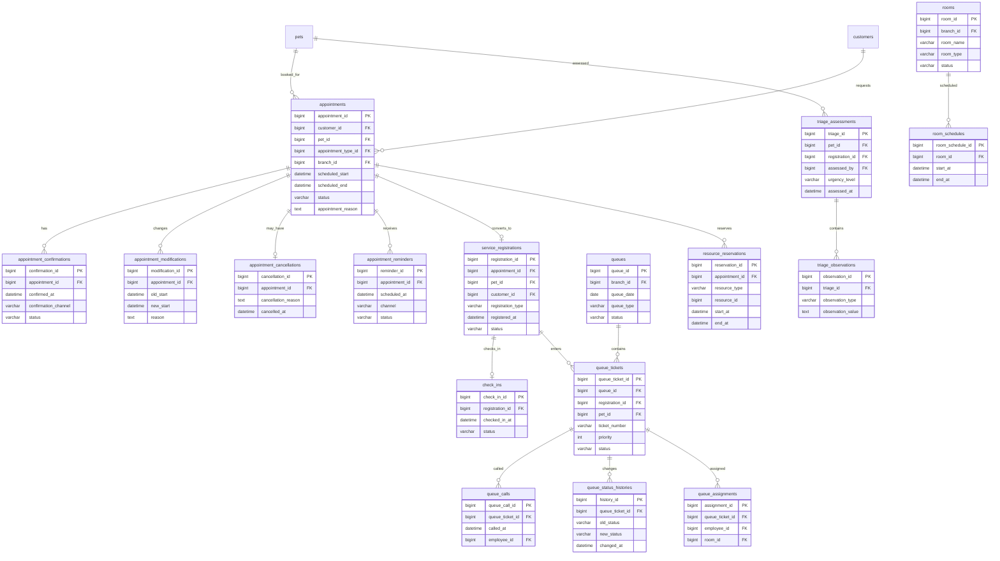

เจ้าของข้อมูล: Domain 02

ความสัมพันธ์สำคัญ

- `appointments` → `service_registrations` เป็นการเปลี่ยนจากนัดหมายไปสู่การเข้ารับบริการจริง
- `service_registrations` → `queue_tickets` เป็นการสร้างคิว
- Walk-in สามารถสร้าง `service_registrations` และ `queue_tickets` โดยไม่มี `appointment_id`
- `clinical_encounters` จะถูกสร้างเมื่อเริ่มกระบวนการตรวจรักษาจริง ไม่ใช่เมื่อจองนัด

ผมไม่แนะนำให้สร้างตาราง `veterinarians` แยกจาก `employees` เพราะข้อมูลสัตวแพทย์เป็นข้อมูลบุคลากรประเภทหนึ่ง ให้ใช้ `employee_id` จาก Domain 10 แทน ส่วนตารางเวลาทำงานต้องอ้างอิงตารางกะจาก HR ไม่สร้างข้อมูลเวลาทำงานซ้ำ&#x20;

02.Appointment_and_Queue_Management.md

02.Appointment_and_Queue_Management.md

## 5. ER Diagram: Domain 03 — Clinical & Medical Management

Domain นี้เป็นแกนหลักของระบบทางการแพทย์ และเป็นจุดเชื่อมโยงไปยัง Laboratory, Pharmacy และ Surgery

```mermaid
erDiagram
    pets ||--o{ clinical_encounters : visits
    service_registrations ||--o{ clinical_encounters : initiates
    clinical_encounters ||--o{ medical_records : documents
    clinical_encounters ||--o{ clinical_notes : records
    clinical_encounters ||--o{ physical_examinations : examines
    physical_examinations ||--o{ vital_signs : measures

    clinical_encounters ||--o{ diagnoses : diagnosed
    diagnosis_catalogs ||--o{ diagnoses : classifies
    pets ||--o{ clinical_problem_lists : has

    clinical_encounters ||--o{ treatment_plans : plans
    treatment_plans ||--o{ treatment_plan_items : contains
    clinical_encounters ||--o{ clinical_follow_ups : follows
    clinical_encounters ||--o| clinical_discharges : discharges

    clinical_encounters ||--o{ prescriptions : prescribes
    prescriptions ||--|{ prescription_items : contains

    pets ||--o{ pet_allergies : has
    pets ||--o{ pet_chronic_conditions : has
    pets ||--o{ pet_vaccinations : receives

    clinical_encounters {
        bigint encounter_id PK
        bigint pet_id FK
        bigint registration_id FK
        bigint branch_id FK
        datetime started_at
        datetime closed_at
        bigint primary_veterinarian_id FK
        varchar encounter_type
        varchar status
    }

    medical_records {
        bigint medical_record_id PK
        bigint encounter_id FK
        varchar record_number
        datetime created_at
        bigint created_by FK
        varchar status
    }

    clinical_notes {
        bigint clinical_note_id PK
        bigint encounter_id FK
        varchar note_type
        text note_content
        bigint created_by FK
        datetime created_at
    }

    physical_examinations {
        bigint examination_id PK
        bigint encounter_id FK
        text examination_findings
        bigint examined_by FK
        datetime examined_at
    }

    vital_signs {
        bigint vital_sign_id PK
        bigint examination_id FK
        varchar measurement_type
        decimal measurement_value
        varchar unit
        datetime measured_at
    }

    diagnosis_catalogs {
        bigint diagnosis_catalog_id PK
        varchar diagnosis_code
        varchar diagnosis_name
        varchar description
    }

    diagnoses {
        bigint diagnosis_id PK
        bigint encounter_id FK
        bigint diagnosis_catalog_id FK
        varchar diagnosis_type
        boolean is_primary
        text clinical_evidence
        bigint diagnosed_by FK
        datetime diagnosed_at
    }

    clinical_problem_lists {
        bigint problem_id PK
        bigint pet_id FK
        varchar problem_name
        varchar status
        date identified_date
        date resolved_date
    }

    treatment_plans {
        bigint treatment_plan_id PK
        bigint encounter_id FK
        varchar plan_name
        text plan_description
        bigint created_by FK
        varchar status
    }

    treatment_plan_items {
        bigint plan_item_id PK
        bigint treatment_plan_id FK
        varchar item_type
        varchar item_description
        datetime planned_at
        varchar status
    }

    prescriptions {
        bigint prescription_id PK
        bigint encounter_id FK
        bigint prescribed_by FK
        datetime prescribed_at
        varchar status
    }

    prescription_items {
        bigint prescription_item_id PK
        bigint prescription_id FK
        bigint product_id FK
        decimal prescribed_quantity
        varchar dosage
        varchar route
        varchar frequency
        varchar duration
        text instructions
    }

    pet_allergies {
        bigint allergy_id PK
        bigint pet_id FK
        varchar allergen
        varchar reaction
        varchar severity
        varchar status
    }

    pet_chronic_conditions {
        bigint condition_id PK
        bigint pet_id FK
        varchar condition_name
        date diagnosed_date
        varchar status
    }

    pet_vaccinations {
        bigint vaccination_id PK
        bigint pet_id FK
        varchar vaccine_name
        date administered_date
        date next_due_date
        bigint administered_by FK
    }

    clinical_follow_ups {
        bigint follow_up_id PK
        bigint encounter_id FK
        datetime follow_up_date
        text follow_up_notes
        varchar status
    }

    clinical_discharges {
        bigint discharge_id PK
        bigint encounter_id FK
        datetime discharged_at
        text discharge_instructions
        bigint approved_by FK
    }
```

เจ้าของข้อมูล: Domain 03

### การผสานข้อมูลสุขภาพที่ซ้ำซ้อน

ในเอกสาร Domain 01 มีข้อมูล `pet_allergies`, `pet_chronic_conditions` และ `pet_vaccinations` ขณะที่ Domain 03 มีข้อมูลทางการแพทย์ที่มีความหมายใกล้เคียงกัน ผมจึงเสนอให้ใช้ตารางชุดเดียวตาม ERD นี้ โดยให้ Domain 03 เป็นเจ้าของข้อมูลทางการแพทย์ และ Domain 01 สามารถอ่านข้อมูลที่จำเป็นเพื่อแสดงบนประวัติสัตว์เลี้ยงได้

ไม่ควรสร้าง `clinical_allergies` หรือ `vaccination_records` ซ้ำอีกชุดหนึ่ง เพราะจะทำให้ข้อมูลสุขภาพของสัตว์ตัวเดียวกันแยกอยู่หลายแหล่ง&#x20;

03.Clinical_and_Medical_Management.md

03.Clinical_and_Medical_Management.md

## 6. ER Diagram: Domain 04 — Pharmacy & Inventory Management

ส่วนนี้ต้องแยกข้อมูลสินค้า หน่วยนับ ล็อต ยอดคงเหลือ และธุรกรรมการจ่ายยาออกจากกัน เพื่อให้สามารถตรวจสอบย้อนหลังได้

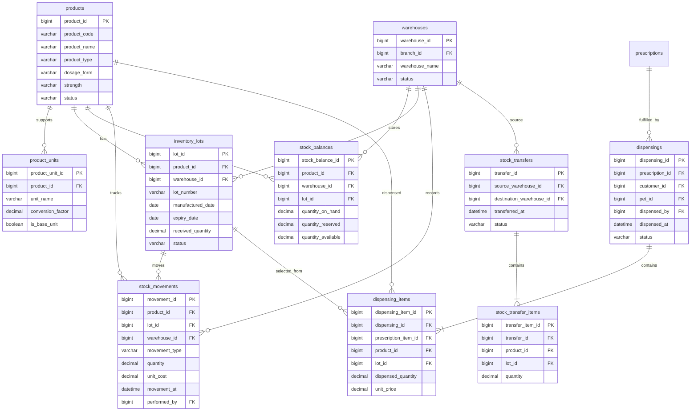

เจ้าของข้อมูล: Domain 04

ข้อเสนอสำคัญ:

- ยาที่มีรูปแบบหรือความแรงต่างกันควรเป็นคนละ `product_id`
- ยอดสต็อกควรเก็บในหน่วยหลัก และมี `product_units` สำหรับแปลงหน่วย
- การจ่ายยาต้องระบุล็อตที่จ่ายจริง
- การจ่ายบางส่วนต้องบันทึกปริมาณจริงใน `dispensing_items`
- `stock_movements` เป็นประวัติธุรกรรมสต็อก ไม่ควรแก้ไขย้อนหลังโดยตรง
- `stock_balances` เป็นยอดคงเหลือสำหรับเรียกใช้งานรวดเร็ว ส่วน `stock_movements` เป็นหลักฐานการเปลี่ยนแปลง

การแยก `prescriptions` กับ `dispensings` เป็นข้อกำหนดสำคัญ เพราะ Clinical เป็นเจ้าของคำสั่งยา ส่วน Pharmacy เป็นเจ้าของการจ่ายยาจริง&#x20;

06.Surgery_and_Treatment_Management.md

## 7. ER Diagram: Domain 05 — Laboratory & Diagnostic Imaging Management

ผมเสนอให้ใช้ `diagnostic_orders` เป็นจุดเริ่มต้นของกระบวนการตรวจ และให้ผลตรวจ ตัวอย่าง ภาพ และรายงานเป็นข้อมูลแยกกัน

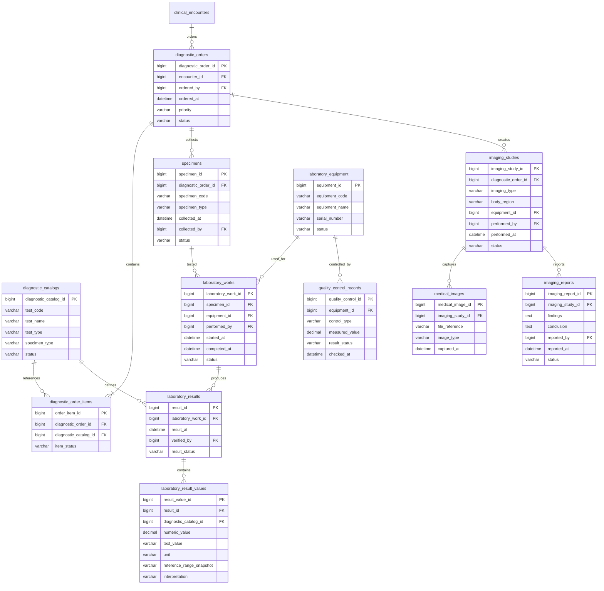

เจ้าของข้อมูล: Domain 05

การออกแบบนี้แยกความหมายของข้อมูลออกเป็น 7 ส่วน ได้แก่

1. `diagnostic_orders` — คำสั่งตรวจ
2. `diagnostic_order_items` — รายการตรวจที่อยู่ภายในคำสั่ง
3. `specimens` — ตัวอย่างที่เก็บจากสัตว์
4. `laboratory_works` — งานตรวจวิเคราะห์
5. `laboratory_results` — ผลตรวจ
6. `imaging_studies` — กระบวนการตรวจด้วยภาพ
7. `medical_images` และ `imaging_reports` — ภาพและรายงานผล

ผมเลือกให้ `diagnostic_catalogs` เป็นทะเบียนรายการตรวจกลาง และให้ `diagnostic_order_items` อ้างอิงรายการดังกล่าว เพื่อลดการสร้างรายการตรวจซ้ำระหว่าง Clinical และ Laboratory เอกสาร Domain 05 ระบุชัดว่าคำสั่งตรวจ ตัวอย่าง ผลตรวจ ภาพ และรายงานมีความหมายต่างกัน&#x20;

05.Laboratory_and_Diagnostic_Imaging_Management.md

## 8. ER Diagram: Domain 06 — Surgery & Treatment Management

ผ่าตัดและหัตถการต้องมีข้อมูลตั้งแต่คำขอ การประเมิน ความยินยอม การจัดตาราง ไปจนถึงการดำเนินการจริง

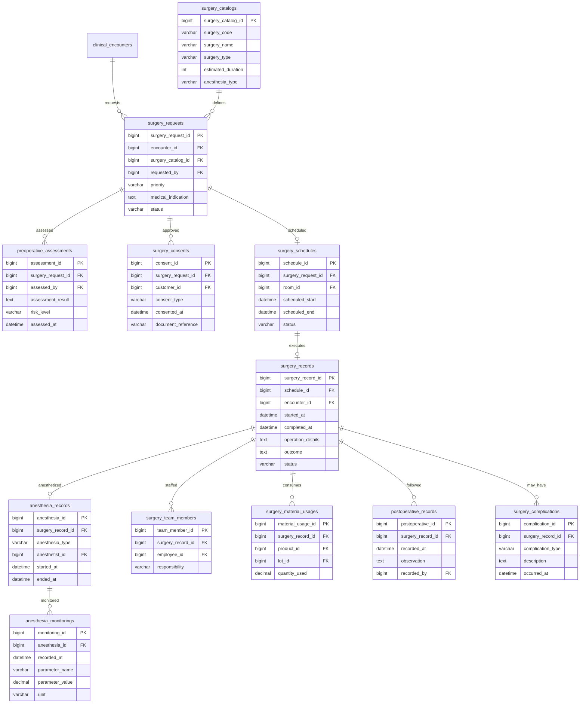

เจ้าของข้อมูล: Domain 06

ข้อสำคัญ:

- `surgery_requests` เป็นคำขอ ไม่ใช่การผ่าตัดจริง
- `surgery_records` เป็นหลักฐานการดำเนินการจริง
- `surgery_consents` เก็บหลักฐานการยินยอม
- `surgery_material_usages` บันทึกการใช้วัสดุจริงและเชื่อมโยงกับล็อตใน Pharmacy
- ผู้ปฏิบัติงานเชื่อมกับ `employees` จาก HR
- การประเมินความพร้อมและความเสี่ยงเป็นการตัดสินใจของสัตวแพทย์ ไม่ควรให้ระบบตัดสินแทนโดยอัตโนมัติ

เอกสาร Domain 06 ระบุการแยกคำขอผ่าตัด การประเมิน การยินยอม และการผ่าตัดจริง รวมถึงการเชื่อมโยงข้อมูลการใช้ยาและวัสดุกับ Pharmacy&#x20;

06.Surgery_and_Treatment_Management.md

## 9. ER Diagram: Domain 07 — Billing & Payment Management

Domain นี้เป็นเจ้าของธุรกรรมเรียกเก็บเงินและรับชำระ ไม่ใช่เจ้าของข้อมูลการรักษาหรือการจ่ายยาจริง

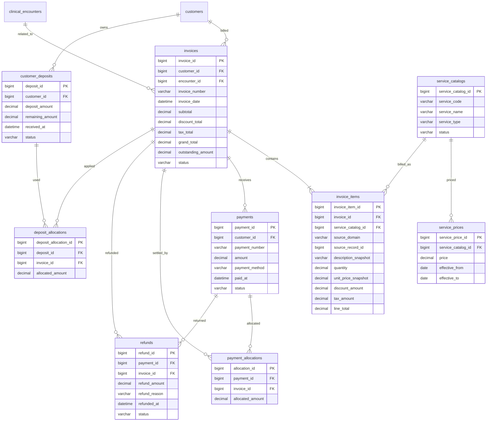

เจ้าของข้อมูล: Domain 07 สำหรับธุรกรรมการเงิน, Domain กลางที่กำหนดไว้สำหรับทะเบียนบริการและราคา

### เหตุผลที่ออกแบบ `invoice_items` แบบนี้

ผมเสนอให้เก็บข้อมูลต่อไปนี้ไว้ในรายการเรียกเก็บเงิน:

- `source_domain` — Domain ต้นทาง เช่น Pharmacy, Laboratory, Surgery
- `source_record_id` — รหัสธุรกรรมต้นทาง
- `description_snapshot` — ชื่อบริการ ณ เวลาที่เรียกเก็บ
- `unit_price_snapshot` — ราคาต่อหน่วย ณ เวลาที่เรียกเก็บ
- `quantity` — จำนวนที่นำมาเรียกเก็บจริง

จุดสำคัญคือ ต้องมีข้อกำหนด Unique สำหรับรายการต้นทางที่ไม่อนุญาตให้เรียกเก็บซ้ำ เช่น `(source_domain, source_record_id)` หรือใช้ตารางเชื่อมโยงแยกต่างหาก หากธุรกรรมต้นทางหนึ่งรายการสามารถสร้างหลายรายการเรียกเก็บได้

ตัวอย่าง: หากสัตวแพทย์สั่งยา 10 เม็ด แต่ Pharmacy จ่ายจริง 8 เม็ด Billing ต้องเรียกเก็บ 8 เม็ด ไม่ใช่ 10 เม็ด และต้องไม่เปลี่ยนราคาของใบแจ้งหนี้เก่าตามราคาปัจจุบัน&#x20;

07.Billing_and_Payment_Management.md

07.Billing_and_Payment_Management.md

## 10. ER Diagram: Domain 08 — Marketing & Customer Relationship Management

ข้อมูลลูกค้าต้องอ้างอิงจาก Domain 01 ส่วน CRM เป็นเจ้าของกิจกรรมการตลาด การสื่อสาร โปรโมชั่น ความคิดเห็น และข้อร้องเรียน

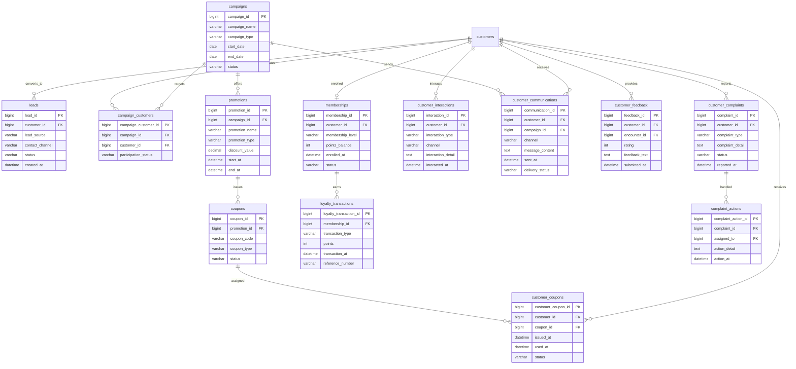

เจ้าของข้อมูล: Domain 08

ข้อเสนอการรวมข้อมูล:

- ไม่สร้าง `customer_activities` ใน Domain 01 ซ้ำกับ `customer_interactions` ของ CRM ให้ใช้ `customer_interactions` เป็นตารางกลางสำหรับประวัติการติดต่อและกิจกรรมสัมพันธ์ลูกค้า
- ไม่สร้าง `customer_feedback` และ `customer_complaints` ซ้ำสอง Domain ให้ CRM เป็นเจ้าของ
- `leads` เป็นข้อมูลผู้สนใจ ไม่ใช่ลูกค้าที่ลงทะเบียนแล้ว หากมีการเปลี่ยนสถานะเป็นลูกค้าจึงเชื่อมกับ `customers`
- แยกช่องทางที่ลูกค้ารู้จักคลินิกออกจากช่องทางที่ลูกค้าใช้ติดต่อจริง

เอกสาร Domain 08 เน้นการแยก Lead, Campaign, Promotion, Coupon, Membership, Loyalty และ Customer Interaction ออกจากกัน รวมถึงการไม่เป็นเจ้าของข้อมูลลูกค้าต้นทาง&#x20;

08.Marketing_and_Customer_Relationship_Management.md

08.Marketing_and_Customer_Relationship_Management.md

## 11. ER Diagram: Domain 09 — Procurement & Supplier Management

ข้อมูลผู้จำหน่ายและเอกสารจัดซื้อจะเป็นชุดข้อมูลกลางที่ Pharmacy และหน่วยงานอื่นสามารถส่งความต้องการเข้ามาได้

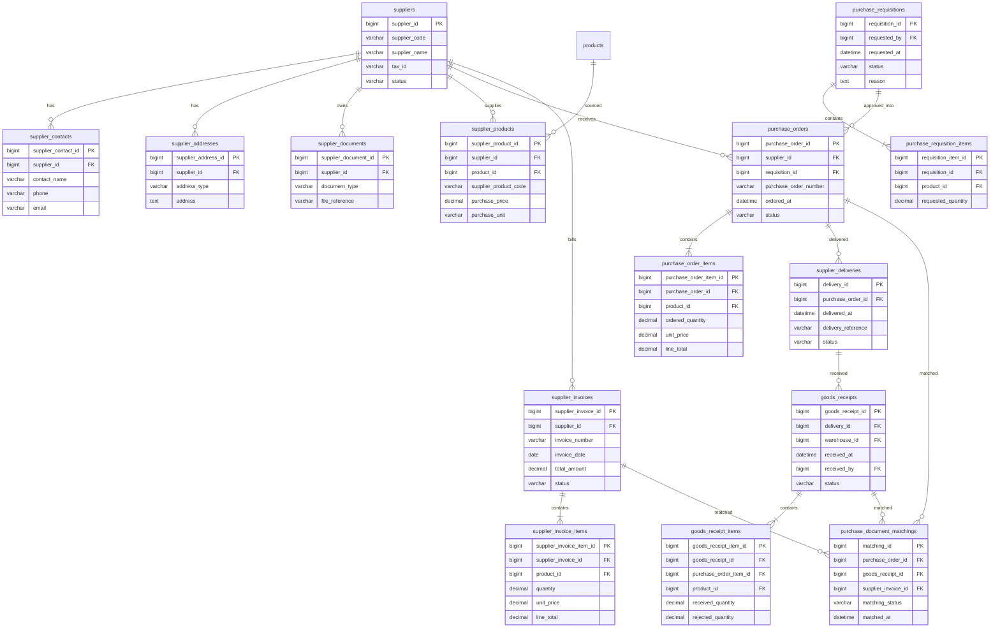

เจ้าของข้อมูล: Domain 09

ตารางเหล่านี้รองรับวงจรจัดซื้อ ตั้งแต่คำขอจัดซื้อ ใบสั่งซื้อ การส่งสินค้า การรับสินค้า ใบแจ้งหนี้ และการจับคู่เอกสารสามฝ่าย (Three-Way Matching)

ข้อสำคัญ: `goods_receipts` เป็นหลักฐานการรับสินค้าจริง ส่วนการเพิ่มยอดคงเหลือในคลังต้องเกิดผ่านธุรกรรมของ Domain 04 ไม่ควรให้ Procurement แก้ไข `stock_balances` โดยตรง&#x20;

09.Procurement_and_Supplier_Management.md

09.Procurement_and_Supplier_Management.md

## 12. ER Diagram: Domain 10 — Human Resources & Workforce Management

Domain นี้เป็นเจ้าของข้อมูลพนักงานและประวัติการทำงานทั้งหมด โดย Domain อื่นอ้างอิง `employee_id` เมื่อต้องระบุผู้ปฏิบัติงาน

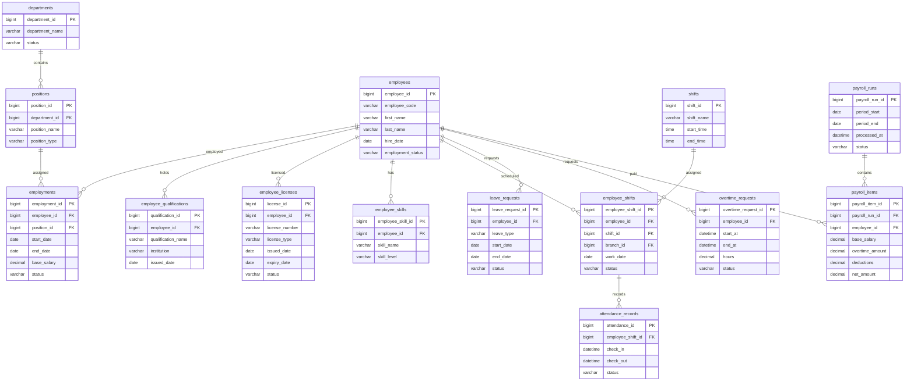

เจ้าของข้อมูล: Domain 10

ผมไม่สร้างตาราง `veterinarians`, `pharmacists`, `lab_technicians` และ `receptionists` แยกจากกัน เพราะทั้งหมดเป็นบุคลากรที่อยู่ใน `employees` เหมือนกัน ความแตกต่างจะอยู่ที่ `positions`, `employee_qualifications`, `employee_licenses` และ `employee_skills`

ตัวอย่าง:

- สัตวแพทย์: ตำแหน่งและใบอนุญาตวิชาชีพ
- เภสัชกร: ตำแหน่งและคุณสมบัติที่เกี่ยวข้อง
- เจ้าหน้าที่ห้องปฏิบัติการ: ตำแหน่งและทักษะ
- เจ้าหน้าที่ผ่าตัด: ตำแหน่งและทักษะเฉพาะทาง

ทุก Domain สามารถอ้างอิง `employee_id` เพื่อระบุผู้สั่ง ผู้ตรวจ ผู้จ่ายยา ผู้รับรองผล หรือผู้อนุมัติได้ โดยไม่ต้องจัดเก็บข้อมูลพนักงานซ้ำ&#x20;

10.Human_Resources_and_Workforce_Management.md

## 13. ความสัมพันธ์ข้าม Domain ที่สำคัญที่สุด

เมื่อรวม ER Diagram ทั้ง 10 Domains เข้าด้วยกัน จะได้ความสัมพันธ์หลักดังนี้

| ตารางต้นทาง             | ตารางปลายทาง              | ความสัมพันธ์                   | ความหมาย                                                                      |
| ----------------------- | ------------------------- | ------------------------------ | ----------------------------------------------------------------------------- |
| `customers`             | `pets`                    | M:N ผ่าน `pet_ownerships`      | ลูกค้าหนึ่งคนมีสัตว์หลายตัว และสัตว์มีเจ้าของร่วมได้                          |
| `pets`                  | `appointments`            | 1:N                            | สัตว์หนึ่งตัวมีนัดหมายหลายครั้ง                                               |
| `appointments`          | `service_registrations`   | 1:0..1                         | นัดหมายอาจเปลี่ยนเป็นการเข้ารับบริการ                                         |
| `service_registrations` | `queue_tickets`           | 1:N                            | การเข้ารับบริการอาจมีคิวหนึ่งรายการหรือหลายรายการ                             |
| `service_registrations` | `clinical_encounters`     | 1:N                            | การเข้ารับบริการอาจเกี่ยวข้องกับการตรวจรักษาหลายเหตุการณ์                     |
| `pets`                  | `clinical_encounters`     | 1:N                            | สัตว์หนึ่งตัวมีประวัติการตรวจรักษาหลายครั้ง                                   |
| `clinical_encounters`   | `prescriptions`           | 1:N                            | การตรวจรักษาหนึ่งครั้งอาจมีคำสั่งยาหลายรายการ                                 |
| `prescriptions`         | `dispensings`             | 1:N                            | คำสั่งยาอาจมีการจ่ายยาเป็นบางส่วนหรือหลายครั้ง                                |
| `clinical_encounters`   | `diagnostic_orders`       | 1:N                            | การตรวจรักษาหนึ่งครั้งมีคำสั่งตรวจหลายรายการ                                  |
| `diagnostic_orders`     | `specimens`               | 1:N                            | คำสั่งตรวจอาจมีตัวอย่างหลายตัวอย่าง                                           |
| `diagnostic_orders`     | `imaging_studies`         | 1:N                            | คำสั่งตรวจอาจนำไปสู่การตรวจด้วยภาพหลายรายการ                                  |
| `clinical_encounters`   | `surgery_requests`        | 1:N                            | การตรวจรักษาอาจมีคำขอผ่าตัดหรือหัตถการหลายรายการ                              |
| `surgery_requests`      | `surgery_records`         | 1:0..1                         | คำขอที่ได้รับอนุมัติและดำเนินการแล้วจะมีข้อมูลการผ่าตัดจริง                   |
| `customers`             | `invoices`                | 1:N                            | ลูกค้าหนึ่งคนมีใบแจ้งหนี้หลายใบ                                               |
| `invoices`              | `payments`                | M:N ผ่าน `payment_allocations` | ใบแจ้งหนี้หนึ่งใบรับชำระหลายครั้ง และการชำระหนึ่งครั้งอาจจัดสรรหลายใบแจ้งหนี้ |
| `products`              | `inventory_lots`          | 1:N                            | สินค้าหนึ่งรายการมีหลายล็อต                                                   |
| `products`              | `stock_movements`         | 1:N                            | สินค้าหนึ่งรายการมีความเคลื่อนไหวหลายครั้ง                                    |
| `suppliers`             | `purchase_orders`         | 1:N                            | ผู้จำหน่ายหนึ่งรายได้รับใบสั่งซื้อหลายรายการ                                  |
| `purchase_orders`       | `goods_receipts`          | 1:N                            | ใบสั่งซื้อหนึ่งรายการอาจได้รับสินค้าเป็นหลายครั้ง                             |
| `employees`             | ตารางธุรกรรมของทุก Domain | 1:N                            | พนักงานหนึ่งคนเป็นผู้ดำเนินการได้หลายธุรกรรม                                  |

### ภาพรวมความสัมพันธ์ของกระบวนการให้บริการ

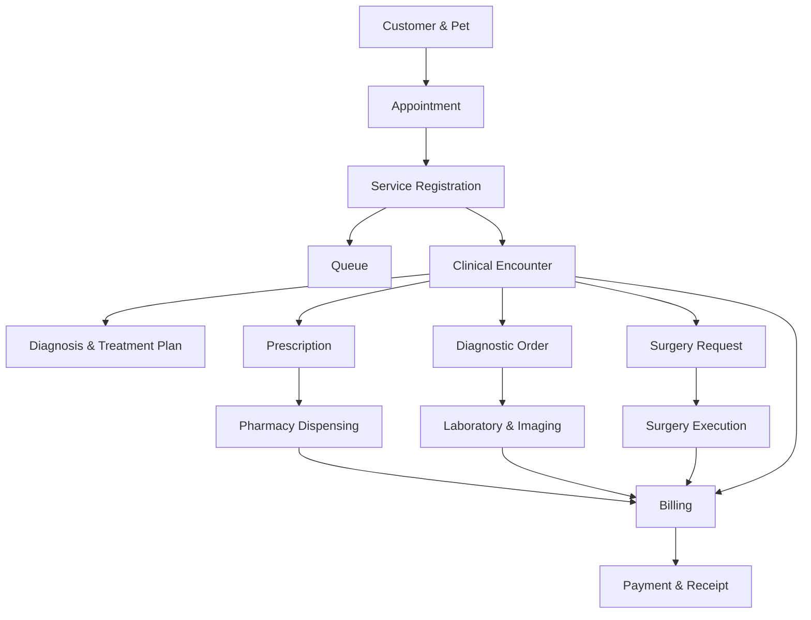

แผนภาพนี้แสดงเส้นทางหลักของข้อมูล ไม่ได้หมายความว่าทุกการเข้ารับบริการจะต้องผ่านทุกขั้นตอน เช่น การเข้ารับบริการทั่วไปอาจไม่มีคำสั่งตรวจหรือการผ่าตัด

## 14. ตารางที่ควรใช้ร่วมกัน และตารางที่ไม่ควรรวม

ส่วนนี้สำคัญมากสำหรับการป้องกันปัญหาออกแบบฐานข้อมูลผิดตั้งแต่ต้น

| ตารางที่เกี่ยวข้อง                                | คำแนะนำ | เหตุผล                                                      |
| ------------------------------------------------- | ------- | ----------------------------------------------------------- |
| `customers` และ `pets`                            | แยก     | เป็นคนละประเภทข้อมูล                                        |
| `pet_ownerships` และ `pet_caregivers`             | แยก     | เจ้าของและผู้ดูแลมีสิทธิและความสัมพันธ์ต่างกัน              |
| `appointments` และ `queue_tickets`                | แยก     | การจองล่วงหน้าไม่ใช่การเข้าคิวจริง                          |
| `service_registrations` และ `clinical_encounters` | แยก     | การลงทะเบียนรับบริการไม่ใช่การตรวจรักษา                     |
| `clinical_notes` และ `medical_records`            | แยก     | เวชระเบียนเป็นข้อมูลหลัก ส่วน Clinical Notes เป็นบันทึกย่อย |
| `diagnoses` และ `clinical_problem_lists`          | แยก     | การวินิจฉัยในแต่ละครั้งไม่เหมือนปัญหาสุขภาพระยะยาว          |
| `treatment_plans` และ `surgery_records`           | แยก     | แผนการรักษาไม่ใช่หลักฐานการรักษาจริง                        |
| `prescriptions` และ `dispensings`                 | แยก     | การสั่งยาไม่ใช่การจ่ายยาจริง                                |
| `diagnostic_orders` และ `laboratory_results`      | แยก     | คำสั่งตรวจไม่ใช่ผลตรวจ                                      |
| `medical_images` และ `imaging_reports`            | แยก     | ไฟล์ภาพไม่ใช่รายงานแปลผล                                    |
| `stock_balances` และ `stock_movements`            | แยก     | ยอดคงเหลือไม่ใช่ประวัติธุรกรรม                              |
| `surgery_requests` และ `surgery_records`          | แยก     | คำขอผ่าตัดไม่ใช่การผ่าตัดที่เกิดขึ้นจริง                    |
| `invoices` และ `payments`                         | แยก     | การเรียกเก็บเงินไม่ใช่การรับชำระเงิน                        |
| `purchase_orders` และ `goods_receipts`            | แยก     | การสั่งซื้อไม่ใช่การรับสินค้า                               |
| `employees` และ `positions`                       | แยก     | บุคลากรหนึ่งคนสามารถเปลี่ยนตำแหน่งได้ตามเวลา                |

## 15. ข้อกำหนดทางฐานข้อมูลที่ผมแนะนำเพิ่มเติม

ER Diagram จะยังไม่สมบูรณ์ในระดับนำไปใช้งานจริง หากไม่มีข้อกำหนดเหล่านี้

### 15.1 Primary Key และ Foreign Key

- ทุกตารางธุรกรรมต้องมี Primary Key ของตัวเอง
- ห้ามใช้ชื่อ รหัสลูกค้า หรือเบอร์โทรศัพท์เป็น Primary Key
- ทุกความสัมพันธ์ระหว่าง Domain ต้องมี Foreign Key เมื่ออยู่ในฐานข้อมูลเดียวกัน
- กำหนด `ON DELETE RESTRICT` สำหรับข้อมูลที่มีธุรกรรมหรือประวัติสำคัญ
- ใช้สถานะยกเลิกหรือปิดใช้งานแทนการลบข้อมูลธุรกรรม

### 15.2 Unique Constraints

ตัวอย่างข้อกำหนดที่ควรมี:

| ตาราง                 | Unique Constraint                                          |
| --------------------- | ---------------------------------------------------------- |
| `customers`           | `customer_code`                                            |
| `pets`                | `pet_code`                                                 |
| `employees`           | `employee_code`                                            |
| `products`            | `product_code`                                             |
| `suppliers`           | `supplier_code`                                            |
| `appointments`        | `appointment_number`                                       |
| `invoices`            | `invoice_number`                                           |
| `payments`            | `payment_number`                                           |
| `purchase_orders`     | `purchase_order_number`                                    |
| `pet_identifications` | `identification_type + identification_number` ตามกฎของระบบ |

ควรกำหนด Unique แบบมีเงื่อนไขสำหรับข้อมูลที่ไม่ควรซ้ำเฉพาะรายการที่ยังใช้งาน เช่น เจ้าของหลักที่มีผลอยู่ในปัจจุบัน หรือรหัสคิวในวันเดียวกันของสาขาเดียวกัน

### 15.3 Audit Trail

ผมแนะนำให้มีตารางกลางสำหรับบันทึกการเปลี่ยนแปลงข้อมูลสำคัญ เช่น

- `audit_logs`
- `entity_status_histories`
- `approval_histories`

ข้อมูลขั้นต่ำควรประกอบด้วย:

- ผู้ดำเนินการ (`employee_id`)
- ประเภทการดำเนินการ
- ชื่อตารางและรหัสรายการ
- ค่าเดิม
- ค่าใหม่
- วันและเวลาที่ดำเนินการ
- เหตุผลในการแก้ไข
- แหล่งที่มาของการเปลี่ยนแปลง

สำหรับเวชระเบียน ผลตรวจ และธุรกรรมทางการเงิน ต้องมีการควบคุมการแก้ไขเป็นพิเศษ ไม่ควรใช้วิธีแก้ไขทับข้อมูลเดิมโดยไม่มีประวัติ

### 15.4 Snapshot Data

ข้อมูลบางอย่างต้องเก็บค่าขณะเกิดธุรกรรม ไม่ควรดึงค่าปัจจุบันมาแสดงแทนข้อมูลในอดีต

ตัวอย่าง:

| ข้อมูล                            | ตารางที่เก็บ Snapshot      |
| --------------------------------- | -------------------------- |
| ราคาสินค้าที่จ่ายจริง             | `dispensing_items`         |
| ราคาบริการที่เรียกเก็บ            | `invoice_items`            |
| รายละเอียดสินค้า ณ เวลาซื้อ       | `purchase_order_items`     |
| ช่วงค่าอ้างอิงของผลตรวจ           | `laboratory_result_values` |
| รายละเอียดรายการรักษาที่ดำเนินการ | `surgery_records`          |

### 15.5 Index ที่ควรกำหนด

ตัวอย่าง Index สำหรับการใช้งานจริง:

| ตาราง                 | Index ที่แนะนำ                                            |
| --------------------- | --------------------------------------------------------- |
| `customers`           | `customer_code`, `tax_id`                                 |
| `pets`                | `pet_code`, `pet_name`, `species_id`                      |
| `pet_ownerships`      | `pet_id`, `customer_id`, `start_date`, `end_date`         |
| `appointments`        | `branch_id + scheduled_start`, `pet_id + scheduled_start` |
| `queue_tickets`       | `queue_id + status + priority`                            |
| `clinical_encounters` | `pet_id + started_at`, `branch_id + started_at`           |
| `prescriptions`       | `encounter_id`, `status`                                  |
| `inventory_lots`      | `product_id + expiry_date`, `warehouse_id + status`       |
| `stock_movements`     | `product_id + movement_at`, `lot_id + movement_at`        |
| `diagnostic_orders`   | `encounter_id + ordered_at`, `status`                     |
| `invoices`            | `customer_id + invoice_date`, `invoice_number`, `status`  |
| `payments`            | `customer_id + paid_at`, `payment_number`                 |
| `employees`           | `employee_code`, `employment_status`                      |

## 16. ตารางที่ยังไม่ครอบคลุมจากเอกสาร 10 Domains

เพื่อให้เข้าใจขอบเขตของแบบจำลองนี้อย่างถูกต้อง ผมขอระบุว่า ERD ที่ออกแบบในคำตอบนี้ครอบคลุม 10 Domains ตามเอกสารที่ได้รับ แต่ยังไม่ใช่ฐานข้อมูล ERP ทั้ง 15 Domains ที่เคยกล่าวถึงก่อนหน้านี้

หากต้องการให้ระบบสมบูรณ์ในระดับ ERP อาจต้องเพิ่ม Domain และกลุ่มตารางต่อไปนี้ในระยะถัดไป:

| Domain ที่ยังไม่รวม       | ตัวอย่างกลุ่มตารางที่อาจต้องเพิ่ม                                                   |
| ------------------------- | ----------------------------------------------------------------------------------- |
| Finance & Accounting      | `chart_of_accounts`, `journal_entries`, `journal_entry_lines`, `accounting_periods` |
| Facility & Equipment      | `equipment`, `equipment_maintenance`, `equipment_calibrations`, `facility_rooms`    |
| Inpatient Care            | `hospital_admissions`, `patient_wards`, `patient_beds`, `inpatient_observations`    |
| Service Catalog & Pricing | `service_catalogs`, `service_categories`, `service_prices`, `service_requirements`  |
| IT & Security             | `users`, `roles`, `permissions`, `user_roles`, `access_logs`                        |

ผมไม่ได้นำตารางเหล่านี้ไปรวมใน ERD หลักโดยอัตโนมัติ เพราะยังไม่มีเอกสาร Domain ที่เกี่ยวข้องครบถ้วนสำหรับกำหนดขอบเขตและเจ้าของข้อมูลอย่างถูกต้อง

## 17. ข้อสรุปด้านสถาปัตยกรรมฐานข้อมูล

แนวทางที่แนะนำ

สำหรับ Veterinary Clinic ERP ผมแนะนำให้ใช้ฐานข้อมูลเชิงสัมพันธ์แบบรวมศูนย์ในเชิงข้อมูล แต่แยกขอบเขตความรับผิดชอบตาม Domain (Domain-Oriented Data Ownership)

โดยมีหลักการดังนี้:

1. Customer & Pet เป็นแหล่งข้อมูลหลักของลูกค้าและสัตว์เลี้ยง ทุก Domain ต้องอ้างอิงข้อมูลชุดเดียวกัน
2. HR เป็นแหล่งข้อมูลหลักของพนักงาน ไม่สร้างข้อมูลสัตวแพทย์หรือบุคลากรซ้ำใน Domain อื่น
3. Clinical เป็นเจ้าของเวชระเบียนและคำสั่งทางการแพทย์ แต่ไม่เป็นเจ้าของการจ่ายยาหรือผลตรวจทางห้องปฏิบัติการ
4. Pharmacy เป็นเจ้าของสินค้า ล็อต สต็อก และการจ่ายยาจริง
5. Laboratory เป็นเจ้าของคำสั่งตรวจในกระบวนการตรวจ ผลตรวจ ตัวอย่าง และภาพวินิจฉัย โดยรับคำสั่งจาก Clinical
6. Surgery เป็นเจ้าของกระบวนการผ่าตัดจริง และเชื่อมโยงกับ Clinical, Pharmacy และ HR
7. Billing เป็นเจ้าของใบแจ้งหนี้และการรับชำระเงิน โดยรับข้อมูลธุรกรรมจาก Domain ต้นทาง
8. Procurement เป็นเจ้าของกระบวนการจัดซื้อ แต่ไม่เป็นเจ้าของยอดสต็อก
9. CRM เป็นเจ้าของกิจกรรมการตลาดและความสัมพันธ์ลูกค้า แต่ไม่เป็นเจ้าของข้อมูลลูกค้าต้นทาง
10. Appointment เป็นเจ้าของนัดหมายและคิว แต่ใช้ข้อมูลตารางทำงานจาก HR

ข้อเสนอทางวิศวกรรม: ควรนำ ERD นี้ไปต่อยอดเป็น Physical Database Design โดยกำหนดชนิดข้อมูลจริง, Primary Key, Foreign Key, Unique Constraint, Check Constraint, Index, Status Lifecycle และ Data Dictionary ให้ครบก่อนเริ่มพัฒนา

อีกประเด็นที่ผมอยากเน้นคือ ไม่ควรออกแบบโดยมุ่งลดจำนวนตารางให้เหลือน้อยที่สุด แต่ควรลดข้อมูลที่ซ้ำซ้อนโดยรักษาความหมายของข้อมูลและความรับผิดชอบของแต่ละ Domain ไว้ให้ถูกต้อง เพราะการรวมตารางที่มีวงจรชีวิตต่างกันอาจทำให้ระบบซับซ้อนขึ้นและเกิดปัญหาข้อมูลในระยะยาวครับ
